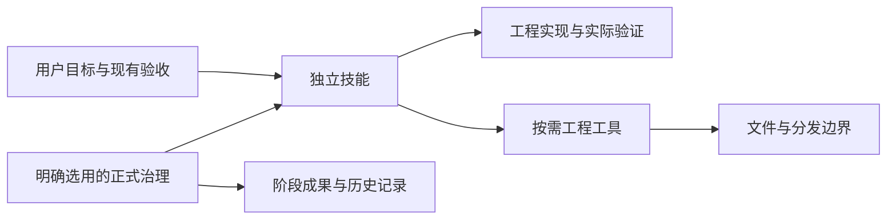

# 默认直接使用技能的架构优化设计

用户于 2026-10-24 确认批准本设计，当前进入实施计划编写；本设计不是已经生效的入口政策，不代表程序已实施，也不授权提交或发布。治理合同事实源位于模板仓；CLI 按后续批准的模板来源实现并装配，不能在 CLI 仓另定生命周期规则。

## 1. 设计目标与依据

用户要求移除门禁、减少注册机制、checkpoint 与重复验证，并借鉴 Matt Skills v1.3.1。成功标准是普通任务能直接进入有用工作，专业知识仍可复用，实际工程错误仍能被发现。

比较基线和源码证据见[调研报告](../../../yss-cli/docs/research/2026-10-23-matt-skills-131-simplification.md)；上游固定为 `24fe0ef7737efae15c87225755e9f6f5965e4888`。本地模板与 CLI 基线见 frontmatter。CLI 当前 Bundle 固定模板 v4.7.1，不能将模板 main 的修改视为已经进入 CLI。昨日 Matt 优化设计的治理保留决策不作为本次设计的批准。

本设计采用以下假设供审阅：普通任务默认直接使用技能；正式治理是明确选择的附加能力；已有正式实例保持原义，迁移时再明确选择。完全删除正式治理及其历史解释能力不属于首批范围。

## 2. 方案比较与选择

| 方案 | 变更与效果 | 成本及问题 | 选择 |
|---|---|---|---|
| 独立技能、工程工具、可选治理分离 | 普通任务不经过流程资格判断，治理可独立演进 | 需同时修改入口、调用者、分发和 CLI 加载 | 推荐 |
| 继续放宽 daily/standard | 保持原协议，短期改动较少 | 普通任务仍依赖身份、政策与 evidence block，继续增加分支 | 仅处理必要兼容修复 |
| 整体替换 Matt 并删除治理 | 大幅缩小现役代码 | 丢失 YSS 专业指导，旧实例迁移面大；上游也有 setup 暂停点 | 不采用 |

本方案不新增第四条 lite 路由，不引入新的资格注册表、任务包、常驻调度器或效能数据库。优先直接使用宿主原生技能发现；无真实消费者需求时不额外生成发现索引。

## 3. 目标结构与依赖方向

| 单元 | 持有内容 | 最小输入 | 不依赖 |
|---|---|---|---|
| 独立技能 | 方法、领域知识、实际必需参考 | 当前目标、相关上下文、真实工程 | lifecycle registry、checkpoint、人员角色、完整治理安装 |
| 工程工具 | 安装、同步、脚手架、升级、快照 | 目标根、具体操作及其输入 | 产品阶段批准，除非本次明确消费正式合同 |
| 正式治理 | 生命周期、阶段成果、合同、显式交接 | 原政策要求的当前输入 | 普通技能调用反向授予的资格 |
| 分发装配 | 来源锁、平台投影、Bundle、受管状态 | 固定来源和分发选择 | 每个普通任务的执行状态 |

允许方向是治理调用技能、技能按需调用工具。通用技能不能先回治理编排器申请资格；技能发现不能加载治理内核。工具只在实际操作需要时加载受管身份和事务状态。

## 4. 普通任务如何工作

默认流程：理解目标与验收 → 选择适用技能 → 读取必需输入 → 修改 → 定向验证 → 适用复核 → 回报实际结果。复用当前对话、Issue、Ticket、PR 或用户已有文档，不强制新建任何一种记录载体。

- 小修改直接实施；复杂或存在真实设计分歧的工作先澄清、设计。复杂度不自动触发产品阶段批准文件。
- 不要求先运行 `lifecycle route`、注册执行者、配置 tracker 或生成 Slice/checkpoint。
- 技能只声明自己真正需要的业务与工程输入。词汇表、ADR、来源索引缺失时先查已有材料，区分可继续的背景缺口和确实无法判断的关键事实。
- 需求与验收确实不清楚时只询问缺失部分；不让用户重复授权已覆盖的本地工作，不要求用户填写内部摘要或 ID。
- 默认当前执行者自检。用户或实际外部规则要求独立复核时，按真实要求执行；不将多个检查轴转成固定人数。
- 调查没有结论、检查未运行或结果失败时如实报告；流程记录完整不代表工程验收通过。

现有入口 AGENTS、CLAUDE 及运行时投影必须一致表达新默认方式。仅修改 implement 正文而保留根入口的强制 route，视为未完成。

## 5. 注册表与发现的简化

将注册表承担的职责拆开，但不为每种职责新建一份文件：

1. 技能名称、描述和入口以 canonical `SKILL.md` 为准，由宿主发现；不要同时人工维护相同信息。
2. 对分发必需的来源、别名、平台根、安装集合沿用现有装配元数据。先清点消费者，再删除已失去用途的字段。
3. 专业技能的必要参考在技能内部按需加载。分发需要携带的依赖由装配处理，不用“依赖闭包已验收”授予普通实现资格。
4. 现有 `yss-public-skills.json` 是发布选择与分组，不是全量技能发现索引，不能直接复用为默认资格清单。
5. 现有 `skills list --details` 和 `skills resolve` 保留既有协议语义。尤其不能将 resolve 的 ready 从“受管校验就绪”悄悄改成“本地文件存在”。首批不新增发现命令。

后续若确有 CLI 本地发现消费者，单独定义一个只读发现接口，返回可读入口与解析诊断，不返回批准或完整性通过。其入口处理必须能在未初始化治理的普通 Git 工程工作；不能仅绕过函数内部检查而仍在上层强制加载项目身份。

## 6. 校验如何减少

| 场景 | 保留的检查 | 从该场景移出的检查 |
|---|---|---|
| 读取技能、分析任务 | 所选入口能否读取，真正缺失的任务输入 | 完整 registry/lock、阶段资格、tracker setup |
| 本地实现 | 当前写范围、实际工程测试与适用复核 | daily 资格、标准化 evidence block、阶段批准 |
| 普通模板维护 | 受影响事实源、生成消费者及行为验证 | 默认 checkpoint、整套候选与维护回执 |
| 安装/同步/升级 | 来源完整性、写入冲突、路径、事务及当前计划输入 | 无关产品阶段材料 |
| 正式治理命令 | 显式选择政策要求的语义与当前性检查 | 无关功能的提前资产生成 |
| 分发/发行 | 适用分发、兼容与发行检查 | 用局部维护通过替代发行验证 |

同一次验证中的“重复”以相同检查、输入、参数和适用环境判定。输入变化后重验相关项。跨进程缓存暂不实现，避免新增缓存失效系统；先利用现有影响选择器和同次执行去重。

现有 CI 固定检查与 fast 计划是否重复执行，需用真实计划/日志定位。去重只针对确认重复项。注册表仍有分发用途时，相关输入变动继续检查；普通说明改动不应强制遍历无关注册及治理协议。

## 7. checkpoint 与状态的处置

- 生命周期 checkpoint：普通任务不生成、不消费；选用正式治理时继续原义。
- 维护 checkpoint：退出普通维护前提；当前任务/PR 简述范围、实际验证与未覆盖项即可，不强制新建表单。
- Git `refs/checkpoints/*`：保留为显式可选快照，默认不自动执行。临时 index、拒绝覆盖和引用合法性检查属于该工具自身能力。
- Ticket 状态：普通任务复用 tracker 自己的状态，不把 `ready-for-agent` 作为技能调用许可证。已有正式绑定按原协议处理。
- 历史记录：保存原始输入和解释语义；不将旧批准字段重写为新普通任务完成状态，不将旧失败改写成通过。

不要把 validator 改成恒定成功来实现去门禁。正确顺序是删除默认调用依赖、移除无用途的产生者和消费者，最后退役失效入口及测试。

## 8. 新建、现有实例与迁移

| 对象 | 设计行为 |
|---|---|
| 用户直接安装单个技能 | 独立工作；无需项目治理初始化 |
| 新建普通项目 | 默认独立技能与工程指引，不下发强制治理入口 |
| 新建正式治理项目 | 用户明确选用；安装现有完整治理政策及工具 |
| 已有正式实例及活动正式任务 | 保持原政策；普通同步不转换流程 |
| 已有实例主动转普通方式 | 明确选定项目及活动工作范围，预览入口/分发变更后应用；历史资产保留 |
| 身份冲突或受管升级状态不明 | 仅停止依赖该身份的同步/迁移；可独立解释源码，不伪造治理结果 |

“普通/正式”是安装选择及其入口内容，不是每个任务又要填写的新资格字段。实现阶段须确定现有 init/prepare 命令中承载显式选择的最小接口，并写明对应分发集合；该接口审阅前不修改默认初始化行为。Profile 仍只保留当前 Spec/Backend，不把是否治理新增为第三个业务 Profile。

迁移预览必须列出将改动的入口、受管文件和保留资产；活跃正式任务未处置时不能通过删除绑定转换。旧命令不隐式回退成新普通路径。回滚恢复工具与入口版本，不回写旧批准，也不删除迁移后的用户工作；遇到已修改文件时保留现场并报告冲突。

## 9. 两仓改造范围与顺序

| 批次 | 模板仓 | CLI 仓 | 完成边界 |
|---|---|---|---|
| A：独立技能 | 改核心技能与参考的治理前提，保留现有实例入口；核对独立安装导出 | 暂无产品接口变化 | 无治理安装的工程能直接使用核心技能 |
| B：分发与入口 | 定义普通/正式安装集合、根入口、Spec/Backend 派生 | 实现对应安装选择与固定来源消费 | 新建默认简单，正式选择完整；旧实例无隐式迁移 |
| C：加载解耦与迁移 | 治理参考仅从正式入口可达；迁移语义归模板 | 分离工程身份与治理 Authorities，提供现有事务体系内的迁移计划 | 普通操作不加载治理，正式协议保持 |
| D：维护与 CI | 按影响选择检查，删除确认重复项与无用维护前提 | 必要装配/兼容检查接线 | 定向修改有定向验证，无额外状态系统 |
| E：收口 | 更新实际消费者、投影、锁与说明 | 刷新最终固定 Bundle，校验两类实例 | 分发结果可复核，源码与实际装配一致 |

A 不直接改已有项目的根 AGENTS，避免它与仍适用的正式入口冲突。B 的默认切换必须模板与 CLI 联动完成，不能发布只有说明变轻而初始化仍强制治理的半套结果。C 的活动任务迁移规则先于自动转换实现。各批可以独立审阅，但 B/C 未完成不得宣称整体默认路径已经去门禁。

所有 Skill 修改只改 canonical，再用既有生成器更新受影响投影和锁。先用引用与调用链清点判定可删文件；不能批量删除包含 registry/checkpoint/gate 字样的文件。暂不删除整个 internal/governance，也不重建通用流程引擎。

## 10. 验收场景

| 场景 | 预期结果 |
|---|---|
| 普通工程安装 implement、review，无 yss-project、registry、checkpoint、tracker | 可以读取技能并按真实需求工作；不补治理文件 |
| 用户明确目标和范围，已授权本地修改 | 无新增流程确认或内部授权字段要求 |
| 有实现但无独立 Spec 文件 | 先用已有验收；确无可用依据时报告相关检查限制 |
| 无关技能 frontmatter 损坏 | 指出该技能问题，正常技能可发现和使用 |
| 普通任务修改代码后原测试结果已过期 | 重验受影响行为，不复用旧通过结论 |
| 安装写目标被占用或来源损坏 | 相应写入拒绝并给出具体原因 |
| 正式项目缺当前阶段合同 | 正式操作仍按原语义失败，不隐式走普通路径 |
| 新建普通项目与明确选择正式项目 | 分别得到独立入口和完整治理入口，无混合政策 |
| 普通同步已有正式项目 | 不移除正式绑定、不转换 checkpoint |
| 活跃正式任务申请迁移 | 预览中列出待处置绑定，未处理前不自动转换 |
| 未请求 Git 快照的普通维护 | 不创建 refs/checkpoints 或维护 checkpoint |
| API/领域/安全相关变更 | 执行命中专业检查，省略与变更无关的流程资产 |
| 仅声明性说明改动 | 使用适用轻检查，不生成产品阶段材料 |

技能行为验收使用真实指令样例并人工核对决定与结果，不能只匹配文案。Go 行为测试用小型临时工程，遵循 CLI 的时间和无网络约定；已有测试足够时直接复用。源码构建、产品测试、宿主技能发现和正式发行分别记录，不互相替代。

## 11. 成效与退出条件

架构硬目标：普通任务强制新增治理文件 0；强制 checkpoint 0；强制人员注册 0；调用普通技能不进入 Authorities；已有授权范围不产生重复授权表单。

用少量自然发生的真实任务记录启动前文件/命令数、额外产物、无关阻断、验证执行与等待、缺陷和返工；沿用现有记录，不要求安装常驻采集。缺样本、缺时间或不可比环境明确说明，不能用删行数或测试数宣称效率提升。

首轮退出条件：A—E 的实际受影响入口和消费者完成；两类初始化与现有正式实例兼容用例通过；所有已发现阻断问题有处理结论。兼容代码的最终删除单独以消费者清点和已公布支持窗口为依据；本设计不虚构一个未经版本策略确认的退役日期。

## 12. 设计交付边界

本轮交付设计稿及 CLI 对应技术说明，不修改运行时代码、不切换默认安装、不删除现有检查。实施前以本设计审阅结果固定安装接口、迁移范围和批次验收，再编写实施计划。原研究文件保留为来源，设计不更改其研究结论。
