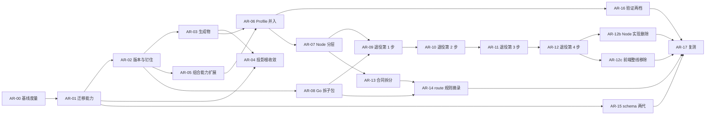

# 架构迭代执行计划

本计划执行[架构迭代规格](architecture-iteration-v1.md)。规格负责需求、验收和未决项；本文只负责顺序、写入范围、验证和回退。第 7 节保留历史执行记录；续推当前状态与欠项统一维护在第 8 节。两者冲突时以规格为准，并修正本文。

## 1. 执行规则

1. **从干净提交起步。** 每个工作包使用独立的 worktree 和分支 `arch/ar-<编号>`（`using-git-worktrees`）。多个会话共用同一工作目录，动手前先确认分支和工作区。
2. **一个工作包一个 PR。** 跨仓的工作包每个仓一个 PR，PR 描述互相引用。PR 标题带工作包编号，描述里列出命中的 FR / AC，以及 `harness-metrics` 的前后对比（AR-00 之后）。
3. **维护 checkpoint。** 每个工作包按 `.template-source/process/templates/maintenance-checkpoint-template.yaml` 建立 checkpoint，用 `scripts/maintenance-path checkpoints/arch-ar-<编号>/checkpoint.yaml` 取得仓外路径。`intensity` 与 `triggers` 按第 3 节填写；命中 `permission-boundary`、`release-semantics`、`lifecycle-gate` 时附反例证据。
4. **验证。** 根仓依次运行：`scripts/verify-template-fast --plan` → 执行所选集合 → `scripts/ci-gate --mode pr --base <base SHA>` → `scripts/verify-maintenance-checkpoint <checkpoint>`。yss-cli 仓库维持「不放测试」的政策，只做构建；FR-011 的 fixture 回放放在根仓，用固定版本的 `yss` 执行。
5. **跨仓顺序。** 先 yss-cli，后根仓。AR-02 之前，根仓更新 yss-cli 的 gitlink；AR-02 之后，改为更新固定版本文件。
6. **检查随对象一起删除。** 工作包删掉某个检查对象（锁、投影、同步脚本、Profile 副本等）时，在同一个 PR 里删掉对应的检查和验证 profile 登记（FR-015），不留悬空检查。
7. **不加概念。** 任何工作包如需新增流程文档、术语或门禁，先停下，修订规格并取得维护者确认（NFR-006）。
8. **外部动作逐次授权。** 推送、打 tag、发布 CLI、在 GitHub 上归档旧仓库，每次都要维护者单独授权。
9. **立项收尾（已完成）。** 规格转为 `accepted` 的同一个提交里，已在[模板加固执行计划](harness-hardening-v1-plan.md)第 7 节把 WP-08 标为「移交 architecture-iteration-v1」；仓外的 repo-slimming 地图中已重开的 5 张票同时标为 superseded。

## 2. 阶段与依赖



| 阶段 | 工作包 | 出口条件 |
|---|---|---|
| S0 版本与迁移底座 | AR-00、AR-01、AR-02 | AC-001～AC-004 通过；基线已存档 |
| S1 生成物与投影 | AR-03、AR-04 | AC-005、AC-006 通过 |
| S2 Profile 并入 | AR-05、AR-06，随后 AR-16 | AC-007、AC-008、AC-015 通过 |
| S3 分层与单一实现 | AR-07～AR-12b | AC-009 通过；每一步退役后 AC-010、AC-011、AC-016 通过 |
| S4 规则与 Agent 上下文 | AR-13～AR-15 | AC-012～AC-014 通过 |
| 复测 | AR-17 | 全部阶段完成后满 30 天，AC-017 通过 |

S3 的 AR-08 可以和 S1、S2 并行。S4 的 AR-15 只依赖 AR-01，可以提前做。

## 3. 工作包总表

| 编号 | 规格引用 | 维护强度与触发 | 涉及仓库 | 允许写入（概要） | 依赖 | 未决项 |
|---|---|---|---|---|---|---|
| AR-00 | NFR-001～NFR-003 | L2：non-core-validator | 根仓 | `scripts/lib/harness-metrics.mjs` 增加管道提交占比与 daily 起步必读两项（只读）、对应测试、验证 profile 登记 | 无 | — |
| AR-01 | FR-003、FR-004、NFR-004 | L2：release-semantics、cross-repo-contract（需反例） | yss-cli | 迁移规则的版本区间匹配、删除动作的「保留」决定、「commit → 版本」对照表生成工具与产物 | AR-00 | — |
| AR-02 | FR-001、FR-002 | L2：release-semantics、cross-repo-contract（需反例） | yss-cli、根仓 | 来源锁改钉 tag，`refresh-source-lock` 并入发布流程；根仓删除 `submodules/yss-cli` gitlink，新增固定版本文件，改写 `check.cli-content-identity`，删除 N7 的手动落后工具及其登记；首个 tag 为 `v4.0.0` | AR-01 | — |
| AR-03 | FR-005 | L2：generation-semantics、release-semantics | yss-cli、根仓 | 同步上游 yss-cli 后收窄：根 `skills-lock.json` 不再提交 `effectiveHash`，`skill-supply-chain.mjs` 与读取方现算或按实例锁严格比较，打包器缺哈希时按旧键序补回；yss-cli 的 `bundles.json.gz`、离线帮助 JSON、`docs/cli-help.md` 保持提交，由上游 CI 校验、只在发布时重新生成；固定二进制改按上游的 `tools/build-candidate.mjs` 构建 | AR-02 | — |
| AR-04 | FR-006 | L2：generation-semantics、cross-repo-contract、release-semantics（需反例） | yss-cli、根仓 | 删除 `.codex/skills`、`.cursor/skills`、`.pi/skills`；`.claude/skills` 一并删除；打包器仅为历史来源保留识别能力；根仓移出 `.codex/skills/product-design`，注册表 `platform_skills` 与锁的平台技能组清空；实例运行时模型、注册表与锁、`bundle-profile.json`、`skill-migrations.md` 登记 | AR-01、AR-03 | Q-003 |
| AR-05 | FR-007 | L2：generation-semantics、cross-repo-contract | yss-cli | `internal/bundle/skill_composition.go`、`producer.go` 的来源读取、`rules/*.json`；组合配置格式 | AR-02 | — |
| AR-06 | FR-008、NFR-002 | L2：template-structure、generation-semantics、cross-repo-contract | 根仓（旧 Profile 仓只归档） | `profiles/**`（新增，导入时排除 design Profile 里的 `product-design` 副本）、`.gitmodules`、删除同步脚本、`strategic-handoff-tools.lock.json`、`profile-variants.json`、`.strategic-design-skills-manifest.json` 与对应检查；来源锁 `sourcePath`；evidence 与 wiki 移到仓外归档 | AR-03、AR-05 | — |
| AR-07 | FR-009 | L2：core-validator | 根仓 | `scripts/lib/**` 中切断 5 条边、把 user-decision 的读写与摘要工具下沉到 core；新增导入方向检查与登记 | AR-06 | — |
| AR-08 | FR-009 | L2：core-validator、cross-repo-contract | yss-cli | `internal/governance` 按领域拆成子包，对外行为不变 | AR-02 | — |
| AR-09 | FR-010、FR-011、FR-016 | L2：core-validator、lifecycle-gate、release-semantics（需反例） | yss-cli、根仓 | 第 1 步（approval、user-decision、verification、spec-baseline）：根仓 fixture 回放、同名薄壳与冒烟检查、非交接调用方委托；**删除对应的 Node 实现与对应版本的删除规则移交 AR-11，再经 2026-10-12 决定顺延至 AR-12b**（2026-10-12 维护者确认，见 `architecture-iteration-v1-ar09-summary.md`） | AR-01、AR-07、AR-08 | — |
| AR-10 | 同上 | 同上 | yss-cli、根仓 | 第 2 步：checkpoint、slice、task 的校验 | AR-09 | Q-004。**checkpoint 对拍**：在真实实例里用 `yss stage plan/apply` 生成已跟踪的 checkpoint，Node 脚本与 yss 对 20 类变体结论全部一致；覆盖缺口（带批准门禁、Plan 聚合、业务票、执行范围终点、`--history`）未量；薄壳化需迁 6 个依赖合成根的测试，详见 AR-10 总结 §4–§5。**checkpoint 薄壳已做**：补对拍带批准门禁 8 类与旧实例未跟踪 7 类，checkpoint 回放共 35 类一致；修 3 处 Go/Node 差异（旧实例未跟踪 checkpoint 不要求功能身份、先核验会签再要求上下文、拒绝原因分开）；薄壳对根外输入先复制到根下临时目录；顺带修复 AR-09 遗留的维护反例生成器回归；迁 `checkpoint-boundary` 测试。固定二进制 `40926d1`。未覆盖：Plan 聚合、业务票组合、执行范围终点、`--history`。**能力协商**：yss `capabilities` 新增 `nodeDelegation` 令牌，Node 委托路径缺令牌退回进程内、薄壳缺令牌提示升级（修旧 yss 加新脚本使校验失败的问题）。**slice**：维护者选「yss 提供同形执行前检查报告」；量得结构部分小，但批准与新鲜度原因码（8 类以上）依赖后端/前端架构证据，与 AR-12 重叠，建议随 AR-12 做（总结 §8）。本片起按维护者要求只在本机单平台验证，固定档暂未更新（仍为 `40926d1`，不含 `nodeDelegation`，统一重建时一并更新） |
| AR-11 | 同上 | 同上 | yss-cli、根仓 | 第 3 步：handoff、context 的校验入口；AR-09 移交的 approval/user-decision 的 Node 实现删除与删除规则于 2026-10-12 顺延至 AR-12b | AR-10 | Q-004。**第二片**：交接消费回放 10 类对拍一致（yss 按 Node 同形返回 `issues`、阻断切片、摘要，命令行暴露 `--slice`）；`verify-strategic-handoff-consumption` 与进程内 `verifyConsumption` 委托（能力令牌 `handoff.consumption-report.v1`），4 类等价一致。**第三片**：`spec-baseline verify --bundle` 委托（令牌 `handoff.spec-baseline-package.v1`）；`evidence verify --kind context-reconciliation` 公开，回放 10 类一致，`verify-context-reconciliation` 普通校验委托（令牌 `evidence.context-reconciliation.v1`）；`verify-strategic-context-import` 无对应公开 Go 命令，待决定退役或公开。**入口收口（2026-10-12 维护者确认）**：AR-11 按「handoff/context 校验入口薄壳 + 退役」收口，approval/user-decision 的 Node 实现删除顺延 AR-12b。**退役**：维护者决定退役 `verify-strategic-context-import`（退役桩失败退出并指向 consumption、context-reconciliation、strategic-handoff verify 三个替代入口；场景与 `yss-tactical-design` 技能同步；文件随 AR-16 旧覆盖清单退役时删除） |
| AR-12 | 同上 | 同上 | yss-cli、根仓 | 第 4 步：backend、frontend 的校验部分（含 AR-10 移交的 slice 执行前检查）。**前端接收、前端预检、前端实现证据不迁移**（2026-10-13 维护者决定，该线整条移除） | AR-11 | 详见 `architecture-iteration-v1-ar12-summary.md` |
| AR-12b | FR-010、FR-016 | L2：core-validator、release-semantics（需反例） | yss-cli、根仓 | 收尾：AR-09 移交的 approval/user-decision Node 实现删除与对应版本的删除规则（清单见 AR-09 总结 §4，并含适配层脚手架与进程内回退）；前提是 `strategic-handoff` 的源检查（`inspectSource`、`openBundle`、`openDelivery`）与 `business-tickets` 校验已改走 yss，依赖合成根的测试已迁到真实实例，AR-12 迁走后剩余的进程内调用方清单已重新实测；前端移交验证整线删除已移交 AR-12c，本包不重复实施 | AR-12 | 来由见 AR-11 总结 §7 |
| AR-13 | FR-012 | L2：lifecycle-gate、template-structure、cross-repo-contract（需反例） | 根仓、yss-cli | 编排合同按层和领域拆成多个文件，`work_unit_routes` 每个工作单元一个文件；逐项写明策略的 owner 与消费者，写不出来的删除；根仓 Node 读取方与 yss-cli 的合同加载、路由和合同摘要计算相应调整，跨仓核验合成内容与摘要语义 | AR-07 | — |
| AR-14 | FR-013、NFR-003 | L2：lifecycle-gate、cross-repo-contract（需反例） | yss-cli、根仓 | `lifecycle route --json` 返回规则摘录；`AGENTS.md` 只保留入口与硬门禁；lifecycle 技能入口相应修改 | AR-08、AR-13 | — |
| AR-15 | FR-014 | L2：release-semantics、cross-repo-contract | yss-cli、根仓 | 每个 schema 常驻两代；更早版本移入 `yss migrate` 的读取范围；实例分发相应调整 | AR-01 | — |
| AR-16 | FR-015、NFR-006 | L2：core-validator、release-semantics（需反例） | 根仓、yss-cli 维护状态消费者 | `template-verification-profiles.yaml` 只留 `fast` 与 `release` 两档；删除 `candidate`、`legacy-full`、`legacy_coverage` 的现役执行与资格校验层（`verification-qualification*`）；`verification-report-validator` 仅退役资格优化职责，保留实际发布报告及历史证据核验；`ci-gate` 步骤相应调整 | AR-06 | — |
| AR-12c | FR-010、FR-016 | L2：lifecycle-gate、cross-repo-contract、release-semantics（需反例） | yss-cli、根仓 | 前端整线移除：交接域与 Slice 合同的前端段、生命周期注册表与编排合同的前端门禁和工作单元、前端 Node 实现与 `profiles/frontend`、yss 的前端 Profile 与治理语义；旧实例明确拒绝升级；前端技能保留 | AR-12 | 顺序见盘点文档 §4 |
| AR-17 | NFR-001、NFR-002 | L1：textual-only | 根仓 | 本计划第 7 节、规格状态 | AR-12b、AR-12c、AR-14、AR-15、AR-16 | — |

「允许写入」之外的路径只读。`lifecycle-registry.yaml` 的阶段、门禁和工作单元结构，以及批准记录、交接包、数字人会签的语义，除已批准 AR-12c 前端退役范围外，在本轮只读（规格「非目标范围」）。

## 4. 工作包说明

- **AR-00 基线度量**：按附录 A 的口径扩展 `harness-metrics`，记录 NFR-001～NFR-003 的起点。每个阶段的开始和结束各跑一次，结果存入维护命名空间。
- **AR-01 迁移能力**：先于一切删除动作合入，因为后面所有清理都依赖「逐文件拒绝」和「版本区间匹配」。对照表找不到的 commit 必须明确报告，不能猜（规格风险表）。
- **AR-02 版本与钉住**：首个模板 tag 为 `v4.0.0`（Q-001 已决）。根仓删除 gitlink 后，本地联调靠 `YSS_NATIVE_BINARY` 加 `YSS_NATIVE_BINARY_OVERRIDE=1`。**打 tag 本身不在本工作包内**：第 1 节第 8 条要求打 tag 单独授权。本工作包交付机制（来源锁与刷新脚本支持钉 tag、yss-cli 固定文件、预检与发行验证核对、`ci-setup` 按固定文件构建并核对摘要、移除 gitlink 与 N7 工具）；真实的来源锁在打 tag 之前仍按提交钉住，AC-001 的完整验收（来源锁记录 tag、普通提交后没有重钉提交）要等维护者授权打 tag 并执行 `tools/refresh-source-lock.mjs --tag v4.0.0` 之后才能做，机制已在一次性的临时模板副本里演练过。
- **AR-03 生成物**：原计划是让 bundle 与帮助不再提交、发布时先生成再构建。动工前核对上游（yss-cli 的 PR #2～#7）发现，上游已经把生成物做成「提交的副本 + 工具校验 + CI 校验」：`tools/artifacts.mjs` 的 `check`/`generate`、`artifacts.yml`、可复现的候选构建和分段 JSON 写入器；再改成不提交会与之冲突，也没有换来收益。所以本工作包收窄为：(1) 先同步上游并按其构建配方重新固定二进制；(2) 只做根锁瘦身，让打包器对缺 `effectiveHash` 的模板锁照样渲染出与旧版逐字节一致的实例锁。**要点**：`effectiveHash` 本来就由 `RenderedSkillLock` 按分发的技能树重算并覆盖，所以模板锁里的这个值是多余的；唯一要补的是键序（缺失时插到 `skillPath` 之后）。读取方（`lifecycle-context-query`、`backend-standards-coverage`）对没有该字段的模板锁放行、对带该字段的实例锁仍严格比较，共用 `lockedTreeHashMatches`。生成物在 yss-cli 里的校验与重新生成沿用上游工具，不在本工作包内重做。
- **AR-04 投影根收敛**：接手 hardening WP-08 已完成的研究，不重做。旧实例里的投影根副本（含 `product-design`），通过 AR-01 的删除规则清理，并且可以拒绝。`product-design` 在根仓随 AR-04 移出；design Profile 里的 56 个文件在 AR-06 导入时排除。两者之间 design 新实例仍会带它，这是已知的短暂窗口。README 或升级计划里注明用户自行安装的来源。
- **AR-05 组合能力扩展**：扩展完成后，旧形态（子模块）的来源必须仍然可以构建，AR-06 的逐文件对比依赖这一点。
- **AR-06 Profile 并入**：一次性导入，不留过渡期。合入前提是 AC-007 的逐文件摘要映射一致。GitHub 上归档旧仓库属于外部动作，按第 1 节第 8 条单独授权。
- **AR-07 Node 分层**：5 条边见规格证据 5。导入方向检查必须亚秒级、只读（NFR-005）。
- **AR-08 Go 拆子包**：只重组包结构，对外命令与输出保持不变。
- **AR-09～AR-12 退役四步**：每一步的顺序固定：先补 fixture 回放 → 再换薄壳 → 再删 Node 实现 → 最后随模板版本发布删除规则。每一步结束时检索技能，确认技能里已经不再引用被退役的实现。
- **AR-13～AR-15 规则与 Agent 上下文**：AR-13 的策略清单写入执行记录；被删除的策略逐条列出。
- **AR-16 验证两档**：S2 完成后进行，此时大部分检查对象已经消失。
- **AR-17 复测**：全部阶段完成后满 30 天，按附录 A 统计并写入第 7 节；没达标时记录差距和原因，不能调高目标后宣称完成。

## 5. 交给 agent 执行时的指令

每个工作包都可以单独派发。派发指令模板：

```text
读取 .template-source/contracts/architecture-iteration-v1.md 与 architecture-iteration-v1-plan.md。
执行工作包 AR-<编号>：只修改计划第 3 节该行「允许写入」列出的路径；其他路径只读。
开工前确认依赖的工作包已合入、相关未决项已有答复；没有答复时停下来提问，不自行假设。
按计划第 1 节建立 worktree、分支和维护 checkpoint，按第 4 节的说明执行，按第 1 节第 4 条验证。
结束时报告：命中的 AC 及证据路径、harness-metrics 前后对比、删除的检查、未完成项。
```

## 6. 决策与例外记录

以下决定由维护者于 2026-10-11 在仓外的 wayfinder 决策地图（`.work/architecture-iteration/`）中逐票确认。

| 日期 | 项 | 决定 | 决定人 |
|---|---|---|---|
| 2026-10-11 | 沿用的约束 | hardening 的 NFR-006（实例兼容）与 FR-016（技能退役冻结）、research 在会话内完成，这几条沿用；「不增加流程概念」沿用，但删除或合并概念不受限；注册表、批准记录、交接包语义不变，旧 schema 版本可以只在迁移命令里读取 | 维护者 |
| 2026-10-11 | Profile 形态 | 并入根仓 `profiles/*`，只放覆盖层，共有部分放 `_specialist/`；这三个 Profile 仓没有外部使用者 | 维护者 |
| 2026-10-11 | 唯一权威 | 每个领域只保留一份实现（按领域划分） | 维护者 |
| 2026-10-11 | 版本与钉住 | 模板与 CLI 两条语义化版本线；CLI 钉模板 tag；根仓去掉 yss-cli 子模块，改为固定版本号和 SHA-256；迁移规则按版本区间匹配；N3 并入发布流程，N7 删除 | 维护者 |
| 2026-10-11 | 内核分层 | 四层；Node 切 5 条边并加导入方向检查；Go 拆子包；不触发 WP-11 的物理拆分 | 维护者 |
| 2026-10-11 | 并入方式 | 快照导入；旧仓库归档为只读；先改 yss-cli、再改根仓，共两个 PR；同步机制一次删除；evidence 与 wiki 移到仓外归档 | 维护者 |
| 2026-10-11 | 「部分」档领域 | 校验归 Go，工作流归 Node；按四步退役；每个领域留 fixture 回放，每个薄壳留冒烟检查 | 维护者 |
| 2026-10-11 | 生成物 | bundle 与 CLI 帮助改为发布时生成；`skills-lock.json` 只保留上游 revision；删除三个投影根，只保留 `.claude/skills` 的链接 | 维护者 |
| 2026-10-11 | 规则与 Agent 上下文 | 合同按层拆分；写不出 owner 的策略删除；Agent 经 `yss lifecycle route --json` 取规则摘录；schema 常驻两代 | 维护者 |
| 2026-10-11 | 实例迁移 | 沿用 `yss upgrade`，不强制升级；删除可以逐文件拒绝；旧副本按版本分批清理；对照表只生成一次 | 维护者 |
| 2026-10-11 | 验证收缩 | 只留 `fast` 与 `release` 两档；`candidate`、`legacy-full`、`legacy_coverage`、资格校验层退役 | 维护者 |
| 2026-10-11 | Q-001 首个 tag | `v4.0.0` | 维护者 |
| 2026-10-11 | Q-002 `product-design` | 它是 OpenAI 的第三方 Codex 插件，从模板、Profile、新实例分发中移出，由用户自行安装；`platform_skills` 机制保留 | 维护者 |
| 2026-10-11 | 规格转为 accepted | 维护者确认措辞，同日完成 WP-08 移交标注与旧图 5 张票的 superseded 标注 | 维护者 |
| 2026-10-11 | AR-02 固定 yss 的方式 | 固定「按指定 yss-cli 提交构建的二进制」的各平台 SHA-256，而不是发行包：目前没有包含本轮改动的 CLI 发行版，也不应为此提前发布。可行性已实测：同一提交、同一 Go 版本、`-trimpath` 构建，在不同检出目录得到逐字节相同的二进制。CLI 发布后再改记发行包摘要。已写入规格 FR-002 | 实施者（待维护者确认） |
| 2026-10-11 | AR-02 不创建 tag | 第 1 节第 8 条要求打 tag 单独授权，本次授权只覆盖「提交、不推送」。机制已就绪，真实来源锁在打 tag 前仍按提交钉住。维护者于 2026-10-11 授权打 tag v4.0.0 并执行 refresh-source-lock --tag；推送仍未授权 | 实施者（待维护者确认） |
| 2026-10-11 | AR-03 收窄 | 动工前核对上游最新 PR 后，bundle 与 CLI 帮助保持提交、由上游 CI 校验、只在发布时重新生成；本工作包只做根锁瘦身（规格 FR-005、AC-005 已据此改写）。维护者选择「先同步再收窄」 | 维护者 |
| 2026-10-11 | AR-03 固定二进制配方 | 同步上游后，固定文件按上游 `tools/build-candidate.mjs` 构建，取代单独的 `-trimpath`；同一提交在两个不同目录得到相同摘要（darwin-arm64 实测）。已写入规格 FR-002 | 实施者（维护者已于 2026-10-12 确认） |
| 2026-10-12 | AR-04 投影根范围 | 维护者指示：投影根只保留 `.agents/skills`，连 `.claude/skills` 也删除（原规格是保留 `.claude/skills` 链接）。规格 FR-006、AC-006、Q-003 已同步；注册表与锁的运行时、投影根清空，`skills resolve` 不再要求运行时参数（仅旧实例可传 codex、cursor、pi）。**已知影响**：Claude Code 不会自动发现 `.agents/skills`，只能经 AGENTS.md 与技能引用使用 | 维护者 |
| 2026-10-12 | AR-04 `product-design` 与生命周期路由 | 注册表 `platform_skills` 与锁的平台技能组清空后，校验要求路由不得引用 `product-design:index`，所以 `orchestration-contract.yaml` 的原型工作单元不再列它；`yss-prototype-stage`、`yss-design-system` 的「有视觉稿时可调用」文字保留，仅在用户自行安装后适用。`profile-skill-sync.json` 同步删去 backend、frontend、design 对它的分发登记（design Profile 里已有的副本留到 AR-06） | 实施者 |
| 2026-10-12 | AR-04 旧实例清理方式 | 不在 bundle-profile 里列逐文件规则：升级规划时按旧实例受管基线动态生成「投影根收敛」删除规则（旧来源的精确字节，可逐文件 keep-local，用户改过的文件进入冲突），目标 Bundle 仍分发该路径（旧模板线的 Profile）时不提议；运行时登记随目标 Bundle 不再分发的投影根一并清掉 | 实施者 |
| 2026-10-12 | AR-05 范围 | 把 FR-007 拆成两部分：「内核 + 覆盖层」组合能力与 AC-007 的等价验证在本工作包完成；「9 种字节替换改成统一路径布局加 2 个参数」顺延到 AR-06，因为只有 Profile 并入同一仓库后，才能把 Profile 之间脚本的差异收成参数，在并入之前改动只会和待删除的同步机制冲突 | 实施者 |
| 2026-10-12 | AR-06 导入基线 | 导入取三个 Profile 子仓的 gitlink 提交，而不是来源锁里较旧的提交：gitlink 才是仓库当前认可的 Profile 状态，来源锁落后只是还没发版。因此首个 v4.0.0 的 Profile 内容比此前发布的 CLI 新，差异按「旧形态 gitlink 提交 vs 新形态」逐项核对 | 实施者 |
| 2026-10-12 | AR-06 不导入的内容 | Profile 仓库的 tests、evidence、wiki 以及除分发清单与 `derived/` 外的 `.template-source` 不导入：evidence 与 wiki 按规格归档到仓外并带 SHA-256 清单，tests 与其余维护材料随旧仓库只读保留（它们验证的是已并入的同步与独立仓流程）。需要整棵 Profile 目录的测试改用 `composeProfileTree` | 实施者 |
| 2026-10-12 | AR-06 保留的冻结项 | 冻结的旧覆盖清单要求 117 条命令文本逐字节不变，所以指向已删除脚本的遗留命令不改文本，只让它们在 fast 里不被选中；`.strategic-design-skills-manifest.json` 在根仓删除（锁里四个设计技能改为本地技能），Profile 覆盖层里各自的副本保留 | 实施者 |
| 2026-10-12 | AR-09 收口范围 | AR-09 验收缩为「入口薄壳 + 非交接调用方委托」，approval/user-decision 的 Node 实现删除与对应删除规则随 AR-11：实测回退中 47% 来自 `strategic-handoff` 的交接包源读取器、约 20% 来自战略决定复用，二者属 handoff 领域，不为现在就删而给 Go 加虚拟读取器；AC-010 的「技能里不再引用被退役实现」按领域分次满足 | 维护者 |
| 2026-10-12 | AR-11 收口范围 | AR-11 按「handoff/context 校验入口薄壳 + `verify-strategic-context-import` 退役」收口；approval/user-decision 的 Node 实现删除顺延为 AR-12b（依赖 AR-12）。理由：阻塞点是 `strategic-handoff` 的源检查（虚拟读取器、源包自带规则）与 `business-tickets` 校验，二者仍在 Node 且自己校验批准；约 20 个生产调用点里一半以上属 backend/frontend 域，AR-12 迁走后剩余调用方最少，一次删净 | 维护者 |
| 2026-10-13 | 前端移交验证不迁移 | 前端接收（`verify-frontend-delivery`）、前端战略预检、前端实现证据三项因这条线后续整个移除而不迁移到 yss；AR-12 第四片及未提交的第五片、yss-cli 对应改动全部丢弃；AR-12b 把前端移交验证的 Node 实现整条删除 | 维护者 |
| 2026-10-13 | 前端整线移除范围 | 维护者：前端整条线移除，包含 Spec 生命周期里的本地前端实现；前端技能保留；旧前端实例升级时明确拒绝并提示已移除。实测改动涉及稳定 ID、Slice 合同与 Handoff 的 schema 和多步发布顺序，从 AR-12b 拆出为 AR-12c（见 `architecture-iteration-v1-ar12b-frontend-inventory.md`） | 维护者 |
| 2026-10-13 | AR-12c 来源 tag 与固定档 | 维护者授权本地创建 `v4.0.1`；固定于模板 `332560ac`，CLI 来源锁刷新并重建为 `f65fa125`。仅本地提交与 tag，不推送、不发布；最终 pin/config/test/doc 收尾不移动来源 tag | 维护者 |
| 2026-10-11 | 合流方式 | 另立本合同，不并入 hardening；hardening 的 WP-08 移交本合同，WP-11 照常签署 | 维护者 |
| 2026-10-11 | 重开的旧决定 | repo-slimming 地图中的「Profile 子模块形态」「Node 与 Go 单源方向」「共享脚本库单源化」「投影根收敛（WP-08）」「是否结束 `legacy-full`」五张票重开，由上面各项决定取代 | 维护者 |

## 7. 历史执行记录（截至各包记录时点）

| 工作包 | 状态 | 分支 | 说明 |
|---|---|---|---|
| AR-00 | 已完成，待合并 | `arch/ar-00`（基于 `arch/architecture-iteration-v1`，未推送） | `harness-metrics` 增加 `pipeline_commits`（管道提交占比，可用 `--rev`、`--since`、`--until` 复现历史口径）与 `daily_start`（daily 起步必读）；11 个测试通过；登记为 fast 检查 `check.harness-metrics`，原补充检查改名 `-supplemental`；fast 通过。基线（S0 开始）存仓外 `maintenance:checkpoints/arch-ar-00/metrics-before.json`：daily 起步 57,013 B；管道提交 2026-08-27 起 149/396（37.6%），最近 30 天 122/289（42.2%）。**修正**：规格立项时写的 398 / 330 / 83% 偏高，原因是临时统计把名字里带 source-lock 的脚本和测试也算成管道文件；纯管道提交数 149 不变，已按 396 / 311 / 78.5% 改正规格证据 1、NFR-001 与附录 A。NFR-002（修一次内核涉及的仓库数）无法从 Git 历史算出，按规格由 AR-17 抽查 |
| AR-01 | 已完成，待合并 | 根仓 `arch/ar-01`（基于 `arch/ar-00`）；yss-cli `arch/ar-01`，提交 `aa0cf47`（均未推送） | yss-cli：迁移规则支持版本区间（`from.versions`，左闭右开）；规则提议的 `delete` 可用 `keep-local` 逐文件拒绝，拒绝后升级成功、文件原样保留，并在之后的计划里继续生效；`tools/version-table.mjs` 一次性生成历史「模板 commit → 版本」对照表（spec 25、design 20、backend 20、frontend 22 条，记为 `4.0.0-pre.N`）。根仓：gitlink 指向 `aa0cf47`。验证：`CGO_ENABLED=0 go build ./...`、`go vet`、`gofmt` 通过；行为用 10 个一次性场景验证后已删除（yss-cli 不放测试）。**没有持久回归覆盖**：删除拒绝与区间匹配的回归检查要等 AR-09 的根仓 fixture 回放。AC-003 的「按历史 commit 初始化的真实实例」只覆盖到当前内嵌 Bundle 的来源，2026-10-06 之前的旧 CLI 实例不在表内，规则对它们不适用并如实报告。**推送顺序**：先 yss-cli，后根仓；根仓 gitlink 指向的提交在 yss-cli 推送前，别处检出会找不到它 |
| AR-02 | 已完成（含 tag 与来源锁），待合并 | 根仓 `arch/ar-02`（基于 `arch/ar-01`）；yss-cli `arch/ar-02`，提交 `ca1e0b9`（均未推送） | yss-cli：来源锁可选 `templateTag`，打包时校验「tag 为正式 vX.Y.Z、存在、指向锁里的提交、`templateVersion` 与之一致」，实例因此记录语义化版本；`refresh-source-lock.mjs --tag` 成为发布流程中的一步，已钉 tag 的来源拒绝按 HEAD 刷新。根仓：新增 `.template-source/distribution/yss-cli-pin.json`（版本 1.3.5、提交 `ca1e0b9`、Go 1.27.1、darwin-arm64 / linux-amd64 / linux-arm64 的 SHA-256）与 `yss-cli-pin.mjs`；预检的 `native-cli`、`tests/cli-retirement.test.mjs`、发行验证 `collectReleaseSources` 核对二进制摘要与源码提交；`ci-setup --yss-commit pin` 取固定提交与 Go 版本、构建后核对摘要；删除 `submodules/yss-cli` gitlink 与 `.gitmodules` 条目；删除 N7 的手动落后检查，被删路径在验证登记里留到合入之后再移除。**限制**：(1) 没有创建 tag，真实来源锁仍按提交钉住，AC-001 的完整验收要等授权打 tag 后做；(2) 固定的是按提交构建的二进制而非发行包，见第 6 节；(3) 摘要在 darwin-arm64 上用本机验证过可复现，linux-amd64 / linux-arm64 的摘要来自交叉编译，CI 首次构建若与之不符，`ci-setup` 会明确失败，届时需按报告的实际值更新固定文件；(4) 对照表与 AR-01 的区间规则都不依赖 tag 是否已建。**取回与推送顺序**：yss-cli 的 `aa0cf47`、`ca1e0b9` 只在本 worktree 的 `.work/yss-cli` 克隆里；根仓固定文件里的提交在 yss-cli 推送前，CI 取不到它。**2026-10-12 打 tag 与钉来源锁（随 AR-04 完成）**：首次尝试在 spec 钉新提交时因 `.claude/skills` 符号链接失败（打包器不支持），改在 AR-04 之后完成：根仓 tag `v4.0.0` 指向 `6fd8d0d1`（AR-04 的第三个提交，注释 tag，仅本地）；design、backend、frontend 在 worktree 内子仓的已钉提交上各有本地 `v4.0.0`（主检出里的子仓没有，推送前要补建）。yss-cli `docs/source-lock.json` 现记录四个模板的 tag `v4.0.0`、提交与版本 `4.0.0`，生成物已刷新。**AC-001**：来源锁记录了 tag 与提交；之后根仓上任何普通提交都不改变 `refresh-source-lock --tag v4.0.0` 的目标（按 tag 解析），所以不需要重钉提交（本工作包的固定文件更新与计划更新就是这样的提交）。**来源锁引用了未推送的模板提交，推送前必须先推模板 tag 与提交，再推 yss-cli，最后推根仓** |
| AR-03 | 已完成（范围已收窄），待合并 | 根仓 `arch/ar-03`（基于 `arch/ar-02`）；yss-cli `arch/ar-03`，提交 `d91df2f`（含与上游 main `9c3c984` 的合并 `5fea7ce`；均未推送） | **同步上游**：yss-cli 的上游 main 比 AR-01 起点多了 PR #2～#7（候选构建、artifacts 校验与生成、分段 JSON 写入器、性能记录），与 AR-01、AR-02 无冲突，合并后 `go build ./...`、`go vet` 通过；固定文件改指新提交并按上游构建配方重算三个平台摘要，同一提交在两个目录构建的 darwin-arm64 摘要相同；`ci-setup` 优先用 `tools/build-candidate.mjs`。**瘦身**：yss-cli `RenderedSkillLock` 对缺 `effectiveHash` 的模板锁按旧键序（`skillPath` 之后）补回，已用一次性用例验证带与不带该字段渲染出的实例锁逐字节相同，并验证把插入位置改错后用例失败，用例随后删除（yss-cli 不放测试）；根仓 `skill-supply-chain.mjs` 不再写入 `effectiveHash`（只现算用于判断是否需要 `adaptationRef`），`update-skill-lock` 重新生成后根锁恰好少 80 行（79 共享 + 1 平台），没有别的变化；`lifecycle-context-query`、`backend-standards-coverage` 共用 `lockedTreeHashMatches`：无该字段放行、有则严格比较、未登记仍拒绝；`skill-governance` 现算。新增 fast 检查 `check.skill-lock-readers`（`tests/skill-lock-readers.test.mjs`，3 个用例，约 60 ms，只读、不依赖二进制）。**限制**：(1) 没有创建 tag，也没有推送，固定文件里的提交只在 `.work/yss-cli`，CI 取不到它；(2) linux 两个平台摘要来自交叉编译，未在 linux 上运行；(3) `tests/scenarios/verify-lifecycle-context-query-scenarios.mjs` 在第 102 行因 `yss-product-lifecycle/SKILL.md`（15,076 B）超过它断言的 8,192 B 预算而失败，这是本分支之前就存在、与本工作包无关的失败，该脚本不在 fast 里，所以它覆盖的实例哈希漂移场景由新增的检查补上；另有 `skill-supply-chain.test.mjs` 对投影根数量的旧断言（仍是 3 个，已有 `.claude/skills`）与 `skill-registry.test.mjs` 读取 backend 子模组里不存在的 `git-commit-core` 技能，两处与本包无关的失败，同样不在 fast 里；(4) 生成物的「发布时重新生成」沿用上游工具，yss-cli 的 `docs/source-lock.json` 要等发布打 tag 时才会因根锁变化而刷新 |
| AR-04 | 已完成，待合并；**Profile 同步类检查未通过，checkpoint 验证未通过** | 根仓 `arch/ar-04`（基于 `arch/ar-03`）；yss-cli `arch/ar-04`，提交 `1ceaf4b`（均未推送） | **根仓**：删除 `.codex/skills`、`.cursor/skills`、`.pi/skills`、`.claude/skills` 与 `product-design`；`PROJECTION_ROOTS` 置空，注册表 `runtimes/projection_roots/agent_runtime_roots` 清空，锁 `projectionRoots: []` 且每个技能 `targets` 只剩 `.agents/skills`；`bundle-profile.json`、`profile-skill-sync.json`、验证登记、`skill-migrations.md`、相关测试同步；`query-lifecycle-context` 没有运行时时不再要求 `--agent-runtime`。**修复 AR-03 遗留问题**：新 CLI 写入的实例锁含 `effectiveHash`，模板脚本 `update-skill-lock --check` 不写它，导致新实例 `verify-project-instance` 报锁过期；脚本现在在实例锁已有该字段时按当前内容重算并保持 `skillPath` 之后的键序（模板锁不加）。**yss-cli**：打包器接受 `.claude/.codex/.cursor/.pi` 链接（旧模板线 Profile 仍需要）、脚本分发基线按正则识别、选定分发运行时置空；`sync` 对旧实例按旧字节动态提议删除投影文件（可 keep-local）并清掉运行时登记；`skills resolve` 不要求运行时；来源锁刷新到 `v4.0.0`。固定文件指向 `1ceaf4b`，三平台摘要按 build-candidate 重算（darwin-arm64 在两个目录相同，linux 两个为交叉编译）。**验证**：新实例 `init` 无任何投影目录，`verify-project-instance`、`update-skill-lock --check` 通过；旧实例（AR-03 固定二进制创建）`sync` 提议 375 项删除与 1 项冲突（用户改过的文件），选 keep-local 后应用成功、校验通过、再次规划只剩 2 项保留例外；根仓 `claude-entry` 检查改为断言没有任何投影根，`skill-sync-efficiency` 断言零投影根不创建目录并覆盖键序。**限制**：(1) design、backend、frontend 三个 Profile 子仓仍带三个旧投影根与 `product-design`，留到 AR-06 导入；(2) yss-cli 的 `rules/*.json` 里 `.codex/skills/...` 的旧排除项未动（AR-05）；(3) 没有 tag 之外的推送，固定文件里的提交只在 `.work/yss-cli`；(4) 同样存在与本包无关的既有失败：`verify-lifecycle-context-query-scenarios` 第 102 行预算断言、`skill-supply-chain.test.mjs`、`skill-registry` 读 backend 子模组缺失文件（在 worktree 需把主检出子仓里被忽略的技能目录复制进来才能跑 `skill-registry.test.mjs`）；(5) Claude Code 不自动发现 `.agents/skills`，见第 6 节 2026-10-12 第一行；(6) **验证结果**：`verify-template-fast --base c7e60313`（用按 `1ceaf4b` 构建的固定二进制）204 个命令通过，唯一失败是 `sync-profile-skills --check --profile=all`（design 的 `product-design` 副本不再登记、三个 Profile 里的技能与 `script-execution.md` 等落后于模板）；`ci-gate --mode pr` 在 `handoff-tools-sync`、`handoff-tools-lock` 失败（Profile 里的共享工具与锁落后，其中 `backend-standards-coverage.mjs` 的锁漂移在 AR-03 提交 `c7e60313` 上已经存在），后面的 `verify-template` 因前置失败被跳过；`verify-maintenance-checkpoint` 因 fresh-verification 不是通过结果而失败，checkpoint 如实记录为 fail。这些都是「改模板就要在三个 Profile 子仓各提交一次再更新 gitlink」的流水线成本，AR-06 并入后消失。**待维护者决定**：(a) 现在就在三个 Profile 子仓的本地克隆里做同步提交并更新 gitlink（这些提交同样只存在于 worktree，推送前要先取回），让门禁变绿；或 (b) 接受这条限制，AR-06 一次性处理 |
| AR-05 | 组合能力已完成，「字节替换改参数」部分顺延 AR-06，待合并 | 根仓 `arch/ar-05`（基于 `arch/ar-04`）；yss-cli `arch/ar-05`，提交 `dc05903`（均未推送） | **yss-cli**：来源锁的 Profile 条目可带 `overlayPath`，从同一仓库同一提交读取内核目录（`.agents/skills`、`scripts`、`.template-spec/process`、`.template-spec/templates`）与覆盖层目录并组合，同一路径覆盖层优先；分发清单同时约束两边（内核里不属于该 Profile 的文件列进 `excludePaths`）；`overlayPath` 不能落在内核目录里、不能越界、不能与 `skillsSource` 并用；没有 `overlayPath` 的条目按原整仓来源构建，重新生成的产物逐字节不变。`readGitFiles` 拆成按前缀读取与投影链接展开两步（`overlay.go` 新增）。文档写在 `tools/bundle/README.md`。**根仓**：固定文件指向 `dc05903`，三平台摘要重算（darwin-arm64 两个目录相同，linux 两个为交叉编译）。**AC-007**：一次性用例（已删除）把同一组源码——锁定提交上的 spec 与三个 Profile（含 backend、frontend 的技能合成）——分别按旧形态与覆盖层形态构建，路径→digest、mode、ownership 映射 spec 1877、design 4582、backend 5766、frontend 9064 项全部一致、0 差异；覆盖层目录由旧形态的合成结果与内核的差异生成。三种拒绝场景各有一次真实失败运行，记录在 checkpoint arch-ar-05。**未做**：规格 FR-007 的第二句「现有 9 种字节替换改为统一路径布局加 2 个参数」没有做——这些替换（`render.go` 对 AGENTS.md、README、`.gitignore`、`skill-supply-chain.mjs` 等的实例化改写，以及 Profile 之间 `query-lifecycle-context`、`lifecycle-context-query.mjs` 等脚本的差异）要等 Profile 并入同一仓库、同一路径下只剩一份脚本之后才能统一为参数，所以顺延到 AR-06。**发现的坑**：覆盖层目录里若带 `.gitignore`（旧 Profile 仓的 `.gitignore` 忽略生成的技能目录），它只管该目录之下的路径，会让覆盖层文件提交时被忽略，AR-06 导入时必须处理 |
| AR-06 | 本地部分已完成（Profile 并入），**GitHub 归档旧仓库未做**；fast 全量未跑完，待合并 | 根仓 `arch/ar-06`（基于 `arch/ar-05`），yss-cli `arch/ar-06`，提交 `08d2cb7`（均未推送）；根仓 tag `v4.0.0` 现指向 `b636f36d` | **导入**：`profiles/{_specialist,design,backend,frontend}` 共 703 个文件（约 3.8 MB，含 `.codex/.cursor/.pi` 投影链接），来源是三个 Profile 子仓在超级仓库登记的 gitlink 提交（design `5602a7e7`、backend `b0b1171c`、frontend `2f87cdc9`，比旧来源锁里的提交新）；backend/frontend 的共享技能按各自 `profile-skills-source.json` 记录的 spec 提交 `58066731` 与同步配置合成；与内核逐字节相同的文件不导入，三个 Profile 都相同的覆盖文件放 `_specialist`；各 Profile 的分发清单在 `profiles/<p>/.template-source/distribution/bundle-profile.json`，内核里不属于它的路径列进 `excludePaths`。`product-design` 按 Q-002 排除，三个 Profile 的锁、注册表、编排合同和 design 的 `skill-governance.mjs` 同步调整。**删除**：`sync-profile-skills` 与配置/补丁/测试/准备脚本、`sync-strategic-handoff-tools`、共享工具锁与校验、`profile-variants`（含检查与测试）、`.gitmodules` 与三个 gitlink、设计技能清单及锁里对设计 Profile 仓库的上游追踪、ci-gate 的两个共享工具步骤、preflight 的子模块检查、发布验证里的子模块核验、`sync-harness-upgrade` 对 Profile 的写入。**改写**：分发守卫 `verify-profile-distribution` 改查覆盖层并检查同步机制是否复活；`ci-setup` 的 `--submodules` 改名 `--toolchain`；测试与夹具经新增的 `scripts/lib/profile-tree.mjs` 取组合后的 Profile 目录；`advance-maintenance-iteration` 不再接受专职仓 `--root`；yss-cli 的 `overlayPath` 改为有序列表 `overlayPaths`。**AC-007/AC-008**：一次性用例（脚本存仓外 `ar06-tests`）把旧形态（gitlink 提交）与新形态逐项对比：backend 只有两份内核文档文案不同，spec 少了被删除的 `profile-variants.mjs` 与设计技能清单，design/frontend 少了 `product-design`（110 项）并按 Q-002 调整，另有两份文档因内核文案更新而在所有 Profile 里同步变化；新实例 `init` 后 design/backend/frontend 的 `verify-skill-registry`、`verify-skill-governance`、`verify-lifecycle-registry` 与 `doctor` 均通过。**归档**：三个 Profile 的 `.template-source/evidence` 与 `wiki` 已导出到仓外 `maintenance:archives/arch-ar-06`（含 SHA-256 清单，design 170、backend 159、frontend 159 个文件）。**AR-04 记录的 Profile 同步类失败随本包消失**。**未做/限制**：(1) 「在 GitHub 上归档旧仓库」属外部动作，等你单独授权；(2) `verify-template-fast` 全量一次跑了很久被你停掉，改为逐项运行受影响的检查与测试（见 checkpoint arch-ar-06），其余检查未重跑；(3) 冻结的旧覆盖清单（117 条）与 legacy-full 里指向已删除脚本的命令保留，其中只有 `check.a74d7c2cc539e456` 在 fast 里有定义，已把输入改成永不命中的占位路径，全部随 AR-16 删除；(4) Profile 仓库自己的 `tests/`、`.template-source` 里除分发清单和 `derived/` 之外的内容（evidence、wiki 已归档，其余随旧仓库只读保留）没有导入；(5) 覆盖层里保留的是 Profile 当时的副本（含相对内核已落后的脚本），去重与参数化（FR-007 第二句）留给后续；(6) `tests/scenarios/verify-template-verification-scenarios.mjs`、`verify-retired-skill-ids`、`plugin-design-consumption` 的一个用例等在 AR-05 提交上就已失败，未处理 |
| AR-07 | 已完成，待合并 | 根仓 `arch/ar-07`（基于 `arch/ar-06`），yss-cli `arch/ar-07`，提交 `a4a7b8a`（来源锁刷新；均未推送）；根仓 tag `v4.0.0` 现指向 `1afff73a` | **导入环**：`scripts/lib` 原有 34 个模块、88 条内部边的强连通分量，按规格证据 5 的原型切断 5 条边后无环（现 138 个模块无环）。`user-decision` 的 `decisionError`、`decisionDigest`、`requestDigest`、`decisionIO`、`requireText` 下沉到 core 层新模块 `user-decision-core.mjs`（原模块再导出，调用方不变）；`decision-continuation` 不再导入 `user-decision`，原批准核验器由 `user-decision` 通过 `options.assertRequirement` 注入；`plan-review-control` 不再导入 `user-decision`，后继周期的决定核验器改由入口脚本 `scripts/plan-review-control` 注入（缺失时明确失败）；`prepareContractReview` 从 `contract-views` 移到工作流层 `contract-review-preparation.mjs`（`scripts/contract` 与两个测试改导入）；`validateImplementationRepositoriesReady` 及其依赖的就绪判定与信号搬到 `lifecycle-readiness.mjs`（`lifecycle-transition` 再导出），`slice-repositories` 改依赖它；`slice-contract` 不再导入 `slice-repositories`，改为 `registerSliceRepositories` 登记，`slice-repositories` 加载时登记，需要多仓合同的工作流模块（`lifecycle-transition`、编译器、`approved-execution-context`、`frontend-delivery-boundary`、`delivery-preflight`、`task-package`）加副作用导入，没有登记时遇到多仓绑定以「接收端不支持当前来源的多项目准备协议」失败，与旧 Profile 接收端的原有提示一致。**检查**：新增 `scripts/verify-import-direction` 与 `scripts/lib/import-direction.mjs`（只读、纯文本解析、真实仓库约 0.07 秒），规则是无导入环、core 层（`.template-source/process/node-core-layer.json` 登记 14 个模块）只导入 core 层；`tests/import-direction.test.mjs` 5 个用例，含故意加反向导入后失败并指出这条边（AC-009）；登记为 fast 检查，并从各 Profile 与实例分发中排除。**同时补登记**此前未登记的 `contract-review-preparation`、`plan-review-control` 测试。**修正**：切边时漏改的第二处 `assertUserDecisionRequirement` 引用（外部审批的延续路径）在验证中发现并修好。**未做/限制**：(1) 验证子系统自己的 7 模块环不在本工作包；(2) 没有跑 `verify-template-fast` 全量，改为逐项运行受影响的测试与场景（见 checkpoint arch-ar-07）；(3) 旧覆盖层里的 `lifecycle-transition.mjs` 副本仍是旧版，Profile 接收端行为不变；(4) `plan-review-control` 的 `real CLI dispatch` 用例、`plugin-design-consumption` 的一个用例在 AR-05 提交上就失败，未纳入 |
| AR-08 | **已完成（基础层拆出，核心环原样保留）** | 根仓 `arch/ar-08`（基于 `arch/ar-07`，改本计划与固定二进制）；yss-cli 分支 `arch/ar-08`（`9533945`） | 用 go/types 重新做符号级依赖分析（方法并入接收类型，比此前按名字的分析准确）：强连通核心只有 43 个符号、约 5,400 行；其余符号里「没有任何下层符号依赖它」的最大集合是上层（448 个符号、约 24,900 行），其余约 7,100 行为基础层。用一次性类型感知搬运程序（存仓外）把基础层移到 `internal/governance/kernel`（29 个文件、7,687 行），上层留在 `internal/governance`（26,124 行，入口与对外符号不变，`SemanticReport` 因定义在基础层以类型别名保留）；上层引用的 107 个基础层符号加 `kernel.` 限定，176 个小写名（符号、方法、字段）改为首字母大写，新导出的字段一律加 `json:"-" yaml:"-"` 以保持序列化不变。`go build ./...`、`go test ./...` 通过；`go vet` 只报 `kernel.Binding`、`kernel.TrackingEntry` 的无键字面量（跨包风格提示，不影响行为）。**核对**：同一实例上新旧二进制对 99 个命令组合输出逐字节相同，但其中 87 个落在 `UNPORTED`/未知命令（缺参数），真正走到校验逻辑的只有约 12 个，**行为等价只有这些加编译期保证，没有测试可兜底**；已记录为未覆盖。**未做**：5,400 行核心环（43 个符号）仍在一个包里，要继续拆需先消除约 30 条符号级环。固定二进制改指 `9533945`（darwin 两次构建摘要相同） |
| AR-09 | **已收口（范围缩小，见 `architecture-iteration-v1-ar09-summary.md`）；第一段：回放、Go 侧补齐、两个命令行入口换成薄壳** | 根仓 `arch/ar-09`（基于 `arch/ar-08`） | 用户选「分两段，先做入口」。新增 `tests/go-validator-replay.test.mjs` 与 `scripts/lib/native-evidence.mjs`（只定位固定版本 `yss`、拼 `evidence verify` 参数、解码信封、透传退出码）：在用固定二进制现场 `yss init` 的 spec 实例里构建合成夹具，同一批夹具同时交给 Node 校验与 Go。**Q-004 实测结论**：用户决定 17 组（通过 1、拒绝 16）通过/拒绝结论全部一致，拒绝码 14 组一致，3 组两边都拒绝但码粒度不同（Node 对 schema 违规不带码、Go 报 `SCHEMA`；来源文件缺失 Node 报 `user-decision-source-unreadable`、Go 报 `INPUT`），测试里显式登记为「结论一致、码不同」；批准记录只回放了「历史数字人记录可读、无当前上下文不能关闭关键门禁」一组。**阻塞 (1) 已解决（维护者决定「让 Go 在模板源仓根也能跑校验」）**：yss-cli 分支 `arch/ar-09`（`370b15f`）改两处——仓库身份为 `template-source` 时可以没有 `harness-profile.yaml`（实例缺失仍报错），上下文扫描跳过模板源仓根的 `profiles/` 覆盖层；回放测试现在在实例与模板源仓根两处各跑一遍（36 组 + 批准记录 2 组全部通过），固定二进制改指 `370b15f`。**(2) 已解决（按「默认范围推导放进 Go」）**：`yss evidence verify --kind user-decision` 新增显式 `--from-record`（按待验记录自身事项核验，对应旧命令行省略 `--requirements`；默认仍不反推，且不能与 requirements/checkpoint/task/continuation 同用），`--requirements` 可只写一项。**薄壳已换**：`scripts/verify-user-decision`（含 `--continuation`）、`scripts/verify-approval-record` 只翻译参数、透传 yss 的结论与退出码（失败退出码为 yss 的 1/2，旧 Node 一律 1）；`profiles/backend` 里一份缺 `--continuation` 的旧版覆盖层已删除，由根的薄壳取代；场景与 `approval-current` 测试里依赖「在无实例的合成目录跑 Node 命令行」的几处改为在回放测试里用薄壳冒烟覆盖。固定二进制 `545755a`。**仍待做**：(3) `evidence verify` 的 `--kind` 只有 approval/user-decision/verification，spec-baseline 在 `handoff` 下另有入口，且 `verification`、`spec-baseline`、带当前绑定的批准记录尚未回放；(4) 这些 Node 库仍被约 35 个工作流模块进程内调用，删除需先有 Node→Go 子进程适配层。**未做**：`spec-baseline` 命令行入口的薄壳、verification 与带当前绑定的批准记录的回放、删除 Node 实现、删除规则 |
| AR-09b | **第一片完成：用户决定的进程内入口委托给 yss；其余入口与删除未做** | 根仓 `arch/ar-09b`（基于 `arch/ar-09`）；yss-cli `arch/ar-09b`（`79f2990`） | 维护者选「Go 增加候选态入口」。调研结论：约 35 个调用方不是传文件路径，而是在工作流中校验尚未落盘的内存记录并传入 Node 算出的期望对象与 rolesDoc/registry，Go 的 `evidence verify` 只认落盘记录加 checkpoint/task，所以按函数分片迁移。**本片**：`assertUserDecisionRequirement`（已落盘的用户决定，覆盖 `maintenance-research`、`plan-spec-entry`、`prototype-contract` 以及经它的 `assertWorkUnitUserDecision`、`assertImplementationDecision`、`assertScaffoldUserDecision`）在能唯一定位 yss、根是完整治理根（有 digital-human-roles、lifecycle-registry，且有 Profile 身份文件或为 template-source）、引用都落在根内、且调用方没有注入 rolesDoc/read/registry 时，改为子进程调用 `yss evidence verify --kind user-decision --requirements <临时文件>`（临时文件写在根下 `.work/native-candidates`，用完即删），否则仍走进程内实现（过渡期，两份实现并存）；yss 新增 `coverage.user_decision_validated` 返回已核验事项，适配层据此返回与进程内一致的 `validated`。回放测试新增「适配层等价」17 组（进程内与委托的结论、拒绝码、已核验事项一致）和延续模式薄壳用例，共 56 个通过；受影响测试 229 个通过，仅 `backend plugin receives Handoff v5…` 失败（需 `YSS_PLUGIN_BINARY`，此前已登记）。因 `decision-continuation` 测试里的命令行用例依赖无实例的合成根，已移除该一支。固定二进制 `79f2990`。**未做**：(a) 批准记录族（`validateApprovalRecord`、`assertCurrentApproval`、`approvalExpectationFor*` 等，约 25 个调用方）需要 Go 的候选态入口（校验未落盘记录并接受显式期望），尚未设计；(b) `assertWorkUnitUserDecision`、`assertCheckpointUserDecisions` 等工作流策略函数仍在进程内；(c) 退出过渡期（合成根的测试改为现场 `yss init` 实例）之后才能删除 Node 实现和对应删除规则 |
| AR-09c | **设计完成；分片 1～4 已实现，分片 5 未开始** | 根仓 `arch/ar-09c`（基于 `arch/ar-09b`）；yss-cli `arch/ar-09f`（`07b37d7`，已固定到根仓） | 批准记录族的 Go 候选态入口设计见 `architecture-iteration-v1-approval-adapter-design.md`。要点：Go 内核已有与 Node 同构的 `AssertCurrentApprovalSemantic(record, expected)`，缺的只是命令行入口，故只新增 `evidence verify --kind approval --expected <文件>`（与 checkpoint/task 互斥，不改默认）和返回字段，不新增校验语义；Node 适配层沿用用户决定入口的模式（候选写到 `.work/native-candidates`、同样的委托条件）。原型在模板源仓根对 8 类场景（通过、审查人非原回复者、起草者自签、范围不同、主体被改、依据过期、缺起草者来源、生物人门禁数字人签）对拍，结论与拒绝码全部一致；未验证 v2 审查任务、review-bundle、Plan 聚合、continuation。已知差异：拒绝文案不同（Node 把内部码拼进文案）、`.md` 主体正文为 JSON 时 Go 不接受、子进程开销。待维护者确认三点，见设计 §7。**分片 1 已做**（维护者确认三点：Go 保留内部码、先扫描 `.md` 主体、合成根测试迁移单独成包）：`validateApprovalRecord` 在 v1、非 review-bundle、有显式期望、无 checkpoint、非 Plan 聚合、引用都在根内且无注入 rolesDoc 时委托 `yss evidence verify --kind approval --expected`；回放 8 组对拍一致，共 64 个通过；受影响测试 209/210 通过（唯一失败 `backend plugin receives…` 为既有）。`.md` 主体扫描仅发现一处测试夹具。固定二进制 `c03edea`。**分片 2 已做**：v2 记录与 review-bundle 组合包（`validateApprovalRecord`、`validateApprovalRecordFile`）在有显式期望时委托；Go 无改动；回放 12 组（6 类 × 组合包与单行）一致，共 70 个通过；影响范围测试 94 个通过。**分片 3 已做（缩小范围）**：不整份 checkpoint 委托，而是在 `assertApprovedGateHasValidApproval` 里把状态算出的期望交给显式期望入口并按 `--gate` 取行（原因见设计 §10）；回放 6 类一致，共 76 个通过；影响范围测试通过。Go 无改动。**分片 4 已做**：期望由 yss 计算（`--binding`，三种绑定，Node 构造函数登记来源，调用方不改）；对拍通过时期望关键字段一致；已知差异一处（期望算出后主体被改，码不同，两边都拒绝）；回放共 86 个通过，影响范围测试通过。固定二进制 `f367e44`。Node 的期望构造函数仍在，删除并入分片 5。**分片 5 已估算**（设计 §12）：实测 5028 次回退，76% 因调用方自带 `read`、15% 因自带 rolesDoc/registry，其中大头在 `strategic-handoff`（交接包源，属 handoff 领域）与 `user-decision-reuse`；故批准/用户决定的 Node 实现不能在 AR-11 前删除。建议 5a（去冗余注入，约 6 个生产文件）、5b（合成根测试辅助，迁约 13 个测试文件）现在做，5c（删除）随 AR-11，并修订 AR-09 验收；待维护者确认。**维护者确认 5c 随 AR-11；5a 已做**：用 `rootBoundRead` 与 `defaultAuthorities` 标记默认等价的读取器与规则，涉及 `approved-execution-context`、`existing-backend-architecture`、`business-ticket-lifecycle`、`lifecycle-transition` 4 个生产文件；回放共 87 个通过，相关夹具测试 114 个通过。5a 的真实实例端到端委托由 5b 覆盖。AR-09 验收范围缩为「入口薄壳 + 非交接调用方委托」。**5b 第一批已做**：测试辅助 `yss-instance`（现场 `yss init` 后按用例复制）；迁移 `decision-continuation`、`approval-current` 的 fixture、`approval-consumption`，首次在真实实例上端到端走委托；暴露并修掉 3 处差异（延续标志、会签规则返回、绑定重算削弱期望冻结），2 处措辞差异在测试里放宽；已知限制：并行写模板源仓根的测试可能偶发 `INPUT_DRIFT`。固定二进制 `07b37d7`；其余约 10 个依赖合成根的测试待迁。**5b 第二批已做**：Plan→Spec 入口场景的 Plan 夹具改用真实实例根（13 次校验真正走到 yss），夹具保留实例身份文件；记下核验登记要点（迁移场景按历史路径匹配）；`round2`/`approved-execution` 夹具族应复用已有 `nativeSeed`、`plan-review-control` 需先修基线、`lifecycle-transition` 场景需补 `root`，均暂缓并各自估算 |
| AR-10 | **task 已完成；slice、checkpoint 停在决定点（见 `architecture-iteration-v1-ar10-summary.md`）** | 根仓 `arch/ar-10`（基于 `arch/ar-09h`）；yss-cli `arch/ar-10`（`d25928e`，已固定到根仓） | task：回放 7 类 + 薄壳冒烟，对拍一致；修掉一处 Go/Node 差异（yss 拒绝 Node 生成的、以 `/` 结尾的目录写范围，现允许单个尾部 `/`）；写范围通配符 `**` 有意保留差异；`verify-digital-human-task-package` 换成 yss 薄壳；任务包全生命周期压力场景通过；固定二进制 `d25928e`。未做进程内委托（约 30 个调用点，命令行入口已覆盖主要生产调用）。**决定点**：`slice-contract verify` 是执行前检查（报告含 blockers），不等价于 `contract verify --kind slice` 的合同语义校验，需先定输出形态；`verify-lifecycle-checkpoint` 是约 12 个子校验的组合，与 yss `lifecycle verify` 的覆盖与一致率未量，建议先做只统计不改入口的对拍量测 | 未推送、未合并 |
| AR-11 | **已完成（入口收口，删除顺延 AR-12b）；第三片后追加 `verify-strategic-context-import` 退役** | 根仓 `arch/ar-11`（基于 `arch/ar-10d`）；yss-cli `arch/ar-11`（本机构建验证，固定档未更新） | 见 `architecture-iteration-v1-ar11-summary.md`：交接包校验回放 8 类对拍一致（含 ZIP）；`scripts/strategic-handoff verify --bundle` 对目录与 ZIP 包委托给 yss（交付目录与旧 yss 仍走进程内）；新增能力令牌 `handoff.package-identity.v1`。第二片：交接消费回放 10 类一致并委托；第三片：spec-baseline 包校验与 Context 对账委托；`verify-strategic-context-import` 退役桩（提交 `3bf7c774`）。**顺延**：`sourceApproval`、`user-decision-reuse` 与 AR-09 的删除清单移交 AR-12b |
| AR-12 | **已完成（前端三项不迁移）：第 1～5 片** | 根仓 `arch/ar-12`（基于 `arch/ar-11d`）；yss-cli `arch/ar-12`（`ec917e5`；均未推送，固定档仍为 `40926d1`） | 见 `architecture-iteration-v1-ar12-summary.md`：OpenAPI Draft validation record（`1ccb6287`，回放 17 类）、后端终点（`c84f2425`，9 类）、后端交付包（`7b111eaf`，8 类）、脚手架架构选择记录（14 类 + 模板模式，维护者选「yss 新增独立 kind」）、Slice 执行前检查（7 类，同形报告）换成 yss 薄壳；回放发现并修掉 Go 跨文件 `$ref` 缓存缺陷。**前端接收、前端预检、前端实现证据因决定整条移除而不迁移**（2026-10-13），第四片与第五片已丢弃，AR-12b 整条删除其 Node 实现 |
| AR-12b | **进行中：第一步完成（脚手架架构选择记录的 Node 对照实现已删，回放改为录制预期，`dfd38c98`）；其余删除被进程内调用方阻塞，顺序见右** | `arch/ar-12b`（基于 `arch/ar-12`，未推送） | 其余可删的对照实现都还有生产调用方（`openapi-draft-validation.mjs` 被 `api-contract-decision.mjs` 使用；`context-reconciliation`、`spec-baseline`、`task-package`、`strategic-handoff-consumption` 同理），所以必须先做前置，再删。**建议顺序**：(1) `business-tickets` 校验给 yss 出同形诊断报告（Node `checkBusinessTickets` 约 190 行、按诊断码收集；Go 现有的 `contractBusinessTicketsMode` 是遇错即拒的门禁式，要改成收集式）；(2) 公开 `handoff verify --kind source`（Go 里 `handoff-source` 校验已存在），`inspectSource`、`openBundle`、`openDelivery` 的校验改走 yss、解析读取与校验拆开；(3) 依赖合成根的测试迁到真实实例（约 13 个文件）；(4) 删除 approval/user-decision 的 Node 实现与进程内回退，写删除规则；(5) 其余对照实现的回放改录制预期并删除。前端盘点见 `architecture-iteration-v1-ar12b-frontend-inventory.md` |
| AR-12c | **实现及来源锁收尾；limited 本机定向验证**：前端整线移除，Bundle 与帮助产物已重建；本地 tag `v4.0.1` 固定模板 `332560ac`，固定档指向 CLI `09517522`；三平台构建，本机 darwin-arm64 执行验证 | 根仓 `arch/ar-12c`（基于 `arch/ar-12b`）；yss-cli `arch/ar-12c`（`09517522`；均未推送） | 见 `architecture-iteration-v1-ar12c-summary.md`：Slice 合同与 Handoff 保留形状但拒绝前端、八个前端稳定 ID 进 `deprecated_ids`、`frontend-accepted` 去除、`profiles/frontend` 删除、yss 对旧前端实例明确拒绝且不改文件 |
| AR-13～AR-17 | 未开始 | — | 规格与计划已 `accepted` |

## 8. Codex 续推进计划（2026-10-13）

### 8.1 目标、授权与事实基线

维护者本次要求“构建推进计划与codex进行协作持续推进完成”，并选择“由本聊天组织 Codex 子代理”。本轮在既有 architecture-iteration-v1 范围内持续实施、定向验证和独立审查。主控维护本节，子代理只写派发的互不重叠路径；不新增一套进度文档。

- 模板实施基线：`0abbe49ee4cfd8608beab95243520888228dad41`（AR-12c），CLI 基线：`0951752204eed69ab946b5df261bf04e02477cdc`。CLI 来源 tag 为本地 `v4.0.1`，指向模板 `332560acfbfe59208b3e499074429a4450fb5748`。
- 原 Claude 的 `arch-ar-00` worktree 与其中被忽略的 `.work/yss-cli` 独立 clone 保留；`arch-ar-13` 的 15 个已跟踪改动与 28 个未跟踪文件保留，不覆盖、不移动、不清理。
- Codex 在独立 worktree `architecture-iteration-closeout` 推进；主 checkout 的 main 不作为可直接覆盖的目标。调查时本地 main 与架构分支分别有 36、64 个独有提交，集成必须逐项保留两边已完成的修复。
- 初始授权仅覆盖本地实施与协作；2026-10-13 侧边对话传达维护者新要求“后续注重推进效率完成发布合并主分支，测试和验证要注意非严格的验证和测试”，当前目标已扩展为完成范围内实现、合并 main 并发布，包含这些交付所必要的提交、推送与新版本 tag，不重复请求已有范围授权。具体目标与版本先以实际事实确定，存在实质歧义时才询问唯一所需决定；外部仓库归档仍单独判断，原有 tag 不移动。来源与边界记录于 `maintenance:checkpoints/architecture-iteration-resume/ar12b-business-report/user-direction-main-release.json`。
- 本地必要验证通过只交付 `implementation-ready / limited`；PR、main 集成、发布仍走各自合同。AR-17 必须在全部阶段完成后真实观察 30 天，不能通过包数或提交数预先证明。

### 8.2 当前包状态与未闭合验收

原始 18 包，加 AR-12b、AR-12c 共 20 包。以下“本地完成”仅指已记录的收窄范围实现和定向证据，不代表全量验收、集成或发布；欠项保留原 FR/AC 归属，不因转交删除。

**禁止重做既有成果。** 后续每次派发先核对本地 `arch/ar-*` 提交、当前实现、总结与验收证据，区分已完成、部分完成和未开始；未合入 main 不等于未实现。任务包必须列出“已有成果与证据”“本次确认未完成的缺口”“不重复的范围”，只实施缺口。已有证据仅在相关输入变化后定向重验，不能从 AR-00 起重新执行；保留原 Claude 分支、worktree 与未提交成果。

| 包 | 当前状态 | 后续必须闭合的事项 |
|---|---|---|
| AR-00 | 本地完成 | AR-17 用相同口径复测收益 |
| AR-01 | 本地完成 | 集成时保留版本区间、未知历史来源、逐文件拒绝删除覆盖；一次性用例不冒充持久回归 |
| AR-02 | 已有成果已集成发行，本次范围 | 本批 v4.0.3 / v2.0.0 固定来源、远端可取回性及公开发行已验收；平台范围与后续欠项见最新回执 |
| AR-03 | 已有成果已集成发行，收窄范围 | 本批 bundle/help 提交、必要 CI 与公开分发通过；根锁无哈希、实例锁严格校验的边界保持 |
| AR-04 | 源码投影收敛已补齐，limited | 本轮已补 backend/design 覆盖层、注册表、锁和可拒绝清理；临时 Bundle 三个新实例与四个旧实例升级场景通过，不再重做。本批正式固定 Bundle、Mac 三 Profile 分发与公开发行已验收；各运行时自动发现及非 Mac 运行资格仍未覆盖；旧二进制内的投影不代表源码尚未实现 |
| AR-05 | 部分完成 | 组合能力完成；FR-007 查询共享核心已补入当前 worktree，验收入口见 8.5；物理合同路径及 Go Producer 的其余替换尚未闭合，归 AR-06 收尾 |
| AR-06 | 部分完成 | 保留导入与归档证据；查询三份实现已收敛为共享核心与两参数适配器，不再重做；仍需处理其余共享脚本、物理路径与 Producer 替换；GitHub 旧仓归档仍待实际授权 |
| AR-07 | 本地完成，核心 Node 范围 | 验证子系统的环归 AR-16；覆盖层行为不得漏验 |
| AR-08 | 部分完成 | 仅抽出 kernel 基础层，领域拆包与核心环仍未完成；保留 FR-009 目标 |
| AR-09 | 本地完成，入口与非交接委托 | Node 语义、回退与版本删除规则归 AR-12b；verification 等覆盖缺口随该领域补齐 |
| AR-10 | 本地完成，入口范围 | task/checkpoint 已薄壳，slice 已在 AR-12 完成；Plan 聚合、业务票组合、执行终点、history 覆盖与进程内语义归 AR-12b |
| AR-11 | 本地完成，入口与退役范围 | handoff source、旧回退、spec-baseline checkpoint 模式及 Node 实现删除归 AR-12b |
| AR-12 | 本地完成，调整后五项范围 | v2 Slice、部分新鲜度原因、local-evidence 的覆盖缺口须在相关语义改动时补齐；前端不迁移 |
| AR-12b | 本批迁移与退役已合入发行，保留未覆盖边界 | 已确认的业务报告、普通/认证来源和生产调用迁移、八个旧 Node 实现与六份过时 CLI overlay 退役，已随 CLI v2.1.0 / 模板 v4.0.4 交付，不再重做。维护者取消双轴审查并停止自动回放；未执行回放及显式 bounded Plan 完整来源闭包正例留人工后续处理，不扩大成全部语义已验收 |
| AR-12c | 已有成果已集成发行，本次范围 | 原 22 项检查、169 个测试及独立定向复审保留；本批必要 CI、Mac 恢复与公开发布通过，Linux 运行仍未覆盖 |
| AR-13 | 已开始，未提交 | 27 个合同部件、17 个工作单元文件与 Node 读取方在原 worktree；Go 部件加载、摘要绑定、完整消费者与验证未闭合；不得覆盖在途字节 |
| AR-14 | 未开始 | AR-13 完成后交付 route 规则摘录与 daily 起步 ≤10 KB |
| AR-15 | 未开始 | AR-01 后可独立推进；常驻两代与 migrate 读取旧代一起验收 |
| AR-16 | 本地实现，验收以回执为准 | CI 首片已完成；两档、孤儿检查、资格层及跨目录环的实现与验收见 8.5 的退役片回执；仅限回执记录的必要验证，不代表完整发行或整轮完成 |
| AR-17 | 未开始 | 全部阶段完成后开始 30 天观察；同口径管道提交 <10%，抽查五次内核修复 |

### 8.3 实施顺序与协作

主控负责合同、任务包、分支保护、跨仓汇合、fresh verification 与状态；实施者只做自己的包；独立审查者不修改实现。并行仅用于互不重叠的调查或已固定写范围的切片，不在同一 CLI clone 或同一事实源并发写入。

| 顺序 | 交付范围 | 依赖与负责人 | 完成条件 |
|---|---|---|---|
| 1 | 同步合同、状态与本续推计划 | 主控；独立审查核对原决定与当前事实 | 不取消未完成 FR；文档检查、当前字节审查通过，记录实际证据 |
| 2 | AR-04/06 投影收敛首片 | 分发 Explorer 定位后，由专属 Worker 实施；主控汇合 | 现役三个 Profile 新实例无投影；锁、注册表、运行时一致；旧实例删除可拒绝，改过文件冲突且保留 |
| 3 | AR-05/06 共享布局与参数化收尾 | 首片通过后；仅该 Worker 写分发与覆盖层 | 列明每个字节替换与覆盖副本的替代；直接消费者同形；未调整内容路径/digest/mode/ownership 对比一致 |
| 4 | AR-16 验证两档 | AR-06 剩余对象明确后；专属 Worker，独立 Reviewer | 删除失去对象检查和旧资格层；fast/release 的输入选择、拒绝和证据消费保持，旧记录只读兼容 |
| 5 | AR-12b 分批闭合调用方并退役 | 退役 Explorer 定位；每片先 CLI 能力再 Node 消费者 | business-tickets 同形报告 → handoff source → 真实实例夹具 → approval/user-decision 及其余语义删除 → 版本化删除规则；每片录制回放与薄壳冒烟 |
| 6 | AR-08 领域拆包余项 | AR-12b 明确最终语义依赖后 | 先消除已量测依赖环，再按领域拆；公开命令与序列化不变，有真实校验路径回放 |
| 7 | 接续 AR-13，再 AR-14 | 先确认原 worktree 无其他实施者写入，以完整字节快照接入 AR-12c 最终基线 | Node/Go 同一合并与摘要语义；策略 owner/消费者及删除清单齐备；route 给当前规则，起步字节达标 |
| 8 | AR-15 两代 schema | 可与只读调查并行；源码写入避免碰 AR-12b/13 的 CLI 文件 | 当前/上一代常驻，旧代仅 migrate；不降低历史资产校验 |
| 9 | main 集成与发布 | 先发行已有成果，剩余 AR-12b 合为下一完整批次；单独整合两个仓最新 main，保留双方修复；已按维护者新指示授权交付目标 | 形成可审阅固定来源结果，执行影响相关的必要集成/发布检查；复用有效证据，披露可选未覆盖，不以全量回归拖延交付；版本/目标存在实质歧义才询问 |
| 10 | AR-17 效果复测 | 全部阶段完成后满 30 天 | 达到原 NFR-001/002，未达标记录原因，不调整目标冒充完成 |

本轮首先实施顺序 2 的现役 Profile 投影收敛；调查确认 OpenAPI 校验已有 Go 能力且与投影写范围不重叠，因此并行实施顺序 5 的 OpenAPI 最小退役片。两片通过后进入顺序 3 的共享布局与参数化；不自动并入领域迁移或验证框架重写。顺序 5/7/8 可提前只读定位；如确认无共享写路径和依赖，可由主控在本表记录后并行派发。

### 8.4 验证、证据与恢复

沿用当前 AGENTS.md 的日常必要验证策略：先 `scripts/verify-template-fast --plan --json`，处理未知输入与依赖，再运行命中行为及直接/传递消费者。L2 命中生命周期、发布或权限触发时保留真实反例；不因“持续推进”执行全量回归，也不改选集制造通过。正式候选/main/发布使用其对应合同。

- 文档收口只运行文档事实检查和差异检查；投影首片复用 `profile-tree`、`profile-distribution`、`skill-sync-efficiency`、实例锁与升级场景；具体命令由调查结果和 fast 计划确定，不预填通过。
- 每片在当前 worktree 的仓外 maintenance 目录保存基线、允许写范围、命令/退出码、结果引用/摘要、独立审查和未覆盖边界。本节只保留当前状态与证据入口。
- 不修改历史 checkpoint 的失败结论，不把 AR-12c 的 limited 报告推广成整轮验收。源码、工具、参数或输入变化后仅重验受影响证据。
- 恢复以固定基线及任务允许写清单为界；保留原 worktree、CLI clone、AR-13 未提交文件和所有 tag。禁止 reset/clean/stash 或覆盖他人改动；需要撤回本轮修改时先展示具体差异。

### 8.5 本轮执行记录

- 2026-10-13：已建立独立 worktree，模板基线 `0abbe49e`，CLI 基线 `09517522`；原 Claude worktree 与 AR-13 未提交资产保留。文档审查补齐 AR-13 跨仓范围和旧前端拒绝验收，定向复审无未关闭 P1/P2。
- 投影首片：两名实施者中的分发 Worker 删除 `_specialist/backend/design` 中 203 个投影条目，同步锁、注册表、预检与分发防复活检查；主控补 CLI 对已登记旧 `.cursor/skills/.yss-skills-manifest.json` 的精确退役识别。其他隐藏文件不在该规则内。独立静态审查无未关闭 P1/P2。
- OpenAPI 首片：另一 Worker 将最后一个生产校验调用委托 Go，保留输入观察，删除重复 Node 验证函数；迁移现有实例夹具与固定预期回放。独立审查发现的测试摘要环境问题已修复并定向复审；不表示 business-tickets、handoff source 或其余 AR-12b 实现已经退役。
- FR-007 查询片：在已完成的组合、投影与 OpenAPI 基线上，只将 spec/design/backend 的查询重复实现收敛为一个核心，以查询 Profile 和编排合同路径配置薄适配器；保留公开接口、输出、输入观察及模板锁可缺哈希、专职实例锁严格校验的区别。结果登记于 `maintenance:checkpoints/architecture-iteration-resume/fr007-query/delivery-receipt.json`，该文件生成并核验前不视为交付通过；整项 FR-007/AC-007 尚未完成。原查询场景的技能入口 8 KB 断言在新旧实现均失败（当前技能 15054 字节），保留原失败，不改阈值；该预算欠项归 AR-14，完整旧场景通过不在本片结论内。
- FR-007 Producer 证据路径片：复核当前模板与来源锁 `332560ac` 的两个后端证据引用均不命中旧替换，仅删除 CLI `render.go` 的两个失效 case（8 行），保留其余实例化、`renderPaths`、来源锁与已有迁移改动。固定同一测试模板提交和来源锁，前后 Producer 三端 `files/initial` 共 4,923 条 path/digest/mode/ownership 映射零差异，压缩 Bundle 也逐字节一致；新构建 CLI 的平台证据导出、篡改/缺失拒绝及脚手架缺合同反例通过。证据与独立审查登记于 `maintenance:checkpoints/architecture-iteration-resume/fr007-render/delivery-receipt.json`，回执未生成并核验前不视为交付通过。本片按独立 Go CLI 的本地 `AGENTS.md` 完成普通源码维护。正式任务包校验另有既有阻塞：`maintenance:` 引用为保护已登记仓库扫描 `.work`，遇 `.work/yss-cli/.git` 被路径保护拒绝；纯模板写范围的下一 Worker 包也复现同一错误，不能解释为本片 CLI 写授权缺失。保留两次实际 exit=2 与日志；未修复前不声称正式派发或生命周期汇合通过。下一已确认的源码缺口仅为 backend 的 `skill-registry.mjs` 与内核逐字节相同覆盖副本；该删除尚未派发，先闭合此派发阻塞。
- 维护引用派发修复：将 Go 的登记仓库保护与维护引用输入观察统一为专用登记扫描，先拒绝符号链接，再跳过真实 Git 元数据及依赖目录；通用扫描与路径保护保持原语义。原阻塞任务包已可通过，现有任务与新增嵌套 Git/登记仓库边界回放 9 项通过，仓外确定性检查覆盖登记增删、内容与身份替换、目录、tracker 和 `.gitmodules` 漂移，及普通扫描/虚拟来源拒绝。证据与独立审查登记于 `maintenance:checkpoints/architecture-iteration-resume/maintenance-reference-scan/delivery-receipt.json`，回执生成并核验前不视为本片完成；该修复只恢复本地派发，后端重复注册表仍单独交付。
- FR-007 后端注册表片：仅删除与共享核心逐字节一致的 backend `skill-registry.mjs` 覆盖副本（50,492 字节、737 行），由既有覆盖组合继承同一逻辑路径；保留 design 特化、实例迁移与所有调用接口。单个固定 Producer 对仅差该删除的两个测试提交比较，三端六组共 4,924 条 path/digest/mode/ownership 及解池后原始字节零差异，仅测试来源提交与 Bundle 摘要元数据不同。实际删除后的完整源码与 after 夹具一致；组合目录/根定位 6 项、Pi 元数据 1 项通过。证据与独立审查登记于 `maintenance:checkpoints/architecture-iteration-resume/fr007-backend-registry/delivery-receipt.json`，回执生成并核验前不视为本片完成；其余 Producer 替换与编排合同物理路径仍待闭合。
- FR-007 来源预处理片：仅删除当前模板与固定来源 `332560ac` 均不命中的三段旧替换，共 7 行；保留 AGENTS 标记校验、两条有效裁剪、专职 Profile 透传与实例指导。相同模板提交和来源锁下，新旧 Producer 三端六组 4,924 条映射及原始内容零差异，压缩 Bundle 逐字节相同；缺失配对 AGENTS 标记的新旧真实 Producer 均以 `AGENTS_SOURCE_ONLY_MARKERS` 拒绝。证据与独立审查登记于 `maintenance:checkpoints/architecture-iteration-resume/fr007-prepare-source/delivery-receipt.json`，回执生成并核验前不视为本片完成。剩余三种物理编排合同内容不等价，路径统一与 AR-13 最终部件装载一并规划，保留当前覆盖语义与在途资产。
- 扫描容量兼容补片：独立审查发现登记扫描的 20,000 项上限被误用到普通运行路径保护（`SCAN-COMPAT-001`）；已用合法实例的真实 `runtime inspect` 复现，再将上限仅限定于维护会话。扩展持久回归确认普通大目录通过、排序在第 20,000 项之后的登记仍拒绝运行目录侵入、维护会话继续超限拒绝；相关任务回放 9/9 通过。证据与 P2 关闭记录见 `maintenance:checkpoints/architecture-iteration-resume/maintenance-capacity/delivery-receipt.json`，回执核验前不将累计候选视为无阻断。FR-007 剩余合同/脚本/Producer 对象清单见 `maintenance:checkpoints/architecture-iteration-resume/fr007-physical-path/intake.json`；按 8.3 可进入 AR-16，FR-007/AC-007 仍为部分完成。
- AR-16 CI 入口片：沿用已完成的 CI 执行器、fast 按影响选择、输入观察与固定来源保护，仅取消 PR 中额外的非阻断 candidate 步骤；PR 与推送都由既有 fast 阻断，并同步帮助及三个 Profile 相关的现役 PR 用法。完整 base SHA、推送 HEAD^、失败跳过、通用非阻断能力、报告仓外和仓库不变保护保持。证据与独立审查见 `maintenance:checkpoints/architecture-iteration-resume/ar16-ci-candidate/delivery-receipt.json`，回执生成并核验前不视为本片完成；独立 candidate 入口、现有发布资格与历史合同不在本片删除范围。剩余两档转换及七模块验证环的安全消费边界见 `maintenance:checkpoints/architecture-iteration-resume/ar16-intake/cycles-intake.json`，保留发布报告防伪、历史固定来源和恢复校验，不将 CI 首片记为完整 AR-16/AC-015 通过。
- 验证：先补全 fast 计划缺失的两个已有测试映射，再按计划执行。审查修复后的最终结果、输入摘要、CLI 本地构建、临时 Bundle 新实例与升级反例集中登记在 `maintenance:checkpoints/architecture-iteration-resume/delivery-receipt.json`；该文件生成并通过前，不将本记录视为交付通过。临时源码样本的 Git 提交仅供测试，未改变真实仓库 HEAD、来源锁、版本固定或发行资格。
- 续推：由本聊天主控恢复同一计划，每片独立实施与审查，更新同一执行记录及仓外证据。优先闭合当前片的验证，再按 8.3 推进。仅在范围内自主写入；本次交付所需提交、推送、main 合入、新 tag 与发布已获授权；外部仓库归档仍需另行授权。AR-17 从全部阶段完成后计满 30 天，当前不得提前关闭。

- AR-16 两档与退役片：从 `ar16-ci-candidate` 最新绑定恢复，已核对 255 项绑定及模板/CLI HEAD，先读取 fast 计划（52 项，未执行全量）。已有 CI、FR-007 与 Claude 子批次不重做。本片现役仅保留 fast/release；删除失去对象的检查、旧资格驱动和旧覆盖清单，历史固定提交以纯数据读取，不执行旧校验代码，历史 qualified-gates 不作为当前基线。消除共享目录与模板源目录间七模块验证环；发布报告仍核验独立期望台账、日志/退出/输入/来源和恢复证据。Node/Go 当前正式审查转为 release，历史 candidate 只读兼容；三 Profile 发行回执按实际固定家族集合校验。运行内核与维护状态由互不重叠 Worker 实施，主控维护文案；仅删空置的验证检查 Gate G16，其余稳定 ID 不重排，不新增生命周期术语或门禁。独立审查另发现历史测试依赖移动 HEAD（`AR16-HISTORY-HEAD-001`），提交退役改动后会丢失旧清单；本片将其固定到完整历史 SHA，并用隔离提交后的回放验收，问题关闭以最终复审为准。必要验证、反例、独立审查及最终字节绑定见 `maintenance:checkpoints/architecture-iteration-resume/ar16-retirement/delivery-receipt.json`；回执生成并核验前不视为本片通过。此片不包含全量 fast/release、真实发行、跨平台或当前 Bundle 等价认证，不将本地实现记为整轮完成。

- 阶段性发行集成：模板候选 `43e968e9` 已推送至草稿 PR #66，CLI 版本/文档候选为 `d0bfbd49`；仓外 Producer 对该固定模板完成三 Profile 生成（exit 0、输入无漂移），完整 path/digest/mode/ownership 差异及归因见 `maintenance:checkpoints/architecture-iteration-resume/release-intake/producer-preflight/`。该预检没有改正式锁、Bundle 或 tag，不授予发行资格。独立审查后的双平台执行工具已固定为 `07bd997d` 并登记 Windows workflow，实际平台执行仍待最终源码冻结。PR 首次 CI 在准备维护 CLI 时失败，尚未执行检查：旧启动步骤重新生成已提交的历史 Bundle 造成漂移，runner 的 Go stable 也不等于 pin 的精确版本；修复与原失败日志保留在 `maintenance:checkpoints/architecture-iteration-resume/release-intake/ci-bootstrap-repair/` 和 `template-main-integration/`，不删除源码洁净或摘要门禁。

- 发行安装与 CI 补缺：更新器原先仍要求四 Profile 且拒绝合法 backend 覆盖层，现已复用共享覆盖层路径校验修复，并以 40 项公开入口回放、19 项独立回放及构建核验，CLI 提交 `9259fed8` 已推送；验收工具新增真实公开 `upgrade --to 2.0.0` 路径，经独立审查固定为 `788cbd7e`，尚未实际运行双平台发行验收。模板第二次 CI `38406440397` 的启动已成功，但在 30 分钟被取消：285 个计划任务中 247 条实际通过（含 198 条语法检查）、12 条实际失败、2 条依赖失败未执行、1 条运行中取消、23 条尚未开始。原始归档和分诊见 `maintenance:checkpoints/architecture-iteration-resume/release-intake/ci-second-diagnosis/`；正修复退役引用、夹具身份/来源、临时目录隔离及分发/独立 CLI 登记缺口，不重做已实现 AR。为容纳已观测的串行检查耗时，CI 预算改为有界 60 分钟，选集、依赖和拒绝/恢复检查保持。修复后必须定向验证和独立审查，未执行项不得记通过；最终来源锁、Bundle、main 合入与发行仍待完成。

- 维护 CLI 来源闭合：上述 CI 修复及新增的夹具发行环境污染、发行 CLI 与维护 pin 混淆两项 P2 已独立复审关闭，固定模板来源为 `f6cf3e4f`（S）。旧维护 CLI `afdb8aa1` 的代码与内嵌 `332560ac` 资产不一致，故在既有授权内进行一次内部维护锁重建：以 S 的真实提交和政策字节生成三 Profile Bundle，保留旧锁与 tag，不将该步骤称为正式发行刷新。现役生成、重复生成检查与生产包编译通过；独立审查确认六份文件映射、对象、权限/归属、技能锁及保留资产符合预期。新维护 CLI `e65bb37b`（P2）已提交、推送，并通过 CLI 构建/生成资产 CI；精确 Go 1.27.1 的三个维护平台构建摘要已写入 pin，Linux 仍仅为交叉编译。Darwin 上两项原失败（按需安装后直接生成 DDD/MVC 参考工程、严格 Slice 业务审查消费）、同源/漂移拒绝伴随检查及 pin 身份检查共四条命令实际通过，输入无漂移。完整证据见 `maintenance:checkpoints/architecture-iteration-resume/release-intake/maintenance-pin-refresh/`。P2 内嵌 S，后继模板 T 更新维护 pin；最终发行 CLI C 仍须从正式 `v4.0.2` 的 T 生成，不能把内部 P2、局部回放或交叉编译当作最终发行资格。模板后继 CI、双平台原生与公开安装、main 合入和正式 Release 尚待完成；剩余 AR 与 AR-17 边界不变。

- 发行验收范围调整：维护者随后明确要求“完成最终产物及 除Mac外无需验收，完成产物即可”。本次仍交付 CLI v2.0.0 / 模板 v4.0.2 的 Mac ARM64 与 Windows x64 产物，实际平台验收仅限 Mac；本节先前的“双平台原生/安装/恢复”安排由此调整。Mac 继续消费真实原生、安装、旧实例恢复和受影响消费者证据，独立 caller 的 `requiredPlatforms` 固定为 `darwin/arm64`；Windows 仅完成同源构建、打包和来源/摘要核验，以独立 `build-only-checksums.json` 记录 `stableReady=false`、`nativeRuntimeVerified=false`，不启动 Windows 验收 workflow。Windows 下载核验后解压使用，现有在线升级资格检查保持并拒绝未验收平台。来源、摘要、用户资产保护、固定旧版本恢复及不可移动既有 tag 的边界不变。决定、实施与独立审查入口为 `maintenance:checkpoints/architecture-iteration-resume/release-intake/mac-only-qualification/`；未取得最终 C、Mac 实际结果、main 合入与公开发行证据前仍不记为发行完成。

- 2026-10-14 发行补缺：已固定的模板 `c7983f05`（T3、远端 `v4.0.2`）与 CLI `28564d75`（C2）完成 Mac 本地原生、安装、恢复及 scoped 门禁，Windows 仅同源构建打包；这些实际证据保留在 `maintenance:checkpoints/architecture-iteration-resume/release-final-v2.0.0-r2/`，公开发行尚未执行。正式模板检查实际执行 411 项，409 项通过、2 项旧夹具失败，输入无漂移；最终外层集成未到达，原报告保持失败。已修复退役 manifest/runtime 平台夹具及 schema 3、初始 Skill 依赖和实例事务身份的旧预期，原 metadata/drift 88 项通过；补齐该双套件的 fast 输入映射。沿原三 Profile smoke 继续验证又发现 `RELEASE-INTAKE-TRANSPORT-001`：任务薄壳将仓外结果暂存到被观测仓库，自身触发只读漂移拒绝。最小修复仅在显式 run-dir 内的主文件使用既有 `run:` 引用；保留通用运输、Go 校验和路径/漂移保护。隔离开发消费者的 7 项正反例及普通入口兼容通过，C2 已有 Bundle 仍包含旧薄壳，不能据此改判其完整 smoke 或模板发行通过。修复字节、失败历史、实际命令与独立审查以 `maintenance:checkpoints/architecture-iteration-resume/release-final-v2.0.0-r2/template-fixture-repair/` 为准。既有 `v4.0.2` 标签不移动；维护者已确认将修复纳入新模板 `v4.0.3`、CLI 保持 `v2.0.0`，继续完成发行验证与发布，决定见 `maintenance:checkpoints/architecture-iteration-resume/release-final-v2.0.0-r3/user-decision.json`。当前进入固定来源准备，Mac ARM64 实际验收、Windows x64 仅构建打包的范围保持。现役工具不支持跨轮恢复失败报告，旧 409 项成功事实保留；维护者已接受正式新来源重新绑定与执行变更选中门禁的成本，尚未执行的验收仍不得记为通过，不扩大重跑或缩小发行基线。剩余 AR-12b 继续归下一完整批次，AR-17 尚未开始。

- 2026-10-14 新来源冻结前核验：模板 `5b2e1f04`（T4）通过仓外临时来源锁及 Go overlay 的三 Profile 分发预检；实际 46 条命令中 45 条成功、1 条按预期拒绝事务冲突，path/digest/mode/ownership 核验通过，2,775 项源码输入未变，独立审查无新增阻断。该临时二进制不作为正式发行资格。随后 PR #68 的 CI `38497885267` 实际执行 16 项、15 项通过、1 项失败（385 个测试中 384 个通过），输入无漂移；唯一失败为 `verification-execution.test.mjs` 仍预期已补齐映射的原生实例测试被拒绝。现仅修正该旧断言，核验 fast/release 精确选中已有 metadata/native 命令，保留未知输入拒绝和正式补充门禁；定向 34 项测试通过、无跳过。主控更新本记录后仍须对最终提交独立复审并重跑受影响 CI。实际日志、原失败与修复冻结见 `maintenance:checkpoints/architecture-iteration-resume/release-final-v2.0.0-r3/`；新 tag、正式 CLI 资产刷新及新来源发行验收尚未执行，不把预检或局部修复记为发行完成。

- 2026-10-14 阶段发行完成：CLI `v2.0.0` 固定 `dbc71541868ce4c0284df05dc5e36cfca705ca1d`（C3），模板 `v4.0.3` 固定 `7ac487880dcbda5ca6e121e1641ee7ebc8a55996`（T5）；旧 `v4.0.2` 标签未移动。两仓已正常合入 main，CLI 合并提交 `7893928b1d7a01b923d82d7021dd7a337e88dcaa`、模板合并提交 `63e3c3b99c7fbbbc1a07014b5427f42607856bc7` 的文件树分别等于 C3/T5，合并后自动 CI 均实际通过。本批完整变化集选中的正式模板检查 412/412、18/18 门禁及 9/9 外层命令通过，无未执行项或输入漂移；Mac 本地原生、安装与旧实例恢复，以及 Windows 同源构建已独立复审。两个正式 Release 已发布，CLI 8 项和模板 3 项资产的无认证公开下载均匹配上传前独立摘要。公开 Mac 执行器在空隔离工具目录运行 `upgrade --to 2.0.0`，实际安装、收据与三 Profile 载荷校验、回滚、重复恢复及只读用户资产保护通过；旧实例兼容范围继承已审本地恢复证据，不扩大为所有旧执行器直接升级保证。Windows 仅构建、打包与下载核验，未执行原生运行或安装验收，在线升级资格拒绝保持。完整证据与独立公开终检见 `maintenance:checkpoints/architecture-iteration-resume/release-final-v2.0.0-r3/`。本节随后进行的事实补记属于独立文档维护，不替换 C3/T5 发行报告的测试提交，不重新生成发行资产。

- 下一完整批次保持 AR-12b：先消费已有报告和调用方清单，只补确认未闭合的调用迁移、录制回放、旧实现删除与可拒绝退役规则，不重做已实现成果。本次中间发行不关闭其余 AR、FR-007/AC-007 或 architecture-iteration-v1；AR-17 尚未开始，仍须全部阶段完成后真实经过 30 天。继续从同一仓外 `delivery-receipt.json` / `fr007-next-slice.json` 的最新绑定与回执恢复。

- 2026-10-14 AR-12b 完整批次本地补缺：以发行后文档维护提交 `8a556818` 和 CLI `dbc71541` 为基线，复用已发行的原生业务报告与共享严格核心，已迁移本批确认的普通来源、认证来源视图和 Node 生产调用，删除合同列明的八个旧校验实现及六份过时 CLI overlay；六个 canonical 技能和三 Profile 分发同步维护。三 Profile 退役规则只绑定已发布 T5 的精确提交、快照及 Bundle 摘要；实际 24 条事务命令验证 35 项分发文件的 path/digest/mode/ownership、受改文件拒绝、原始文件逐项 keep-local、删除和回滚，用户资产与实例状态恢复保持。该证据来自本批早期固定候选，不能改写成最新二进制重跑；受改固定文件仍按现有策略拒绝，不承诺保留其修改后继续应用。初始 280 项回放的 251 通过/29 失败及后续失败报告均保留；按失败影响修复封存交付包入口、v2 审查上下文、v3/v4 来源政策、独立批准期待和真实 owner 选择，定向重验分别记录，不合并声称 280 项整轮通过。最新实际二进制通过普通 git init 的 Context 边界、完整 Plan → Spec 场景（含旧 control、错误 owner 和 14 个批准反例）、阶段流转以及来源 4/4 正反例，无输入漂移；Spec 按需安装缺少三份 schema 与派生锁漂移亦已修复并定向通过。独立 CLI 源码复审关闭普通 .git 目录 P1，Standards/Spec 无未关闭问题，结论仅为 passed-limited。当前仍是未提交工作树，模板正式候选审查、main 集成和新版本固定来源发行验收未执行，不能沿用 C3/T5 的正式资格；AR-12b、FR-007/AC-007 和整轮仍未关闭，AR-17 未开始。当前源码绑定、实际命令、复用边界及下一步统一见 `maintenance:checkpoints/architecture-iteration-resume/ar12b-complete-batch/progress-checkpoint.json`。

- 2026-10-14 AR-12b 新版本来源准备：维护者已明确确认 CLI `v2.1.0`、模板 `v4.0.4`，继续 Mac ARM64 实际验收、Windows x64 仅构建打包和公开下载核验。模板内部来源 S 固定为 `7a3321d0143214c3f358f31d3befc6182f62bc6f`；CLI 生成器 D 固定为 `5ae489d44ea61bd2f3292e8392fd082aa6aff2c3`，按现有 schema 3 构造内部无 tag 的维护来源锁，再实际生成并重复校验 Bundle/helpview/help。三 Profile 的 files/initial 六份 path/digest/mode/ownership 映射与已回放候选完全一致，独立审查通过。维护执行器 P `42e0c35e5208170d99f84d2041687a7c3ce8eaf7` 已保留当前 main 祖先并提交推送；三维护平台标准构建均通过、来源为 committed、无输入漂移，本次 pin 记录其实际摘要，Linux 仍仅为交叉构建。正式模板 T、带 `v4.0.4` 来源锁的最终 CLI C、当前正式门禁和平台发行验收尚待完成，不将 S/P 或旧发行证据当作新版本资格。已审阅的仓外工具 W `ab4be9b17e132f09daa2931344b9788cc1ec9d0b` 只调整本批版本身份；其语法与拒绝边界检查不代表平台验收。新版本决定、源码与工具审查、实际构建和后续结果统一见 `maintenance:checkpoints/architecture-iteration-resume/release-final-v2.1.0-r1/`；其余 AR 和 AR-17 边界不变。

- 2026-10-14 AR-12b CI 补缺与范围纠正：模板 PR #70 的首轮 CI 实际失败，原报告和日志保留；后续修复包括原生错误与 ZIP 输入运输、原始交付目录定位、完整批准容器消费、Spec/Design 完成门禁区分，以及真实 Profile 夹具的来源输入。定向回放已关闭已记录的 Basis 类型、部分承接状态和显式 Context 快照参数缺陷；批准边界 30/30、CI 行为 25/25、来源批准 2/2、用户决定 38 组，以及 Spec 基线承接 27 项和真实导出快照消费者均已实际通过。Design 本地重新批准夹具保持原 Profile 身份；最后两条受影响回放前后源码库存一致。当前 PR CI、固定来源生成及正式发行资格仍待刷新，以上结果不替代整轮 CI 或发行验收。这里的显式 Plan 消费兼容缺陷不等于普通交付必需的 Plan 前置；不能把失败报告改成通过，也不以此前 S/P 或局部回放授予新版本发行资格。当前字节、已通过与失败的命令及独立审查统一消费 `maintenance:checkpoints/architecture-iteration-resume/delivery-receipt.json` 指向的最新绑定与 checkpoint。

- 维护者最新明确普通交付已不强制依赖 Plan 结果和校验，并建议放宽 CI 门禁。本批据此区分已取消前置及旧断言、显式 Plan 路径兼容诊断、当前主路径真实回归；不为修复历史测试恢复已取消的 Plan 强制依赖。CI 与发行阻断按当前合同和实际变化重新映射，保留来源与摘要、三 Profile 分发一致性、关键当前行为、Mac 安装与恢复，以及 Windows 构建和下载核验。明确选择的 Plan 或来源包仍按其适用合同校验，诊断失败与未执行项单独记录。该决定及具体门禁调整证据见 `maintenance:checkpoints/architecture-iteration-resume/release-final-v2.1.0-r1/ci-relaxation-intake/`；CLI `v2.1.0`、模板 `v4.0.4` 和其余 AR/AR-17 边界不变。

- 本批 CI 放宽仅将独立文档事实扫描记为非阻断观察，保留其实际退出码和日志；配置安全、技能投影与锁、注册表、变更行为及工作树保护仍为必需检查。旧 Plan collector 半夹具不符合完整 Handoff 合同，改为验证原生 schema 明确拒绝，同时恢复该用例的完整执行。真实来源包的离线消费正例继续保留；bounded Plan 的 checkpoint、task、result、policy、schema 全闭包正例尚未覆盖，单列后续显式兼容诊断，不作为普通交付前置。修复、实际回放与独立审查分别记录，未执行项不记通过。

- 2026-10-14 AR-12b 发行完成：CLI `v2.1.0` 固定 `cf6b486ee806a6f66878435ac54c7d5e51d2b00b`，模板 `v4.0.4` 固定 `df93f325b65debd24bcf1eb7d4968fc192662f2c`；两个仓库分别经 PR #13 / #70 正常合入 main，合并提交 `0e26d720505fa535bbcc682897ea1ddb360ba083` / `ffabecd1f479523b37266fad9c7c488abf79a85e` 的文件树与固定来源相等，旧 tag 未移动。当前模板 PR CI 136/136、CLI 产物 CI，以及此前已完成的 Mac 原生、安装 5/5、固定旧实例恢复 36/36、相关模板集成 9/9 证据均保留。维护者明确要求“去掉双轴检查”“不应回放”，因此取消分轴及另行 Lead 循环，停止正在运行的自动回放，改为一次必要独立终检；该终检未发现阻断发布的具体缺陷。原正式流水线仅有 17 条命令实际成功，其后取消记录与未执行项原样保留，不声称 290 条命令或全部门禁通过，也不自动补跑；后续回放问题由人工处理。两个正式 Release 已发布，11 项资产的无认证公开下载与上传前独立摘要全部一致。Windows x64 仅构建、打包和下载核验，未做原生运行或安装资格；本次未追加公开安装/恢复回放，复用已记录的本地 Mac 实际证据。模板合并后自动 CI 的运行状态单独记录，不冒称通过。本次事实补记不改变发行固定来源，不重建产物或重跑发行验收。完整证据见 `maintenance:checkpoints/architecture-iteration-resume/release-final-v2.1.0-r1/delivery-receipt.json` 与同目录 `final-delivery-checkpoint.json`。其余 AR、FR-007/AC-007 仍未闭合，AR-17 尚未开始；下一范围从根回执最新绑定恢复，禁止重新实施本批已发行成果或恢复自动回放。

## 附录 A：度量口径

- **管道提交（NFR-001）**：根仓的非合并提交里，只改下列路径的提交算作管道提交：`skills-lock.json`、`submodules/*`、`*.lock.json`、`*manifest.json`、`.codex/skills/**`、`.cursor/skills/**`、`.pi/skills/**`、`.claude/skills/**`、`profile-skill-sync.json`、`pnpm-lock.yaml`、来源锁（文件名为 `source-lock*.json`，不含名字里带 source-lock 的脚本和测试）。之后这些路径即使已被删除，口径也保持不变，以便前后可比。实现是 `scripts/lib/harness-metrics.mjs` 的 `pipelineCommitStats`，输出在 `scripts/harness-metrics` 的 `pipeline_commits`；没有改动任何文件的提交不计入。
  - 起点：2026-08-27 至 2026-10-11 共 396 个非合并提交，其中 149 个是管道提交（37.6%），311 个至少触及一个管道文件（78.5%）。复现：`scripts/harness-metrics --rev ec1edda0 --since 2026-08-27`。
  - 默认窗口是 rev 的提交时间往前 30 天，同一个提交上结果可重复；本计划立项时（`e4873299`）最近 30 天为 289 个提交里 122 个，42.2%。
- **修一次内核涉及的仓库数（NFR-002）**：一次修复从提交到新实例可用，需要提交的仓库个数，即 PR 所在仓库个数。起点是 5 个：根仓、三个 Profile、yss-cli。
- **daily 起步必读（NFR-003）**：
  - 起点 57,013 B（约 56 KiB），由这些文件构成：`AGENTS.md`、`CONTEXT.md`、`.agents/skills/yss-product-lifecycle/SKILL.md`、`.agents/skills/yss-product-lifecycle/references/daily-delivery.md`、`.agents/skills/yss-product-lifecycle/references/user-decisions.md`，加上编排合同的 `request_triage` 段（原文 6,094 B）。
  - 实现是 `scripts/harness-metrics` 的 `daily_start`，`profile` 为 `pre-s4`；AR-14 切换口径时把 profile 改为新值，前后数字不混用。
  - S4 之后的口径：`AGENTS.md`、`CONTEXT.md`、`yss lifecycle route --json` 的输出。

- AR-12b 业务 Ticket 报告片：从 AR-16 最终回执恢复并核验 301 项当前绑定，保留全部已有 arch/ar 子批次。已派发独立 CLI Worker，仅复用现有严格校验补公开同形报告、受控导入来源视图与真实二进制回放；主控维护本计划与检查映射，独立审查另派。Node 生产调用、旧实现和回退暂未迁移，本片不将公开报告等同于 Node 退役。实现与本机定向回放已落地：新报告及五类严格消费者的 14 项真实二进制回放通过，旧二进制对同批合格来源的 6 次公开入口回放也通过；检查映射与文档 26 项通过。独立初审指出正式审查证据的既有 Basis 保护和直接输入映射两项 P2，按三文件最小范围修复并定向复审；初审、反例和修复证据分别保留，不覆盖旧候选。最终通过状态、主控复验与独立审查以 `maintenance:checkpoints/architecture-iteration-resume/ar12b-business-report/delivery-receipt.json` 为准，回执生成并核验前不视为交付通过。普通来源与战略 Handoff v5 导入已覆盖，Spec 基线包报告和并发 Finish 漂移注入未覆盖；不以本片代替 Node 调用迁移、全量发行或整轮验收。

- 发行批次准备：按维护者的效率与交付方向集中组织一次 main/发行批次，已盘点最新 main、现有脚手架提交、版本与真实发行前置。AR-12c 前端整线退役作为已完成基线，不恢复整线，保留明确保留的前端技能。已补现役三 Profile 装配数量与 source-lock schema 2/3、版本/tag/commit 身份兼容，公开装配前缀定向检查分别 9/9 与 24/24 通过；正确合成输入只到非 Go 二进制哨兵，不是发行资格。生命周期入口由 15,054 B 降为 8,041 B，条件细节按需引用，既有查询场景、技能/锁/链接必要检查通过，入口检查映射已补齐；不展开整个 AR-14。固定来源收集器的提交互锁已确认，仍待按批准发行边界闭合；未执行完整 native 装配或正式发行。维护增量统一独立审查与当前字节见 `maintenance:checkpoints/architecture-iteration-resume/release-intake/maintenance-review/`，报告生成并核验前不判审查通过。维护者已明确采用 CLI v2.0.0、模板 v4.0.2，Mac ARM64 与 Windows x64，先发布已有成果；剩余 AR-12b 合为下一完整批次。模板采用完整变化集驱动的必要发行检查，保留来源、摘要、真实安装与恢复门禁，不能将 limited 证据提升为正式发行。批次输入与实际维护进展见 `maintenance:checkpoints/architecture-iteration-resume/release-intake/release-proposal.md` 和 `maintenance:checkpoints/architecture-iteration-resume/fr007-next-slice.json`；本项不是独立微切片或发行通过回执。

- 本次阶段性发行前置已归并为四类：保留 main 有效修复且退役内容不复活；最终三个 Profile 分发的 path/digest/mode/ownership 与批准差异一致；本次变更关键入口及旧实例安装、用户修改保护、拒绝和恢复可用；CLI v2.0.0 / 模板 v4.0.2 的提交、来源锁、Bundle 与下载摘要一致，Mac ARM64 / Windows x64 有实际平台证据。AR-05/06 剩余物理统一与归档、AR-08 领域拆包、AR-12b 剩余整批迁移、AR-13/14/15 及 AR-17 均不是此次前置，状态继续保留。当前 main 集成及发布策略修复证据在 `maintenance:checkpoints/architecture-iteration-resume/release-intake/template-main-integration/`，未完成 Producer、双平台验收或发布前不得标记发行完成。

- 本批 main 集成增量已完成独立分项审查：Profile/work-layout 104 路径、完整变化集驱动的 release 选择与报告消费、CLI 九项现役消费者映射，以及来源链适配。来源报告绕过、平台集合顺序与测试环境泄漏三项 P2 均已修复并定向复审，失败原记录保留。维护固定 CLI 更新为已审查的 `afdb8aa`，三个平台构建均为 committed 且无输入漂移；Linux 仅交叉构建，不记作原生验收。CLI v2.0.0 文档与版本已独立审查并提交；最终模板提交、Producer/Bundle、Mac/Windows 真实资格、受保护 main 合入与发行仍待闭合。当前证据入口为 `maintenance:checkpoints/architecture-iteration-resume/release-intake/`，局部通过不提升为发行完成。
