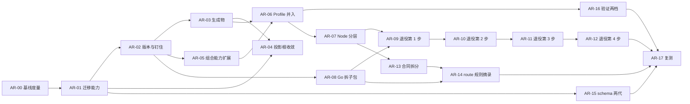

# 架构迭代执行计划

本计划执行[架构迭代规格](architecture-iteration-v1.md)。规格负责需求、验收和未决项；本文只负责顺序、写入范围、验证和回退。两者冲突时以规格为准，并修正本文。

## 1. 执行规则

1. **从干净提交起步。** 每个工作包使用独立的 worktree 和分支 `arch/ar-<编号>`（`using-git-worktrees`）。多个会话共用同一工作目录，动手前先确认分支和工作区。
2. **一个工作包一个 PR。** 跨仓的工作包每个仓一个 PR，PR 描述互相引用。PR 标题带工作包编号，描述里列出命中的 FR / AC，以及 `harness-metrics` 的前后对比（AR-00 之后）。
3. **维护 checkpoint。** 每个工作包按 `.template-source/process/templates/maintenance-checkpoint-template.yaml` 建立 checkpoint，用 `scripts/maintenance-path checkpoints/arch-ar-<编号>/checkpoint.yaml` 取得仓外路径。`intensity` 与 `triggers` 按第 3 节填写；命中 `permission-boundary`、`release-semantics`、`lifecycle-gate` 时附反例证据。
4. **验证。** 根仓依次运行：`scripts/verify-template-fast --plan` → 执行所选集合 → `scripts/ci-gate --mode pr --base <base SHA>` → `scripts/verify-maintenance-checkpoint <checkpoint>`。yss-cli 仓库维持「不放测试」的政策，只做构建；FR-011 的 fixture 回放放在根仓，用固定版本的 `yss` 执行。
5. **跨仓顺序。** 先 yss-cli，后根仓。AR-02 之前，根仓更新 yss-cli 的 gitlink；AR-02 之后，改为更新固定版本文件。
6. **检查随对象一起删除。** 工作包删掉某个检查对象（锁、投影、同步脚本、Profile 副本等）时，在同一个 PR 里删掉对应的检查和验证 profile 登记（FR-015），不留悬空检查。
7. **不加概念。** 任何工作包如需新增流程文档、术语或门禁，先停下，修订规格并取得维护者确认（NFR-006）。
8. **外部动作逐次授权。** 推送、打 tag、发布 CLI、在 GitHub 上归档旧仓库，每次都要维护者单独授权。
9. **立项收尾（已完成）。** 规格转为 `accepted` 的同一个提交里，已在[模板加固执行计划](harness-hardening-v1-plan.md)第 7 节把 WP-08 标为「移交 architecture-iteration-v1」；仓外的 repo-slimming 地图中已重开的 5 张票同时标为 superseded。

## 2. 阶段与依赖



| 阶段 | 工作包 | 出口条件 |
|---|---|---|
| S0 版本与迁移底座 | AR-00、AR-01、AR-02 | AC-001～AC-004 通过；基线已存档 |
| S1 生成物与投影 | AR-03、AR-04 | AC-005、AC-006 通过 |
| S2 Profile 并入 | AR-05、AR-06，随后 AR-16 | AC-007、AC-008、AC-015 通过 |
| S3 分层与单一实现 | AR-07～AR-12 | AC-009 通过；每一步退役后 AC-010、AC-011、AC-016 通过 |
| S4 规则与 Agent 上下文 | AR-13～AR-15 | AC-012～AC-014 通过 |
| 复测 | AR-17 | 全部阶段完成后满 30 天，AC-017 通过 |

S3 的 AR-08 可以和 S1、S2 并行。S4 的 AR-15 只依赖 AR-01，可以提前做。

## 3. 工作包总表

| 编号 | 规格引用 | 维护强度与触发 | 涉及仓库 | 允许写入（概要） | 依赖 | 未决项 |
|---|---|---|---|---|---|---|
| AR-00 | NFR-001～NFR-003 | L2：non-core-validator | 根仓 | `scripts/lib/harness-metrics.mjs` 增加管道提交占比与 daily 起步必读两项（只读）、对应测试、验证 profile 登记 | 无 | — |
| AR-01 | FR-003、FR-004、NFR-004 | L2：release-semantics、cross-repo-contract（需反例） | yss-cli | 迁移规则的版本区间匹配、删除动作的「保留」决定、「commit → 版本」对照表生成工具与产物 | AR-00 | — |
| AR-02 | FR-001、FR-002 | L2：release-semantics、cross-repo-contract（需反例） | yss-cli、根仓 | 来源锁改钉 tag，`refresh-source-lock` 并入发布流程；根仓删除 `submodules/yss-cli` gitlink，新增固定版本文件，改写 `check.cli-content-identity`，删除 N7 的手动落后工具及其登记；首个 tag 为 `v4.0.0` | AR-01 | — |
| AR-03 | FR-005 | L2：generation-semantics、release-semantics | yss-cli、根仓 | 同步上游 yss-cli 后收窄：根 `skills-lock.json` 不再提交 `effectiveHash`，`skill-supply-chain.mjs` 与读取方现算或按实例锁严格比较，打包器缺哈希时按旧键序补回；yss-cli 的 `bundles.json.gz`、离线帮助 JSON、`docs/cli-help.md` 保持提交，由上游 CI 校验、只在发布时重新生成；固定二进制改按上游的 `tools/build-candidate.mjs` 构建 | AR-02 | — |
| AR-04 | FR-006 | L2：generation-semantics、cross-repo-contract、release-semantics（需反例） | yss-cli、根仓 | 删除 `.codex/skills`、`.cursor/skills`、`.pi/skills`；`projectionLink` 接受 `.claude`；根仓移出 `.codex/skills/product-design`，注册表 `platform_skills` 与锁的平台技能组清空；实例运行时模型、注册表与锁、`bundle-profile.json`、`skill-migrations.md` 登记 | AR-01、AR-03 | Q-003 |
| AR-05 | FR-007 | L2：generation-semantics、cross-repo-contract | yss-cli | `internal/bundle/skill_composition.go`、`producer.go` 的来源读取、`rules/*.json`；组合配置格式 | AR-02 | — |
| AR-06 | FR-008、NFR-002 | L2：template-structure、generation-semantics、cross-repo-contract | 根仓（旧 Profile 仓只归档） | `profiles/**`（新增，导入时排除 design Profile 里的 `product-design` 副本）、`.gitmodules`、删除同步脚本、`strategic-handoff-tools.lock.json`、`profile-variants.json`、`.strategic-design-skills-manifest.json` 与对应检查；来源锁 `sourcePath`；evidence 与 wiki 移到仓外归档 | AR-03、AR-05 | — |
| AR-07 | FR-009 | L2：core-validator | 根仓 | `scripts/lib/**` 中切断 5 条边、把 user-decision 的读写与摘要工具下沉到 core；新增导入方向检查与登记 | AR-06 | — |
| AR-08 | FR-009 | L2：core-validator、cross-repo-contract | yss-cli | `internal/governance` 按领域拆成子包，对外行为不变 | AR-02 | — |
| AR-09 | FR-010、FR-011、FR-016 | L2：core-validator、lifecycle-gate、release-semantics（需反例） | yss-cli、根仓 | 第 1 步（approval、user-decision、verification、spec-baseline）：根仓 fixture 回放、同名薄壳与冒烟检查、删除对应的 Node 实现、对应版本的删除规则 | AR-01、AR-07、AR-08 | — |
| AR-10 | 同上 | 同上 | yss-cli、根仓 | 第 2 步：checkpoint、slice、task 的校验 | AR-09 | Q-004 |
| AR-11 | 同上 | 同上 | yss-cli、根仓 | 第 3 步：handoff、context | AR-10 | Q-004 |
| AR-12 | 同上 | 同上 | yss-cli、根仓 | 第 4 步：backend、frontend 的校验部分 | AR-11 | — |
| AR-13 | FR-012 | L2：lifecycle-gate、template-structure（需反例） | 根仓 | 编排合同按层和领域拆成多个文件，`work_unit_routes` 每个工作单元一个文件；逐项写明策略的 owner 与消费者，写不出来的删除；读取合同的 Node 与 Go 代码相应调整 | AR-07 | — |
| AR-14 | FR-013、NFR-003 | L2：lifecycle-gate、cross-repo-contract（需反例） | yss-cli、根仓 | `lifecycle route --json` 返回规则摘录；`AGENTS.md` 只保留入口与硬门禁；lifecycle 技能入口相应修改 | AR-08、AR-13 | — |
| AR-15 | FR-014 | L2：release-semantics、cross-repo-contract | yss-cli、根仓 | 每个 schema 常驻两代；更早版本移入 `yss migrate` 的读取范围；实例分发相应调整 | AR-01 | — |
| AR-16 | FR-015、NFR-006 | L2：core-validator、release-semantics（需反例） | 根仓 | `template-verification-profiles.yaml` 只留 `fast` 与 `release` 两档；删除 `candidate`、`legacy-full`、`legacy_coverage`；删除资格校验层（`verification-qualification*`、`verification-report-validator`）或并入选择与报告模块；`ci-gate` 步骤相应调整 | AR-06 | — |
| AR-17 | NFR-001、NFR-002 | L1：textual-only | 根仓 | 本计划第 7 节、规格状态 | AR-12、AR-14、AR-15、AR-16 | — |

「允许写入」之外的路径只读。`lifecycle-registry.yaml` 的阶段、门禁和工作单元结构，以及批准记录、交接包、数字人会签的语义，在本轮全部只读（规格「非目标范围」）。

## 4. 工作包说明

- **AR-00 基线度量**：按附录 A 的口径扩展 `harness-metrics`，记录 NFR-001～NFR-003 的起点。每个阶段的开始和结束各跑一次，结果存入维护命名空间。
- **AR-01 迁移能力**：先于一切删除动作合入，因为后面所有清理都依赖「逐文件拒绝」和「版本区间匹配」。对照表找不到的 commit 必须明确报告，不能猜（规格风险表）。
- **AR-02 版本与钉住**：首个模板 tag 为 `v4.0.0`（Q-001 已决）。根仓删除 gitlink 后，本地联调靠 `YSS_NATIVE_BINARY` 加 `YSS_NATIVE_BINARY_OVERRIDE=1`。**打 tag 本身不在本工作包内**：第 1 节第 8 条要求打 tag 单独授权。本工作包交付机制（来源锁与刷新脚本支持钉 tag、yss-cli 固定文件、预检与发行验证核对、`ci-setup` 按固定文件构建并核对摘要、移除 gitlink 与 N7 工具）；真实的来源锁在打 tag 之前仍按提交钉住，AC-001 的完整验收（来源锁记录 tag、普通提交后没有重钉提交）要等维护者授权打 tag 并执行 `tools/refresh-source-lock.mjs --tag v4.0.0` 之后才能做，机制已在一次性的临时模板副本里演练过。
- **AR-03 生成物**：原计划是让 bundle 与帮助不再提交、发布时先生成再构建。动工前核对上游（yss-cli 的 PR #2～#7）发现，上游已经把生成物做成「提交的副本 + 工具校验 + CI 校验」：`tools/artifacts.mjs` 的 `check`/`generate`、`artifacts.yml`、可复现的候选构建和分段 JSON 写入器；再改成不提交会与之冲突，也没有换来收益。所以本工作包收窄为：(1) 先同步上游并按其构建配方重新固定二进制；(2) 只做根锁瘦身，让打包器对缺 `effectiveHash` 的模板锁照样渲染出与旧版逐字节一致的实例锁。**要点**：`effectiveHash` 本来就由 `RenderedSkillLock` 按分发的技能树重算并覆盖，所以模板锁里的这个值是多余的；唯一要补的是键序（缺失时插到 `skillPath` 之后）。读取方（`lifecycle-context-query`、`backend-standards-coverage`）对没有该字段的模板锁放行、对带该字段的实例锁仍严格比较，共用 `lockedTreeHashMatches`。生成物在 yss-cli 里的校验与重新生成沿用上游工具，不在本工作包内重做。
- **AR-04 投影根收敛**：接手 hardening WP-08 已完成的研究，不重做。旧实例里的投影根副本（含 `product-design`），通过 AR-01 的删除规则清理，并且可以拒绝。`product-design` 在根仓随 AR-04 移出；design Profile 里的 56 个文件在 AR-06 导入时排除。两者之间 design 新实例仍会带它，这是已知的短暂窗口。README 或升级计划里注明用户自行安装的来源。
- **AR-05 组合能力扩展**：扩展完成后，旧形态（子模块）的来源必须仍然可以构建，AR-06 的逐文件对比依赖这一点。
- **AR-06 Profile 并入**：一次性导入，不留过渡期。合入前提是 AC-007 的逐文件摘要映射一致。GitHub 上归档旧仓库属于外部动作，按第 1 节第 8 条单独授权。
- **AR-07 Node 分层**：5 条边见规格证据 5。导入方向检查必须亚秒级、只读（NFR-005）。
- **AR-08 Go 拆子包**：只重组包结构，对外命令与输出保持不变。
- **AR-09～AR-12 退役四步**：每一步的顺序固定：先补 fixture 回放 → 再换薄壳 → 再删 Node 实现 → 最后随模板版本发布删除规则。每一步结束时检索技能，确认技能里已经不再引用被退役的实现。
- **AR-13～AR-15 规则与 Agent 上下文**：AR-13 的策略清单写入执行记录；被删除的策略逐条列出。
- **AR-16 验证两档**：S2 完成后进行，此时大部分检查对象已经消失。
- **AR-17 复测**：全部阶段完成后满 30 天，按附录 A 统计并写入第 7 节；没达标时记录差距和原因，不能调高目标后宣称完成。

## 5. 交给 agent 执行时的指令

每个工作包都可以单独派发。派发指令模板：

```text
读取 .template-source/contracts/architecture-iteration-v1.md 与 architecture-iteration-v1-plan.md。
执行工作包 AR-<编号>：只修改计划第 3 节该行「允许写入」列出的路径；其他路径只读。
开工前确认依赖的工作包已合入、相关未决项已有答复；没有答复时停下来提问，不自行假设。
按计划第 1 节建立 worktree、分支和维护 checkpoint，按第 4 节的说明执行，按第 1 节第 4 条验证。
结束时报告：命中的 AC 及证据路径、harness-metrics 前后对比、删除的检查、未完成项。
```

## 6. 决策与例外记录

以下决定由维护者于 2026-10-11 在仓外的 wayfinder 决策地图（`.work/architecture-iteration/`）中逐票确认。

| 日期 | 项 | 决定 | 决定人 |
|---|---|---|---|
| 2026-10-11 | 沿用的约束 | hardening 的 NFR-006（实例兼容）与 FR-016（技能退役冻结）、research 在会话内完成，这几条沿用；「不增加流程概念」沿用，但删除或合并概念不受限；注册表、批准记录、交接包语义不变，旧 schema 版本可以只在迁移命令里读取 | 维护者 |
| 2026-10-11 | Profile 形态 | 并入根仓 `profiles/*`，只放覆盖层，共有部分放 `_specialist/`；这三个 Profile 仓没有外部使用者 | 维护者 |
| 2026-10-11 | 唯一权威 | 每个领域只保留一份实现（按领域划分） | 维护者 |
| 2026-10-11 | 版本与钉住 | 模板与 CLI 两条语义化版本线；CLI 钉模板 tag；根仓去掉 yss-cli 子模块，改为固定版本号和 SHA-256；迁移规则按版本区间匹配；N3 并入发布流程，N7 删除 | 维护者 |
| 2026-10-11 | 内核分层 | 四层；Node 切 5 条边并加导入方向检查；Go 拆子包；不触发 WP-11 的物理拆分 | 维护者 |
| 2026-10-11 | 并入方式 | 快照导入；旧仓库归档为只读；先改 yss-cli、再改根仓，共两个 PR；同步机制一次删除；evidence 与 wiki 移到仓外归档 | 维护者 |
| 2026-10-11 | 「部分」档领域 | 校验归 Go，工作流归 Node；按四步退役；每个领域留 fixture 回放，每个薄壳留冒烟检查 | 维护者 |
| 2026-10-11 | 生成物 | bundle 与 CLI 帮助改为发布时生成；`skills-lock.json` 只保留上游 revision；删除三个投影根，只保留 `.claude/skills` 的链接 | 维护者 |
| 2026-10-11 | 规则与 Agent 上下文 | 合同按层拆分；写不出 owner 的策略删除；Agent 经 `yss lifecycle route --json` 取规则摘录；schema 常驻两代 | 维护者 |
| 2026-10-11 | 实例迁移 | 沿用 `yss upgrade`，不强制升级；删除可以逐文件拒绝；旧副本按版本分批清理；对照表只生成一次 | 维护者 |
| 2026-10-11 | 验证收缩 | 只留 `fast` 与 `release` 两档；`candidate`、`legacy-full`、`legacy_coverage`、资格校验层退役 | 维护者 |
| 2026-10-11 | Q-001 首个 tag | `v4.0.0` | 维护者 |
| 2026-10-11 | Q-002 `product-design` | 它是 OpenAI 的第三方 Codex 插件，从模板、Profile、新实例分发中移出，由用户自行安装；`platform_skills` 机制保留 | 维护者 |
| 2026-10-11 | 规格转为 accepted | 维护者确认措辞，同日完成 WP-08 移交标注与旧图 5 张票的 superseded 标注 | 维护者 |
| 2026-10-11 | AR-02 固定 yss 的方式 | 固定「按指定 yss-cli 提交构建的二进制」的各平台 SHA-256，而不是发行包：目前没有包含本轮改动的 CLI 发行版，也不应为此提前发布。可行性已实测：同一提交、同一 Go 版本、`-trimpath` 构建，在不同检出目录得到逐字节相同的二进制。CLI 发布后再改记发行包摘要。已写入规格 FR-002 | 实施者（待维护者确认） |
| 2026-10-11 | AR-02 不创建 tag | 第 1 节第 8 条要求打 tag 单独授权，本次授权只覆盖「提交、不推送」。机制已就绪，真实来源锁在打 tag 前仍按提交钉住。维护者于 2026-10-11 授权打 tag v4.0.0 并执行 refresh-source-lock --tag；推送仍未授权 | 实施者（待维护者确认） |
| 2026-10-11 | AR-03 收窄 | 动工前核对上游最新 PR 后，bundle 与 CLI 帮助保持提交、由上游 CI 校验、只在发布时重新生成；本工作包只做根锁瘦身（规格 FR-005、AC-005 已据此改写）。维护者选择「先同步再收窄」 | 维护者 |
| 2026-10-11 | AR-03 固定二进制配方 | 同步上游后，固定文件按上游 `tools/build-candidate.mjs` 构建，取代单独的 `-trimpath`；同一提交在两个不同目录得到相同摘要（darwin-arm64 实测）。已写入规格 FR-002 | 实施者（维护者已于 2026-10-12 确认） |
| 2026-10-12 | AR-04 投影根范围 | 维护者指示：投影根只保留 `.agents/skills`，连 `.claude/skills` 也删除（原规格是保留 `.claude/skills` 链接）。规格 FR-006、AC-006、Q-003 已同步；注册表与锁的运行时、投影根清空，`skills resolve` 不再要求运行时参数（仅旧实例可传 codex、cursor、pi）。**已知影响**：Claude Code 不会自动发现 `.agents/skills`，只能经 AGENTS.md 与技能引用使用 | 维护者 |
| 2026-10-12 | AR-04 `product-design` 与生命周期路由 | 注册表 `platform_skills` 与锁的平台技能组清空后，校验要求路由不得引用 `product-design:index`，所以 `orchestration-contract.yaml` 的原型工作单元不再列它；`yss-prototype-stage`、`yss-design-system` 的「有视觉稿时可调用」文字保留，仅在用户自行安装后适用。`profile-skill-sync.json` 同步删去 backend、frontend、design 对它的分发登记（design Profile 里已有的副本留到 AR-06） | 实施者 |
| 2026-10-12 | AR-04 旧实例清理方式 | 不在 bundle-profile 里列逐文件规则：升级规划时按旧实例受管基线动态生成「投影根收敛」删除规则（旧来源的精确字节，可逐文件 keep-local，用户改过的文件进入冲突），目标 Bundle 仍分发该路径（旧模板线的 Profile）时不提议；运行时登记随目标 Bundle 不再分发的投影根一并清掉 | 实施者 |
| 2026-10-12 | AR-05 范围 | 把 FR-007 拆成两部分：「内核 + 覆盖层」组合能力与 AC-007 的等价验证在本工作包完成；「9 种字节替换改成统一路径布局加 2 个参数」顺延到 AR-06，因为只有 Profile 并入同一仓库后，才能把 Profile 之间脚本的差异收成参数，在并入之前改动只会和待删除的同步机制冲突 | 实施者 |
| 2026-10-12 | AR-06 导入基线 | 导入取三个 Profile 子仓的 gitlink 提交，而不是来源锁里较旧的提交：gitlink 才是仓库当前认可的 Profile 状态，来源锁落后只是还没发版。因此首个 v4.0.0 的 Profile 内容比此前发布的 CLI 新，差异按「旧形态 gitlink 提交 vs 新形态」逐项核对 | 实施者 |
| 2026-10-12 | AR-06 不导入的内容 | Profile 仓库的 tests、evidence、wiki 以及除分发清单与 `derived/` 外的 `.template-source` 不导入：evidence 与 wiki 按规格归档到仓外并带 SHA-256 清单，tests 与其余维护材料随旧仓库只读保留（它们验证的是已并入的同步与独立仓流程）。需要整棵 Profile 目录的测试改用 `composeProfileTree` | 实施者 |
| 2026-10-12 | AR-06 保留的冻结项 | 冻结的旧覆盖清单要求 117 条命令文本逐字节不变，所以指向已删除脚本的遗留命令不改文本，只让它们在 fast 里不被选中；`.strategic-design-skills-manifest.json` 在根仓删除（锁里四个设计技能改为本地技能），Profile 覆盖层里各自的副本保留 | 实施者 |
| 2026-10-11 | 合流方式 | 另立本合同，不并入 hardening；hardening 的 WP-08 移交本合同，WP-11 照常签署 | 维护者 |
| 2026-10-11 | 重开的旧决定 | repo-slimming 地图中的「Profile 子模块形态」「Node 与 Go 单源方向」「共享脚本库单源化」「投影根收敛（WP-08）」「是否结束 `legacy-full`」五张票重开，由上面各项决定取代 | 维护者 |

## 7. 执行状态

| 工作包 | 状态 | 分支 | 说明 |
|---|---|---|---|
| AR-00 | 已完成，待合并 | `arch/ar-00`（基于 `arch/architecture-iteration-v1`，未推送） | `harness-metrics` 增加 `pipeline_commits`（管道提交占比，可用 `--rev`、`--since`、`--until` 复现历史口径）与 `daily_start`（daily 起步必读）；11 个测试通过；登记为 fast 检查 `check.harness-metrics`，原补充检查改名 `-supplemental`；fast 通过。基线（S0 开始）存仓外 `maintenance:checkpoints/arch-ar-00/metrics-before.json`：daily 起步 57,013 B；管道提交 2026-08-27 起 149/396（37.6%），最近 30 天 122/289（42.2%）。**修正**：规格立项时写的 398 / 330 / 83% 偏高，原因是临时统计把名字里带 source-lock 的脚本和测试也算成管道文件；纯管道提交数 149 不变，已按 396 / 311 / 78.5% 改正规格证据 1、NFR-001 与附录 A。NFR-002（修一次内核涉及的仓库数）无法从 Git 历史算出，按规格由 AR-17 抽查 |
| AR-01 | 已完成，待合并 | 根仓 `arch/ar-01`（基于 `arch/ar-00`）；yss-cli `arch/ar-01`，提交 `aa0cf47`（均未推送） | yss-cli：迁移规则支持版本区间（`from.versions`，左闭右开）；规则提议的 `delete` 可用 `keep-local` 逐文件拒绝，拒绝后升级成功、文件原样保留，并在之后的计划里继续生效；`tools/version-table.mjs` 一次性生成历史「模板 commit → 版本」对照表（spec 25、design 20、backend 20、frontend 22 条，记为 `4.0.0-pre.N`）。根仓：gitlink 指向 `aa0cf47`。验证：`CGO_ENABLED=0 go build ./...`、`go vet`、`gofmt` 通过；行为用 10 个一次性场景验证后已删除（yss-cli 不放测试）。**没有持久回归覆盖**：删除拒绝与区间匹配的回归检查要等 AR-09 的根仓 fixture 回放。AC-003 的「按历史 commit 初始化的真实实例」只覆盖到当前内嵌 Bundle 的来源，2026-10-06 之前的旧 CLI 实例不在表内，规则对它们不适用并如实报告。**推送顺序**：先 yss-cli，后根仓；根仓 gitlink 指向的提交在 yss-cli 推送前，别处检出会找不到它 |
| AR-02 | 已完成（含 tag 与来源锁），待合并 | 根仓 `arch/ar-02`（基于 `arch/ar-01`）；yss-cli `arch/ar-02`，提交 `ca1e0b9`（均未推送） | yss-cli：来源锁可选 `templateTag`，打包时校验「tag 为正式 vX.Y.Z、存在、指向锁里的提交、`templateVersion` 与之一致」，实例因此记录语义化版本；`refresh-source-lock.mjs --tag` 成为发布流程中的一步，已钉 tag 的来源拒绝按 HEAD 刷新。根仓：新增 `.template-source/distribution/yss-cli-pin.json`（版本 1.3.5、提交 `ca1e0b9`、Go 1.27.1、darwin-arm64 / linux-amd64 / linux-arm64 的 SHA-256）与 `yss-cli-pin.mjs`；预检的 `native-cli`、`tests/cli-retirement.test.mjs`、发行验证 `collectReleaseSources` 核对二进制摘要与源码提交；`ci-setup --yss-commit pin` 取固定提交与 Go 版本、构建后核对摘要；删除 `submodules/yss-cli` gitlink 与 `.gitmodules` 条目；删除 N7 的手动落后检查，被删路径在验证登记里留到合入之后再移除。**限制**：(1) 没有创建 tag，真实来源锁仍按提交钉住，AC-001 的完整验收要等授权打 tag 后做；(2) 固定的是按提交构建的二进制而非发行包，见第 6 节；(3) 摘要在 darwin-arm64 上用本机验证过可复现，linux-amd64 / linux-arm64 的摘要来自交叉编译，CI 首次构建若与之不符，`ci-setup` 会明确失败，届时需按报告的实际值更新固定文件；(4) 对照表与 AR-01 的区间规则都不依赖 tag 是否已建。**取回与推送顺序**：yss-cli 的 `aa0cf47`、`ca1e0b9` 只在本 worktree 的 `.work/yss-cli` 克隆里；根仓固定文件里的提交在 yss-cli 推送前，CI 取不到它。**2026-10-12 打 tag 与钉来源锁（随 AR-04 完成）**：首次尝试在 spec 钉新提交时因 `.claude/skills` 符号链接失败（打包器不支持），改在 AR-04 之后完成：根仓 tag `v4.0.0` 指向 `6fd8d0d1`（AR-04 的第三个提交，注释 tag，仅本地）；design、backend、frontend 在 worktree 内子仓的已钉提交上各有本地 `v4.0.0`（主检出里的子仓没有，推送前要补建）。yss-cli `docs/source-lock.json` 现记录四个模板的 tag `v4.0.0`、提交与版本 `4.0.0`，生成物已刷新。**AC-001**：来源锁记录了 tag 与提交；之后根仓上任何普通提交都不改变 `refresh-source-lock --tag v4.0.0` 的目标（按 tag 解析），所以不需要重钉提交（本工作包的固定文件更新与计划更新就是这样的提交）。**来源锁引用了未推送的模板提交，推送前必须先推模板 tag 与提交，再推 yss-cli，最后推根仓** |
| AR-03 | 已完成（范围已收窄），待合并 | 根仓 `arch/ar-03`（基于 `arch/ar-02`）；yss-cli `arch/ar-03`，提交 `d91df2f`（含与上游 main `9c3c984` 的合并 `5fea7ce`；均未推送） | **同步上游**：yss-cli 的上游 main 比 AR-01 起点多了 PR #2～#7（候选构建、artifacts 校验与生成、分段 JSON 写入器、性能记录），与 AR-01、AR-02 无冲突，合并后 `go build ./...`、`go vet` 通过；固定文件改指新提交并按上游构建配方重算三个平台摘要，同一提交在两个目录构建的 darwin-arm64 摘要相同；`ci-setup` 优先用 `tools/build-candidate.mjs`。**瘦身**：yss-cli `RenderedSkillLock` 对缺 `effectiveHash` 的模板锁按旧键序（`skillPath` 之后）补回，已用一次性用例验证带与不带该字段渲染出的实例锁逐字节相同，并验证把插入位置改错后用例失败，用例随后删除（yss-cli 不放测试）；根仓 `skill-supply-chain.mjs` 不再写入 `effectiveHash`（只现算用于判断是否需要 `adaptationRef`），`update-skill-lock` 重新生成后根锁恰好少 80 行（79 共享 + 1 平台），没有别的变化；`lifecycle-context-query`、`backend-standards-coverage` 共用 `lockedTreeHashMatches`：无该字段放行、有则严格比较、未登记仍拒绝；`skill-governance` 现算。新增 fast 检查 `check.skill-lock-readers`（`tests/skill-lock-readers.test.mjs`，3 个用例，约 60 ms，只读、不依赖二进制）。**限制**：(1) 没有创建 tag，也没有推送，固定文件里的提交只在 `.work/yss-cli`，CI 取不到它；(2) linux 两个平台摘要来自交叉编译，未在 linux 上运行；(3) `tests/scenarios/verify-lifecycle-context-query-scenarios.mjs` 在第 102 行因 `yss-product-lifecycle/SKILL.md`（15,076 B）超过它断言的 8,192 B 预算而失败，这是本分支之前就存在、与本工作包无关的失败，该脚本不在 fast 里，所以它覆盖的实例哈希漂移场景由新增的检查补上；另有 `skill-supply-chain.test.mjs` 对投影根数量的旧断言（仍是 3 个，已有 `.claude/skills`）与 `skill-registry.test.mjs` 读取 backend 子模组里不存在的 `git-commit-core` 技能，两处与本包无关的失败，同样不在 fast 里；(4) 生成物的「发布时重新生成」沿用上游工具，yss-cli 的 `docs/source-lock.json` 要等发布打 tag 时才会因根锁变化而刷新 |
| AR-04 | 已完成，待合并；**Profile 同步类检查未通过，checkpoint 验证未通过** | 根仓 `arch/ar-04`（基于 `arch/ar-03`）；yss-cli `arch/ar-04`，提交 `1ceaf4b`（均未推送） | **根仓**：删除 `.codex/skills`、`.cursor/skills`、`.pi/skills`、`.claude/skills` 与 `product-design`；`PROJECTION_ROOTS` 置空，注册表 `runtimes/projection_roots/agent_runtime_roots` 清空，锁 `projectionRoots: []` 且每个技能 `targets` 只剩 `.agents/skills`；`bundle-profile.json`、`profile-skill-sync.json`、验证登记、`skill-migrations.md`、相关测试同步；`query-lifecycle-context` 没有运行时时不再要求 `--agent-runtime`。**修复 AR-03 遗留问题**：新 CLI 写入的实例锁含 `effectiveHash`，模板脚本 `update-skill-lock --check` 不写它，导致新实例 `verify-project-instance` 报锁过期；脚本现在在实例锁已有该字段时按当前内容重算并保持 `skillPath` 之后的键序（模板锁不加）。**yss-cli**：打包器接受 `.claude/.codex/.cursor/.pi` 链接（旧模板线 Profile 仍需要）、脚本分发基线按正则识别、选定分发运行时置空；`sync` 对旧实例按旧字节动态提议删除投影文件（可 keep-local）并清掉运行时登记；`skills resolve` 不要求运行时；来源锁刷新到 `v4.0.0`。固定文件指向 `1ceaf4b`，三平台摘要按 build-candidate 重算（darwin-arm64 在两个目录相同，linux 两个为交叉编译）。**验证**：新实例 `init` 无任何投影目录，`verify-project-instance`、`update-skill-lock --check` 通过；旧实例（AR-03 固定二进制创建）`sync` 提议 375 项删除与 1 项冲突（用户改过的文件），选 keep-local 后应用成功、校验通过、再次规划只剩 2 项保留例外；根仓 `claude-entry` 检查改为断言没有任何投影根，`skill-sync-efficiency` 断言零投影根不创建目录并覆盖键序。**限制**：(1) design、backend、frontend 三个 Profile 子仓仍带三个旧投影根与 `product-design`，留到 AR-06 导入；(2) yss-cli 的 `rules/*.json` 里 `.codex/skills/...` 的旧排除项未动（AR-05）；(3) 没有 tag 之外的推送，固定文件里的提交只在 `.work/yss-cli`；(4) 同样存在与本包无关的既有失败：`verify-lifecycle-context-query-scenarios` 第 102 行预算断言、`skill-supply-chain.test.mjs`、`skill-registry` 读 backend 子模组缺失文件（在 worktree 需把主检出子仓里被忽略的技能目录复制进来才能跑 `skill-registry.test.mjs`）；(5) Claude Code 不自动发现 `.agents/skills`，见第 6 节 2026-10-12 第一行；(6) **验证结果**：`verify-template-fast --base c7e60313`（用按 `1ceaf4b` 构建的固定二进制）204 个命令通过，唯一失败是 `sync-profile-skills --check --profile=all`（design 的 `product-design` 副本不再登记、三个 Profile 里的技能与 `script-execution.md` 等落后于模板）；`ci-gate --mode pr` 在 `handoff-tools-sync`、`handoff-tools-lock` 失败（Profile 里的共享工具与锁落后，其中 `backend-standards-coverage.mjs` 的锁漂移在 AR-03 提交 `c7e60313` 上已经存在），后面的 `verify-template` 因前置失败被跳过；`verify-maintenance-checkpoint` 因 fresh-verification 不是通过结果而失败，checkpoint 如实记录为 fail。这些都是「改模板就要在三个 Profile 子仓各提交一次再更新 gitlink」的流水线成本，AR-06 并入后消失。**待维护者决定**：(a) 现在就在三个 Profile 子仓的本地克隆里做同步提交并更新 gitlink（这些提交同样只存在于 worktree，推送前要先取回），让门禁变绿；或 (b) 接受这条限制，AR-06 一次性处理 |
| AR-05 | 组合能力已完成，「字节替换改参数」部分顺延 AR-06，待合并 | 根仓 `arch/ar-05`（基于 `arch/ar-04`）；yss-cli `arch/ar-05`，提交 `dc05903`（均未推送） | **yss-cli**：来源锁的 Profile 条目可带 `overlayPath`，从同一仓库同一提交读取内核目录（`.agents/skills`、`scripts`、`.template-spec/process`、`.template-spec/templates`）与覆盖层目录并组合，同一路径覆盖层优先；分发清单同时约束两边（内核里不属于该 Profile 的文件列进 `excludePaths`）；`overlayPath` 不能落在内核目录里、不能越界、不能与 `skillsSource` 并用；没有 `overlayPath` 的条目按原整仓来源构建，重新生成的产物逐字节不变。`readGitFiles` 拆成按前缀读取与投影链接展开两步（`overlay.go` 新增）。文档写在 `tools/bundle/README.md`。**根仓**：固定文件指向 `dc05903`，三平台摘要重算（darwin-arm64 两个目录相同，linux 两个为交叉编译）。**AC-007**：一次性用例（已删除）把同一组源码——锁定提交上的 spec 与三个 Profile（含 backend、frontend 的技能合成）——分别按旧形态与覆盖层形态构建，路径→digest、mode、ownership 映射 spec 1877、design 4582、backend 5766、frontend 9064 项全部一致、0 差异；覆盖层目录由旧形态的合成结果与内核的差异生成。三种拒绝场景各有一次真实失败运行，记录在 checkpoint arch-ar-05。**未做**：规格 FR-007 的第二句「现有 9 种字节替换改为统一路径布局加 2 个参数」没有做——这些替换（`render.go` 对 AGENTS.md、README、`.gitignore`、`skill-supply-chain.mjs` 等的实例化改写，以及 Profile 之间 `query-lifecycle-context`、`lifecycle-context-query.mjs` 等脚本的差异）要等 Profile 并入同一仓库、同一路径下只剩一份脚本之后才能统一为参数，所以顺延到 AR-06。**发现的坑**：覆盖层目录里若带 `.gitignore`（旧 Profile 仓的 `.gitignore` 忽略生成的技能目录），它只管该目录之下的路径，会让覆盖层文件提交时被忽略，AR-06 导入时必须处理 |
| AR-06 | 本地部分已完成（Profile 并入），**GitHub 归档旧仓库未做**；fast 全量未跑完，待合并 | 根仓 `arch/ar-06`（基于 `arch/ar-05`），yss-cli `arch/ar-06`，提交 `08d2cb7`（均未推送）；根仓 tag `v4.0.0` 现指向 `b636f36d` | **导入**：`profiles/{_specialist,design,backend,frontend}` 共 703 个文件（约 3.8 MB，含 `.codex/.cursor/.pi` 投影链接），来源是三个 Profile 子仓在超级仓库登记的 gitlink 提交（design `5602a7e7`、backend `b0b1171c`、frontend `2f87cdc9`，比旧来源锁里的提交新）；backend/frontend 的共享技能按各自 `profile-skills-source.json` 记录的 spec 提交 `58066731` 与同步配置合成；与内核逐字节相同的文件不导入，三个 Profile 都相同的覆盖文件放 `_specialist`；各 Profile 的分发清单在 `profiles/<p>/.template-source/distribution/bundle-profile.json`，内核里不属于它的路径列进 `excludePaths`。`product-design` 按 Q-002 排除，三个 Profile 的锁、注册表、编排合同和 design 的 `skill-governance.mjs` 同步调整。**删除**：`sync-profile-skills` 与配置/补丁/测试/准备脚本、`sync-strategic-handoff-tools`、共享工具锁与校验、`profile-variants`（含检查与测试）、`.gitmodules` 与三个 gitlink、设计技能清单及锁里对设计 Profile 仓库的上游追踪、ci-gate 的两个共享工具步骤、preflight 的子模块检查、发布验证里的子模块核验、`sync-harness-upgrade` 对 Profile 的写入。**改写**：分发守卫 `verify-profile-distribution` 改查覆盖层并检查同步机制是否复活；`ci-setup` 的 `--submodules` 改名 `--toolchain`；测试与夹具经新增的 `scripts/lib/profile-tree.mjs` 取组合后的 Profile 目录；`advance-maintenance-iteration` 不再接受专职仓 `--root`；yss-cli 的 `overlayPath` 改为有序列表 `overlayPaths`。**AC-007/AC-008**：一次性用例（脚本存仓外 `ar06-tests`）把旧形态（gitlink 提交）与新形态逐项对比：backend 只有两份内核文档文案不同，spec 少了被删除的 `profile-variants.mjs` 与设计技能清单，design/frontend 少了 `product-design`（110 项）并按 Q-002 调整，另有两份文档因内核文案更新而在所有 Profile 里同步变化；新实例 `init` 后 design/backend/frontend 的 `verify-skill-registry`、`verify-skill-governance`、`verify-lifecycle-registry` 与 `doctor` 均通过。**归档**：三个 Profile 的 `.template-source/evidence` 与 `wiki` 已导出到仓外 `maintenance:archives/arch-ar-06`（含 SHA-256 清单，design 170、backend 159、frontend 159 个文件）。**AR-04 记录的 Profile 同步类失败随本包消失**。**未做/限制**：(1) 「在 GitHub 上归档旧仓库」属外部动作，等你单独授权；(2) `verify-template-fast` 全量一次跑了很久被你停掉，改为逐项运行受影响的检查与测试（见 checkpoint arch-ar-06），其余检查未重跑；(3) 冻结的旧覆盖清单（117 条）与 legacy-full 里指向已删除脚本的命令保留，其中只有 `check.a74d7c2cc539e456` 在 fast 里有定义，已把输入改成永不命中的占位路径，全部随 AR-16 删除；(4) Profile 仓库自己的 `tests/`、`.template-source` 里除分发清单和 `derived/` 之外的内容（evidence、wiki 已归档，其余随旧仓库只读保留）没有导入；(5) 覆盖层里保留的是 Profile 当时的副本（含相对内核已落后的脚本），去重与参数化（FR-007 第二句）留给后续；(6) `tests/scenarios/verify-template-verification-scenarios.mjs`、`verify-retired-skill-ids`、`plugin-design-consumption` 的一个用例等在 AR-05 提交上就已失败，未处理 |
| AR-07 | 已完成，待合并 | 根仓 `arch/ar-07`（基于 `arch/ar-06`），yss-cli `arch/ar-07`，提交 `a4a7b8a`（来源锁刷新；均未推送）；根仓 tag `v4.0.0` 现指向 `1afff73a` | **导入环**：`scripts/lib` 原有 34 个模块、88 条内部边的强连通分量，按规格证据 5 的原型切断 5 条边后无环（现 138 个模块无环）。`user-decision` 的 `decisionError`、`decisionDigest`、`requestDigest`、`decisionIO`、`requireText` 下沉到 core 层新模块 `user-decision-core.mjs`（原模块再导出，调用方不变）；`decision-continuation` 不再导入 `user-decision`，原批准核验器由 `user-decision` 通过 `options.assertRequirement` 注入；`plan-review-control` 不再导入 `user-decision`，后继周期的决定核验器改由入口脚本 `scripts/plan-review-control` 注入（缺失时明确失败）；`prepareContractReview` 从 `contract-views` 移到工作流层 `contract-review-preparation.mjs`（`scripts/contract` 与两个测试改导入）；`validateImplementationRepositoriesReady` 及其依赖的就绪判定与信号搬到 `lifecycle-readiness.mjs`（`lifecycle-transition` 再导出），`slice-repositories` 改依赖它；`slice-contract` 不再导入 `slice-repositories`，改为 `registerSliceRepositories` 登记，`slice-repositories` 加载时登记，需要多仓合同的工作流模块（`lifecycle-transition`、编译器、`approved-execution-context`、`frontend-delivery-boundary`、`delivery-preflight`、`task-package`）加副作用导入，没有登记时遇到多仓绑定以「接收端不支持当前来源的多项目准备协议」失败，与旧 Profile 接收端的原有提示一致。**检查**：新增 `scripts/verify-import-direction` 与 `scripts/lib/import-direction.mjs`（只读、纯文本解析、真实仓库约 0.07 秒），规则是无导入环、core 层（`.template-source/process/node-core-layer.json` 登记 14 个模块）只导入 core 层；`tests/import-direction.test.mjs` 5 个用例，含故意加反向导入后失败并指出这条边（AC-009）；登记为 fast 检查，并从各 Profile 与实例分发中排除。**同时补登记**此前未登记的 `contract-review-preparation`、`plan-review-control` 测试。**修正**：切边时漏改的第二处 `assertUserDecisionRequirement` 引用（外部审批的延续路径）在验证中发现并修好。**未做/限制**：(1) 验证子系统自己的 7 模块环不在本工作包；(2) 没有跑 `verify-template-fast` 全量，改为逐项运行受影响的测试与场景（见 checkpoint arch-ar-07）；(3) 旧覆盖层里的 `lifecycle-transition.mjs` 副本仍是旧版，Profile 接收端行为不变；(4) `plan-review-control` 的 `real CLI dispatch` 用例、`plugin-design-consumption` 的一个用例在 AR-05 提交上就失败，未纳入 |
| AR-08 | **已完成（基础层拆出，核心环原样保留）** | 根仓 `arch/ar-08`（基于 `arch/ar-07`，改本计划与固定二进制）；yss-cli 分支 `arch/ar-08`（`9533945`） | 用 go/types 重新做符号级依赖分析（方法并入接收类型，比此前按名字的分析准确）：强连通核心只有 43 个符号、约 5,400 行；其余符号里「没有任何下层符号依赖它」的最大集合是上层（448 个符号、约 24,900 行），其余约 7,100 行为基础层。用一次性类型感知搬运程序（存仓外）把基础层移到 `internal/governance/kernel`（29 个文件、7,687 行），上层留在 `internal/governance`（26,124 行，入口与对外符号不变，`SemanticReport` 因定义在基础层以类型别名保留）；上层引用的 107 个基础层符号加 `kernel.` 限定，176 个小写名（符号、方法、字段）改为首字母大写，新导出的字段一律加 `json:"-" yaml:"-"` 以保持序列化不变。`go build ./...`、`go test ./...` 通过；`go vet` 只报 `kernel.Binding`、`kernel.TrackingEntry` 的无键字面量（跨包风格提示，不影响行为）。**核对**：同一实例上新旧二进制对 99 个命令组合输出逐字节相同，但其中 87 个落在 `UNPORTED`/未知命令（缺参数），真正走到校验逻辑的只有约 12 个，**行为等价只有这些加编译期保证，没有测试可兜底**；已记录为未覆盖。**未做**：5,400 行核心环（43 个符号）仍在一个包里，要继续拆需先消除约 30 条符号级环。固定二进制改指 `9533945`（darwin 两次构建摘要相同） |
| AR-09 | **第一段完成：回放、Go 侧补齐、两个命令行入口换成薄壳；其余入口与删除 Node 实现未做** | 根仓 `arch/ar-09`（基于 `arch/ar-08`） | 用户选「分两段，先做入口」。新增 `tests/go-validator-replay.test.mjs` 与 `scripts/lib/native-evidence.mjs`（只定位固定版本 `yss`、拼 `evidence verify` 参数、解码信封、透传退出码）：在用固定二进制现场 `yss init` 的 spec 实例里构建合成夹具，同一批夹具同时交给 Node 校验与 Go。**Q-004 实测结论**：用户决定 17 组（通过 1、拒绝 16）通过/拒绝结论全部一致，拒绝码 14 组一致，3 组两边都拒绝但码粒度不同（Node 对 schema 违规不带码、Go 报 `SCHEMA`；来源文件缺失 Node 报 `user-decision-source-unreadable`、Go 报 `INPUT`），测试里显式登记为「结论一致、码不同」；批准记录只回放了「历史数字人记录可读、无当前上下文不能关闭关键门禁」一组。**阻塞 (1) 已解决（维护者决定「让 Go 在模板源仓根也能跑校验」）**：yss-cli 分支 `arch/ar-09`（`370b15f`）改两处——仓库身份为 `template-source` 时可以没有 `harness-profile.yaml`（实例缺失仍报错），上下文扫描跳过模板源仓根的 `profiles/` 覆盖层；回放测试现在在实例与模板源仓根两处各跑一遍（36 组 + 批准记录 2 组全部通过），固定二进制改指 `370b15f`。**(2) 已解决（按「默认范围推导放进 Go」）**：`yss evidence verify --kind user-decision` 新增显式 `--from-record`（按待验记录自身事项核验，对应旧命令行省略 `--requirements`；默认仍不反推，且不能与 requirements/checkpoint/task/continuation 同用），`--requirements` 可只写一项。**薄壳已换**：`scripts/verify-user-decision`（含 `--continuation`）、`scripts/verify-approval-record` 只翻译参数、透传 yss 的结论与退出码（失败退出码为 yss 的 1/2，旧 Node 一律 1）；`profiles/backend` 里一份缺 `--continuation` 的旧版覆盖层已删除，由根的薄壳取代；场景与 `approval-current` 测试里依赖「在无实例的合成目录跑 Node 命令行」的几处改为在回放测试里用薄壳冒烟覆盖。固定二进制 `545755a`。**仍待做**：(3) `evidence verify` 的 `--kind` 只有 approval/user-decision/verification，spec-baseline 在 `handoff` 下另有入口，且 `verification`、`spec-baseline`、带当前绑定的批准记录尚未回放；(4) 这些 Node 库仍被约 35 个工作流模块进程内调用，删除需先有 Node→Go 子进程适配层。**未做**：`spec-baseline` 命令行入口的薄壳、verification 与带当前绑定的批准记录的回放、删除 Node 实现、删除规则 |
| AR-09b | **第一片完成：用户决定的进程内入口委托给 yss；其余入口与删除未做** | 根仓 `arch/ar-09b`（基于 `arch/ar-09`）；yss-cli `arch/ar-09b`（`79f2990`） | 维护者选「Go 增加候选态入口」。调研结论：约 35 个调用方不是传文件路径，而是在工作流中校验尚未落盘的内存记录并传入 Node 算出的期望对象与 rolesDoc/registry，Go 的 `evidence verify` 只认落盘记录加 checkpoint/task，所以按函数分片迁移。**本片**：`assertUserDecisionRequirement`（已落盘的用户决定，覆盖 `maintenance-research`、`plan-spec-entry`、`prototype-contract` 以及经它的 `assertWorkUnitUserDecision`、`assertImplementationDecision`、`assertScaffoldUserDecision`）在能唯一定位 yss、根是完整治理根（有 digital-human-roles、lifecycle-registry，且有 Profile 身份文件或为 template-source）、引用都落在根内、且调用方没有注入 rolesDoc/read/registry 时，改为子进程调用 `yss evidence verify --kind user-decision --requirements <临时文件>`（临时文件写在根下 `.work/native-candidates`，用完即删），否则仍走进程内实现（过渡期，两份实现并存）；yss 新增 `coverage.user_decision_validated` 返回已核验事项，适配层据此返回与进程内一致的 `validated`。回放测试新增「适配层等价」17 组（进程内与委托的结论、拒绝码、已核验事项一致）和延续模式薄壳用例，共 56 个通过；受影响测试 229 个通过，仅 `backend plugin receives Handoff v5…` 失败（需 `YSS_PLUGIN_BINARY`，此前已登记）。因 `decision-continuation` 测试里的命令行用例依赖无实例的合成根，已移除该一支。固定二进制 `79f2990`。**未做**：(a) 批准记录族（`validateApprovalRecord`、`assertCurrentApproval`、`approvalExpectationFor*` 等，约 25 个调用方）需要 Go 的候选态入口（校验未落盘记录并接受显式期望），尚未设计；(b) `assertWorkUnitUserDecision`、`assertCheckpointUserDecisions` 等工作流策略函数仍在进程内；(c) 退出过渡期（合成根的测试改为现场 `yss init` 实例）之后才能删除 Node 实现和对应删除规则 |
| AR-09c | **设计完成；分片 1～4 已实现，分片 5 未开始** | 根仓 `arch/ar-09c`（基于 `arch/ar-09b`）；yss-cli `arch/ar-09f`（`07b37d7`，已固定到根仓） | 批准记录族的 Go 候选态入口设计见 `architecture-iteration-v1-approval-adapter-design.md`。要点：Go 内核已有与 Node 同构的 `AssertCurrentApprovalSemantic(record, expected)`，缺的只是命令行入口，故只新增 `evidence verify --kind approval --expected <文件>`（与 checkpoint/task 互斥，不改默认）和返回字段，不新增校验语义；Node 适配层沿用用户决定入口的模式（候选写到 `.work/native-candidates`、同样的委托条件）。原型在模板源仓根对 8 类场景（通过、审查人非原回复者、起草者自签、范围不同、主体被改、依据过期、缺起草者来源、生物人门禁数字人签）对拍，结论与拒绝码全部一致；未验证 v2 审查任务、review-bundle、Plan 聚合、continuation。已知差异：拒绝文案不同（Node 把内部码拼进文案）、`.md` 主体正文为 JSON 时 Go 不接受、子进程开销。待维护者确认三点，见设计 §7。**分片 1 已做**（维护者确认三点：Go 保留内部码、先扫描 `.md` 主体、合成根测试迁移单独成包）：`validateApprovalRecord` 在 v1、非 review-bundle、有显式期望、无 checkpoint、非 Plan 聚合、引用都在根内且无注入 rolesDoc 时委托 `yss evidence verify --kind approval --expected`；回放 8 组对拍一致，共 64 个通过；受影响测试 209/210 通过（唯一失败 `backend plugin receives…` 为既有）。`.md` 主体扫描仅发现一处测试夹具。固定二进制 `c03edea`。**分片 2 已做**：v2 记录与 review-bundle 组合包（`validateApprovalRecord`、`validateApprovalRecordFile`）在有显式期望时委托；Go 无改动；回放 12 组（6 类 × 组合包与单行）一致，共 70 个通过；影响范围测试 94 个通过。**分片 3 已做（缩小范围）**：不整份 checkpoint 委托，而是在 `assertApprovedGateHasValidApproval` 里把状态算出的期望交给显式期望入口并按 `--gate` 取行（原因见设计 §10）；回放 6 类一致，共 76 个通过；影响范围测试通过。Go 无改动。**分片 4 已做**：期望由 yss 计算（`--binding`，三种绑定，Node 构造函数登记来源，调用方不改）；对拍通过时期望关键字段一致；已知差异一处（期望算出后主体被改，码不同，两边都拒绝）；回放共 86 个通过，影响范围测试通过。固定二进制 `f367e44`。Node 的期望构造函数仍在，删除并入分片 5。**分片 5 已估算**（设计 §12）：实测 5028 次回退，76% 因调用方自带 `read`、15% 因自带 rolesDoc/registry，其中大头在 `strategic-handoff`（交接包源，属 handoff 领域）与 `user-decision-reuse`；故批准/用户决定的 Node 实现不能在 AR-11 前删除。建议 5a（去冗余注入，约 6 个生产文件）、5b（合成根测试辅助，迁约 13 个测试文件）现在做，5c（删除）随 AR-11，并修订 AR-09 验收；待维护者确认。**维护者确认 5c 随 AR-11；5a 已做**：用 `rootBoundRead` 与 `defaultAuthorities` 标记默认等价的读取器与规则，涉及 `approved-execution-context`、`existing-backend-architecture`、`business-ticket-lifecycle`、`lifecycle-transition` 4 个生产文件；回放共 87 个通过，相关夹具测试 114 个通过。5a 的真实实例端到端委托由 5b 覆盖。AR-09 验收范围缩为「入口薄壳 + 非交接调用方委托」。**5b 第一批已做**：测试辅助 `yss-instance`（现场 `yss init` 后按用例复制）；迁移 `decision-continuation`、`approval-current` 的 fixture、`approval-consumption`，首次在真实实例上端到端走委托；暴露并修掉 3 处差异（延续标志、会签规则返回、绑定重算削弱期望冻结），2 处措辞差异在测试里放宽；已知限制：并行写模板源仓根的测试可能偶发 `INPUT_DRIFT`。固定二进制 `07b37d7`；其余约 10 个依赖合成根的测试待迁 |
| AR-10～AR-17 | 未开始 | — | 规格与计划已 `accepted` |

## 附录 A：度量口径

- **管道提交（NFR-001）**：根仓的非合并提交里，只改下列路径的提交算作管道提交：`skills-lock.json`、`submodules/*`、`*.lock.json`、`*manifest.json`、`.codex/skills/**`、`.cursor/skills/**`、`.pi/skills/**`、`.claude/skills/**`、`profile-skill-sync.json`、`pnpm-lock.yaml`、来源锁（文件名为 `source-lock*.json`，不含名字里带 source-lock 的脚本和测试）。之后这些路径即使已被删除，口径也保持不变，以便前后可比。实现是 `scripts/lib/harness-metrics.mjs` 的 `pipelineCommitStats`，输出在 `scripts/harness-metrics` 的 `pipeline_commits`；没有改动任何文件的提交不计入。
  - 起点：2026-08-27 至 2026-10-11 共 396 个非合并提交，其中 149 个是管道提交（37.6%），311 个至少触及一个管道文件（78.5%）。复现：`scripts/harness-metrics --rev ec1edda0 --since 2026-08-27`。
  - 默认窗口是 rev 的提交时间往前 30 天，同一个提交上结果可重复；本计划立项时（`e4873299`）最近 30 天为 289 个提交里 122 个，42.2%。
- **修一次内核涉及的仓库数（NFR-002）**：一次修复从提交到新实例可用，需要提交的仓库个数，即 PR 所在仓库个数。起点是 5 个：根仓、三个 Profile、yss-cli。
- **daily 起步必读（NFR-003）**：
  - 起点 57,013 B（约 56 KiB），由这些文件构成：`AGENTS.md`、`CONTEXT.md`、`.agents/skills/yss-product-lifecycle/SKILL.md`、`.agents/skills/yss-product-lifecycle/references/daily-delivery.md`、`.agents/skills/yss-product-lifecycle/references/user-decisions.md`，加上编排合同的 `request_triage` 段（原文 6,094 B）。
  - 实现是 `scripts/harness-metrics` 的 `daily_start`，`profile` 为 `pre-s4`；AR-14 切换口径时把 profile 改为新值，前后数字不混用。
  - S4 之后的口径：`AGENTS.md`、`CONTEXT.md`、`yss lifecycle route --json` 的输出。
