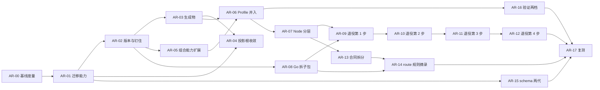

# 架构迭代执行计划

本计划执行[架构迭代规格](architecture-iteration-v1.md)。规格负责需求、验收和未决项；本文只负责顺序、写入范围、验证和回退。两者冲突时以规格为准，并修正本文。

## 1. 执行规则

1. **从干净提交起步。** 每个工作包使用独立的 worktree 和分支 `arch/ar-<编号>`（`using-git-worktrees`）。多个会话共用同一工作目录，动手前先确认分支和工作区。
2. **一个工作包一个 PR。** 跨仓的工作包每个仓一个 PR，PR 描述互相引用。PR 标题带工作包编号，描述里列出命中的 FR / AC，以及 `harness-metrics` 的前后对比（AR-00 之后）。
3. **维护 checkpoint。** 每个工作包按 `.template-source/process/templates/maintenance-checkpoint-template.yaml` 建立 checkpoint，用 `scripts/maintenance-path checkpoints/arch-ar-<编号>/checkpoint.yaml` 取得仓外路径。`intensity` 与 `triggers` 按第 3 节填写；命中 `permission-boundary`、`release-semantics`、`lifecycle-gate` 时附反例证据。
4. **验证。** 根仓依次运行：`scripts/verify-template-fast --plan` → 执行所选集合 → `scripts/ci-gate --mode pr --base <base SHA>` → `scripts/verify-maintenance-checkpoint <checkpoint>`。yss-cli 仓库维持「不放测试」的政策，只做构建；FR-011 的 fixture 回放放在根仓，用固定版本的 `yss` 执行。
5. **跨仓顺序。** 先 yss-cli，后根仓。AR-02 之前，根仓更新 yss-cli 的 gitlink；AR-02 之后，改为更新固定版本文件。
6. **检查随对象一起删除。** 工作包删掉某个检查对象（锁、投影、同步脚本、Profile 副本等）时，在同一个 PR 里删掉对应的检查和验证 profile 登记（FR-015），不留悬空检查。
7. **不加概念。** 任何工作包如需新增流程文档、术语或门禁，先停下，修订规格并取得维护者确认（NFR-006）。
8. **外部动作逐次授权。** 推送、打 tag、发布 CLI、在 GitHub 上归档旧仓库，每次都要维护者单独授权。
9. **立项收尾（已完成）。** 规格转为 `accepted` 的同一个提交里，已在[模板加固执行计划](harness-hardening-v1-plan.md)第 7 节把 WP-08 标为「移交 architecture-iteration-v1」；仓外的 repo-slimming 地图中已重开的 5 张票同时标为 superseded。

## 2. 阶段与依赖



| 阶段 | 工作包 | 出口条件 |
|---|---|---|
| S0 版本与迁移底座 | AR-00、AR-01、AR-02 | AC-001～AC-004 通过；基线已存档 |
| S1 生成物与投影 | AR-03、AR-04 | AC-005、AC-006 通过 |
| S2 Profile 并入 | AR-05、AR-06，随后 AR-16 | AC-007、AC-008、AC-015 通过 |
| S3 分层与单一实现 | AR-07～AR-12 | AC-009 通过；每一步退役后 AC-010、AC-011、AC-016 通过 |
| S4 规则与 Agent 上下文 | AR-13～AR-15 | AC-012～AC-014 通过 |
| 复测 | AR-17 | 全部阶段完成后满 30 天，AC-017 通过 |

S3 的 AR-08 可以和 S1、S2 并行。S4 的 AR-15 只依赖 AR-01，可以提前做。

## 3. 工作包总表

| 编号 | 规格引用 | 维护强度与触发 | 涉及仓库 | 允许写入（概要） | 依赖 | 未决项 |
|---|---|---|---|---|---|---|
| AR-00 | NFR-001～NFR-003 | L2：non-core-validator | 根仓 | `scripts/lib/harness-metrics.mjs` 增加管道提交占比与 daily 起步必读两项（只读）、对应测试、验证 profile 登记 | 无 | — |
| AR-01 | FR-003、FR-004、NFR-004 | L2：release-semantics、cross-repo-contract（需反例） | yss-cli | 迁移规则的版本区间匹配、删除动作的「保留」决定、「commit → 版本」对照表生成工具与产物 | AR-00 | — |
| AR-02 | FR-001、FR-002 | L2：release-semantics、cross-repo-contract（需反例） | yss-cli、根仓 | 来源锁改钉 tag，`refresh-source-lock` 并入发布流程；根仓删除 `submodules/yss-cli` gitlink，新增固定版本文件，改写 `check.cli-content-identity`，删除 N7 的手动落后工具及其登记；首个 tag 为 `v4.0.0` | AR-01 | — |
| AR-03 | FR-005 | L2：generation-semantics、release-semantics | yss-cli、根仓 | `bundles.json.gz`、`docs/cli-help.md` 改为发布时生成；`skills-lock.json` 只保留上游 revision，`skill-supply-chain.mjs` 现算本地树哈希 | AR-02 | — |
| AR-04 | FR-006 | L2：generation-semantics、cross-repo-contract、release-semantics（需反例） | yss-cli、根仓 | 删除 `.codex/skills`、`.cursor/skills`、`.pi/skills`；`projectionLink` 接受 `.claude`；根仓移出 `.codex/skills/product-design`，注册表 `platform_skills` 与锁的平台技能组清空；实例运行时模型、注册表与锁、`bundle-profile.json`、`skill-migrations.md` 登记 | AR-01、AR-03 | Q-003 |
| AR-05 | FR-007 | L2：generation-semantics、cross-repo-contract | yss-cli | `internal/bundle/skill_composition.go`、`producer.go` 的来源读取、`rules/*.json`；组合配置格式 | AR-02 | — |
| AR-06 | FR-008、NFR-002 | L2：template-structure、generation-semantics、cross-repo-contract | 根仓（旧 Profile 仓只归档） | `profiles/**`（新增，导入时排除 design Profile 里的 `product-design` 副本）、`.gitmodules`、删除同步脚本、`strategic-handoff-tools.lock.json`、`profile-variants.json`、`.strategic-design-skills-manifest.json` 与对应检查；来源锁 `sourcePath`；evidence 与 wiki 移到仓外归档 | AR-03、AR-05 | — |
| AR-07 | FR-009 | L2：core-validator | 根仓 | `scripts/lib/**` 中切断 5 条边、把 user-decision 的读写与摘要工具下沉到 core；新增导入方向检查与登记 | AR-06 | — |
| AR-08 | FR-009 | L2：core-validator、cross-repo-contract | yss-cli | `internal/governance` 按领域拆成子包，对外行为不变 | AR-02 | — |
| AR-09 | FR-010、FR-011、FR-016 | L2：core-validator、lifecycle-gate、release-semantics（需反例） | yss-cli、根仓 | 第 1 步（approval、user-decision、verification、spec-baseline）：根仓 fixture 回放、同名薄壳与冒烟检查、删除对应的 Node 实现、对应版本的删除规则 | AR-01、AR-07、AR-08 | — |
| AR-10 | 同上 | 同上 | yss-cli、根仓 | 第 2 步：checkpoint、slice、task 的校验 | AR-09 | Q-004 |
| AR-11 | 同上 | 同上 | yss-cli、根仓 | 第 3 步：handoff、context | AR-10 | Q-004 |
| AR-12 | 同上 | 同上 | yss-cli、根仓 | 第 4 步：backend、frontend 的校验部分 | AR-11 | — |
| AR-13 | FR-012 | L2：lifecycle-gate、template-structure（需反例） | 根仓 | 编排合同按层和领域拆成多个文件，`work_unit_routes` 每个工作单元一个文件；逐项写明策略的 owner 与消费者，写不出来的删除；读取合同的 Node 与 Go 代码相应调整 | AR-07 | — |
| AR-14 | FR-013、NFR-003 | L2：lifecycle-gate、cross-repo-contract（需反例） | yss-cli、根仓 | `lifecycle route --json` 返回规则摘录；`AGENTS.md` 只保留入口与硬门禁；lifecycle 技能入口相应修改 | AR-08、AR-13 | — |
| AR-15 | FR-014 | L2：release-semantics、cross-repo-contract | yss-cli、根仓 | 每个 schema 常驻两代；更早版本移入 `yss migrate` 的读取范围；实例分发相应调整 | AR-01 | — |
| AR-16 | FR-015、NFR-006 | L2：core-validator、release-semantics（需反例） | 根仓 | `template-verification-profiles.yaml` 只留 `fast` 与 `release` 两档；删除 `candidate`、`legacy-full`、`legacy_coverage`；删除资格校验层（`verification-qualification*`、`verification-report-validator`）或并入选择与报告模块；`ci-gate` 步骤相应调整 | AR-06 | — |
| AR-17 | NFR-001、NFR-002 | L1：textual-only | 根仓 | 本计划第 7 节、规格状态 | AR-12、AR-14、AR-15、AR-16 | — |

「允许写入」之外的路径只读。`lifecycle-registry.yaml` 的阶段、门禁和工作单元结构，以及批准记录、交接包、数字人会签的语义，在本轮全部只读（规格「非目标范围」）。

## 4. 工作包说明

- **AR-00 基线度量**：按附录 A 的口径扩展 `harness-metrics`，记录 NFR-001～NFR-003 的起点。每个阶段的开始和结束各跑一次，结果存入维护命名空间。
- **AR-01 迁移能力**：先于一切删除动作合入，因为后面所有清理都依赖「逐文件拒绝」和「版本区间匹配」。对照表找不到的 commit 必须明确报告，不能猜（规格风险表）。
- **AR-02 版本与钉住**：首个模板 tag 为 `v4.0.0`（Q-001 已决）。根仓删除 gitlink 后，本地联调靠 `YSS_NATIVE_BINARY`。
- **AR-03 生成物**：发布流程先按 tag 生成 bundle，再执行 `go build`；本地构建提供一条现场生成的命令。
- **AR-04 投影根收敛**：接手 hardening WP-08 已完成的研究，不重做。旧实例里的投影根副本（含 `product-design`），通过 AR-01 的删除规则清理，并且可以拒绝。`product-design` 在根仓随 AR-04 移出；design Profile 里的 56 个文件在 AR-06 导入时排除。两者之间 design 新实例仍会带它，这是已知的短暂窗口。README 或升级计划里注明用户自行安装的来源。
- **AR-05 组合能力扩展**：扩展完成后，旧形态（子模块）的来源必须仍然可以构建，AR-06 的逐文件对比依赖这一点。
- **AR-06 Profile 并入**：一次性导入，不留过渡期。合入前提是 AC-007 的逐文件摘要映射一致。GitHub 上归档旧仓库属于外部动作，按第 1 节第 8 条单独授权。
- **AR-07 Node 分层**：5 条边见规格证据 5。导入方向检查必须亚秒级、只读（NFR-005）。
- **AR-08 Go 拆子包**：只重组包结构，对外命令与输出保持不变。
- **AR-09～AR-12 退役四步**：每一步的顺序固定：先补 fixture 回放 → 再换薄壳 → 再删 Node 实现 → 最后随模板版本发布删除规则。每一步结束时检索技能，确认技能里已经不再引用被退役的实现。
- **AR-13～AR-15 规则与 Agent 上下文**：AR-13 的策略清单写入执行记录；被删除的策略逐条列出。
- **AR-16 验证两档**：S2 完成后进行，此时大部分检查对象已经消失。
- **AR-17 复测**：全部阶段完成后满 30 天，按附录 A 统计并写入第 7 节；没达标时记录差距和原因，不能调高目标后宣称完成。

## 5. 交给 agent 执行时的指令

每个工作包都可以单独派发。派发指令模板：

```text
读取 .template-source/contracts/architecture-iteration-v1.md 与 architecture-iteration-v1-plan.md。
执行工作包 AR-<编号>：只修改计划第 3 节该行「允许写入」列出的路径；其他路径只读。
开工前确认依赖的工作包已合入、相关未决项已有答复；没有答复时停下来提问，不自行假设。
按计划第 1 节建立 worktree、分支和维护 checkpoint，按第 4 节的说明执行，按第 1 节第 4 条验证。
结束时报告：命中的 AC 及证据路径、harness-metrics 前后对比、删除的检查、未完成项。
```

## 6. 决策与例外记录

以下决定由维护者于 2026-10-11 在仓外的 wayfinder 决策地图（`.work/architecture-iteration/`）中逐票确认。

| 日期 | 项 | 决定 | 决定人 |
|---|---|---|---|
| 2026-10-11 | 沿用的约束 | hardening 的 NFR-006（实例兼容）与 FR-016（技能退役冻结）、research 在会话内完成，这几条沿用；「不增加流程概念」沿用，但删除或合并概念不受限；注册表、批准记录、交接包语义不变，旧 schema 版本可以只在迁移命令里读取 | 维护者 |
| 2026-10-11 | Profile 形态 | 并入根仓 `profiles/*`，只放覆盖层，共有部分放 `_specialist/`；这三个 Profile 仓没有外部使用者 | 维护者 |
| 2026-10-11 | 唯一权威 | 每个领域只保留一份实现（按领域划分） | 维护者 |
| 2026-10-11 | 版本与钉住 | 模板与 CLI 两条语义化版本线；CLI 钉模板 tag；根仓去掉 yss-cli 子模块，改为固定版本号和 SHA-256；迁移规则按版本区间匹配；N3 并入发布流程，N7 删除 | 维护者 |
| 2026-10-11 | 内核分层 | 四层；Node 切 5 条边并加导入方向检查；Go 拆子包；不触发 WP-11 的物理拆分 | 维护者 |
| 2026-10-11 | 并入方式 | 快照导入；旧仓库归档为只读；先改 yss-cli、再改根仓，共两个 PR；同步机制一次删除；evidence 与 wiki 移到仓外归档 | 维护者 |
| 2026-10-11 | 「部分」档领域 | 校验归 Go，工作流归 Node；按四步退役；每个领域留 fixture 回放，每个薄壳留冒烟检查 | 维护者 |
| 2026-10-11 | 生成物 | bundle 与 CLI 帮助改为发布时生成；`skills-lock.json` 只保留上游 revision；删除三个投影根，只保留 `.claude/skills` 的链接 | 维护者 |
| 2026-10-11 | 规则与 Agent 上下文 | 合同按层拆分；写不出 owner 的策略删除；Agent 经 `yss lifecycle route --json` 取规则摘录；schema 常驻两代 | 维护者 |
| 2026-10-11 | 实例迁移 | 沿用 `yss upgrade`，不强制升级；删除可以逐文件拒绝；旧副本按版本分批清理；对照表只生成一次 | 维护者 |
| 2026-10-11 | 验证收缩 | 只留 `fast` 与 `release` 两档；`candidate`、`legacy-full`、`legacy_coverage`、资格校验层退役 | 维护者 |
| 2026-10-11 | Q-001 首个 tag | `v4.0.0` | 维护者 |
| 2026-10-11 | Q-002 `product-design` | 它是 OpenAI 的第三方 Codex 插件，从模板、Profile、新实例分发中移出，由用户自行安装；`platform_skills` 机制保留 | 维护者 |
| 2026-10-11 | 规格转为 accepted | 维护者确认措辞，同日完成 WP-08 移交标注与旧图 5 张票的 superseded 标注 | 维护者 |
| 2026-10-11 | 合流方式 | 另立本合同，不并入 hardening；hardening 的 WP-08 移交本合同，WP-11 照常签署 | 维护者 |
| 2026-10-11 | 重开的旧决定 | repo-slimming 地图中的「Profile 子模块形态」「Node 与 Go 单源方向」「共享脚本库单源化」「投影根收敛（WP-08）」「是否结束 `legacy-full`」五张票重开，由上面各项决定取代 | 维护者 |

## 7. 执行状态

| 工作包 | 状态 | 分支 | 说明 |
|---|---|---|---|
| AR-00～AR-17 | 未开始 | — | 规格与计划已 `accepted`，等待派发 AR-00 |

## 附录 A：度量口径

- **管道提交（NFR-001）**：根仓的非合并提交里，只改下列路径的提交算作管道提交：`skills-lock.json`、`submodules/*`、`*.lock.json`、`*manifest.json`、`.codex/skills/**`、`.cursor/skills/**`、`.pi/skills/**`、`.claude/skills/**`、`profile-skill-sync.json`、`pnpm-lock.yaml`、来源锁。之后这些路径即使已被删除，口径也保持不变，以便前后可比。起点：2026-08-27 至 2026-10-11 共 398 个非合并提交，其中 149 个是管道提交（37%）。
- **修一次内核涉及的仓库数（NFR-002）**：一次修复从提交到新实例可用，需要提交的仓库个数，即 PR 所在仓库个数。起点是 5 个：根仓、三个 Profile、yss-cli。
- **daily 起步必读（NFR-003）**：
  - 起点约 56 KB，由这些文件构成：`AGENTS.md`、`CONTEXT.md`、`.agents/skills/yss-product-lifecycle/SKILL.md`、`.agents/skills/yss-product-lifecycle/references/daily-delivery.md`、`.agents/skills/yss-product-lifecycle/references/user-decisions.md`，加上编排合同的 `request_triage` 段。
  - S4 之后的口径：`AGENTS.md`、`CONTEXT.md`、`yss lifecycle route --json` 的输出。
