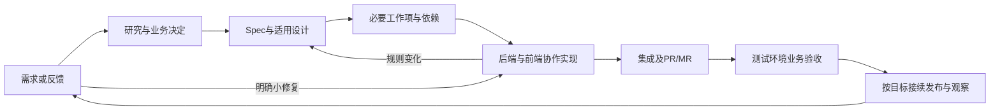

# YSS 全生命周期研发与衔接管理迭代规格

创建日期：2026-11-17（Asia/Shanghai）

需求 key：`2026-11-17-full-lifecycle`

适用范围：YSS 模板、Skills、三 Profile 分发与工程接入；兼容多人团队和多 Agent。

内容状态：已依据本轮澄清综合的迭代规格稿，尚未获得针对本文完整版本的确认；保存不启动实现，也不新增逐阶段审批。

实施状态：未实施；本文验收场景均为下一版要求，不是已通过的结果。

版本基线：2026-11-17 重新获取的 `origin/main`，固定提交为 `f85c038f135a6dbe107baca0fab591f2674327db`（[准备 Template 5.10.0](https://github.com/iloveZzz/yss-spec-project-template/commit/f85c038f135a6dbe107baca0fab591f2674327db)）。本文在该主线基础上规划后续迭代，不预设本迭代发行号；提交标题和 README 中的 CLI 3.10.0 配套声明不代表发行、安装或真实试点已经完成。

主要输入：上述固定主线、[深度调研报告](2026-11-17-full-lifecycle-research.md)、用户 Q1—Q5 答复及本轮审查结论。报告保留其原调查时点；其中描述的旧工作树现状不覆盖本 Spec 更新后的主线基线。当前编辑工作树仍位于 `e60d603e` 且有既有未提交内容，本文通过固定主线读取核实事实，未将这些本地内容视作已合入或覆盖到主线。

## 1. 本版要解决的问题

YSS 已有研究、Spec、前后端工程、Issue 协作、PR/MR 跟进与部署恢复方法，但它们存在于不同入口和材料中。复杂需求由 Spec 转入工程、分给不同人或 Agent、跨会话续办时，仍需要执行者自行拼接责任、来源、依赖和完成含义。最新主线已合入共享 Issue 方法、工程拆票参考及 Frontend 默认的共享研发入口；源码与分发声明存在尚未证明本轮增量在实际工程中正确使用。

本版将这些能力贯通：执行者从任一适用入口进入，都能找到同一需求来源、必要工作项、实际工程与契约、当前结果和下一责任人；用户能区分实现、联调、合并、部署及业务验收的实际进度。复杂研发请求主动组织必要工作，小修复继续直接完成。

本版必须以一条真实需求走通 **Spec → Backend / Frontend → PR/MR → 测试环境业务验收**。生产发布、恢复和运行反馈要有可接续的约定；不要求本版实际部署生产或等待长期业务效果。

## 2. 已确认决定与范围

以下决定来自当前对话，不能扩展成对具体业务仓、远程平台或生产环境的操作授权。

| 编号 | 已确认决定 | 对本版的约束 | 来源 |
|---|---|---|---|
| D-01 | 同时兼容多人团队与多 Agent | 用同一套目标、来源、责任、依赖和结果信息交接；不按执行者类型复制两套流程 | 前轮协作方式答复 |
| D-02 | 贯通现有 Skills、模板和 CLI 接入能力 | 不新建流程管理 UI、后台调度平台；真实验证暴露必需的 CLI 缺口时才评估最小补齐 | Q1 |
| D-03 | 复杂研发任务主动组织必要工作项 | 对明确的跨仓、跨会话完整研发请求，不等待用户再说一次“拆票”；已有目标及相应操作授权时维护 Issues | Q2 |
| D-04 | 一条真实跨仓需求到测试环境业务验收 | 模板安装、教学 Demo 和模拟流程不能代替真实业务结果；生产实际发布和长期观察不属于本版必做动作 | Q3 |
| D-05 | GitHub、GitLab、Local Markdown 三种方式 | 使用共用方法；GitLab 做真实试点，另两种做针对性兼容验证；不要求购买高级套餐 | Q4 |
| D-06 | 优先 SCRM 未完成的小范围跨端需求 | 实施时核对待办、代码、MR、验收证据再选；没有合适需求时，由用户另选真实项目 | Q5 |

持续沿用根 [AGENTS.md](../../AGENTS.md) 的范围约束：保留 Spec、Backend、Frontend；不增加统一开工/交付门禁、批准包或强制检查体系；模板仓不维护脚本和测试套件；Spec 交付业务规格与适用设计，生产 API、数据库及实现切片由研发承担。

### 2.1 本版包含

- 统一复杂研发请求的主动组织、已有工作复用与三入口接续行为。
- 明确来源、责任、依赖、跨仓集成、完成含义、变更与续办规则。
- 让现有发布、恢复和反馈方法从主流程可发现、可接续。
- 核实候选内容经过 Bundle、安装和实际宿主调用后有效；保留旧工程配置与用户改动。
- 覆盖三种工作项方式，完成 GitLab 真实试点及必要兼容验证。

### 2.2 本版不包含

- 新工作流引擎、中央状态库、常驻 Agent 调度、自动抢单、Webhook 对账平台或看板 UI。
- 第四个 Profile；为入口名称对称而向 Frontend 安装整套 Backend 拆票能力。
- 所有任务强制建 Issue、业务父票或固定数量子票；按技术层机械分票。
- 全面迁移 Matt、pstack、Spec Kit 或 OpenSpec 的目录、CLI、默认提交/TDD与流程门槛。
- 全量改造 SCRM、重做已实现需求、生产部署与长期业务效果实测。
- 固定生产 API、存储结构、CLI 新命令、持久化 schema 或调度算法。技术方案由后续研发核实。

## 3. 对研究报告的取舍及真实增量

报告第 3 节已修正早期基线：Backend、Frontend 并非没有 tracker，部署恢复也并非空白。本版进一步以固定主线 `f85c038f` 为起点：共享 Issue 接续和前端通用研发入口已经合入，不能重新列为从零建设。以下主线事实按该提交核对；相对路径只供当前工作树导航，旧工作树或未提交内容不代表主线版本。

| 报告建议 | 当前证据与判断 | 本版处理 |
|---|---|---|
| 同一来源与工作项协作 | [共享 Issue 方法](../../.template-spec/agents/issue-tracker-operations.md)的定位、写入、依赖、并发、恢复和父项验收规则已合入主线 | 复用并验证；核对直接复杂研发请求的主动组织及 tracker 接续 |
| 主动拆分复杂研发 | [主线通用 implement](https://github.com/iloveZzz/yss-spec-project-template/blob/f85c038f135a6dbe107baca0fab591f2674327db/.agents/skills/implement/SKILL.md)已在需要拆分工程范围时读取工程票参考；[共享 to-tickets](https://github.com/iloveZzz/yss-spec-project-template/blob/f85c038f135a6dbe107baca0fab591f2674327db/.agents/skills/to-tickets/SKILL.md)按请求区分业务与工程拆票，研发可直接读取其叶子方法；Backend 保留专业覆盖，Frontend 应用技能承担前端专业实现 | 复用现有触发与方法，补齐实际使用中有证据的缺口；不再将通用工程拆分入口描述为缺失或仅支持接票 |
| 前后端契约与共享资源 | [跨仓方法](../../.agents/skills/implement/references/repository-scope.md)已明确契约归属、共享写入与运行资源 | 保留并纳入真实交接场景；不另建接口权威源 |
| 发布恢复与反馈 | 主线已有[后端部署方法](../../profiles/backend/.agents/skills/implement/references/build-deploy-guide.md)、[团队指南](../../docs/process/yss-product-lifecycle-team-guide.md)与[能力地图](../../.template-spec/agents/profile-skills.md)，仍需明确主链的发布运行和反馈责任；本地 [Demo](../../.template-spec/user-guide/客户跟进项目全生命周期Demo.md)未进入该主线，仅为待整合教学参考 | 补接续关系与责任；不默认新增发布技能，也不把未跟踪 Demo 当作主线已分发能力 |
| 分发和工程采用 | 三 Profile 已有分发声明；[Frontend 主线清单](https://github.com/iloveZzz/yss-spec-project-template/blob/f85c038f135a6dbe107baca0fab591f2674327db/profiles/frontend/.template-source/distribution/bundle-profile.json)在 project / skills 两模式默认提供共享 implement、to-tickets 及必要参考；本次未取得能证明本轮增量实际采用的证据 | 以上述主线配置为基线验证增量，真实试点绑定本轮候选；不以源码和清单代替采用结果 |
| 真实生命周期闭环 | 研究未执行业务工程，本地 Demo 是教学材料；本次读取的主线变更也未提供本轮 SCRM 试点证据 | GitLab + SCRM 真实试点；保留来源与实际结果，不将旧试点或教学材料代替本版验证 |

主线已有可复用的历史验证记录：[PR/MR 真实任务记录](https://github.com/iloveZzz/yss-spec-project-template/blob/f85c038f135a6dbe107baca0fab591f2674327db/.template-source/design/2026-11-17-pr-mr-real-task-validation-plan.md)记载后端 MR 与实际工程检查，但明确工程未升级、未观察跨仓和恢复，也未合并部署；[Home 验证报告](https://github.com/iloveZzz/yss-spec-project-template/blob/f85c038f135a6dbe107baca0fab591f2674327db/.template-source/design/2026-11-15-spec-home-repo-validation.md)记载旧候选的合成三仓、HTTP/浏览器与续办结果，其 Frontend 安装集合仍为 13 项。它们可支持已覆盖方法的复用，不能直接证明当前默认 15 项的 Frontend、本轮候选采用或 SCRM 真实业务验收。本次只核对主线记录，未重新执行其历史验证。

对外部方法的采纳限于报告中已核对的机制：吸收 Matt 的按行为拆分与真实依赖、pstack 的责任延续和现场恢复、Spec Kit 的意图与实现分离、OpenSpec 的增量回流。完整框架迁移、自建调度与精确效率收益均暂缓。本版验证可用性与衔接正确性，不承诺未经测量的收益比例。

## 4. 使用者、责任与信息来源

Profile 表示能力组合，不是固定人员或顺序阶段。一人或一个 Agent 可以承担多项执行工作；业务决定仍由实际有权决定的人作出。每个跨仓目标要明确本次集成负责人，允许承担多个职责，不要求新增岗位。

| 责任 | 应对什么结果负责 | 交给下一方的内容 |
|---|---|---|
| 业务决定 | 目标、范围、规则取舍和验收含义 | 已有决定、未决选择及其影响 |
| 规格与设计维护 | 原规则、AC、适用原型与交互说明一致 | 可读取来源、采用版本/读取时点、模拟边界 |
| 工程契约 | 生产接口、兼容性与消费者影响 | 实际契约来源、可消费版本与已知限制 |
| 仓内实现 | 本仓实现、实际验证和剩余事项 | 代码/PR/MR、检查对象、事实结果 |
| 跨仓集成 | 依赖满足、版本组合及整体 AC | 哪些结果已成立、哪些仍缺、下一责任人 |
| 发布与运行反馈 | 环境状态、恢复依据、观察与反馈归属 | 实际部署组合、异常入口、后续观察约定 |

接收方可为人员或 Agent；不能仅填写“Backend/Frontend”就认定责任已有人承担。责任尚无人承接时明确指出影响，但可继续独立工作。

| 信息 | 权威来源 | 引用规则 |
|---|---|---|
| 业务意图与 AC | 原 Spec，或本来承担需求来源的 Issue 正文 | 沿原编号/章节和可获得版本；已有直接缺陷无需补造 Spec |
| 体验与状态 | 选定原型、设计与交互说明 | 标明入口、采用内容和模拟边界 |
| 生产契约 | 实际后端或契约仓的既有来源 | 前端生成物/快照注明消费来源，不自成第二套权威 |
| 当前执行状态 | 一个选定的 Issue 或明确选定的 Local 工作项 | 不在 Spec、仓库地图、聊天摘要中另维护同一份当前状态 |
| 实现与验证 | 实际源码、PR/MR、检查记录 | 指向被检查的版本和范围，不仅写“通过” |
| 环境结果 | 既有部署、发布或运维记录 | 区分环境、制品、配置/迁移和业务验证 |

“最新约定”与“环境当前行为”可以不同。规则已确认不代表已经上线，运行偏差也不自动修改规则。

## 5. 主流程与交接规则

这是交接关系图，不是必经审批或强制串行图。审查和验证可以在实现中持续进行；本版真实试点到测试环境验收，生产环节按 FR-09 形成接续约定。

### FR-01 按请求范围进入，并主动组织必要工作

收到明确的复杂研发请求时，Agent 应先读取已有需求、工程和工作项，识别是否存在独立责任、跨仓依赖或跨会话接续需要，再复用或组织足够承接目标的工作项。多仓参与不等于必须每仓一票，多会话也不等于必须建立父子层级。

组织行为包括说明本次结果、作用仓库/路径、责任、来源、真实依赖和交付终点；信息可放在已有条目中，简单情况一段即可。已有工作项能够承载时优先更新，不能因换 Agent、分支或会话重复拆分。

Spec 分析、确认或准备交接本身不触发工程执行或业务拆票。业务票仅在明确要求拆票时组织；明确完整研发请求所需的工程工作项由研发承担，不等待用户重复提出拆票。小修复、局部样式调整、纯查询继续按原目标直接完成。

### FR-02 工作项定位与写入沿用实际目标和授权

Issue 是工作项的远程载体，Local Markdown 是已选择时可用的本地载体。按当前明确目标及目标工程配置定位，不能凭角色、默认登录实例、同名项目或裸编号猜测写入目标。跨仓工程票允许沿用项目既有集中管理方式，但必须关联实际实施仓库。

已有目标和对应操作授权时，Agent 应直接完成必要创建、更新与关系维护，不逐条再次确认。只获研究、开发或本地保存授权时，不据此推出所有远程写入、关闭、提交、合并、部署均已授权。缺少某项授权或访问能力只影响相应动作；继续有依据的独立工作，并准确说明未写入的结果。

不能因远程不可用就自动改投本地或另一平台。确需保存未发布草稿时，沿已有保存授权和约定位置处理，不建立第二份当前执行状态。

### FR-03 业务来源保持一致，交接可实际读取

Spec 交接包含目标、范围/非目标、规则/权限/状态、AC、适用设计及交互、模拟边界、未决项和采用版本或读取时点。源文件保持权威，工作项只引用本次需要的内容；Issue 本身为原需求时沿其正文继续。

接收方实际读取所需材料；不可访问、动态链接无法固定版本、内容不完整时明确影响。工程演示或原型数据不能升级为生产契约。共享新规则须沿原来源回写，不能只在评论中形成与正文冲突的第二套规则。

### FR-04 前后端按真实契约和依赖协作

研发根据实际工程决定 API、数据持久化、兼容性和实现拆分。契约负责人和消费者共同核对本次涉及的行为、权限、错误与异常恢复；仅讨论本次相关内容，不要求固定设计包。

在规格和设计足够明确时，前端布局、交互状态及标明模拟范围的工作可先行；真实接口接入依赖可消费契约，真实联调依赖实际服务。阻塞只作用于依赖该结果的范围，不冻结全部前端或后端工作。

来源、父子范围、阻塞、契约消费、实现、验证/部署关系分别表达实际含义。原生关系确实可用时复用；确认不支持时以真实链接和明确解除条件表达。链接、assignee、票据关闭均不构成互斥锁或依赖已满足的证明。

### FR-05 多人和多 Agent 能继续同一项工作

跨仓目标明确本次集成负责人。并行执行者获得足以独立开始的目标、验收、权限、拥有路径、输入来源/版本、共享资源和预期结果；指针不可读时补足必要内容或改为顺序处理。不得用复制整段聊天代替可读取来源。

并行前核对已有执行者、未提交工作、共享接口、根锁文件、生成产物、端口、测试数据库及外部服务。共享写入由明确整合者处理；不同文件或 worktree 不能单独证明可并行。任何一方不得覆盖、回滚他人无关工作，也不能把重复引用同一结果当作多次独立验证。

### FR-06 需求与契约变化按影响处理

当业务角色、权限、状态或结果改变时，沿原 FR/AC 和设计更新，标明影响的任务与消费者；真正业务取舍交给有权决定的人。技术细化但业务意图不变时，在现有研发授权内继续，不要求重新做业务审批。

契约变化须识别受影响版本和消费者，核对相关实现及验证；不以“此前冻结”为由忽略新事实。文字等义修订或无关工程变化不触发全量返工。保留仍适用的结果，已失效证据不能继续证明新版本行为。实现偏离规则时先处理偏差或提出业务选择，不通过改写 Spec 为代码补理由。

### FR-07 续办先重建事实，未知动作先查结果

恢复时读取原工作项、当前来源、工作树/分支、已有 PR/MR、运行中操作、最近检查与部署状态，识别已完成范围和仍在工作的执行者。无需原聊天全文也能解释下一步；不重复实现已完成需求，不因时间久就自动接管。

创建、更新或关系维护超时后，按目标、实际身份或创建前保留的稳定标识核实结果；未知保持未知，不盲目重发。更新前复读、保留人工修改、写后回读；发现冲突只暂停受影响覆盖。平台没有提供原子条件写入时，不宣称不存在竞争窗口。

会话结束不代表远程 CI/部署停止，也不代表有后台 Agent 持续跟进。后续必须基于真实现场继续。

### FR-08 完成以本次承诺和实际证据判断

每个工作项明确本次终点。局部实现、PR/MR 可审、已合并、某环境部署、业务验收、运行效果是不同事实，可以分别成立；它们不是新增强制状态字段或一条全项目统一状态机。

沿本项规则/AC 说明已验证、失败、未验证和待决定的结果，并关联实际范围和版本。构建、模拟运行、两端各自检查通过不能替代真实联调；要求设计还原时沿用适用的工程、同条件视觉及关键交互验证。

业务父票如存在，由集成负责人按其承诺结果汇总。全部子票关闭或全部 MR 合并不自动证明业务完成；自动关闭仅适用于触发行为已满足该票完成条件的情况。若平台提前关闭，在授权内纠正并保留缺口。任务仅要求本地完成时，不额外要求提交、部署或生产观察。

### FR-09 发布、部分失败与运行反馈可接续

涉及环境交付时，沿既有记录说明实际组合：业务与契约依据、各仓源码及制品、相关配置/迁移、目标环境、实际结果和下一责任人。不强制新增发布文档或批准包。

顺序和恢复动作基于实际兼容性；部分成功按组件/环境分别报告，不自动推断整组成功或全部回退。应用回退与数据恢复分别处理，无法证明安全恢复时明确限制。沿现有部署方法决定具体操作，本 Spec 不承诺跨仓原子发布或一键数据恢复。

生产接续应使接收者知道谁负责、观察什么、在何时或何种事件后观察、异常回到哪里。观察时间窗及业务目标沿实际需求决定，不填通用虚构指标。区分实现缺陷、业务规则变化、产品假设问题、契约兼容和运行故障，回到相应原工作项或既有入口。

本版试点必须形成生产后续约定及未执行范围；不要求实际生产部署、生产恢复演练或长期效果实测。测试环境验收通过只能报告该环境已通过。

### FR-10 三种工作项方式保持相同语义

GitHub、GitLab 和 Local Markdown 使用相同的范围、来源、责任、依赖和完成规则。实例版本、套餐、权限和工具能力应实查，不能从公开文档或 CLI 已安装推断目标能力。

平台原生关系不可用时保留真实目标链接与方向说明；鉴权失败或读取超时不能当作“不支持”。不能为了对齐看板名称改变完成含义，也不要求用户购买高级套餐或迁移平台。GitLab 做真实业务试点；GitHub 和 Local 的兼容结果不得被扩大成两套远程平台均完成真实业务验证。

### FR-11 候选通过分发到达实际执行环境

沿当前共享源、Backend 专有源和 Frontend 白名单维护入口与引用。先准备确实包含本轮候选的 CLI/Bundle，再核实 Spec、Backend、Frontend 的 project 与 skills 两种模式，共六种组合；不能用旧发行包的安装成功证明新候选有效。

区分模板源码、Bundle 内容、工程已安装资源、宿主实际发现/读取和真实业务结果。共享方法及必要叶子引用须在对应安装方式中可读；平台副本、清单和来源声明保持一致。沿主线保留 Frontend 默认的共享 implement、to-tickets，并由 yss-frontend-application 承担前端专业工作；共享入口不等于 Backend 专有覆盖，单独消费叶子资源也不要求安装整套 Backend 能力。

存量升级保留原平台/实例/目标、自定义内容、未受管同名文件和业务工作。出现冲突按实际 CLI 能力处理，不静默覆盖或改投默认平台，不声称旧二进制获得尚未发布的命令。CLI 是否需要修改由实际缺口决定，本版不预设新增 Issue 命令或强制升级。

### FR-12 用真实试点证明贯通，观察后再决定自动化

优先从 SCRM 现有待办中选择尚未完成、范围小、业务规则与前后端均相关的需求。先查代码、分支/MR和验收记录，未合并不等于未实现。无需为展示完整性人为增加仓库、业务父票或产品功能。

试点复用实际 Spec/设计与仓库关系，由明确责任人协作，使用 GitLab 工作项及真实 PR/MR，部署到已约定测试环境并按业务 AC 验收。操作范围和授权在实际执行时核对；本轮选择原则不代替具体业务实施授权。

真实试点开始前，确认参与 Spec、Backend、Frontend 工作的实际宿主采用 FR-11 已验证的同一本轮候选，按各 Profile 使用相应内容。在既有试点记录中关联候选的源码/内容版本、CLI/Bundle 来源、实际安装位置及入口和必要参考的加载依据，再将业务实现与验收结果关联到该候选。仅核对安装命令成功、CLI 版本号或临时目录内容不足以证明试点采用；宿主仍读取旧版、全局副本或缓存时，应纠正实际来源并验证受影响工作，不能以旧技能下的业务成功完成本轮候选验收。

试点反馈导致候选变化时，记录新旧候选及受影响范围，补验相关安装、宿主行为和业务场景；未受影响且来源可追溯的证据可复用。正式采用的候选须与这些结果对应，不要求无差别重跑整个试点或新增证明包。

试点须观察多执行者交接及独立上下文续办，可以由人员与 Agent 的实际组合完成；不要求组织虚构的人类团队演练。保留遇到的来源缺失、重复维护、依赖等待、提前关闭及恢复问题。先记录实际基线，后续再决定是否值得增加自动化；不以票数、提交数或 Agent 数作为收益证明。

## 6. 关键场景与可观察验收

以下 AC 是本版候选的验证要求，不是所有日常任务的固定检查清单。复用有效证据，按实际变化选择必要检查；本仓不新增常驻脚本或测试套件。表中“验证方式”约束结论能说到哪里，不能用文档核对替代真实运行。

| 编号 | 初始条件与动作 | 必须观察到的结果 | 关联规则 / 验证方式 |
|---|---|---|---|
| AC-01 | 从任一适用入口提出无现成票的明确复杂跨仓研发请求 | 先复用已有工作；形成最少必要范围、责任、依赖和终点；有效目标与写入授权齐备时直接维护工作项 | FR-01/02；实际宿主调用，真实试点覆盖 |
| AC-02 | 提出小修复、普通查询或仅确认 Spec | 分别完成原请求；不强制 tracker、业务父票或自动开始工程实现 | FR-01；有针对性的宿主对照场景 |
| AC-03 | 已有 Issue 或 Spec 已足以承载目标，换人/Agent 接手 | 复用同一来源和当前执行记录，不因换会话重建同名票或第二份规格 | FR-01/03/07；续办观察 |
| AC-04 | 目标实例/项目或外部动作授权不足 | 明确受影响操作并继续独立工作；不猜目标、不擅自改投平台、不声称写入成功 | FR-02/10；可控情境核对 |
| AC-05 | Spec 交给后端和前端，原型包含模拟数据 | 接收方实际找到规则/AC/设计与版本；模拟范围可见，生产契约由研发决定 | FR-03/04；真实试点 |
| AC-06 | 前端设计明确，接口或服务尚未就绪 | 可独立布局/状态继续，只有依赖契约或服务的部分等待；结果标明模拟或待联调 | FR-04；真实发生时记录，否则有界演练 |
| AC-07 | 两名执行者承担有依赖的工作，并涉及共享产物/资源 | 责任、路径及共享资源整合者明确；按实际依赖推进，不覆盖他人工作 | FR-04/05；实际协作与记录核对 |
| AC-08 | 实现中发生业务或契约实质变化 | 沿原来源更新受影响规则/AC与消费者；保留无关有效成果，不反改业务意图解释偏差 | FR-06；有界变更演练或真实事件 |
| AC-09 | 从单独打开的前端工程/新上下文恢复 | 不依赖原聊天全文即可找出来源、契约、已完成实现、当前依赖、未知动作和下一步 | FR-05/07；实际宿主续办 |
| AC-10 | 创建超时或关系只部分写入，另有人修改正文 | 先核实实际结果，未知不重发；保留人工内容并分别报告已成功、失败及未知范围 | FR-07；受控异常演练，不制造生产故障 |
| AC-11 | 两端各自检查通过或子票全关闭，但整体 AC 尚缺 | 仍报告整体未完成/未验证；不凭合并或关闭完成业务父项 | FR-08；真实记录核对或反例演练 |
| AC-12 | 后端已部署而前端失败，或应用可退但数据恢复未知 | 保留各组件环境事实，依据兼容性处理；不宣称整组成功、整组自动回退或数据已恢复 | FR-09；受控演练或既有真实证据 |
| AC-13 | 同一协作意图分别使用 GitHub、GitLab、Local | 来源、依赖与完成含义一致；无原生关系时有真实引用，不把访问失败当能力缺失 | FR-10；三方式针对性兼容核验 |
| AC-14 | 使用包含候选的 Bundle 接入三 Profile × 两模式 | 六种组合的实际入口与依赖可读，安装选择符合声明；能追溯实际被测来源 | FR-11；真实安装核验 |
| AC-15 | 已有自定义 tracker、旧项目配置、未受管同名文件 | 升级后原目标与用户内容保留；冲突明确，不静默覆盖或换平台 | FR-11；可控目录中的存量接入核验 |
| AC-16 | 在实际支持的宿主加载安装后的能力 | 能沿实际入口读取共享方法和相关叶子引用；未运行宿主仅报告静态一致性，不扩大兼容结论 | FR-11；实际宿主调用 |
| AC-17 | 选择 SCRM 试点 | 选择依据包含待办、代码/MR和验收现状，确为尚需完成的小范围真实跨端需求；没有合适需求则提出替代选择 | FR-12；只读盘点与实际选择记录 |
| AC-18 | 真实试点完成测试环境交付 | 参与试点的实际宿主采用 FR-11 已验证的本轮候选，候选来源、安装位置与实际入口加载依据可核对；同一业务规则可追溯到实际 Backend/Frontend、PR/MR、制品与环境组合，业务结果关联到该候选；适用 AC 实测完成，无未解决的范围内验收缺口。若试点仍使用旧技能或来源未知，不得报告本轮候选真实闭环通过 | FR-03/04/08/11/12；实际宿主来源核对及真实测试环境业务验收 |
| AC-19 | 测试环境验收通过、生产尚未发布 | 明确仅测试环境完成；后续发布/恢复责任、依据、观察对象与时机、反馈入口可接续，实际未执行事项保留 | FR-09/12；交接内容核对，不冒充生产验证 |
| AC-20 | 汇总本版结果与试点反馈 | 分开报告源码/Bundle/安装/宿主/业务证据及未覆盖项；记录实际协作问题，不编造收益或生产完成 | FR-11/12；结果核对 |

AC-18 是用户选定的本版真实验收终点。若真实环境或权限导致它无法完成，可以交付已完成的候选和其他结果，但必须明确本版真实闭环尚未验收，不能用 Demo 或模拟替代。AC-10、AC-12 等异常可受控演练，不要求在真实业务环境制造破坏。

## 7. 下一版实施顺序与衔接

这是版本规划，未生成业务票或工程切片。后续研发在真实候选上决定文件改动、技术方案和必要工作项。

| 顺序 | 本次要形成的结果 | 主要范围与责任 | 与前后工作的关系 |
|---|---|---|---|
| 1. 核对主线并收敛增量 | 从本文固定主线复用已有方法，核对复杂请求主动组织与小任务边界 | 共享方法整合；各 Profile 维护者核对自身入口 | 实施前核实 main 后续变化及本地候选差异，不用旧工作树覆盖已合入能力，保护并行工作 |
| 2. 贯通责任与信息 | Spec、接口、实现、集成、发布反馈的引用和下一责任人明确 | 现有团队指南、能力地图、交接方法 | 与独立入口调整可并行；共享正文由一位整合者负责 |
| 3. 准备候选并验证采用 | 确实包含本轮候选的 Bundle，六种安装组合、存量配置及实际宿主结果 | 模板分发整合；仅确有缺口时由 CLI 维护者补齐 | 候选打包先于安装验证，正式发行不作为试点前提 |
| 4. GitLab 真实试点 | 实际宿主使用步骤 3 已验证候选，SCRM 未完成需求到测试环境业务验收，并完成独立上下文续办 | 业务/规格、契约、仓内实现及本次集成人 | 先核实业务目标、仓库、环境、动作授权及实际加载来源；将业务结果绑定候选，反馈修订按影响补验 |
| 5. 汇总与正式采用 | 版本覆盖、真实结果、限制与使用方式可核对；生产后续约定可接续 | 分发整合与试点负责人 | 正式打包、发行、逐工程升级使用对应动作授权；最终候选变化须核对证据适用范围并完成必要补验后再报告采用结果 |
| 6. 决定后续优化 | 根据实际重复劳动和恢复问题决定是否需要自动化 | 当前维护者与业务责任人 | 不作为本版必须新建平台的任务 |

本版不设无依据的工期、人数、Issue 数量或改善百分比。正式版本号、具体实现切片和发行时间由后续研发/发布规划确定。

## 8. 尚待调查及试点落地时的选择

下列事项不阻塞本通用迭代 Spec 的保存；它们分别约束后续实际操作或验收。已明确延后到试点选择的事项，不应重新要求用户回答同一原则问题。

| 编号 | 尚缺内容 | 谁处理、何时处理 | 影响与处理方式 |
|---|---|---|---|
| OQ-01 | 具体 SCRM 需求、真实工程/分支及测试环境 | 试点执行者先查待办、代码/MR与现有配置；候选存在业务取舍时交给用户选择 | 试点实施前明确；排除已完成工作。无合适需求时由用户另选项目 |
| OQ-02 | 目标 GitLab 实例能力/权限，GitHub 兼容验证目标和可用动作 | 执行者在实际接入时调查 | 影响原生关系与远程动作；缺能力如实限定，不扩大授权或默认购买套餐 |
| OQ-03 | 候选 Bundle、已装版本、宿主与存量配置的实际差异，以及真实试点实际加载来源 | 分发/CLI 维护者在采用验证前调查，试点执行者在开始与相关来源变化时核对 | 决定是否需最小 CLI 补齐；未证明试点采用本轮候选时，不以业务成功宣称本版真实闭环完成 |
| OQ-04 | 试点具体责任人及生产后续观察对象、时机和反馈入口 | 复用项目现有责任/业务目标；缺失的真实选择在选定试点后澄清 | 测试环境验收交接前形成约定；不要求本版执行生产或长期观察 |

初稿编写时实查 PATH 中的 YSS CLI 为 3.8.0，帮助列有工作台登记能力；该记录不是本次主线修订后的安装版本证明。本仓应使用的既有工作台数据目录仍未可靠确定。本文按模板维护的既有位置保存，不另建工作台、猜测目录或伪造登记/答复 ID。工作台尚未登记，不影响读取和继续修订同一文件。

## 9. 研发承接说明

下一步研发从本 Spec 固定的 main 基线开始，核对实施时的后续主线变化、工作树候选和已完成成果，再细化实际变更。研究报告用于理解证据与取舍，旧工作树描述不覆盖新主线。已有技术方法是复用输入，不将研究建议逐条转成新工程任务。本文不要求额外确认包，也不替代具体提交、远程写入、发行和环境操作的授权。

可使用以下内容明确发起后续研发请求；它是交接文本，不是本轮已经执行的命令：

> 按 `.template-source/design/2026-11-17-full-lifecycle-spec.md` 实施本次 YSS 生命周期迭代。以本文固定的 main 提交为基线，先核实后续主线变化、本地候选、来源和并行工作，复用已完成能力；对齐三 Profile 的复杂任务组织与交接，补齐责任和反馈接续，验证实际分发与工程采用。以既有材料和已授权工程为边界，按 FR/AC 说明结果与缺口。试点优先调查 SCRM 尚未完成的最小真实跨端需求，在明确具体范围、目标及相应操作授权后，由实际宿主采用本轮已验证候选，推进到测试环境业务验收并关联候选来源。不得用教学 Demo、旧 Bundle 或已完成需求代替本版实证。

本文是模板能力的迭代规格，不是业务产品 Spec；不生成虚构产品页面、原型或数据库/API 设计。第 5 节与第 6 节表达方法行为和验收场景，未作为可运行原型或真实试点证据。

## 10. 本轮产物核对

初稿完成后，主线对照审查发现 AC-18 未明确绑定试点实际采用的 YSS 候选。本次仅修订本文：更新为 `f85c038f` 主线基线，补充已有共享研发入口与分发事实，在 FR-12、AC-18、实施顺序及交接文本中补齐候选来源与真实业务验收的关联。研究报告、既有技能与其他未提交内容保持原状。

本次已核对 8 个本地链接、5 个固定主线文件引用、12 条 FR 与 20 项 AC 的编号及关联，文件空白检查无告警；限定范围的独立复核确认原 P2 已闭合，相关规则、验收与实施顺序一致。流程图未变更，本次未验证其渲染。

未执行候选构建、安装、宿主业务场景、真实联调、远程 Issue 写入、提交、发行或部署；工作台未登记。上述文档核对不替代第 6 节的版本验收。
