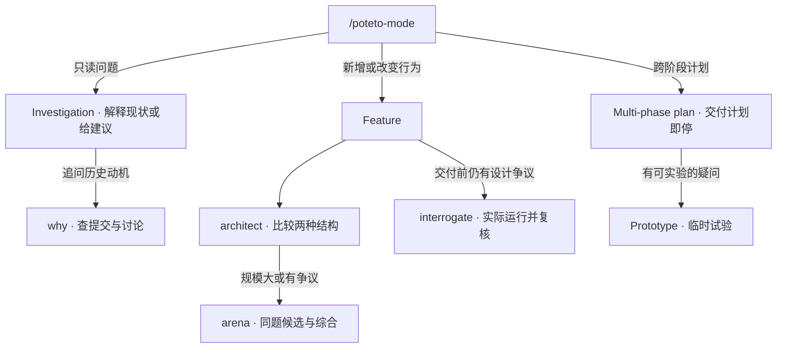

# pstack Skills 如何用于 YSS 详细设计

**研究结论 · 2026 年 11 月 18 日**

建议由 YSS 现有的 `yss-technical-design` 主持后端详细设计。只有遇到一个会改变实现的分歧，才值得引入 pstack 的相应方法。模块职责难定时，用 `/architect` 比较两种结构。团队对同一问题有可行但代价不同的解法时，用 `/arena` 对照候选。争议可以被一次运行裁决时，把它改写为一个可以失败的实验。这样得到的结果能直接写回同一份设计说明。[YSS 技术设计入口][yss-design] · [pstack 设计指南][design-guide]

**状态所有权和状态转换条件是两项设计决定。** 例如，“订单服务拥有最终状态”回答了谁可以写。支付回调和取消请求同时到达时，还需要说明哪一个可以成功、失败方看到什么结果，以及怎样发现裁决有误。本文用 pstack 自带的工具验证了一个类似问题。同一份有错的设计，验证场景取一个参与方时通过，取两个时出现五步反例。[YSS 详细设计方法][yss-detail] · [上游实验模型][fault-model]

## 1. 调用入口和当前版本

研究对象是 Lauren Tan 维护的 `cursor/plugins/pstack`。调查时 `main` 指向 `93b916d4a1e806507e22f4716b352fa91f2b227e`，其中 pstack 版本是 **0.15.43**，最近修改 pstack 的提交是 `2f87c854`。本地对照采用 YSS Template **5.12.0**，提交 `32ce303e`。此前 YSS 关于 pstack 的研究已覆盖项目验证入口、技能对照评估和 PR/MR 续办，本次聚焦工程详细设计。[插件清单][manifest] · [上游变更][revision] · [YSS 版本][yss-version] · [仓内既有研究与采纳记录][prior]

对固定版本的目录逐项计数，`skills/*/SKILL.md` 共 **58** 个，其中 **24** 个为 `principle-*` 原则条目，其余 **34** 个涵盖任务入口、调查、设计、验证、写作等工作。另有 **22** 个 `poteto-mode/playbooks/*.md` 和 **2** 个代理定义。计数按文件所在目录计算，22 个工作流程没有再算成 22 条斜杠命令。[技能目录][skill-tree] · [工作流程目录][playbook-tree] · [代理目录][agent-tree]

**在 Cursor 中实际使用**，上游给出的安装入口是聊天命令 `/add-plugin pstack`。安装后从 `/` 菜单选择目标技能。`/setup-pstack` 可配置角色所用的模型和推理预算，结果写入 `~/.cursor/rules/pstack-models.mdc`，新会话生效。缺少某个角色配置时，工作流程使用该角色的默认值。[安装与使用][install] · [模型配置与生效范围][setup-effect] · [默认角色规则][mode]

| 动作 | 谁来执行 | 实际效果 |
|---|---|---|
| 在 Cursor 的 `/` 菜单选择 `/architect` | 使用已装 pstack 的人 | 技能附到当前消息。58 个入口中有 57 个声明 `disable-model-invocation: true`，唯一未声明的是 `setup-pstack`。单写“请做详细设计”无法据此认定 Cursor 已自动加载 `architect`。[Cursor 技能规则][cursor-skills] · [architect 入口][architect] · [配置入口][setup] |
| 在 Cursor 选择 `/poteto-mode` 并描述任务 | 收到消息的主会话 | 主会话选工作流程，按触发条件读取配套技能、原则或委派任务。工作流程里的 `Prototype` 和 `Multi-phase plan` 是该模式下的选择，可以直接在需求里点名。普通选择作用于一条消息，Custom Mode 可跨轮保留。[主模式][mode] · [使用说明][usage] |
| 在 YSS 或其他宿主引用这套方法 | 当前任务的 Agent | 能读取 Markdown，就可以采用里面的提问和比较方法。要声称调用了插件、启动了独立候选或取得跨供应商裁决，仍需要对应宿主的实际能力和运行结果。Claude Code 有上游适配，用户入口带 `/pstack:` 前缀。本次 Codex 会话的技能清单未列出 pstack。[Claude Code 适配][claude] · [YSS 宿主调用约定][yss-scope] |

**旧版教程有一处会直接改变工作量。** 仓内先前研究使用的 0.15.42 将 `/architect` 分为五阶段，草图阶段固定调用 `arena`，有专门的 `architect runners`，默认继续实现，调用者可明确要求先停下审阅。0.15.43 的入口缩为 11 行，要求追踪受影响系统、画两种结构，仅在设计规模大或有争议时转 `arena`。当前 `setup-pstack` 已把 `architect runners` 列为退役配置。新版指南依然建议需要先看设计时在提示里明说。仅交付报告时，直接写“工程目录只读，交付设计说明即结束”比依赖旧措辞可靠。[0.15.42 原文][old-architect] · [0.15.43 原文][architect] · [配置迁移][setup] · [当前指南][design-guide]

## 2. 从设计问题选技能

主会话按任务选择工作流程。图中的箭头表示满足条件时才会发生的调用，用户也可以从菜单直接选择其中的技能。[主模式的触发条件][triggers] · [Feature 工作流程][feature] · [多阶段计划][plan]



| 当前缺口 | 入口和必要输入 | 可交给下游的结果 |
|---|---|---|
| 现有调用如何走，原有分层为什么这样定 | `/how` 给代码入口和调用场景。`/why` 给所问的决定，再查引入及后续变更的提交、PR 与讨论。只读选型问题也可走 Investigation。 | 现有调用路径、作者留下的理由、研究者的推断，以及历史记录仍解释不了的地方。这样可以识别一个看似能删除、实际为旧调用方保留的约束。[how][how] · [why][why] · [Investigation][investigation] |
| 同一新需求可以放在两个不同位置 | `/architect` 需要真实调用者、既有状态和受影响系统。跨越函数边界是主模式的一个触发条件。 | 两种有实质差别的类型、签名和模块边界。判断哪种能让每份状态有一个责任人、同一任务有一条明确路径、调用方需要知道的细节更少。反复出现同类绕行说明应重新检查结构。[architect][architect] |
| 候选设计有争议，选错后迁移代价高 | `/arena` 给所有候选**同一份任务和事实**。协调者预先确定 3 至 6 条可判定标准，候选独立产出。 | 协调者逐项比较，选一个基础方案，吸收兼容的优点，记录取舍并验证综合结果。交叉评审优先选与**主会话**不同供应商的模型，席位不可用时可以跳过并披露。排名本身不能证明实现正确。[arena][arena] |
| 工作要覆盖多个消费者、版本或运行环境 | `/swarm` 预先定义各自检查的范围。它也能让多个工作者竞做同一题，但要事先声明选取规则。 | 一份覆盖结果、问题和缺口。适合把 Web、移动端和后台任务分开核查。裁决目标是覆盖或竞速，`arena` 才负责综合成一套设计。[swarm][swarm] |
| 两方分歧能用运行来裁决 | `Prototype` 工作流程在临时目录验证一个明确问题。状态、重试或交错顺序影响正确性时，可再选 `/statechart`，给出状态、动作、已确认的不变量和模型边界。 | 前者返回观察、取舍及临时产物。后者运行 TLC，给出违反规则的路径、已检查的范围和状态图。模型与真实代码的对应关系仍需单独验证。[Prototype][prototype] · [statechart][statechart] |
| 已有原型或改动，需要检验一个反对意见 | `/interrogate` 给定意图和可运行对象。关注改动以外的消费者时，`/blast-radius` 从“一旦不成立就会出问题的关键前提”入手。 | 前者要求协调者复跑证据，保留所有能复现且违反意图的问题，另列丢弃项。后者检查差异之外的协议、存量数据或调用顺序。只有抽象设计时，应保留待验证风险，零个已证实问题不能替代验证。[interrogate][interrogate] · [blast-radius][blast] · [指南对抽象计划的限制][guide-probe] |
| 选型已定，要得到多阶段实施计划 | 主模式的 `Multi-phase plan`，输入是依赖、影响面和可观察结果。`/figure-it-out` 的用途是组织并执行缺乏现成流程的大型任务。 | 前者交付计划后停止，后者在设计出流程后会继续执行。仅要设计说明时，直接选设计入口可以避免启动这些下游动作。[多阶段计划][plan] · [figure-it-out][figure] |

## 3. 在 YSS 中采用哪些部分

| 已有能力 | pstack 能补什么 | 采用条件与取舍 |
|---|---|---|
| `yss-research` 建立事实，`yss-stage-decision` 处理业务规则、权限和可观察验收，产品设计维护高保真原型与交互说明 | 用 `how` 找到既有行为，用 `why` 检查历史理由。将两者分别给到业务分析或研发。 | 历史代码只能说明曾经怎样运行。遇到“谁有权取消”“两笔请求谁优先”这类新业务决定，应回到原规则负责人。临时技术原型所能回答的是可行性。[YSS 研究方法][yss-research] · [业务分析][yss-stage] · [Spec 与研发边界][yss-scope] |
| Backend `yss-technical-design` 已覆盖架构、方案和详细设计。`codebase-design/DESIGN-IT-TWICE` 已比较接口、调用样例和复杂性藏在哪里 | 从 `architect` 取“状态归谁、调用方要知道什么”两个问题。从 `arena` 取同题候选、先定评价标准、记录淘汰理由。 | 已有方法允许给各候选不同的设计侧重点，适合**找方向**。同题同材料更适合**比较已有方向**。一个清楚的局部改动沿用 YSS 的简化处理，多一套同名技能会增加维护与版本判断成本。[YSS 双方案方法][yss-twice] · [YSS 技术方案][yss-solution] · [arena][arena] |
| DDD 项目已有 `yss-tactical-design`，MVC 项目沿已有 Service 和事务边界 | 用状态所有权和不变量追问两个入口能否写出相互矛盾的结果。 | 由实际工程决定聚合、Service 和持久化责任。开发者仍要说明事务、权限、幂等、异常、数据映射、旧数据兼容和恢复，按本次变更选取相关项。`architect` 提供的类型与签名草图覆盖其中一部分。[DDD 战术设计][yss-tactical] · [YSS 详细设计方法][yss-detail] |
| Backend `prototype` 已支持有限的算法、状态和接口试验 | `statechart` 给模型内的最短反例，`interrogate` 给经复跑的失败输入、实际输出和预期结果。独立消费者需要分别核实时，再考虑 `swarm`。 | 集中检查真正能改变选型的假设。YSS 按实际任务选择验证深度。pstack 多阶段计划要求每个 PR 列单元、真实操作和性能验证，直接照搬会给纯说明或局部变更增加与决策无关的工作。[Backend 技术原型][yss-prototype] · [多阶段计划原文][plan] · [YSS 仓库约定][yss-rules] |

**一次 YSS 设计任务如何交接。** 给候选的材料包括同一版需求和代码、受影响的调用者、已确认的规则、本轮可以写入的位置，以及需要决定的问题。候选应返回调用样例、状态归属、失败结果和所依赖的假设。设计负责人把选中方案及其代价写回原设计说明。候选结论相反时，先找出导致分歧的输入或评价标准，再决定是做实验，还是请业务负责人决定取舍。能比较两个方案却暂时无法运行实验时，仍可交付带条件的推荐，保留推翻条件。[arena 的候选综合][arena] · [YSS 方案比较][yss-twice]

**重试、迁移和执行权限**

- **重试之后谁负责收敛。** `make-operations-idempotent` 要求从已经存在的状态继续。评审可把中断点放在“本地记录已写入、外部结果尚未回来”的间隙，要求说明重试时读什么、哪个动作可能重复、调用者怎样查询最后结果。`separate-before-serializing-shared-state` 还可用来判断两个写入者究竟维护同一个事实，还是各自发布独立事实。[幂等原则][idempotent] · [共享状态原则][shared-state]

- **旧接口何时能删。** pstack 的内部 API 迁移原则有适用前提，包括外部用户没有向后兼容依赖、项目能够协调所有调用方一起迁移。YSS 一旦涉及独立发布的客户端、滚动部署或存量数据，就要查明最后一个旧消费者何时退出，再决定收紧约束的时点。仅凭仓内引用已清理，无法覆盖这些消费者。[pstack 适用前提][legacy] · [YSS 滚动迁移方法][yss-migration]
- **谁有权继续执行。** pstack 的 Feature 流程会委派实现并进入开 PR，`swarm` 默认使用云端工作者，主模式还允许部分团队通知和工单动作。YSS 的设计、工程写入及远程操作各有自己的授权范围。当前只要本地设计时，可以直接读方法、在一份说明里作决定。在允许并行的实际工程任务中，再选择宿主确实支持的工作者和材料范围。[Feature][feature] · [swarm][swarm] · [主模式的自治规则][autonomy] · [YSS 仓库约定][yss-rules]

## 4. 两阶段提交模型的三组实测

上游提供两份两阶段提交模型，协调者要决定何时向资源参与方广播提交。实验检查同一条一致性规则 `TCConsistent`，即一次事务中不能同时出现“一个参与方已提交、另一个已中止”。两个模型的关键行为差异只有提交条件。错误版允许**任一参与方**报告准备完成后提交，修正版要求**全部参与方**准备完成。[错误版条件及一致性规则][fault-model] · [修正版条件][fixed-model] · [参与方和不变量配置][fault-config]

本轮在临时目录直接运行固定提交内的 `statechart` 执行器。三组都使用 Node 24.14.1、Corretto 17.0.16 和 TLA+ Tools 1.7.4 中的 TLC 2.19。JAR 的 SHA-256 与执行器固定值一致。前两组读取上游配置，第三组只将错误版配置里的参与方集合由两个缩为一个。三组都使用默认视图。[执行器及退出码][executor] · [固定依赖][tlc-pin]

| 实际输入 | 退出码 | 执行器报告的状态 / 步 | 一致性检查 |
|---|---:|---:|---|
| 任一方准备即可提交，两个参与方 | 1 | 76 / 192 | 违反规则，最短反例为 5 步 |
| 全部准备才可提交，两个参与方 | 0 | 56 / 142 | 此模型范围内规则成立 |
| 任一方准备即可提交，一个参与方 | 0 | 12 / 19 | 此模型范围内规则也成立 |

五步反例可以直接写进设计评审意见。① 参与方 2 自行中止。② 参与方 1 准备完成。③ 协调者收到参与方 1 的准备消息。④ 协调者广播提交。⑤ 参与方 1 转为已提交，参与方 2 仍为已中止。此时两个参与方各自的状态值都合法，组合起来已经违反一致性。第一组中 `TPTypeOK` 与 `NoDeadlock` 仍然成立。[上游记录的同一条路径][fault-trace]

**对详细设计的影响。** 两种设计有同一个状态所有者，暴露同一个提交动作，区别藏在“几个参与方就绪才允许提交”。单参与方时，“任一”和“全部”在这项检查上等价，验证天然无法区分候选。评审时应问“哪一个输入会让两种设计产生不同的可观察结果”。这个例子验证了有限模型和执行器，真实服务的事务、消息投递和故障恢复还需要对应的工程证据。[模型到代码的复核要求][model-replay]

**复现方法。** 在上述固定提交的 `cursor/plugins` 仓库根目录执行。将环境变量 `TLA2TOOLS` 指向上游固定的 JAR，`JAVA` 指向可用的 Java 11 或以上可执行文件，使用支持运行该工具的 Node。本次第一条模型检查预期返回 1，可逐条执行下面的命令。[运行时选择][runtime] · [Java 与 TLC 的选择][tool-select]

```sh
tool=pstack/skills/statechart/scripts/statechart
corpus=pstack/skills/statechart/scripts/test/corpus
study_dir=$(mktemp -d)

"$tool" "$corpus/TwoPhase/TwoPhase.tla" --out "$study_dir/faulty-two"
"$tool" "$corpus/TwoPhaseFixed/TwoPhaseFixed.tla" --out "$study_dir/fixed-two"

sed 's/{r1, r2}/{r1}/' "$corpus/TwoPhase/TwoPhase.cfg" > "$study_dir/one.cfg"
"$tool" "$corpus/TwoPhase/TwoPhase.tla" --config "$study_dir/one.cfg" --out "$study_dir/faulty-one"
```

## 5. 怎样写出能直接使用的调用请求

**例一，在 Cursor 只查现状。** 适合评审一个已有设计依据是否还成立。选择 `/poteto-mode` 并点明 Investigation，可以拿到有出处的说明。若只关心一项历史理由，也可直接选择 `/why`。[Investigation][investigation] · [why][why]

```text
/poteto-mode 用 Investigation 调查订单取消和支付回调现在各从哪里写订单状态。
给出调用入口、事务边界、实际失败结果和代码位置。历史选择有提交或讨论才归因。
本轮交付一份引用来源的现状说明，工程目录只读。
```

**例二，在 Cursor 做一次设计选型。** 下面沿用 YSS 详细设计文档的“取消与支付竞争”教学场景。它展示请求应该提供哪些材料，具体权限、优先级和退款规则以接入项目的真实 Spec 为准。[YSS 场景来源][yss-detail] · [architect 原文][architect]

```text
/architect 为订单取消与支付回调竞争给出研发详细设计。
规格与验收见 <实际路径及规则>，两个入口见 <代码位置和版本>。
候选 A 在订单事务内按当前状态裁决。候选 B 按订单串行处理命令并返回处理结果。
分别写出调用方如何获知最终结果、状态由谁写、重复请求和晚到回调如何处理。
指出哪一个可观察场景能区分 A 和 B，给出选择理由以及会推翻该选择的条件。
产物是一份中文设计说明，工程目录只读，交付说明即结束。
```

这一次比较能否得出决定，取决于**调用方何时必须知道最终结果**。如果原验收要求当前请求返回最终裁决，B 必须说明等待、超时和重查的代价。如果原验收允许先受理再查询，B 有比较价值，但需要说明排队失败、重复投递及结果查询。A 则应说明条件更新竞争失败时如何取得已生效结果，以及与外部副作用的先后关系。若最新业务规则没有定义支付和取消的优先级，应把该点留给业务负责人。技术方案仍可以先比较两种通知时序与恢复成本。以上是设计推演，未针对真实订单系统选型。

**例三，在当前 YSS 体系沿用同一方法。** 在 Backend 目标工程使用其有效的 `yss-technical-design`，给它原需求和真实代码位置。下例也适用于宿主只能顺序阅读资料的情况。[YSS 技术设计方法][yss-design] · [方案比较与宿主降级][yss-twice]

```text
请按 yss-technical-design 细化 <Spec 中的验收场景>，目标工程与版本为 <位置>。
从 <真实调用者> 出发，写清当前行为、已确认的规则和这次需要决定的接口边界。
围绕 <有实质差异的两种做法>，用同一组输入比较状态所有权、兼容性及失败后可观察的结果。
把推荐、淘汰理由、可能推翻推荐的证据写进现有设计说明。已有实测写观察，尚待实验写假设。
本轮完成条件是这份说明可供研发评审。
```

当一个问题确实需要 `arena` 时，在 Cursor 中可以直接选择 `/arena`，把例二的场景、来源和输出要求原样交给每个候选。协调者可以用“旧调用者能否继续工作”“重试能否得到同一结果”“调用者能否区分受理和完成”逐项比较。只有一个执行者时，也能做双方案推演，交付时应据实写成单人或单会话比较。[arena 的输入与综合结果][arena] · [YSS 比较方法][yss-twice]

## 6. 是否值得纳入模板默认行为

**建议先在现有入口按需使用。** YSS 已有双方案设计、技术原型、迁移与恢复方法。pstack 带来的具体增量，是把“两个候选如何公平比较”和“哪条观察足以推翻推荐”写进同一份设计。对一项已有争议、会影响多个调用者的下一次设计，这两个问题就足以试用。只有在真实项目反复出现相同遗漏，且这种方法能发现遗漏或改变设计时，再考虑把做法写回现有参考。[既有方法采纳记录][prior] · [YSS 双方案方法][yss-twice]

如要判断是否值得默认采用，可以取同一份已有设计任务，用相同的源码版本、材料、模型、预算及工具权限分别运行现有方法与增加这两个问题的方法。请熟悉该系统的评审人按匿名产物核对遗漏的调用者、错误的状态假设、能复跑的反例，以及为读懂方案付出的实际时间。若同时更换模型和提示，结果只能评价该组合。上游 Eval 的盲评和统一尺度可借鉴，但其多模型候选安排本身不足以隔离方法的效果。[上游 Eval][eval] · [YSS 既有对照分析][prior-eval]

本轮已核对源码、版本差异、YSS 当前职责，并实际完成三组模型运行。Cursor 或 Claude Code 原生斜杠命令的加载、真实多模型调度、费用与耗时，以及在 YSS 项目中减少返工的实际幅度均未实测。这些结论需要对应宿主与项目的观察。

## 附录　34 个非原则技能的用途

以下按使用目的归类，便于对照用户给出的完整目录。其余 24 个 `principle-*` 条目按核心、架构、验证、委派和经验沉淀组织，由主模式按需读取有关原文。[固定版本技能目录][skill-tree] · [原则索引][principles]

| 用途 | 目录名 |
|---|---|
| 选择入口、配置与明确意图 | `poteto-mode`、`poteto-help`、`setup-pstack`、`in-your-own-words`、`sharpen` |
| 理解当前系统和历史上下文 | `how`、`why`、`teach`、`recall`、`ketchup`、`ketchup-video` |
| 设计、并行与任务组织 | `architect`、`arena`、`swarm`、`figure-it-out`、`statechart` |
| 检查改动与实现质量 | `interrogate`、`blast-radius`、`benchmark-checklist`、`tdd`、`no-comments`、`typescript-best-practices` |
| 建立和维护项目自己的验证能力 | `create-verification-skill`、`maintain-verification-skill`、`create-formal-verification-skill`、`maintain-formal-verification-skill` |
| 记录决策与技术表达 | `show-me-your-work`、`technical-writing`、`unslop`、`bro` |
| 沉淀个人工作方法 | `automate-me`、`correct`、`reflect` |
| 构建 Bot 操作界面 | `make-bot-ui` |

[manifest]: https://github.com/cursor/plugins/blob/93b916d4a1e806507e22f4716b352fa91f2b227e/pstack/.cursor-plugin/plugin.json#L1-L31
[revision]: https://github.com/cursor/plugins/commit/2f87c854fe3e2fcda44ca86b46ede35aad3c46b7
[skill-tree]: https://github.com/cursor/plugins/tree/93b916d4a1e806507e22f4716b352fa91f2b227e/pstack/skills
[playbook-tree]: https://github.com/cursor/plugins/tree/93b916d4a1e806507e22f4716b352fa91f2b227e/pstack/skills/poteto-mode/playbooks
[agent-tree]: https://github.com/cursor/plugins/tree/93b916d4a1e806507e22f4716b352fa91f2b227e/pstack/agents
[cursor-skills]: https://cursor.com/docs/skills#disabling-automatic-invocation
[install]: https://github.com/cursor/plugins/blob/93b916d4a1e806507e22f4716b352fa91f2b227e/pstack/README.md#L15-L49
[setup-effect]: https://github.com/cursor/plugins/blob/93b916d4a1e806507e22f4716b352fa91f2b227e/pstack/skills/setup-pstack/SKILL.md#L49-L70
[usage]: https://github.com/cursor/plugins/blob/93b916d4a1e806507e22f4716b352fa91f2b227e/pstack/README.md#L95-L111
[mode]: https://github.com/cursor/plugins/blob/93b916d4a1e806507e22f4716b352fa91f2b227e/pstack/skills/poteto-mode/SKILL.md#L84-L110
[triggers]: https://github.com/cursor/plugins/blob/93b916d4a1e806507e22f4716b352fa91f2b227e/pstack/skills/poteto-mode/SKILL.md#L13-L33
[principles]: https://github.com/cursor/plugins/blob/93b916d4a1e806507e22f4716b352fa91f2b227e/pstack/skills/poteto-mode/SKILL.md#L31-L72
[autonomy]: https://github.com/cursor/plugins/blob/93b916d4a1e806507e22f4716b352fa91f2b227e/pstack/skills/poteto-mode/SKILL.md#L74-L88
[claude]: https://github.com/cursor/plugins/blob/93b916d4a1e806507e22f4716b352fa91f2b227e/pstack/docs/harness/claude-code.md#L3-L37
[setup]: https://github.com/cursor/plugins/blob/93b916d4a1e806507e22f4716b352fa91f2b227e/pstack/skills/setup-pstack/SKILL.md#L1-L26
[old-architect]: https://github.com/cursor/plugins/blob/bf0c7cd80abdbf7fe47b634978a7d1b4071f71a7/pstack/skills/architect/SKILL.md#L13-L55
[architect]: https://github.com/cursor/plugins/blob/93b916d4a1e806507e22f4716b352fa91f2b227e/pstack/skills/architect/SKILL.md#L1-L11
[design-guide]: https://github.com/cursor/plugins/blob/93b916d4a1e806507e22f4716b352fa91f2b227e/pstack/docs/guide/04-design.md#L9-L25
[guide-probe]: https://github.com/cursor/plugins/blob/93b916d4a1e806507e22f4716b352fa91f2b227e/pstack/docs/guide/04-design.md#L57-L83
[how]: https://github.com/cursor/plugins/blob/93b916d4a1e806507e22f4716b352fa91f2b227e/pstack/skills/how/SKILL.md#L9-L21
[why]: https://github.com/cursor/plugins/blob/93b916d4a1e806507e22f4716b352fa91f2b227e/pstack/skills/why/SKILL.md#L1-L9
[investigation]: https://github.com/cursor/plugins/blob/93b916d4a1e806507e22f4716b352fa91f2b227e/pstack/skills/poteto-mode/playbooks/investigation.md#L3-L14
[feature]: https://github.com/cursor/plugins/blob/93b916d4a1e806507e22f4716b352fa91f2b227e/pstack/skills/poteto-mode/playbooks/feature.md#L3-L21
[plan]: https://github.com/cursor/plugins/blob/93b916d4a1e806507e22f4716b352fa91f2b227e/pstack/skills/poteto-mode/playbooks/multi-phase-plan.md#L1-L11
[figure]: https://github.com/cursor/plugins/blob/93b916d4a1e806507e22f4716b352fa91f2b227e/pstack/skills/figure-it-out/SKILL.md#L15-L38
[arena]: https://github.com/cursor/plugins/blob/93b916d4a1e806507e22f4716b352fa91f2b227e/pstack/skills/arena/SKILL.md#L9-L48
[swarm]: https://github.com/cursor/plugins/blob/93b916d4a1e806507e22f4716b352fa91f2b227e/pstack/skills/swarm/SKILL.md#L18-L41
[interrogate]: https://github.com/cursor/plugins/blob/93b916d4a1e806507e22f4716b352fa91f2b227e/pstack/skills/interrogate/SKILL.md#L7-L31
[blast]: https://github.com/cursor/plugins/blob/93b916d4a1e806507e22f4716b352fa91f2b227e/pstack/skills/blast-radius/SKILL.md#L19-L46
[prototype]: https://github.com/cursor/plugins/blob/93b916d4a1e806507e22f4716b352fa91f2b227e/pstack/skills/poteto-mode/playbooks/prototype.md#L3-L14
[statechart]: https://github.com/cursor/plugins/blob/93b916d4a1e806507e22f4716b352fa91f2b227e/pstack/skills/statechart/SKILL.md#L7-L27
[model-replay]: https://github.com/cursor/plugins/blob/93b916d4a1e806507e22f4716b352fa91f2b227e/pstack/skills/statechart/SKILL.md#L62-L82
[fault-model]: https://github.com/cursor/plugins/blob/93b916d4a1e806507e22f4716b352fa91f2b227e/pstack/skills/statechart/scripts/test/corpus/TwoPhase/TwoPhase.tla#L23-L75
[fixed-model]: https://github.com/cursor/plugins/blob/93b916d4a1e806507e22f4716b352fa91f2b227e/pstack/skills/statechart/scripts/test/corpus/TwoPhaseFixed/TwoPhaseFixed.tla#L23-L39
[fault-config]: https://github.com/cursor/plugins/blob/93b916d4a1e806507e22f4716b352fa91f2b227e/pstack/skills/statechart/scripts/test/corpus/TwoPhase/TwoPhase.cfg#L1-L3
[fault-trace]: https://github.com/cursor/plugins/blob/93b916d4a1e806507e22f4716b352fa91f2b227e/pstack/skills/statechart/scripts/test/corpus/TwoPhase/report.md#L10-L20
[executor]: https://github.com/cursor/plugins/blob/93b916d4a1e806507e22f4716b352fa91f2b227e/pstack/skills/statechart/scripts/statechart.ts#L9-L23
[tlc-pin]: https://github.com/cursor/plugins/blob/93b916d4a1e806507e22f4716b352fa91f2b227e/pstack/skills/statechart/scripts/run.ts#L65-L70
[tool-select]: https://github.com/cursor/plugins/blob/93b916d4a1e806507e22f4716b352fa91f2b227e/pstack/skills/statechart/scripts/run.ts#L195-L213
[runtime]: https://github.com/cursor/plugins/blob/93b916d4a1e806507e22f4716b352fa91f2b227e/pstack/skills/statechart/scripts/statechart
[legacy]: https://github.com/cursor/plugins/blob/93b916d4a1e806507e22f4716b352fa91f2b227e/pstack/skills/principle-migrate-callers-then-delete-legacy-apis/SKILL.md#L3-L14
[idempotent]: https://github.com/cursor/plugins/blob/93b916d4a1e806507e22f4716b352fa91f2b227e/pstack/skills/principle-make-operations-idempotent/SKILL.md#L7-L15
[shared-state]: https://github.com/cursor/plugins/blob/93b916d4a1e806507e22f4716b352fa91f2b227e/pstack/skills/principle-separate-before-serializing-shared-state/SKILL.md#L7-L11
[eval]: https://github.com/cursor/plugins/blob/93b916d4a1e806507e22f4716b352fa91f2b227e/pstack/skills/poteto-mode/playbooks/eval.md#L5-L23
[yss-version]: ../../README.md
[yss-rules]: ../../AGENTS.md
[yss-research]: ../../.agents/skills/yss-research/SKILL.md
[yss-stage]: https://github.com/iloveZzz/yss-spec-project-template/blob/32ce303e0e750d04b54cf12498d8f0bc584e4980/.agents/skills/yss-stage-decision/SKILL.md
[yss-scope]: https://github.com/iloveZzz/yss-spec-project-template/blob/32ce303e0e750d04b54cf12498d8f0bc584e4980/.agents/skills/yss-product-lifecycle/SKILL.md
[yss-design]: ../../profiles/backend/.agents/skills/yss-technical-design/SKILL.md
[yss-solution]: ../../profiles/backend/.agents/skills/yss-technical-design/references/design-method.md#技术方案层
[yss-migration]: ../../profiles/backend/.agents/skills/yss-technical-design/references/design-method.md#数据迁移与运行可观测性
[yss-detail]: ../../profiles/backend/.agents/skills/yss-technical-design/references/design-method.md#详细设计层
[yss-tactical]: ../../profiles/backend/.agents/skills/yss-tactical-design/SKILL.md
[yss-prototype]: https://github.com/iloveZzz/yss-spec-project-template/blob/32ce303e0e750d04b54cf12498d8f0bc584e4980/profiles/backend/.agents/skills/prototype/SKILL.md
[yss-twice]: ../../.agents/skills/codebase-design/DESIGN-IT-TWICE.md
[prior]: ../../.template-spec/agents/matt-skills-adaptation.md#2026-11-16-工程方法与受控对照适配
[prior-eval]: 2026-11-16-pstack-spec-iteration-review.md
