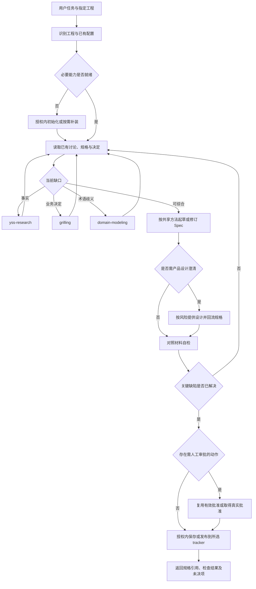

# T02：Spec Profile 目标流程、职责与技能设计

日期：2026-10-29。本文为已获批准的设计记录；当前实施及验证状态见下方更新。

状态更新：用户于 2026-10-29 确认汇总设计及关联方案，后续已完成本地实现；2026-10-30 用户授权提交和发行并确认模板 v5.0.0、CLI v3.0.0。实际实施和尚未完成的验证见 [实施报告](spec-profile-implementation-report.md)及[外部验证记录](spec-profile-external-validation-2026-10-30.md)。下文结尾的设计审查记录保留其形成时的历史状态，不表示当前仍待设计批准。
依据：[最终决议](spec-skill-optimization-notes.md)、[T01 诊断](spec-profile-current-state-diagnosis.md)、[Matt v1.3.1 调研](matt-v131-spec-pr-research.md)。本文只确定职责与流程骨架，T03–T07 继续细化审批、设计裁剪、tracker、初始化和清理；当前不实施代码。

## 方案选择与约束

用户已选择以 Matt v1.3.1 为基线改造非技术 Spec。采用轻量路由、职责小的技能、可替换 tracker 和材料引用。保留 life 名称以降低入口重复，但重写其 Spec 职责；这项具体组织方式是本设计建议，并非此前用户逐项确认。

评估过的其他方式：保留旧阶段内核再裁剪，会继续承受 Plan/阶段包/checkpoint/实施准入依赖；新建平行 Spec 主控，会增加同类入口与规则所有者。因此不作为推荐方案。下游共享政策和 Backend 能力不因 Spec 路径清理而整体删除。

安装默认 governed 继续成立；安装类型负责交付资源，不能决定新 Spec 任务必须走旧生命周期。T07 必须覆盖身份分支及 CLI 消费者，不能只靠技能文本宣称解耦。

## 单一职责主线



图中的保存/发布并非只能发生在末尾：中途可在授权范围保存草稿或发布明确标为草稿的条目。发布是否需独立批准取决于实际授权及 T03 审批动作，不额外预设一轮确认。存在业务 blocker 时可保留草稿，但不表示规格可供下游按确定要求执行。

只读分析跳过写入、初始化应用与发布，仅返回分析和缺口。既有可用材料直接复用，无需重新走所有节点。

规则冲突、关键验收缺失或设计发现未回流时返回澄清与综合；可延期的非关键未决项明确列出，不一律阻断。缺陷未解决时可保存草稿，但不得报告规格已完成。

初始化前由宿主任务入口识别目标；项目 life 尚未安装时，使用已可发现的用户级 setup-yss-harness 引导，成功后交回项目 life。用户级引导也不存在时报告具体能力缺口，不假装项目技能已加载。已有能力直接复用，避免先依赖 life 才能安装 life 的循环。

## 技能树与所有权

```text
yss-product-lifecycle（Spec 侧轻量路由，负责连续推进与汇总）
├─ setup-yss-harness          必要时就绪配置与技能资源
├─ grilling                   必要业务决定的澄清
├─ yss-research               可调查事实与来源
├─ domain-modeling            主动处理术语、业务责任与关键决定
├─ 共享规格综合参考            原生直接使用，不隐式调用 user-only 入口
│  └─ i-have-adhd             当前文档的表达辅助
└─ 产品设计能力               仅确有行为或交互不确定性时使用
   ├─ yss-design-system       有视觉或交互规范需求时提供基线
   ├─ yss-prototype-stage     按所需深度组织设计，不固定构建原型
   └─ prototype-review        有设计产物时按风险审查

to-spec（用户显式入口）
└─ 使用同一规格综合参考及相同 tracker 约定，不另持一套模板或状态
```

这是目标职责树，不表示当前 frontmatter 已允许上述自动调用。原型相关 user-only 声明需在 T06 明确调整后才能成为自动专项；实施前不绕过现行限制。实际宿主没有 Skill 工具时，按其受支持机制读取规范入口并遵守相同调用权限，不编造调用成功。

| 所有者 | 输入 | 输出 | 不持有的职责 |
|---|---|---|---|
| life | 用户目标、当前材料、工程配置 | 下一动作、专项选择、结果汇总及规格定位 | 不重建阶段批准、任务资格或实现编排 |
| setup-yss-harness | 已授权目标、现状、最小资源需求 | 配置与资源就绪结果、真实缺口 | 不创建业务决定、批准或技术交接 |
| grilling | 当前必要决定及其已知事实 | 用户原始决定、适用范围与未决项 | 不代替调查，不将建议当确认 |
| yss-research | 待核实事实、约束或外部行为 | 有来源的结论与访问限制 | 不替用户作业务取舍，不默认生成研究协议套件 |
| domain-modeling | 有歧义的词义、责任或规则 | 稳定术语及必要的决定说明 | 不强制为每个任务创建 Context、ADR 或领域战略包 |
| 原生综合 / to-spec | 已确认需求及相关设计 | 同一非技术 Spec | 不安排技术设计、API、实现切片或测试工程 |
| 产品设计专项 | Spec 的交互疑问及已有规范 | 必要说明、流程、状态或原型和发现 | 不生成生产实现或强制全部设计资产 |
| i-have-adhd | 当前文档与权威材料 | 清楚、完整的表达 | 不变更业务事实或审批状态 |

tracker 操作是共享能力，不新增重复业务主控。其配置、定位、发布和更新语义由 T05 单一约定持有，life、to-spec 及 setup 引用同一来源；采用现有工具还是原生 CLI 由 T05 决定。

共享规格综合方法由 life 持有，to-spec 只提供显式入口。life 负责消费、核验和报告真实用户决定及其有效范围，绝不自行批准；其他技能回交结果，不分别维护批准体系。记录字段和 tracker 表达留待 T03/T05 确定。

## Spec 输入输出

必要输入是用户问题、当前可读材料、已确认决定及现有配置。独立 Plan 文件、领域战略 JSON、checkpoint、技术方案、OpenAPI、实现仓准备和 Slice 合同均不是规格综合的默认前置条件。

推荐的规格内容：问题与目标、使用者及场景、范围与非目标、业务规则、可观察行为、权限与异常恢复、非功能约束、验收例子、适用设计引用、未决项及相关来源。章节随规模裁剪，不凑用户故事数量。

验收描述用户或外部系统能够观察的结果，不预先指定技术测试 seam、测试框架、模块接口或数据库模型。已有约束可引用，AI 不补造技术决定。

一个功能以所选 tracker 中的一份规格作为主要入口；附件、设计和研究只通过引用关联。不强制另建 parent-ticket、业务票集合、阶段包或交接包。最终字段和定位约定留待 T05，不在此预先锁死目录。

返回结果至少包括规格引用、已完成工作、实际自检或验证、未决项、适用审批情况和下游使用限制。条目存在不表示已经批准，批准也不表示下游已经接手。

## 主要分支与反馈

| 情境 | 动作 |
|---|---|
| 已有确认充分的规格 | 读取并仅修改受影响内容，复用仍有效决定 |
| 只需回答问题或审阅材料 | 只读，不初始化写入或发布 |
| 可查事实缺失 | 调查；访问限制明确返回，不把调查问题抛给用户 |
| 存在真实业务取舍 | grilling 询问当前可回答的决定，独立已授权工作继续 |
| 产品设计足够明确 | 复用现有说明，不强制原型 |
| 交互或状态尚不确定 | 按风险补设计，再回流业务规则和 AC |
| 远程不可用 | 报告未发布；保留明确标识的草稿，不静默改投平台、不称同步成功 |
| 下游反馈技术限制 | 作为事实调查；若影响业务范围或验收，回到 Spec 澄清并按 T03 判断是否重新审批 |
| 新流程任务中断 | 读取当前 tracker、已有材料和操作结果，恢复受影响工作，不重放未知副作用 |
| 旧实例请求使用新流程 | 明确需人工迁移，不自动转换身份、历史批准或产品资产 |

## 移出 Spec 路径与保留边界

| 对象 | 目标处理 |
|---|---|
| 技术/API/数据/工程契约、实现仓准备、Slice 准入及实现发布 | 从 Spec 默认职责、路由、模板前置及分发选择中移出；下游能力不在本次重建 |
| implement、implement-spec、to-tickets、TDD、代码审查 | 不作为 Spec 技能树节点；不因此全局删除共享技能 |
| yss-stage-decision 的强制领域战略与阶段包 | 取消默认前置；有价值的业务边界和取舍方法由职责对应技能引用，不另维持必填机器包 |
| 固定 Backend 路由、独立 Handoff | 移除新 Spec 的必经条件，替换为 tracker 引用；不改写下游历史导入实现 |
| 四阶段门禁和 checkpoint 的 Spec 任务资格作用 | 重新划分或移除，具体审批动作由 T03 确定；不能仅把校验器改成永远通过 |
| 分发锁、来源完整性、安装事务及用户文件保护 | 保留必要能力，但不扩大成普通规格起草的流程资格 |

## T02 验收与后续设计接口

本设计覆盖 T02 的非技术输入输出、职责树、按需分支和移出清单。后续设计必须说明如何将其落实到 T01 已定位的 Profile、入口、技能、tracker、CLI 消费与分发，不能仅靠入口文字覆盖旧消费者。

- T03：列出真实审批动作和状态语义；不自动创建新批准节点。
- T04：把产品设计选择落实为风险判断及对应检查。
- T05：确定三平台规格结构、权威位置、定位和幂等发布。
- T06：确定初始化触发、最小安装集合及 user-only 声明调整。
- T07：列出逐项清理位置、共享资产边界与新流程验证范围。

设计形成时，本文的技能组织、取消默认 parent-ticket/业务票集合等具体处理属于待审阅建议；已确认的非技术边界、tracker 模型、不支持自动迁移等不重新作为待决需求。

## 设计检查

设计审查时的历史记录：已进行独立上下文的只读设计检查，并补齐初始化引导、自检失败回路及共享方法和用户决定的职责归属。检查未要求重新澄清既定需求；这不代表运行验证或用户批准。当前状态为 T02 设计草案完成，待审阅。
