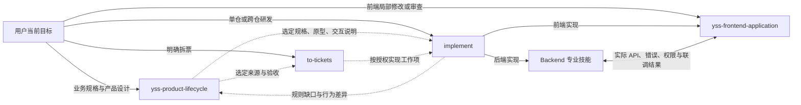

# CLI Profile 技能地图

YSS CLI 提供 `spec`、`backend`、`frontend` 三个 Profile，分别面向产品规格与 Home 入口、后端研发、前端研发。`project` 与 `skills` 是安装模式；同一 Profile 在两种模式下默认安装相同技能。Profile 选择影响预装内容，不代替用户授权，也不阻止承接已有能力能够完成的明确请求。

当前默认集合为 Spec 18 项、Backend 43 项、Frontend 16 项。三个工程入口均可直接问用法，明确研发请求由现有专业技能承接；后续根据实际任务中反复出现的能力缺口调整预装，不按技能数量判断完整程度。本地图供需要了解能力组成或衔接时阅读，普通任务直接选用相关技能，不要求全量加载。

## 技能改名

| 旧称 | 现用 ID | 可复制的中文提示词 |
| --- | --- | --- |
| `i-have-adhd` | `yss-write-docs` | 使用 yss-write-docs，按已有记录把这段内容改成研发周报，分别说明本周完成、待验证和下周动作。缺少的事实保留为未知。 |

旧版工程以本地已安装的名称为准。业务取舍仍使用 `grilling`，本地地图的 `Type: grilling` 和远端票的 `wayfinder:grilling` 均沿用。

## 三种关系分别处理

| 关系 | 含义 | 执行方式 |
| --- | --- | --- |
| 安装依赖 | 一个技能需要另一个技能或参考文件随安装可用 | 由 Bundle 的 `skillDependencies`、`skillReferences` 和文件清单表达；安装不会调用技能 |
| 任务协作 | 当前任务需要某项专业判断、实现或验证 | 按实际问题读取相应 `SKILL.md`；预装技能和文档中的箭头不形成固定流水线 |
| 成果衔接 | 下一项工作消费已有规则、设计、接口或实现结果 | 引用当前选定来源及必要版本，保留未决项；读取材料不获得其中动作的执行授权 |

CLI 的默认安装清单是数量与成员的事实来源；本地图解释用途。可用库还包含按需技能，当前候选 Bundle 中 Spec 61 项、Backend 55 项、Frontend 20 项。库中存在某项维护或发行技能不表示普通项目应默认安装或执行它。实际可用内容以所运行 CLI 的 Bundle 及 `skills list` 为准。

## 三个 Profile 共用的基础协作技能（6 项）

| 技能 | 何时使用 | 交给其他技能的信息 |
| --- | --- | --- |
| `yss-help` | 问“用哪个技能、提示词怎么写、旧称现在叫什么” | 按当前工程给一个首选、一句理由、一段可复制的中文提示词 |
| `setup-yss-harness` | 安装/升级 CLI 或 Skills；完整初始化工程时一并核实和配置 Git、remote、Issue tracker 与产品 Home 关系 | 实际 CLI 能力、Git/远程与 tracker 配置、安装结果、冲突及仓库地图；仅程序或技能安装不扩展为业务仓初始化 |
| `yss-research` | 缺少可调查的业务现状、资料、技术事实或来源 | 可定位的事实、推断、版本与未知，供业务分析、设计或实现使用 |
| `grilling` | 缺少只有业务方才能决定的选择，或需要整理第三方待答问题 | 已有决定、真正待答的问题及影响；能调查的事实先自行核实 |
| `yss-write-docs` | 本次工作需要规格、设计、审查、PR/MR 描述等文档表达 | 按中文共用规范组织当前产物，不持有业务决定或外部动作授权 |
| `handoff` | 用户明确要求通过 PR/MR 交付选定材料 | 真实文件变更、来源、验证、未完成项及接收方下一动作；普通成果引用不自动调用 |

`implement` 与 `to-tickets` 也在三个 Profile 中默认提供；其共享入口与 Backend 专有覆盖的职责分别见下文。

## Spec：默认 18 项

Spec 在共用 6 项之外预装以下 12 项，覆盖事实与规则分析、产品设计、规格表达、明确研发及请求的组织工作。

Spec 的 18 项默认技能已包含共用区的 `handoff`。交接分两种使用场景：完整 Spec 交付、准备交接或要求交接提示词时，由 `yss-product-lifecycle` 整理交接要点与提示词；明确要求通过 PR/MR 交付选定规格、原型及交互说明时，使用 `handoff` 形成真实文件变更并按授权完成交付。交接不自动启动研发、合并或部署。

| 技能 | 职责与衔接条件 |
| --- | --- |
| `yss-product-lifecycle` | 面对较完整的 Spec 工作，按缺口选择研究、业务分析、设计与表达；局部任务可以直接使用相关技能，不要求先路由 |
| `yss-stage-decision` | 分析目标、场景、范围、责任、权限、状态、规则与验收缺口；事实缺口交给研究，真实取舍使用 `grilling` |
| `domain-modeling` | 统一业务词汇、关系、边界与关键决定，为规则和原型提供一致含义；不据此生成生产库表 |
| `yss-design-system` | 根据本次选定规则设计产品 UI、交互和高保真原型；具体业务逻辑试验可使用 `prototype` |
| `prototype` | 用代表输入验证业务行为、状态和异常组合；试验结果不自动成为生产实现 |
| `prototype-review` | 对照实际规格与原型复核承诺行为、适用视觉和可访问性；结论用于修订本次范围 |
| `wayfinder` | 显式为跨会话的大型工作从模糊目标起图，梳理已有决定、未知与依赖，暂时问不清的保留为空白 |
| `to-spec` | 仅显式调用时，综合已确认讨论与设计为业务规格；复用决定，不重新访谈 |
| `to-tickets` | 仅明确要求拆票时使用；业务拆分保留规则与验收，明确工程拆分按实际仓库组织可验收增量，不凭 Profile 改变任务范围 |
| `triage` | 仅显式请求时，分析反馈、Issue 或作为请求入口的外部 PR；只读分析不更新远程状态 |
| `llm-wiki` | 仅显式请求时创建、查询、摄取、巡检和维护有来源的知识库，按授权保存研究成果。查询保护知识文件，QMD 派生状态按选定工具工作区授权维护。 |
| `implement` | 按明确开发、修复或规格实现请求核实工程上下文，完成单仓/跨仓研发与结果整合；只读分析、规格确认和准备交接不触发实现 |

完整 Spec 交付业务规格、高保真交互原型及交互说明，三类内容可以共用文件；纯展示和无 UI 按实际任务选择适用形式。业务票不是第四类必交付物。“确认 Spec”或“准备交研发”不自动拆票、设计生产 API 或开始实现。普通查询、局部修订及模板维护只完成当前范围。

Spec 中的 `code-review`、前端工程等专业技能属于按需能力，默认协调方法不等于安装全部工程技能。明确研发请求按已有授权与实际可用能力承接；不得把原型模拟结构当作生产契约，也不因 Profile 标签强制换仓。需要的技能或工具不可用时，说明具体缺口并继续可独立完成的部分。

### 从产品 Home 进入工程

Home 是产品目标与关联工程的默认会话入口。按任务读取已有仓库地图（默认 `REPOSITORIES.md`）、README 索引或明确路径；地图只记录稳定身份、职责、资料入口和已知关系，本机工作树、分支及采用版本在当前任务核实。没有地图也可直接完成目标明确的工作，配置关系时再使用 setup 的地图模板。

进入工程先核实真实 Git 身份和工作树，再读取该仓入口、局部规则及适用技能。优先采用目标仓有效版本及其资源，其次使用 Home 或宿主已有的适用共享内容；不要将同名技能的不同 Profile 职责混用。改变 shell cwd 不代表宿主重新加载规则；缺少内容沿原安装来源补齐，不切 Profile 或手改收据。三个 Profile 的通用协调方法均在 `setup-yss-harness/references/project-portability.md`；三个 Profile 均默认提供 `implement`，按需读取其仓库范围参考。

一个 Home 可协调多个后端、Web、Mobile 和共享组件；同仓多工程以仓库身份加子路径区分，一个安装根只持有一个 Profile。任务中核实采用的提交及未提交输入，恢复时检查当前工作树和运行资源；共享契约由一人整合，缺少子 Agent 时串行。来源变更只重做受影响部分，mock 或单仓检查不代表整体集成完成。

产品规则和原型留在上游，工程技术方案、源码与验证留在工程仓。简单单仓修改直接进入适用工程方法；跨仓任务按实际依赖分工并逐仓汇总证据，影响业务的发现沿原规则反馈。仅安装 skills 不创建产品地图、不把已有工程自动改为 Home，也不启动研发或发布。

## Backend：默认 43 项

Backend 在共用 6 项之外预装以下 37 项。较完整的后端研发由 `implement` 协调；设计、诊断和只读 review 等明确请求可以直接进入对应技能。

| 默认技能 | 职责与衔接条件 |
| --- | --- |
| `implement` | 读取已有需求及实际工程，选择必要设计、实现和验证，负责集成；依赖明确、资源可隔离且宿主允许时才使用并行工作 |
| `yss-technical-design` | 处理架构、方案和详细设计问题，沿用实际 DDD/MVC 工程；只读设计不自动转实现 |
| `database-analysis-docs` | 负责数据库结构审查、设计说明书、只读元信息采集和可审阅 DDL；默认逻辑关联与写入方提供 ID，保留必要主键、非空和唯一性；已有库如实记录，不自动执行 DDL |
| `yss-tactical-design` | 仅在 DDD 任务需要时设计聚合、不变量、行为和 Gateway，再交给相应实现技能；MVC 不补这一层 |
| `codebase-design`、`domain-modeling` | 分别处理模块接口与封装、业务词汇与边界；不重复替代技术设计或既有业务决定 |
| `prototype` | 对技术假设做有限的逻辑或接口试验；不制作产品 UI，不自动把试验代码迁入生产 |
| `to-tickets` | 明确要求后端拆分，或完整交付确需细化时，组织研发实现切片；沿业务行为贯通实际技术层，不先补业务票 |
| `yss-ddd-scaffold-generator`、`yss-layered-mvc-scaffold-generator` | 仅在新工程需要时，依据实际选定架构生成脚手架；共享生成资源不意味着选择 DDD |
| `alibaba-java-code-style`、`lombok`、`mapstruct` | 分别支撑适用 Java 规范、对象代码生成与模型映射；按本次代码和实际版本选用 |
| `yss-domain`、`yss-application` | DDD 分别实现领域行为与用例编排；MVC 由 `implement → yss-application` 在现有 Service 中处理规则、事务与幂等，按需协作持久化和 Web 技能 |
| `yss-repository`、`yss-mybatis` | 分别处理持久化职责实现、MyBatis 组件用法与兼容性；读取已有模型、Mapper 和实际依赖 |
| `yss-web-controller`、`yss-dto`、`yss-openapi-governance` | 分别实现 Web 边界、统一传输模型、维护实际 API 契约与兼容性；与前端消费的接口保持一致 |
| `yss-validation`、`yss-exception` | 在涉及输入约束、错误码和错误处理时使用，保留业务校验与错误语义 |
| `yss-cache`、`yss-userinfo`、`yss-audit-log` | 分别在缓存一致性、可信用户上下文、审计投递任务中使用；未涉及组件不顺带接入 |
| `yss-distributed-id`、`yss-excel-mvc`、`yss-resilience4j` | 分别处理 ID、Excel 导入导出、熔断限流等实际需求；以组件源码和平台线为依据 |
| `yss-backend-testing` | 普通后端测试与集成验证入口，沿当前行为选择合适验证；组件测试不冒充 HTTP、数据库或端到端验证 |
| `tdd` | 仅在用户明确要求 TDD、测试优先或 red-green-refactor 时使用；默认安装不使普通补测自动进入 TDD |
| `diagnosing-bugs`、`code-review` | 分别诊断具体故障、审查真实候选及相关代码；只读请求不自行修复或启动新开发 |
| `using-git-worktrees`、`resolving-merge-conflicts` | 分别处理确需隔离的并发工作、实际 merge/rebase 冲突；不为普通局部修改自动建工作树 |
| `java-backend-commit`、`git-commit-core` | 在已有提交授权下分别组织 Java 后端提交、执行共享 Git 提交方法；完成实现不自动获得提交授权 |
| `yss-skill-source-index-refresh` | 仅显式要求维护来源索引时使用；作为组件技能的安装依赖，不代表每次组件任务都要刷新索引 |

按需能力包括 `yss-backend-spec-review`、`yss-up-springboot3`、`yss-security-algorithm`、`writing-for-agents`、`maintaining-skills` 等。需求差异核验、版本迁移、既有安全组件排查或技能维护命中时再选用；`yss-security-algorithm` 保持禁止新生产接入的限制。普通工程不默认安装上游插件或执行发行类动作。

## Frontend：默认 16 项

Frontend 在共用 6 项之外预装以下 10 项。测试与质量工具方法由应用技能的参考提供，沿用目标工程工具；无需为了数量对称新增一项测试路由技能。

| 默认技能 | 职责与衔接条件 |
| --- | --- |
| `implement` | 按明确研发请求协调来源、范围、依赖、恢复与结果，前端具体实现交给应用技能；局部修改与只读 review 可直接进入专业技能 |
| `to-tickets` | 明确要求拆票时按意图区分业务票和工程票；工程票沿可观察行为组织，不按组件、hooks 或技术层机械拆分 |
| `yss-frontend-application` | 承接选定规格、原型、交互说明或 API，完成应用实现、设计还原、接口接入与工程审查；不自行重做产品设计 |
| `yss-frontend-scaffold-generator` | 仅在不存在的新目录需要新应用时生成 starter，再由应用技能实现业务；已有工程和只读 review 不生成脚手架 |
| `vue-best-practices` | 在 Vue 响应性、状态、数据流、生命周期和组件行为任务中提供判断；纯文案、颜色与间距不触发 |
| `create-adaptable-composable` | 需要独立状态职责或可复用组合式接口时使用；不为普通页面强制抽取 composable |
| `code-review`、`diagnosing-bugs` | 分别审查前端候选及关联行为、诊断故障或性能问题；按实际涉及的 Vue 和应用行为选用专业技能 |
| `using-git-worktrees`、`resolving-merge-conflicts` | 分别处理确需隔离的并发工作、实际 Git 冲突；保留已有未提交修改 |

Frontend 可按需补装的 4 项为 `yss-design-system`、`prototype-review`、`prototype`、`domain-modeling`。补装设计技能时，Bundle 同时补齐其声明的原型、复核与研究依赖；安装不等于执行。只有本次任务确实包含产品设计、原型或业务概念分析时才使用，不要求研发重新做已经确认的设计。

应用技能负责选择适用工程检查、同条件视觉对比、关键交互和接口验证。模拟数据、生成客户端、构建通过分别说明其实际意义，不能合并声称完成真实联调。

## 跨 Profile 如何衔接

下面描述职责和材料流向；箭头不触发下游执行、外部发布或额外审批。用户可以直接提出其中任一项任务。

| 衔接方向 | 消费哪些信息 | 接收方补充什么 |
| --- | --- | --- |
| Spec → Backend | 业务规则、词汇、权限与状态、验收、选定原型及模拟边界、未决项 | 根据真实工程决定必要技术方案、API、数据模型、实现与验证；不把演示结构直接用于生产 |
| Spec → Frontend | 选定页面与交互版本、状态、文案、资源、业务规则、验收与未决项 | 在现有技术栈中还原行为和视觉，说明接口接入状态及实际验证 |
| Backend ↔ Frontend | 当前真实 API 契约、参数、返回与错误、权限、分页和兼容性约束 | 对齐请求与响应行为，分别报告模拟、契约检查和实际联调覆盖，不由前端补造后端生产约定 |
| 研发 → Spec | 与原规则或验收的具体差异、来源位置、影响及选项 | 沿用已确认决定；只有新的业务取舍才需要业务方决定，技术等义细化不重新审批 |
| 各工程 → 本次集成负责人 | 实现与验证位置、真实依赖、采用版本及未完成范围 | 核对版本组合和整体 AC，明确剩余事项与实际下一责任人 |
| 集成 → 发布与运行反馈接收人 | 实际源码/制品、配置/迁移、目标环境及业务验收结果 | 沿既有记录接续发布结果、恢复依据、观察对象与时机及反馈入口，分别保留部分成功与未知 |

衔接优先引用已有权威材料及本次选定版本；代码或原型处于未提交工作树时，说明相关路径、状态与观察时间。普通任务在既有说明中保留必要上下文即可，不要求建立交接包或先调用 `handoff`。明确要求通过 PR/MR 交付时才使用该技能，并核对相应动作授权。

有明确接收方、影响结果的待决分支，或用户主动问下一步时，带上已选材料、已定事项、未决问题和接收方动作。以退款例外为例，可以给后端一句：“请读[已选退款规格和原型]，按已定规则分析影响，列出仍取决于退款例外的行为。” 单项任务完成即可收尾。

## 用 Issue 接续 Spec 与工程

Ticket 是工作项，Issue 是承载方式；Local Markdown 可承担相同职责。规格规则、原型与验收沿原来源，工作项保留本次范围、责任、依赖和结果，PR/MR 表达真实文件变化。小任务可以直接实现，业务父票仅在有聚合价值时建立。共有方法见 [Issue 操作](issue-tracker-operations.md)，项目选择仍在 [tracker 配置](issue-tracker.md)；无需安装 setup-matt-pocock-skills 才能接票。

| 当前请求 | 承接入口与结果 |
| --- | --- |
| 将选定 Spec 拆成业务票 | Spec 的 to-tickets 组织业务结果、原规则与验收；保存/发布按明确目标及对应授权，不推导生产接口或技术切片 |
| 按 Spec 或 Issue 完成后端研发 | Backend implement 接收来源，在实际工程中按需调用研发 to-tickets；沿原验收报告实现、验证与交付终点 |
| 按 Spec 或 Issue 完成前端研发 | 共享 implement 协调范围与接续，yss-frontend-application 负责实现和验证；需要工程拆分时读取共享 to-tickets 的工程方法，小任务可直接实现 |
| 将选定需求拆成前端工程票 | 共享 to-tickets 的工程分支记录真实仓库、设计/API 版本、验收与依赖；不补造后端契约，不自动发布 Issue 或启动实现 |
| 继续一个跨仓工作项 | 核对真实 Issue、来源、已有改动、PR/MR 与依赖，衔接已有成果；Home 可汇总业务结果，各工程保持自己的实际来源与执行记录 |

父票按原 AC 聚合实际结果，不凭子票全关闭或各仓 MR 合并宣布业务完成。前端 mock、后端单仓验证与真实联调分别报告；认领字段不是锁，仍需协调共享文件与运行资源。已有集中管理方式可以沿用，不为采用 Issues 强制搬票或维护远程/本地双份状态。

收到明确的复杂研发请求时，适用研发入口主动检查独立责任、跨仓依赖和跨会话接续需要，沿共享工程票方法复用或组织最少工作项；目标及对应操作授权齐备时直接维护。业务 `to-tickets` 继续按明确拆票请求使用。跨仓目标由实际人员或接手的 Agent 承担集成责任，允许兼任；环境交付和运行反馈沿共享 [Issue 操作](issue-tracker-operations.md) 接续，已有任务或部署记录可承载，无需为此强制建票。

三个 Profile 的 project/skills 模式向实际使用者（含 setup-yss-harness）分发共享方法及配置。完整新工程无已确认 tracker 且已核实唯一代码托管项目时，由 setup 默认关联该项目的 Issues 并报告；已有 tracker 和集中管理选择优先。CLI 程序安装独立于工程 Git/remote 配置，CLI 的 init/attach/scaffold 本身不创建 Git 仓或托管项目。

配置可定制、方法独立受管；升级保留平台、实例、仓库、root 和历史字段。旧项目的模板与本地配置同时变化时，当前 CLI 会报告冲突，不会自动合并 frontmatter；先按实际差异及有效授权保留现场，采用工具实际支持的处理方式，不声称只合并正文就能解除冲突。未受管同路径文件也不得覆盖。无需新增 CLI 工单命令，现有连接器或经帮助核对的 gh/glab 承担平台操作。

## 用具体请求检查选择是否合理

| 用户请求 | 应选能力 | 不因此扩展的工作 |
| --- | --- | --- |
| 周报写乱了，帮我写一句请 Agent 修订的提示词 | 推荐 `yss-write-docs`，提示词带上已有记录、待验证事项及本周要交付的结果 | 直接要求改稿时就在当前请求中交付修订文本 |
| 只有一个方向，还说不清要决定什么，用哪个技能？ | 已装时推荐显式使用 `wayfinder`，参考该技能的 `references/chart-map.md`。本候选中 Spec 默认安装，Backend 可补装，Frontend 可直接用普通建图提示词 | 用户选定后梳理已知、未知及依赖，允许留白 |
| 有两个业务选项，需要我来定 | `grilling` 澄清取舍，复用已经确定的答案 | 可调查的事实先核实 |
| 从一个想法推进规格与原型 | `yss-product-lifecycle` 按当前缺口组织业务分析、规格与产品原型 | 按本次请求确定交付范围 |
| 讨论已定，把规则与设计综合成规格 | 显式使用 `to-spec`，沿用已有决定 | 已确认内容直接复用 |
| 规格要交给后端，帮我写一段接棒提示词 | 使用 `yss-product-lifecycle` 的 `references/spec-workflow.md` 整理材料、未决项和下一动作 | 在当前对话交付文本 |
| 查某个字段当前含义及来源 | 读取现有资料；确需调查时用 `yss-research` | 不重新访谈、不建决策地图或 wiki |
| 整理发给供应商的待答问题 | `grilling` 的第三方问题方法，复用已知事实 | 不向当前用户逐项索要供应商答案，不自动发送 |
| 设计数据库或从元信息生成说明书 | `database-analysis-docs`，按需结合已有业务资料 | 不查询业务记录、不自动建库或迁移；宿主缺工具时报告限制 |
| 后端为已有行为补集成测试 | `yss-backend-testing`，按需使用 `implement` | 不因预装 `tdd` 而改为测试优先，不自动提交 |
| 修复已有 MVC Service 重复提交 | `implement → yss-application` 的 MVC 分支，按需配合持久化与验证 | 沿用 Service、Repository、Controller，不重新生成工程或新增 Domain/Gateway |
| 按明确规则开发 DDD 聚合 | `yss-domain`，按用例需要协作 `yss-application`、`yss-repository`、`yss-web-controller` | 不索要退役合同或架构登记；真正缺少业务决定时澄清 |
| 排查分页或缓存失效 | `yss-mybatis` 或 `yss-cache`，核对当前组件版本、配置和调用路径 | 不因组件存在就假定代理命中或配置生效，不重生成持久层 |
| 评估或执行 Boot 2→3 迁移 | 按需使用 `yss-up-springboot3`，核对实际依赖、Jakarta、Cloud 与受影响组件 | 不要求 Manifest、Slice 或合同编译器，不外推 Boot 4 兼容 |
| 审查当前未提交改动 | `code-review` 读取完整候选与关联行为 | 不转实现，不漏掉相关未跟踪文件，不覆盖用户修改 |
| 前端只改一处按钮文案和间距 | `yss-frontend-application` 的局部修改方法 | 不加载 Vue 状态、composable、脚手架或产品设计方法 |
| 在新目录开发前端应用 | 必要时脚手架，再由应用技能实现；命中 Vue 行为时使用相应技能 | 不重做已经确认的产品设计，不替后端设计数据库 |
| 将选定成果通过 PR/MR 交付 | 明确交付请求下使用 `handoff`，文档表达按需使用共用写法 | 不自动合并、部署、发行或通知他人 |

## 模板维护定位

默认成员、安装依赖及参考文件以这三份源配置为准：

- Spec：`.template-source/distribution/bundle-profile.json`
- Backend：`profiles/backend/.template-source/distribution/bundle-profile.json`
- Frontend：`profiles/frontend/.template-source/distribution/bundle-profile.json`

共享技能内容源为 `.agents/skills`；Backend 专有内容及覆盖源为 `profiles/backend/.agents/skills`，Frontend 按白名单分发共享技能。解释同名技能时读取所选 Profile 的有效版本，共享 `to-tickets` 按请求选择业务票或工程票，Backend 覆盖保留后端技术设计和切片职责，不能仅凭同名混用。

修改默认集合、职责或依赖时，同步受影响配置、有效技能、注册表、平台副本和本地图；只修改文档导航时不重算未变化技能的内容哈希。不另建一份机器路由清单，也不把协作关系转换为阶段门禁。技能地图随三个 Profile 的两种安装模式分发，六份入口仅保留按需导航。

集合核对日期：2026-11-18。已有项目使用其安装记录对应的 Bundle；模板源仓库更新不会自动改变已安装 CLI 或项目内容。
