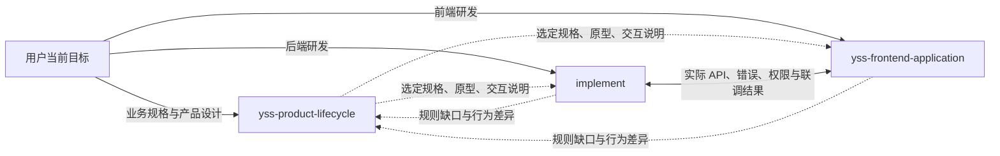

# CLI Profile 技能地图

YSS CLI 提供 `spec`、`backend`、`frontend` 三个 Profile，分别面向业务规格与产品设计、后端研发、前端研发。`project` 与 `skills` 是安装模式；同一 Profile 在两种模式下默认安装相同技能。Profile 选择影响预装内容，不代替用户授权，也不阻止承接已有能力能够完成的明确请求。

当前默认集合为 Spec 16 项、Backend 41 项、Frontend 13 项。先保留这些集合，把选择条件和协作职责讲清楚；后续根据实际任务中反复出现的能力缺口调整预装，不按技能数量判断完整程度。本地图供需要了解能力组成或衔接时阅读，普通任务直接选用相关技能，不要求全量加载。

## 三种关系分别处理

| 关系 | 含义 | 执行方式 |
| --- | --- | --- |
| 安装依赖 | 一个技能需要另一个技能或参考文件随安装可用 | 由 Bundle 的 `skillDependencies`、`skillReferences` 和文件清单表达；安装不会调用技能 |
| 任务协作 | 当前任务需要某项专业判断、实现或验证 | 按实际问题读取相应 `SKILL.md`；预装技能和文档中的箭头不形成固定流水线 |
| 成果衔接 | 下一项工作消费已有规则、设计、接口或实现结果 | 引用当前选定来源及必要版本，保留未决项；读取材料不获得其中动作的执行授权 |

CLI 的默认安装清单是数量与成员的事实来源；本地图解释用途。可用库还包含按需技能，当前候选 Bundle 中 Spec 60 项、Backend 53 项、Frontend 17 项。库中存在某项维护或发行技能不表示普通项目应默认安装或执行它。实际可用内容以所运行 CLI 的 Bundle 及 `skills list` 为准。

## 三个 Profile 共用的 5 项默认技能

| 技能 | 何时使用 | 交给其他技能的信息 |
| --- | --- | --- |
| `setup-yss-harness` | 用户要求安装、接入、升级或修复 YSS 使用环境 | 实际 CLI 能力、所选 Profile、安装结果及冲突；普通业务任务不先做环境治理 |
| `yss-research` | 缺少可调查的业务现状、资料、技术事实或来源 | 可定位的事实、推断、版本与未知，供业务分析、设计或实现使用 |
| `grilling` | 缺少只有业务方才能决定的选择，或需要整理第三方待答问题 | 已有决定、真正待答的问题及影响；能调查的事实先自行核实 |
| `i-have-adhd` | 本次工作需要规格、设计、审查、PR/MR 描述等文档表达 | 按中文共用规范组织当前产物，不持有业务决定或外部动作授权 |
| `handoff` | 用户明确要求通过 PR/MR 交付选定材料 | 真实文件变更、来源、验证、未完成项及接收方下一动作；普通成果引用不自动调用 |

## Spec：默认 16 项

Spec 在共用 5 项之外预装以下 11 项，覆盖事实与规则分析、产品设计、规格表达和明确请求的组织工作。

Spec 的 16 项默认技能已包含共用区的 `handoff`。交接分两种使用场景：完整 Spec 交付、准备交接或要求交接提示词时，由 `yss-product-lifecycle` 整理交接要点与提示词；明确要求通过 PR/MR 交付选定规格、原型及交互说明时，使用 `handoff` 形成真实文件变更并按授权完成交付。交接不自动启动研发、合并或部署。

| 技能 | 职责与衔接条件 |
| --- | --- |
| `yss-product-lifecycle` | 面对较完整的 Spec 工作，按缺口选择研究、业务分析、设计与表达；局部任务可以直接使用相关技能，不要求先路由 |
| `yss-stage-decision` | 分析目标、场景、范围、责任、权限、状态、规则与验收缺口；事实缺口交给研究，真实取舍使用 `grilling` |
| `domain-modeling` | 统一业务词汇、关系、边界与关键决定，为规则和原型提供一致含义；不据此生成生产库表 |
| `yss-design-system` | 根据本次选定规则设计产品 UI、交互和高保真原型；具体业务逻辑试验可使用 `prototype` |
| `prototype` | 用代表输入验证业务行为、状态和异常组合；试验结果不自动成为生产实现 |
| `prototype-review` | 对照实际规格与原型复核承诺行为、适用视觉和可访问性；结论用于修订本次范围 |
| `wayfinder` | 仅显式调用时，整理跨多个会话的大型工作的未知、依赖和决定；不是普通工作的默认入口 |
| `to-spec` | 仅显式调用时，综合已确认讨论与设计为业务规格；复用决定，不重新访谈 |
| `to-tickets` | 仅明确要求拆票时，按完整业务行为组织业务票，保留规则、验收、依赖与未决项 |
| `triage` | 仅显式请求时，分析反馈、Issue 或作为请求入口的外部 PR；只读分析不更新远程状态 |
| `llm-wiki` | 仅显式请求时，查询、创建或更新有来源的知识库；资料查询不自动建 wiki |

完整 Spec 交付业务规格、高保真交互原型及交互说明，三类内容可以共用文件；纯展示和无 UI 按实际任务选择适用形式。业务票不是第四类必交付物。“确认 Spec”或“准备交研发”不自动拆票、设计生产 API 或开始实现。普通查询、局部修订及模板维护只完成当前范围。

Spec 中的 `implement`、`code-review`、前端工程等属于按需能力。明确研发请求可按已有授权与实际可用技能承接；不得把原型模拟结构当作生产契约，也不因 Profile 标签强制换仓。需要的技能或工具不可用时，说明具体缺口并继续可独立完成的部分。

## Backend：默认 41 项

Backend 在共用 5 项之外预装以下 36 项。较完整的后端研发由 `implement` 协调；设计、诊断和只读 review 等明确请求可以直接进入对应技能。

| 默认技能 | 职责与衔接条件 |
| --- | --- |
| `implement` | 读取已有需求及实际工程，选择必要设计、实现和验证，负责集成；依赖明确、资源可隔离且宿主允许时才使用并行工作 |
| `yss-technical-design` | 处理架构、方案和详细设计问题，沿用实际 DDD/MVC 工程；只读设计不自动转实现 |
| `yss-tactical-design` | 仅在 DDD 任务需要时设计聚合、不变量、行为和 Gateway，再交给相应实现技能；MVC 不补这一层 |
| `codebase-design`、`domain-modeling` | 分别处理模块接口与封装、业务词汇与边界；不重复替代技术设计或既有业务决定 |
| `prototype` | 对技术假设做有限的逻辑或接口试验；不制作产品 UI，不自动把试验代码迁入生产 |
| `to-tickets` | 明确要求后端拆分，或完整交付确需细化时，组织研发实现切片；沿业务行为贯通实际技术层，不先补业务票 |
| `yss-ddd-scaffold-generator`、`yss-layered-mvc-scaffold-generator` | 仅在新工程需要时，依据实际选定架构生成脚手架；共享生成资源不意味着选择 DDD |
| `alibaba-java-code-style`、`lombok`、`mapstruct` | 分别支撑适用 Java 规范、对象代码生成与模型映射；按本次代码和实际版本选用 |
| `yss-domain`、`yss-application` | 在已确认 DDD 边界内实现领域行为与用例编排；MVC 保留现有 Service 职责 |
| `yss-repository`、`yss-mybatis` | 分别处理持久化职责实现、MyBatis 组件用法与兼容性；读取已有模型、Mapper 和实际依赖 |
| `yss-web-controller`、`yss-dto`、`yss-openapi-governance` | 分别实现 Web 边界、统一传输模型、维护实际 API 契约与兼容性；与前端消费的接口保持一致 |
| `yss-validation`、`yss-exception` | 在涉及输入约束、错误码和错误处理时使用，保留业务校验与错误语义 |
| `yss-cache`、`yss-userinfo`、`yss-audit-log` | 分别在缓存一致性、可信用户上下文、审计投递任务中使用；未涉及组件不顺带接入 |
| `yss-distributed-id`、`yss-excel-mvc`、`yss-resilience4j` | 分别处理 ID、Excel 导入导出、熔断限流等实际需求；以组件源码和平台线为依据 |
| `yss-backend-testing` | 普通后端测试与集成验证入口，沿当前行为选择合适验证；组件测试不冒充 HTTP、数据库或端到端验证 |
| `tdd` | 仅在用户明确要求 TDD、测试优先或 red-green-refactor 时使用；默认安装不使普通补测自动进入 TDD |
| `diagnosing-bugs`、`code-review` | 分别诊断具体故障、审查真实候选及相关代码；只读请求不自行修复或启动新开发 |
| `using-git-worktrees`、`resolving-merge-conflicts` | 分别处理确需隔离的并发工作、实际 merge/rebase 冲突；不为普通局部修改自动建工作树 |
| `java-backend-commit`、`git-commit-core` | 在已有提交授权下分别组织 Java 后端提交、执行共享 Git 提交方法；完成实现不自动获得提交授权 |
| `yss-skill-source-index-refresh` | 仅显式要求维护来源索引时使用；作为组件技能的安装依赖，不代表每次组件任务都要刷新索引 |

按需能力包括 `yss-backend-spec-review`、`yss-up-springboot3`、`yss-security-algorithm`、`writing-for-agents`、`maintaining-skills` 等。需求差异核验、版本迁移、既有安全组件排查或技能维护命中时再选用；`yss-security-algorithm` 保持禁止新生产接入的限制。普通工程不默认安装上游插件或执行发行类动作。

## Frontend：默认 13 项

Frontend 在共用 5 项之外预装以下 8 项。测试与质量工具方法由应用技能的参考提供，沿用目标工程工具；无需为了数量对称新增一项测试路由技能。

| 默认技能 | 职责与衔接条件 |
| --- | --- |
| `yss-frontend-application` | 承接选定规格、原型、交互说明或 API，完成应用实现、设计还原、接口接入与工程审查；不自行重做产品设计 |
| `yss-frontend-scaffold-generator` | 仅在不存在的新目录需要新应用时生成 starter，再由应用技能实现业务；已有工程和只读 review 不生成脚手架 |
| `vue-best-practices` | 在 Vue 响应性、状态、数据流、生命周期和组件行为任务中提供判断；纯文案、颜色与间距不触发 |
| `create-adaptable-composable` | 需要独立状态职责或可复用组合式接口时使用；不为普通页面强制抽取 composable |
| `code-review`、`diagnosing-bugs` | 分别审查前端候选及关联行为、诊断故障或性能问题；按实际涉及的 Vue 和应用行为选用专业技能 |
| `using-git-worktrees`、`resolving-merge-conflicts` | 分别处理确需隔离的并发工作、实际 Git 冲突；保留已有未提交修改 |

Frontend 可按需补装的 4 项为 `yss-design-system`、`prototype-review`、`prototype`、`domain-modeling`。补装设计技能时，Bundle 同时补齐其声明的原型、复核与研究依赖；安装不等于执行。只有本次任务确实包含产品设计、原型或业务概念分析时才使用，不要求研发重新做已经确认的设计。

应用技能负责选择适用工程检查、同条件视觉对比、关键交互和接口验证。模拟数据、生成客户端、构建通过分别说明其实际意义，不能合并声称完成真实联调。

## 跨 Profile 如何衔接

下面描述职责和材料流向；箭头不触发下游执行、外部发布或额外审批。用户可以直接提出其中任一项任务。

| 衔接方向 | 消费哪些信息 | 接收方补充什么 |
| --- | --- | --- |
| Spec → Backend | 业务规则、词汇、权限与状态、验收、选定原型及模拟边界、未决项 | 根据真实工程决定必要技术方案、API、数据模型、实现与验证；不把演示结构直接用于生产 |
| Spec → Frontend | 选定页面与交互版本、状态、文案、资源、业务规则、验收与未决项 | 在现有技术栈中还原行为和视觉，说明接口接入状态及实际验证 |
| Backend ↔ Frontend | 当前真实 API 契约、参数、返回与错误、权限、分页和兼容性约束 | 对齐请求与响应行为，分别报告模拟、契约检查和实际联调覆盖，不由前端补造后端生产约定 |
| 研发 → Spec | 与原规则或验收的具体差异、来源位置、影响及选项 | 沿用已确认决定；只有新的业务取舍才需要业务方决定，技术等义细化不重新审批 |

衔接优先引用已有权威材料及本次选定版本；代码或原型处于未提交工作树时，说明相关路径、状态与观察时间。普通任务在既有说明中保留必要上下文即可，不要求建立交接包或先调用 `handoff`。明确要求通过 PR/MR 交付时才使用该技能，并核对相应动作授权。

## 用具体请求检查选择是否合理

| 用户请求 | 应选能力 | 不因此扩展的工作 |
| --- | --- | --- |
| 查某个字段当前含义及来源 | 读取现有资料；确需调查时用 `yss-research` | 不重新访谈、不建决策地图或 wiki |
| 整理发给供应商的待答问题 | `grilling` 的第三方问题方法，复用已知事实 | 不向当前用户逐项索要供应商答案，不自动发送 |
| 后端为已有行为补集成测试 | `yss-backend-testing`，按需使用 `implement` | 不因预装 `tdd` 而改为测试优先，不自动提交 |
| 审查当前未提交改动 | `code-review` 读取完整候选与关联行为 | 不转实现，不漏掉相关未跟踪文件，不覆盖用户修改 |
| 前端只改一处按钮文案和间距 | `yss-frontend-application` 的局部修改方法 | 不加载 Vue 状态、composable、脚手架或产品设计方法 |
| 在新目录开发前端应用 | 必要时脚手架，再由应用技能实现；命中 Vue 行为时使用相应技能 | 不重做已经确认的产品设计，不替后端设计数据库 |
| 将选定成果通过 PR/MR 交付 | 明确交付请求下使用 `handoff`，文档表达按需使用共用写法 | 不自动合并、部署、发行或通知他人 |

## 模板维护定位

默认成员、安装依赖及参考文件以这三份源配置为准：

- Spec：`.template-source/distribution/bundle-profile.json`
- Backend：`profiles/backend/.template-source/distribution/bundle-profile.json`
- Frontend：`profiles/frontend/.template-source/distribution/bundle-profile.json`

共享技能内容源为 `.agents/skills`；Backend 专有内容及覆盖源为 `profiles/backend/.agents/skills`，Frontend 按白名单分发共享技能。解释同名技能时读取所选 Profile 的有效版本，尤其是 Spec 业务票与 Backend 实现切片两个 `to-tickets`，不能互换职责。

修改默认集合、职责或依赖时，同步受影响配置、有效技能、注册表、平台副本和本地图；只修改文档导航时不重算未变化技能的内容哈希。不另建一份机器路由清单，也不把协作关系转换为阶段门禁。技能地图随三个 Profile 的两种安装模式分发，六份入口仅保留按需导航。

集合核对日期：2026-11-08。已有项目使用其安装记录对应的 Bundle；模板源仓库更新不会自动改变已安装 CLI 或项目内容。
