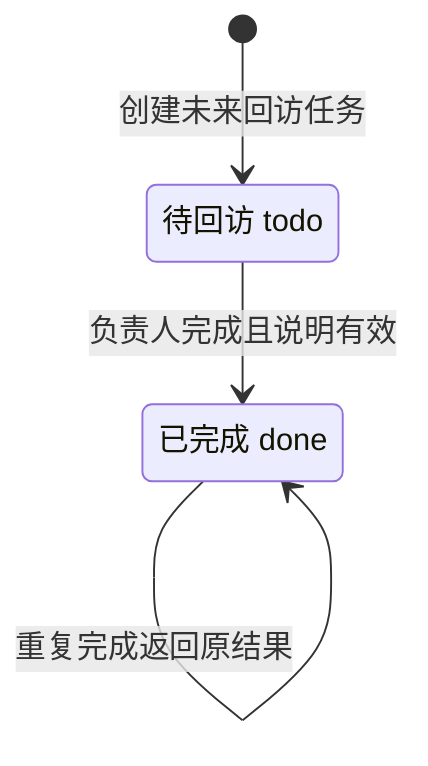
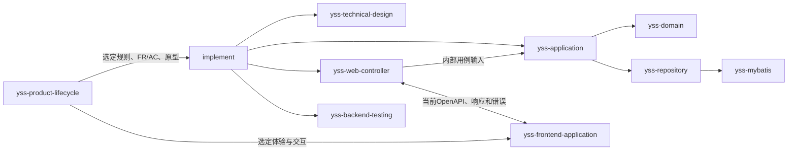
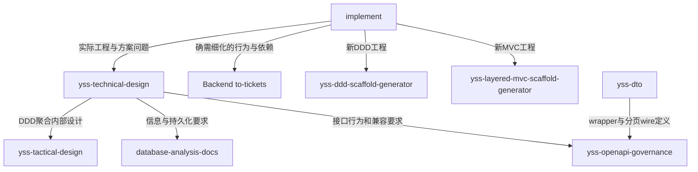
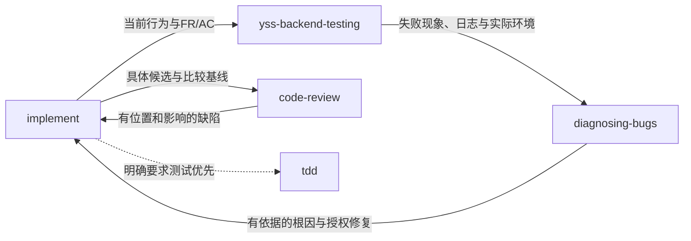
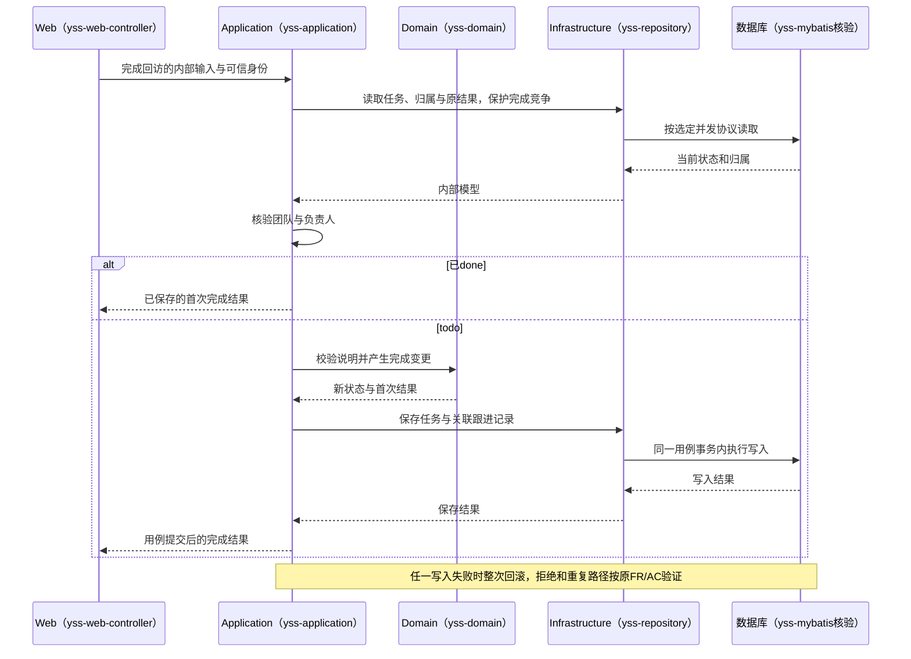

# 客户跟进项目全生命周期 Demo

用一个独立教学项目，讲解从一句需求到测试环境发布、业务验收和交付的完整过程。读者在同一条业务主线上观察技能怎样选择、消费什么输入、产出什么，以及出现问题后怎样定位、修正和验证。

本例面向产品、设计、前后端研发、测试和项目负责人。业务规则、联系人及对话均为教学假设，采用虚构的业务跟进与回访内容。工程由 Spec/Home、Java DDD 后端和 Vue 前端三个仓库组成，后文用同一“完成回访”行为补充 MVC 对照。

## 阅读和演练方式

每一步依次提供当前问题、可复制请求、技能选择及其理由、预期产物和检查方法。先沿主线读完，再根据“用问题理解技能协作”定位具体故障。已有资料可以作为某一步的输入，按本次目标继续工作。

文中的文件树、接口、对话和交付记录展示演练时的保存方式与预期结果。本文的实际交付是说明文档，工程创建、代码实现、真实 PR/MR、部署和业务验收由后续演练产生相应证据。记录中的“待执行”在取得实际结果后填写。

### 按讲解目的导航

- [业务规则与贯穿数据](#样例产品与贯穿数据)
- [技能关系与使用入口](#先看技能怎样协作)
- [后端设计、辅助技能与验证衔接](#后端设计和工程准备怎样衔接)
- [从空目录进入规格工作](#第一步-从空目录建立项目入口)
- [创建工程与技术设计](#第五步-从零创建-api-和-web-工程)
- [审查与合并](#审查与-prmr-持续跟进)
- [测试环境发布](#准备并执行测试环境发布)
- [八个问题的技能选择](#用问题理解技能协作)
- [完成回访在后端怎样贯通](#从完成-r-001-看后端工程衔接)
- [同一行为的 DDD/MVC 对照](#ddd-与-mvc-对照同一次完成回访)

### 版本与工具

本例按 Template **5.9.0** 和已核实的 CLI **3.9.0 本地开发构建**编写。核对时，模板提交为 `e60d603e`，CLI 提交为 `e66c37c`。本机 PATH 当时仍使用 CLI 3.8.0 与 Template 5.8.0，演练前需查看实际程序与内嵌 Bundle。命令兼容性与取得新版技能分别核对，正式发行及下载来源在演练安装时核实。

先让 Agent 确认所用程序、实际帮助和平台，再沿用同一个程序。首次安装或项目升级使用 `setup-yss-harness`，具体方法见[安装与接入](cli/install-and-verify.md)。后续命令示例中的 `YSS_BIN` 指向已核实的程序，`DEMO_PARENT` 指向已存在、经过真实路径解析的独立演练父目录。

```sh
YSS_BIN="/绝对路径/已核实的/yss"
DEMO_PARENT="/绝对路径/客户跟进教学项目"
"$YSS_BIN" version --json
"$YSS_BIN" help
"$YSS_BIN" scaffold catalog --json
```

讲解 YSS 的通用方法见[用户手册](用户手册.md)，所有技能的默认与按需分发见[Profile 技能地图](../agents/profile-skills.md)，安装、工作台和恢复参数见[命令参考](cli/command-reference.md)。

## 样例产品与贯穿数据

### 从这一句话开始

> 我们的客户咨询分散在表格和聊天记录里。请做一个客户跟进小系统，让主管分配联系人，专员记录跟进、安排回访，主管能看到处理进度。

本版完成以下闭环。


| 对象或角色 | 固定教学数据 | 用途 |
| --- | --- | --- |
| 团队 | `T-001`，另有 `T-002` 用于越权场景 | 验证团队数据范围 |
| 主管 | `U-100` | 建档、首次分配、查看团队进度 |
| 专员甲、乙 | `U-101`、`U-102`，均属于 T-001 | 展示负责人权限和无权限访问 |
| 联系人 | `C-001`，显示名为“演示联系人甲”，来源为“线上咨询” | 同一联系人贯穿全部步骤 |
| 回访任务 | `R-001`、`R-002` | 展示完成、重复请求、逾期与统计 |
| 演练时钟 | 固定时刻 `NOW` | 创建未来任务用 NOW 加一小时，逾期任务用 NOW 减一小时 |

界面显示采用 `Asia/Shanghai`。时刻的传输、存储和比较在技术设计中落实。每个独立场景从约定初始数据开始，避免前一个场景影响后一个结果。NOW 是本轮记录的参考时刻，精确时间边界由可控测试时钟验证，真实环境跨时段演练时重新生成相应任务。

### 本例规则的唯一口径

下表展示讨论完成后的教学决定。后续示例中的规则编号、原型、技术设计和验收均引用它。

| 编号 | 规则 |
| --- | --- |
| FR-01 | 主管创建与查看本团队联系人，专员查看自己的联系人。联系人创建后负责人为空。 |
| FR-02 | 主管将联系人首次分配给本团队启用专员。同一分配重试返回现有结果。负责人为空时不能新增跟进或回访任务。本版覆盖首次分配，改派用于后续变更练习。 |
| FR-03 | 负责人可新增跟进记录。摘要去首尾空格后长度为 1 到 500，成功后保留原记录与服务端时间。 |
| FR-04 | 负责人可创建回访任务，计划时刻须晚于服务端当前时刻，初始状态为待回访 `todo`。逾期派生为 todo 且计划时刻已过。一个联系人可以有多条记录和多项任务。 |
| FR-05 | 负责人可完成待回访任务，完成说明去空格后长度为 1 到 500。一次成功同时将任务置为已完成 `done`，追加一条关联该任务的跟进记录，完成时间由服务端填写。 |
| FR-06 | 同一任务重复或并发完成只有首个成功结果和一条完成记录，后续返回原完成结果。后续提交的新说明沿用首次记录内容。 |
| FR-07 | 任务更新或跟进记录写入任一失败，两者均恢复操作前状态。无权限拒绝保持原状态。请求超时先查询任务和时间线核实结果，仍为 todo 时才可按同一幂等入口提交。 |
| FR-08 | 主管统计本团队，专员只统计自己的数据。待回访包含全部 todo，逾期是其中的子集，已完成单列。权限在服务端校验，前端呈现同一含义。 |

任务业务状态只有 todo 和 done。逾期用于展示和筛选，其条件来自 FR-04。加载、提交中、请求超时和查询失败属于界面反馈。



FR-07 定义拒绝、写入失败和结果待核实的处理。状态图与下表一起阅读。

| 编号 | 可观察验收 |
| --- | --- |
| AC-01 | 主管建立 C-001 并分配 U-101，U-101 可访问，U-102 与跨团队用户的读取和写入被拒绝。 |
| AC-02 | U-101 新增有效跟进成功，空白或超过 500 字的摘要被拒绝，记录数量保持原值。 |
| AC-03 | U-101 用 NOW 加一小时创建 R-001 为 todo，NOW 或过去时刻被拒绝。 |
| AC-04 | 完成 R-001 后，可同时查询到 done 和一条 `sourceTaskId=R-001` 的跟进记录。 |
| AC-05 | 两次重复或并发完成 R-001，仅保留一条完成记录，后续显示首次完成结果。 |
| AC-06 | 写记录故障时任务仍为 todo，且没有完成记录。受控超时后按查询到的真实状态恢复。 |
| AC-07 | 固定 NOW，R-002 为逾期待回访、R-001 为已完成时，待回访为 1、逾期为 1、已完成为 1。 |
| AC-08 | 测试环境使用明确的 API/Web 制品版本组合，以真实身份和接口重走闭环，保存实际操作与结果。 |

## 先看技能怎样协作

### 谁承接当前目标



图中展示本例的专业协作与成果方向。Backend 的 `implement` 接收原规格并负责整合，具体技能将规则落实到设计、用例、领域、持久化、HTTP 和验证。后面的局部图继续展开输入输出，执行者按当前问题选用。

| 关系 | 本例怎样观察 |
| --- | --- |
| 安装依赖 | 补装技能时，Bundle 同时补齐其声明的技能和参考资源，随后用实际文件核对。 |
| 任务协作 | 完成回访的事务问题由 `implement` 协调 Application、Repository 与测试方法处理。 |
| 成果衔接 | Frontend 采用选定原型和 Backend 维护的 API，沿同一 FR/AC 实现。 |

### 后端设计和工程准备怎样衔接

进入 API 工程后读取安装在该工程的有效技能。Backend 的 `implement`、`to-tickets`、`yss-technical-design` 等沿用其 Profile 职责，接收原 FR/AC、选定原型、模拟边界和来源版本，补充技术方案及工程事实。



| 交出的信息 | 交给谁使用 | 本例怎样落到下一步 |
| --- | --- | --- |
| `implement` 核实的范围、来源与调用方 | 技术设计和实现执行者 | 固定 FR-05 至 FR-07、原型超时状态与 AC-04 至 AC-06 |
| `yss-technical-design` 的事务、并发、幂等和错误方案 | Domain、Application、持久化与 Web 实现 | 明确重复完成读取原结果，两项写入处于同一用例事务 |
| `yss-tactical-design` 的行为、不变量及 Gateway 边界 | `yss-domain`、`yss-application`、`yss-repository` | 明确 FollowupTask 的完成行为、外部端口与谁负责实现 |
| `database-analysis-docs` 的表字段、逻辑关系和必要约束 | `yss-repository` 与 `yss-mybatis` | 保存任务状态、首次完成结果和 sourceTaskId 关联记录，落实已选并发协议 |
| `yss-dto` 的公开 wire 定义 | `yss-openapi-governance`、`yss-web-controller` 和前端 | endpoint schema 组合现有响应包装、分页及字段语义 |
| `yss-openapi-governance` 维护的权威 YAML | Web 实现、前端请求与契约验证 | 完成接口的参数、成功结果、拒绝、重复结果和错误含义一致 |
| 对应脚手架生成的骨架、配置与来源收据 | `implement` 和各分层技能 | 在真实生成结构中继续实现当前业务 |
| Backend `to-tickets` 组织的可观察行为与依赖 | 实现者和集成负责人 | “完成回访”贯通所需层次，并保留原 AC 与验证办法 |

DDD 内部设计按需要细化，MVC 的对应规则、事务和幂等放在既有 Service。需要验证技术假设时使用 Backend `prototype`，结论回到本次技术方案。

### 后端辅助技能落在哪些代码边界

| 技能 | 本例中的实际落点 | 向相邻职责提供什么 |
| --- | --- | --- |
| `alibaba-java-code-style` | 当前工程适用的 Java 代码、异常与集合用法 | 可读且符合项目约定的实现与调用方 |
| `lombok` | 内部模型、PO、HTTP 模型的构造器和访问器 | 按对象身份生成代码，保留领域行为与敏感字段范围 |
| `mapstruct` | Web 的请求/响应转换，Infrastructure 的持久化转换 | HTTP 输入转内部 Command，内部结果转 VO，PO 与领域模型的显式映射 |
| `yss-userinfo` | 读取认证链已建立的当前用户上下文 | 用例获得可信操作者，再校验团队和联系人归属 |
| `yss-validation` | 请求结构、字段格式及适用 Bean Validation | Web 拒绝结构性无效输入，业务条件继续在领域或用例维护 |
| `yss-exception` | 领域/用例错误到公开 HTTP 语义的接线 | Web 返回已约定、脱敏的业务错误和系统失败响应 |
| `yss-dto` | 请求、结果包装、分页和公开 JSON 边界 | OpenAPI、Web 序列化与前端消费同一 wire 约定 |

本例完成入口先核验对象权限，再对 done 返回原结果，只有 todo 才执行首次完成说明的业务校验。请求注解与 Web 转换应保留 FR-06 的已确认重复语义，相关拒绝和重复路径一起验证。

组件需求出现时再接入对应工程技能，并核对实际依赖与源码。缓存数据需要维护时使用 `yss-cache` 对齐完成动作后的失效与查询，要求审计时使用 `yss-audit-log` 明确提交和投递时点，采用 YSS ID 时使用 `yss-distributed-id`。导入导出使用 `yss-excel-mvc`，外部调用确需熔断限流时使用 `yss-resilience4j`。这些任务沿当前业务范围单独说明输入、改动与验证。

### 后端验证怎样把问题带回实现



修复根据根因回到相应实现。事务范围进入 `yss-application`，状态不变量进入 `yss-domain`，保存字段或适配进入 `yss-repository`，SQL、方言、分页和事务绑定进入 `yss-mybatis`，公开接口接线进入 `yss-web-controller` 及相关边界技能。

具备提交授权时，Backend 的 `java-backend-commit` 与共享 `git-commit-core` 组织本次改动。确需并行隔离时使用 `using-git-worktrees`，出现实际合并冲突时使用 `resolving-merge-conflicts`。PR/MR 交付按明确请求使用 `handoff`，持续跟进由 `implement` 的相应参考处理，直到用户指定结果或具体阻塞。

### 怎样提出请求

自然语言目标足够明确时，Agent 按适用规则选技能。需要指定一种工作方法时，在请求中写出技能名、目的和当前范围。宿主提供技能菜单或 `$技能名` 语法时，也可使用其实际支持的入口。

```text
请使用 grilling，澄清“联系人尚未分配时由谁处理”的业务决定。
先复用已知资料，给出会影响本版范围的选项与建议。
```

`to-spec`、Spec 的 `to-tickets`、`wayfinder`、`triage` 和 `llm-wiki` 保持用户显式调用。`handoff` 用于明确的 PR/MR 交付请求。下面在相应教学请求中点名它们。完整能力地图用于按需查找更多方法。

| 当前问题 | 主要技能 | 本例期望得到什么 |
| --- | --- | --- |
| 现有工作怎样做、资料说了什么 | `yss-research` | 可定位的材料事实、推断与未知 |
| 本版做哪些行为、规则是否完整 | `yss-stage-decision` | 场景、角色、权限、状态和验收缺口 |
| 未分配时谁能操作 | `grilling` | 业务方作出的明确选择及影响 |
| 联系人、跟进记录、回访任务怎样区分 | `domain-modeling` | 一致业务语言与责任 |
| 页面怎样操作、状态怎样表现 | `yss-design-system`、`prototype-review` | 选定原型、交互说明与复核发现 |
| 多仓怎样完成同一需求 | `implement`、`yss-frontend-application` | 各工程实现与必要集成结果 |
| 事务、状态、SQL、HTTP 分别放哪里 | `yss-application`、`yss-domain`、`yss-repository`、`yss-mybatis`、`yss-web-controller` | 对应职责的实现、调用方与边界 |
| 怎样验证、为什么失败 | `yss-backend-testing`、`yss-frontend-application`、`diagnosing-bugs`、`code-review` | 实际结果、原因依据和修复去向 |

## 第一步 从空目录建立项目入口

### 当前问题与请求

产品负责人已经给出项目目标，希望有一个 Home 维护规格、原型和工程导航。

```text
请使用 setup-yss-harness，在我指定的独立父目录中创建 customer-followup-home，
采用 Spec / project。核对已选 CLI 的实际版本、Bundle、帮助和本地路径。
本次允许创建这个教学 Home，完成后说明真实文件与技能，
工程关系根据后续实际创建的仓库维护。
```

```sh
"$YSS_BIN" init --root "$DEMO_PARENT/customer-followup-home" --profile spec --installation project
"$YSS_BIN" skills list --root "$DEMO_PARENT/customer-followup-home"
"$YSS_BIN" doctor --root "$DEMO_PARENT/customer-followup-home" --json
```

`setup-yss-harness` 处理程序与项目接入。此时的产物是 Home、安装记录与方法资源。检查程序来源、实际目录、Profile 和技能文件，再进入业务工作。

建立 Git 仓库和配置远端时，使用演练者已确认的身份与目标。三个工程各自保存历史，当前 checkout 和分支在本次任务核实。已有 YSS 工程接入时按[既有成果复用](阶段接入与产物复用使用手册.md)继续。

## 第二步 把一句需求变成可决定的问题

### 给定的教学资料

在独立 Home 保存以下材料片段，或直接将原文交给 Agent。它们是本例给定输入。

| 建议文件 | 教学输入原文 |
| --- | --- |
| `docs/input/主管访谈.md` | 主管现在通过表格分配咨询联系人，每周手工询问回访进度，希望知道哪些任务还未处理。 |
| `docs/input/专员访谈.md` | 专员需要保存每次跟进内容并约定下次时间。网络不稳定时，曾遇到提交结果不明、再次点击后出现重复记录。 |
| `docs/input/本版目标.md` | 本版贯通建档、首次分配、跟进、回访与进度查看，使用虚构教学数据。 |

```text
请使用 yss-research 阅读这些给定资料，整理材料事实、推断和仍待决定事项。
再按 yss-stage-decision 分析客户跟进的目标、范围、角色、状态和验收。
能从材料调查的内容先核实，业务取舍集中交给业务负责人。
本次在 Home 完成分析。
```

研究解释“目前怎样工作”，业务分析解释“本版要满足什么”。两者的输出共同支撑澄清。

### 一段澄清示例

以下为教学对话，预设答案已经写入 FR-01 和 FR-02。

| 对话 | 影响与回写 |
| --- | --- |
| Agent 询问建档时是否必须立刻确定负责人 | 影响创建校验、未分配视图与后续操作。 |
| 业务负责人答复“主管可先建档，分配完成后由负责人跟进” | 联系人可暂时无负责人，专员操作依赖分配结果。 |
| Agent 使用 `domain-modeling` 统一三类对象 | Contact 保存联系人与归属，FollowupRecord 保存一次已发生记录，FollowupTask 保存计划与完成结果。 |
| Agent 回写 FR-01、FR-02 和 AC-01 | 同步建档、分配、列表可见性与操作条件。 |

演练收到已有明确答案时直接复用。只有新的业务取舍再使用 `grilling`。多会话大型工作确需决定地图时，可以明确调用 `wayfinder` 组织未知与依赖。

## 第三步 形成同一份规格与高保真原型

### 请求与保存位置

```text
请使用 to-spec，综合已确认的教学资料和 FR-01 到 FR-08，形成业务规格。
再使用 yss-design-system 制作高保真可操作原型与交互说明。
覆盖建档、首次分配、记录跟进、安排和完成回访、查看进度，
以及无权限、空白输入、重复提交、结果待核实和查询失败。
使用相同联系人与任务数据，给出查看、运行和重置方法。
允许修改 Home 中本需求的资料与原型。
```

建议保存为同一需求目录，日期和主题 key 在后续修订中沿用。

```text
customer-followup-home/
  docs/input/
  docs/spec/2026-11-17-customer-followup/
    2026-11-17-customer-followup-spec.md
    2026-11-17-customer-followup-interaction.md
  prototypes/2026-11-17-customer-followup/
  CONTEXT.md
```

Spec 主文件保存目标、范围、FR/AC、未决问题和关联产物。稳定业务语言按实际约定进入 CONTEXT。交互已写在 Spec 时可以共用文件。

### 本例页面和状态

| 页面 | 关键操作 | 采用依据 |
| --- | --- | --- |
| 联系人列表 | 主管建档、筛选未分配、首次分配 | FR-01、FR-02，AC-01 |
| 联系人详情与时间线 | 查看归属、新增跟进、安排回访、查看完成记录 | FR-03 至 FR-05，AC-02 至 AC-04 |
| 我的回访任务 | 查看待回访与逾期，完成、重复操作反馈、超时核实 | FR-04 至 FR-07，AC-03 至 AC-06 |
| 团队进度 | 在权限范围内查看待回访、逾期、已完成 | FR-08，AC-07 |

设计技能将业务规则落实为页面、输入、反馈和恢复。`prototype` 可单独验证逾期计算或重复提交的状态模型，产品页面由 `yss-design-system` 制作。按当前技能使用 Vue 与 shadcn-vue，前端工程后续采用同一选定体验。

```text
请使用 prototype-review 对照本次 Spec 和实际原型，检查完整业务闭环、
权限表现、失败恢复与适用可访问性，逐项定位主要偏差。
```

检查时走完 C-001 从未分配到已完成回访的路径，再单独重置并操作拒绝、重复与超时场景。记录实际观察。出现规则冲突回到对应 FR，交互表现问题回到原型和交互说明。

### 需要工作台时

沿已核实的独立个人数据目录登记同一个主 Spec。该目录位于项目和 Git 工作树之外，元数据由 Spec 方法依据实际产物填写。

```text
请将主 Spec 登记到本次指定的工作台数据目录，关联交互说明与原型。
已有答复先读取复用，回写 FR、AC 与关联产物后再更新原问题状态。
```

`workbench register` 保存来源登记，`request` 提供续办文本，`respond` 保存真实答复。JSON 信封中的续办文本位于 `result.text`，保存答复返回 `result.responseId`。回写原问题时关联实际答复 ID。需要内容确认时展示范围和版本，由业务负责人明确回复，已授权工作按其范围继续。具体示例见[Spec / Home 教程](cli/tutorial-spec.md)。

## 第四步 让研发能够接住这份成果

### 先用业务票组织行为

本例为讲解拆分，先明确调用 Spec 的有效 `to-tickets`。研发在工程及方案明确后细化实现切片。

```text
请使用 Spec 的 to-tickets，将当前规格组织为三个完整业务行为票，
沿用 FR/AC，并保留业务依赖。本次先保存本地内容。
```

| 业务行为票 | 主要规则与验收 | 交给研发的依据 |
| --- | --- | --- |
| 建档与首次分配 | FR-01、FR-02，AC-01 | 角色、可见范围和首次分配条件 |
| 跟进与回访闭环 | FR-03 至 FR-07，AC-02 至 AC-06 | 状态、事务目标、重复与超时含义 |
| 进度查看 | FR-08，AC-07 | 权限范围、筛选和计数口径 |

业务票提供行为、验收和依赖。普通清晰的小修改可以直接交给实现技能。

### 明确从产品工作进入研发

```text
请依据选定 Spec、原型与交互说明，在指定 API 和 Web 工程完成本版研发。
采用 FR-01 到 FR-08、AC-01 到 AC-08，复用已确认决定。
先核查工程与实际能力，完成必要技术设计、代码、测试及集成，
产品规则发现缺口时沿原编号反馈。各仓说明实际执行与剩余事项。
```

该请求使 `implement` 承接完整研发。Home 整合目标与结果，Backend 和 Frontend 在自己的有效技能与工程规则下完成任务。

## 第五步 从零创建 API 和 Web 工程

### 生成后端与前端

先查看实际 catalog 和子命令帮助，确认父目录存在、目标目录尚未创建。下列命令在独立演练目录使用，五项 Java 工程参数均显式填写。

```sh
"$YSS_BIN" scaffold ddd \
  --project-name customer-followup-api \
  --base-package com.example.customerfollowup \
  --output-dir "$DEMO_PARENT" \
  --group-id com.example \
  --project-version 0.1.0-SNAPSHOT
"$YSS_BIN" attach --root "$DEMO_PARENT/customer-followup-api" --profile backend --installation skills
"$YSS_BIN" scaffold frontend --project-name customer-followup-web --output-dir "$DEMO_PARENT"
"$YSS_BIN" attach --root "$DEMO_PARENT/customer-followup-web" --profile frontend --installation skills
```

后端脚手架技能解释生成条件和所选架构，Frontend 脚手架技能负责新应用。生成提供骨架，业务实现继续消费本例规格。已有工程按其实际结构增量修改。

已核对的 DDD 预览采用带项目前缀的模块目录，Web 模块位于 Adapter 之下。

```text
customer-followup-api/
  customer-followup-api-domain/
  customer-followup-api-application/
  customer-followup-api-infrastructure/
  customer-followup-api-adapter/customer-followup-api-web/
  customer-followup-api-bootstrap/
  db/
  pom.xml
  mvnw
```

前端入口为 `src/App.vue` 与 `src/views/Home/index.vue`，已有基础 UI 和样式。业务页面、路由、请求客户端与后端业务类在后续实现中补齐，位置按实际工程约定记录。


该 CLI 3.9.0 开发构建 catalog 的默认 Java 组合为 YSS `4.0.0-SNAPSHOT`、Spring Boot `4.1.2` 与 Java `17`，配方证据状态仍需按 catalog 阅读。Frontend 的 Node、pnpm、依赖与 scripts 从 catalog 及生成 package.json 读取，目标工程的实际构建与运行结果在演练中取得。

### 建立 Home 地图

```text
请核实三个教学仓库的真实 Git 身份与入口，在 Home 维护 REPOSITORIES.md。
每仓记录稳定身份、职责、规格或接口入口和依赖关系，沿用现有导航。
允许修改本次三个教学工程的相应入口，当前分支与本机运行信息保留在任务中。
```

| 仓库 | 负责内容 | 下游使用的入口 |
| --- | --- | --- |
| customer-followup-home | 业务规则、选定原型与交互说明 | 本次主 Spec 和原型入口 |
| customer-followup-api | 技术方案、数据库与生产 API、服务端实现 | 当前 OpenAPI、构建运行说明 |
| customer-followup-web | 页面、资源、真实接口消费与浏览器验证 | 应用入口、生成客户端配置、运行说明 |

一个安装根使用一个 Profile。进入目标工程读取其规则和实际技能正文，再依据依赖安排可隔离工作，共享契约与生成输出指定一位整合者。

## 第六步 把业务规则落实为技术职责

### 技术设计请求

```text
请使用 yss-technical-design，依据本版规则和实际 DDD 工程形成必要技术方案。
重点设计联系人归属、回访状态、完成回访的事务、重复请求、权限与查询。
聚合内部需要细化时使用 yss-tactical-design，数据库结构使用 database-analysis-docs，
API使用 yss-openapi-governance。采用 PostgreSQL 作为本例数据库教学配置，
实际方言、版本和依赖在工程中固定。将关键决定、验证办法与未决影响写入同一说明。
```

这里把 PostgreSQL 作为教学选项。数据库、身份服务、测试环境和配置在真实演练时核实，设计中的技术 API 从实际解析依赖与组件源码查明。

| 技术职责 | 本例设计决定 | 主要技能 |
| --- | --- | --- |
| 聚合与不变量 | Contact 维护归属，FollowupTask 维护 todo 到 done 的行为与完成结果 | `yss-tactical-design`、`yss-domain` |
| 用例与事务 | 完成回访时校验当前身份，协调任务与跟进记录的同一事务 | `yss-application` |
| 持久化 | 条件更新与完成记录唯一性共同保护重复、并发和失败恢复 | `yss-repository`、`yss-mybatis` |
| 数据库说明 | 表、字段、关系、必要约束和查询依据可追溯到规则 | `database-analysis-docs` |
| Web 边界 | 参数校验、可信用户上下文、错误响应和模型映射 | `yss-web-controller`、`yss-dto`、`yss-validation`、`yss-exception` |
| API 协作 | 参数、结果、权限、错误和分页由后端或契约仓统一维护 | `yss-openapi-governance` |

Java 代码按实际需要使用 `alibaba-java-code-style`、`lombok` 和 `mapstruct`。组件接入由当前问题决定，示例不要求给骨架一次性加装全部组件。

### 一份可衔接的 API 草案形状

下表是研发阶段的教学方案片段。执行时由后端在实际 OpenAPI 中维护字段、错误、权限与兼容性，前端消费该权威版本。

| 行为 | 教学接口形状 | 对应规则 |
| --- | --- | --- |
| 创建联系人 | `POST /contacts` | FR-01 |
| 首次分配 | `PUT /contacts/{contactId}/owner` | FR-02 |
| 新增手动跟进 | `POST /contacts/{contactId}/followups` | FR-03 |
| 安排回访 | `POST /contacts/{contactId}/followup-tasks` | FR-04 |
| 完成回访 | `POST /followup-tasks/{taskId}/complete` | FR-05 至 FR-07 |
| 查询时间线和任务 | `GET /contacts/{contactId}/timeline`、`GET /followup-tasks` | FR-01、FR-08 |
| 查看进度 | `GET /team-progress` | FR-08 |

完成请求提供说明，操作者从可信登录上下文取得。下列响应业务数据片段表达完成结果与关联记录。

```json
{
  "taskId": "R-001",
  "status": "done",
  "followupRecordId": "F-001",
  "summary": "已确认后续联系时间"
}
```

记录标识 `F-001` 为教学数据。实际 DTO/wire 结构、ID 表示、时间、错误码和统一响应由目标工程落实。技术设计方法详见[技术设计用户指南](技术设计用户指南.md)。

### 依据真实工程细化实现切片

现在 API/Web 工程、有效技能与本次方案已经明确，再由研发组织可实施的切片。

```text
请在后端研发上下文中使用 to-tickets，按实际工程与技术依赖细化实现切片。
每个切片说明业务目标、受影响层次、前后端衔接和验证办法，沿用原 FR/AC。
```

| 本例业务行为 | Backend 细化内容 | Frontend 对应行为 |
| --- | --- | --- |
| 建档与首次分配 | 权限、联系人、归属与查询 | 建档表单、未分配列表、分配反馈 |
| 跟进与回访闭环 | 摘要校验、任务状态、事务与重复完成 | 时间线、任务表单、完成与恢复反馈 |
| 进度查看 | 权限范围、查询条件、派生逾期和计数 | 筛选、计数含义与刷新 |

Spec 的业务票组织目标和验收，Backend 的实现切片结合真实模块、技术职责和依赖。两者沿同一规则衔接。

## 第七步 贯通所有行为并完成前端还原

### Backend 的完整目标

```text
请使用 implement，按已选技术方案完成建档、首次分配、跟进记录、
回访创建与完成、权限查询和进度统计三个业务切片。
使用 yss-domain 落实已确认状态不变量，yss-application 编排用例事务，
yss-repository 实现持久化及Gateway适配，yss-mybatis 核对实际SQL与组件行为，
yss-web-controller 对接HTTP与内部用例，按 yss-dto 的wire约定对齐OpenAPI。
身份、校验、错误和模型转换按相关技能处理，修改所有受影响调用方与配置，
用 yss-backend-testing 验证原 FR/AC，并报告实际执行结果。
```

先贯通一个可观察行为，再按同一规则完成其余切片。完成回访是重点观察对象，建档、分配、创建任务和查询统计也需要有真实入口与结果。

### 从完成 R-001 看后端工程衔接

将 FR-05 至 FR-07、AC-01 及 AC-04 至 AC-06 交给后端后，每项技能应交出相邻职责能继续消费的产物。下表中的类型名是教学命名，实际位置按生成工程与项目约定落实。

| 当前输入 | 负责技能与工程位置 | 交出的产物及使用者 |
| --- | --- | --- |
| `POST /followup-tasks/R-001/complete` 与提交说明 | `yss-web-controller`、`yss-dto`、`yss-validation`，位于 Web 模块 | 公开请求 DTO、校验与响应约定，由 Web Convertor 转成内部用例输入 |
| HTTP 模型与内部输入的字段对应 | `mapstruct`，转换由 Web 持有 | `CompleteFollowupCommand` 交给 Application，可信操作者从认证上下文取得 |
| U-101、任务标识、当前归属与原完成结果 | `yss-userinfo` 协作 `yss-application`，位于 Application 用例 | 用例先核验团队和负责人，在同一事务内确定重复结果或首次完成路径 |
| todo、有效说明和服务端时刻 | `yss-domain`，位于 Domain 的 FollowupTask 行为 | 完成变更与首次结果，交回 Application 编排保存，Gateway 接口由相应领域边界持有 |
| 已选并发协议、任务状态与关联记录 | `yss-repository`，位于 Infrastructure 的适配、PO 与 Convertor | 实现 Gateway/查询端口，将领域及内部模型映射为本次允许保存的字段 |
| 条件更新、参数、影响行数及事务数据源 | `yss-mybatis`，核对实际 Mapper 与 SQL | 数据库操作满足已选并发协议，失败沿用例传播，任务与记录共同提交或回滚 |
| 已保存的完成结果或稳定业务错误 | `yss-web-controller`、`yss-dto`、`yss-exception` | 将内部结果映射为公开 VO 和既有包装，公开错误保持约定和脱敏 |
| 当前 OpenAPI 与真实 HTTP 观察 | `yss-openapi-governance`、`yss-backend-testing` | 契约与实现一致的结果，交给前端请求、错误呈现与 AC 核验 |

持久化转换在 Infrastructure 中维护，Web 转换在 Web 中维护。聚合重建按领域工厂与不变量完成，保存按实际加载和允许更新的字段处理。Java 规范与 Lombok 贯穿相应代码，调用方与映射跟随字段变化同步。

下图展示运行时的工程职责，括号内标明维护相应代码的技能。执行者按上表实现这些职责，再用相同 FR/AC 验证实际行为。



前端收到公开结果后刷新任务与时间线。提交超时继续查询这两个入口，确认实际状态，再按 FR-07 恢复。真实 HTTP、数据库并发与浏览器结果分别提供证据，回到同一业务验收。

### Frontend 的完整目标

```text
请使用 yss-frontend-application，在 Web 工程还原本次选定的原型与交互说明。
完成联系人列表与详情、我的回访、团队进度，采用 API 工程当前契约。
处理真实权限、摘要和日期校验、空数据、错误、重复操作、超时查询与恢复。
实际 Vue 状态和数据流使用 vue-best-practices，需要独立可复用状态职责时
再使用 create-adaptable-composable。报告工程、视觉和关键交互的实际验证。
```

应用技能负责设计到工程的对应、组件复用、请求边界和验证。Vue 技能处理响应性、组件数据流和生命周期，composable 方法处理确有复用价值的状态接口。原型中的模拟请求在应用中对接真实接口，保留两者采用版本及联调状态。

一个具体交接点是“完成 R-001”。用户提交后显示处理中，超时显示结果待核实，随后查询任务和时间线，再按 FR-07 恢复。统计在真实结果核实后刷新，展示 FR-08 的同一口径。

## 第八步 用同一组验收贯通验证

```text
请使用 yss-backend-testing 核查真实 Maven 测试入口，执行能覆盖本版规则的验证。
前端按应用技能执行工程检查、同条件视觉对比和关键交互，
再以真实 API、身份和测试数据完成本地联调。记录目标版本、实际运行、
跳过项、失败、环境限制与资源清理结果，按 AC-01 到 AC-07 汇总。
```

| 验收 | 需要观察的层面 | 对本例的检查 |
| --- | --- | --- |
| AC-01 | HTTP、身份和数据范围 | 专员乙直接请求联系人与写入口时被服务端拒绝 |
| AC-02、AC-03 | 规则、请求校验、界面与时间 | 空白、过长、当前时刻、未来时刻与实际反馈一致 |
| AC-04 | 用例事务、数据库、真实接口与时间线 | done 与完成记录同时可见 |
| AC-05 | 真实并发写入和最终数据 | 竞争请求结束后只有一条完成记录 |
| AC-06 | 部分失败、事务和超时后查询 | 受控失败回退，结果不明按真实查询恢复 |
| AC-07 | SQL 查询、权限和前端展示 | 待回访 1、逾期 1、已完成 1，逾期按 todo 派生 |

后端优先使用实际工程根 `./mvnw`，前端优先 `pnpm` 与已有 scripts。执行前读取 POM、测试插件、选择器和报告位置，核对目标测试是否真正发现并运行。TDD 在明确要求测试优先时采用。

服务启动后核实工作树、配置、端口与业务可用条件，使用本次隔离的数据和资源。浏览器验证核对所选原型的视口、主题、数据与状态，保留关键操作结果。测试环境的版本组合和完整验收在下一段继续。


## 审查与 PR/MR 持续跟进

本节从 customer-followup-api 与 customer-followup-web 已有候选改动接续，规则仍以本例 FR-01 至 FR-08 为准。以下请求和产物均用于教学，PR/MR、提交、检查与运行结果在真实执行时填写。

### 先审查当前改动

可复制请求如下，尖括号内容替换为真实对象后使用。

> 请使用 code-review 审查 customer-followup-api 与 customer-followup-web 的 <实际功能分支或工作树候选及比较基线>。核对本例 FR-01 至 FR-08 与 AC-01 至 AC-07，重点查看完成回访的事务、重复与并发提交、服务端权限和前端超时恢复。先核实实际仓库、源分支 head SHA、目标分支当前 SHA、相关未提交文件与完整差异，只读报告有证据的缺陷、位置、影响和未验证范围。

`code-review` 在这里处理候选是否满足规则，默认保持只读。问题定位需要周边调用链，不能仅凭 diff 中出现的几行判断完成任务与写记录是否共用事务。

预期审查记录采用以下形状，示例现象需要实际证据支持后才能填写。

| 对象 | 待填写内容 |
| --- | --- |
| 候选身份 | 仓库、实例、PR/MR、源 head SHA、目标当前 SHA、读取时间 |
| 实际范围 | 读取的差异、周边代码、规格版本、相关调用路径 |
| 发现 | 严重性、文件与行号、触发输入、实际后果、违反的 FR/AC |
| 支持证据 | 可复现操作、日志或代码依据，实际运行时再填结果 |
| 范围限制 | 无法读取的页面、未运行路径、环境与身份缺口 |

例如发现“任务已变为 done，但完成记录写入失败后任务状态仍保留”的真实路径时，关联 FR-07 与 AC-06。先确认事务边界与异常传播，再决定修改位置。

可复制修复请求如下。

> 请按审查中已核实的问题修复这两个已授权工程，继续沿用本例已确认规则。由 implement 协调，按涉及范围使用 yss-application、yss-domain、yss-repository 或前端应用技能。执行能验证本次缺陷及受影响路径的检查，记录实际结果。提交、推送和平台回写沿用本次已经明确的对应授权，缺少某项授权时继续完成可执行部分并指出具体缺口。

`implement` 承接已授权修复。普通回归检查按实际风险选用 yss-backend-testing，明确要求测试优先开发时才选用 tdd。审查意见涉及新业务取舍时，保留原规则并定点确认缺失决定。

### 将选定成果交到真实 PR/MR

用户明确要求 PR/MR 交付时调用 `handoff`，普通文档完成不会自动触发它。

> 请使用 handoff，将 <已选定的规格、原型、代码或验证材料路径> 交到 <实际仓库> 的 <源分支和目标分支>。已有 PR/MR 时填写实际链接，首次交付按本次授权创建并回读链接。保留已有正文，核对选定产物确实进入平台展示的文件变更，说明来源版本、完成与未完成项、实际验证和接收方下一动作。本次授权 <明确填写提交、推送、创建或更新PR/MR的范围>。

Home 仓的依据可通过可读链接引用。需要把材料放入 diff 时，只复制本次选定且获授权的内容，并标明来源与读取版本。创建响应超时后先查询同仓、同分支的实际结果，避免重复创建。

Home 中选定的规格、原型、交互说明和工程导航也按对应授权保存提交，保留本次采用的来源。项目采用 Home PR/MR 时沿同一交付方法处理，发布组合记录其实际版本。

### 持续跟进到实际合并

下列请求明确了当前会话的完成条件。GitHub 与 GitLab 按实际平台二选一，真实实例、分支和允许动作需要在使用前填清。

> 请持续跟进 customer-followup-api 的 <PR/MR链接> 与 customer-followup-web 的 <PR/MR链接>，直到两者实际合并或遇到无法自行解除的具体阻塞。本次授权修复相关缺陷、执行必要检查、提交、推送、回复相关讨论、按项目规则解决对应讨论、在有依据时重试CI，以及按项目策略合并。每轮核对源 head 与目标当前 SHA、讨论、实际检查提交或队列组合，合并后回读状态与实际合并产物。保持测试环境发布待执行，另按下一节的目标与动作范围开展。

`implement` 此时读取 PR/MR 持续跟进方法，恢复已有授权并在当前会话推进。查询 CI 状态、修复失败、等待队列与合并回读属于同一目标的连续动作。

| 遇到的情况 | 接下来的动作与技能选择 |
| --- | --- |
| CI 失败 | 固定 run/pipeline、attempt/job、事件、实际检出提交或组合，读取日志，再用诊断方法确认回归、基线或环境原因 |
| 缺陷已证实 | 由 implement 修复，按问题选事务、持久层、接口或前端技能，验证后在授权内推送 |
| 依赖短暂不可用 | 取得恢复或瞬态故障证据后再重试，失败次数和未明原因保留在记录中 |
| 讨论位置 outdated | 回查当前代码与意见适用条件，核实问题是否消失，回写后再读讨论状态 |
| 合并队列等待 | 核实服务端实际入队状态与队列检查组合，等待有意义变化，继续观察新讨论和版本 |
| 源 head 或目标前进 | 读取新差异，重新关联受影响检查，保留仍适用的已有结果 |
| 权限或平台受阻 | 说明具体对象、缺少能力和下一动作，继续完成独立可做部分 |

CI 的绿色结果要能对应本次候选。源提交、临时合并提交和队列组合可能不同，旧 head 的成功记录不能直接填入当前候选。

出现取消、跳过、允许失败或必要检查迟迟未出现时，核对项目实际规则和触发条件。项目确认没有 CI 配置时如实记录，再按现有约定判断交付条件。

调用自动合并或进入队列后继续观察，直至平台返回真实合并结果。目标分支变化是否需要 rebase 由项目策略和兼容性决定。

合并前回读当前源 SHA、目标 SHA、适用检查、讨论和授权。合并后记录平台状态、时间、策略与实际产物提交，按 merge、squash 或 rebase 的真实方式核对内容已纳入目标历史。

两个仓库分别保留合并结果，并记录后续联调使用的版本组合。一仓合并失败时，先判断依赖影响和可继续动作，再决定该仓的修复或恢复措施。

## 准备并执行测试环境发布

本例教学配置采用一个后端服务、Web 静态产物与 PostgreSQL。实际平台、部署方式、数据库版本、配置入口、日志位置和健康检查入口，在真实工程与环境中核实。

### 先补齐构建部署手册

> 请按 Backend implement 的构建部署手册方法，增量维护现有运行文档。依据 customer-followup-api、customer-followup-web 的真实构建配置，说明源码版本、工具版本、构建命令、产物位置、安全配置注入、数据库迁移、启动与停止、就绪判断、日志和恢复步骤。未知环境保留具体缺口，本次只编写手册。

手册中的步骤描述供执行者使用。真实部署另需明确测试环境目标、允许改变的资源和执行动作，本文档中的请求示例本身只用于教学。

后端优先从根 `./mvnw` 与实际模块/Profile 找到入口，前端从现有 `pnpm` scripts 找到入口。产物名称从配置或实际输出确认，手册不补造服务名、端口、健康 URL 或 CI 脚本。

手册应能回答以下实际问题。

| 问题 | 应记录的依据 |
| --- | --- |
| 从哪里构建 | 两仓提交 SHA、工作树状态、实际模块与构建入口 |
| 部署什么 | 后端制品与 Web 静态产物的版本、校验值或平台可用的唯一标识 |
| 使用哪些配置 | 配置项用途、测试环境注入位置，敏感值留在受控配置系统 |
| 数据如何变化 | PostgreSQL 版本、schema、当前迁移版本、实际迁移入口和执行顺序 |
| 怎样判断可用 | 真实启动/就绪依据、业务入口、日志位置及关键闭环 |
| 失败怎样处理 | 已完成步骤、当前数据状态、应用回退条件与数据恢复限制 |

数据库已有 schema 或数据时，分别说明存量升级与空库安装。迁移失败后先读取实际完成的结构、迁移记录和数据批次，再决定继续、前向修复或恢复。

旧应用回退前核对它能否读取当前 schema 和已转换数据。数据恢复还要核对备份/恢复点、期间新增写入及影响，尚无演练结果时保留待验证状态。

### 第一次发布时准备环境

从空白测试环境开始，先由执行者调查实际主机或平台、网络、数据库、配置和制品存放能力，再在明确范围内建立本例运行入口。

```text
请核查我指定的测试环境及允许资源，为本例单后端服务、Web 静态产物与
PostgreSQL 准备最小运行方式。本次允许在指定环境内配置本应用目录、
测试数据库或schema、配置注入、静态服务与进程管理、日志及就绪入口。
复用平台现有能力，记录实际路径、命令、身份和恢复办法，再继续发布。
```

环境已经具备相应能力时直接复用。实际执行需要目标、连接方式及该环境允许的动作，使用者在请求中提供已有资料，Agent 先调查可核实事实。运行方式形成后回写原构建部署手册，后续版本沿该入口发布。

### 固定本次发布组合

发布组合把 API 与 Web 绑定到实际制品，不能只写两个可继续移动的分支名。

```text
发布组合编号    <执行时填写>
Home规则版本   <提交SHA或明确的工作树来源>
API源码        <实际合并产物SHA>
API制品        <位置/版本/唯一标识及校验依据>
Web源码        <实际合并产物SHA>
Web制品        <位置/版本/唯一标识及校验依据>
配置版本       <执行时核实的标识>
数据库状态     <PostgreSQL版本、schema、迁移版本>
目标环境       <真实测试环境标识>
```

构建时与发布前核对制品来源，发布后再核对运行实例与静态产物实际版本。若其中一个制品变化，记录新组合，并重新判断需要重复的联调与验收范围。

### 在明确环境授权内执行

可复制请求如下，使用前填写目标与已有发布入口。

> 请把上述固定组合发布到 <真实测试环境标识与可核实目标>，沿用 <既有部署入口或运行方式>。本次授权构建所列源码、部署该后端服务和 Web 静态产物、注入指定测试配置、按已核实迁移入口执行本次兼容迁移、启动或重启本次对象，并执行就绪与关键业务核验。执行前核对目标数据库、schema、资源归属和配置，不触及其他环境。失败时先确认已完成步骤与当前数据状态，再在当前兼容条件内恢复旧应用或提出具体恢复动作。记录实际命令、制品、版本和结果。

若发布范围还包含备份恢复、破坏性迁移或不可逆写入，使用请求时具体写清目标与动作。已有授权足够的动作直接推进，只有实际缺失的必要范围需要补齐。

执行时依据手册逐项观察构建、部署、启动与业务可用状态。构建成功仅填入构建结果，真实服务状态与 AC-08 由后续环境操作回填。

| 发布中断位置 | 先确认什么 | 如何继续 |
| --- | --- | --- |
| 构建失败 | 实际源码、依赖、模块、日志 | 用诊断方法定位，修复后重建并重新固定制品 |
| 迁移中断 | 已落地 schema、迁移记录、数据批次 | 依据实际迁移工具与 PostgreSQL 行为选择续跑或前向修复 |
| API 已更新、Web 失败 | 当前 API/Web 组合与接口兼容性 | 保留可用组合，修复 Web 或在兼容条件内回退对应应用 |
| 应用不可用 | 实际进程、配置、日志、就绪与业务请求 | 修复运行入口或按兼容条件恢复旧制品，再核对真实状态 |
| 数据需要恢复 | 恢复点、期间写入、影响与授权 | 按已确认路径处理，未确认时保留现场与具体恢复需求 |

多仓合并与多个部署动作各有结果。恢复方案按当前 schema、数据与消费者兼容性决定，不能预设整组操作会同时成功或整组回退。

## 在实际环境完成业务验收与交付

AC-01 至 AC-07 提供业务路径与预期。AC-08 要求在真实测试环境使用固定 API/Web 制品组合调用系统，执行前统一保留“待验证”。

可复制验收请求如下。

> 请在 <真实测试环境> 对固定发布组合执行 AC-08，使用获准的测试身份与虚构联系人数据。记录实际访问 URL、时区、固定演练时钟 NOW、身份、运行版本、操作与结果。按 AC-01 至 AC-07 重复权限、创建任务、完成、重复/并发、失败恢复和统计关键闭环。仅在可控隔离范围验证写入故障与超时场景，先确认故障注入及数据清理入口。结果逐项回填，无法执行的场景说明具体限制。

本例联系人 C-001 为虚构数据。真实执行时核对环境数据归属，采用可区分的演练标记，沿现有方式清理本次生成的数据。

| 操作 | 对应验收 | 观察重点 |
| --- | --- | --- |
| U-100 创建并分配 C-001 给 U-101 | AC-01 | 服务端权限，U-102 与跨团队读写被拒绝且数据无变化 |
| U-101 新增跟进并提交边界输入 | AC-02 | 成功留存原记录和服务端时间，无效摘要不增加记录 |
| 以 NOW 生成未来到期时间并创建任务 | AC-03 | 时间条件由服务端判断，界面与 Asia/Shanghai 显示一致 |
| 完成 R-001 后查询任务和时间线 | AC-04 | done 与一条 sourceTaskId=R-001 记录同时可查 |
| 对 R-001 重复或并发完成 | AC-05 | 仅首个结果和一条完成记录，界面展示原结果 |
| 受控写入故障与提交超时 | AC-06 | 故障保持 todo 且无记录，超时先查真实状态再恢复 |
| 固定 NOW 下核对 R-002 与 R-001 | AC-07 | 待回访1、逾期1、已完成1，逾期属于待回访子集 |

并发或故障核验要使用已确认的测试入口，不能为填表在共享环境随意停止数据库或删除记录。身份、实际请求及副作用有证据后再写结果。

若平台检查成功而业务验收失败，保留失败操作、实际版本与证据，回到对应实现修复。重新发布后更新组合，重复受影响的验收路径。

### 精简交付记录模板

下列模板可直接套用，所有空项在真实执行时回填。状态采用“待执行”“已观察结果”或具体受阻说明，成功结论需要对应事实。

```markdown
# 客户跟进测试环境交付记录

- 交付范围与规则版本    <本次实际范围、Home来源>
- API PR/MR    <链接、源SHA、目标当前SHA、读取时间>
- Web PR/MR    <链接、源SHA、目标当前SHA、读取时间>
- 实际检查对象    <run/pipeline、attempt/job、事件、检出提交或组合、结果>
- 讨论处理    <适用版本、实际处理、仍未解决项>
- 合并回读    <两仓状态、合并时间、策略、实际产物提交>
- 固定发布组合    <API/Web制品标识、配置版本、数据库/schema/迁移版本>
- 发布执行    <目标、入口、动作、实际结果、剩余资源>
- AC-08环境证据    <身份、实际URL、NOW、版本、AC-01至AC-07操作与观察>
- 发布说明    <可观察变化、使用方式、已知限制、恢复前提>
- 未完成与下一步    <具体缺口、接续动作及当前执行者>
```

发布说明围绕本次用户可观察变化，引用固定组合与真实验收结果。避免复制全套规则，也不把计划执行的操作写成已完成。

交付回复说明哪些 PR/MR 已真实合并、哪些制品已部署、哪些业务操作已观察，以及仍受阻的项。本文档演练尚无这些执行结果。

## 复盘、Wiki 与中断续办

### 复盘实际遇到的返工

> 请基于本次实际日志、差异和交付记录复盘完成回访闭环，整理已观察问题、已确认原因、仍待验证的解释和最小改进。优先修正已有导航、运行说明或实现入口，保留未完成事项，不生成无依据的成功率或耗时节省。

这里按 yss-write-docs 的 PR 与复盘方法组织事实。若出现 CI 重试后才通过，核对是否取得原因证据。若出现发布回退，记录应用、schema、数据和期间写入分别发生了什么。

改进应能回到本次问题，例如把真实健康检查入口补回已有手册，把超时后查询状态的入口补进现有交互说明。实际效果留待后续使用观察。

### 显式调用 Wiki 沉淀当前交付

从空 Home 开始，先根据本次实际材料建立知识页，再进行后续来源变化查询。

```text
请使用 llm-wiki，在 customer-followup-home 创建或复用 wiki，摄取本次选定的
主Spec、交互说明、原型导航、实际工程入口与交付记录。
按联系人归属、回访完成、验证和运行方式综合主题，保留原始来源与采用版本。
已执行观察和待验证结果按实际记录区分，保护已有人工正文并更新必要导航。
```

先核对规则和实际结果能追溯到原件，再进入下面的改派影响查询。

### 显式调用 Wiki 查询改派影响

`llm-wiki` 只在用户明确调用时工作。以下练习引入后续“改派负责人”需求，当前版本仍按 FR-02 只覆盖首次分配。

> 请使用 llm-wiki，在 customer-followup-home 已有 Wiki 中查询“联系人改派负责人”会影响哪些内容。先读导航、相关规则与原始来源，定位 FR-02、负责人权限、待回访处理、统计口径以及对应原型和验收引用。仅给出影响位置、当前规则、来源版本与待确认问题，本次先保持查询只读。

预期影响定位只列本次有关内容。

| 影响位置 | 需要核对的问题 |
| --- | --- |
| 首次分配规则 FR-02 | 改派主体、允许条件与重试含义需要业务确认 |
| 负责人权限 FR-01、FR-03 至 FR-05 | 负责人变更后读写权限何时生效，已有 todo 由谁处理 |
| 并发与失败 FR-06、FR-07 | 改派与完成同时发生时以何种已确认规则判断 |
| 统计 FR-08、原型与验收引用 | 历史数据与待回访归属如何展示，需要更新哪些具体位置 |

这些问题用于确认新规则。新规则来源尚未明确时，Wiki 保留当前版本与开放问题，不替业务方补出改派行为。

业务方确认后，可复制以下更新请求。

> 请使用 llm-wiki，按 <已确认改派规则的原始来源与版本> 更新刚定位的授权 Wiki 页面及必要导航。保留首次分配旧版的适用范围与替代依据，更新受影响摘要、引用和已知派生页，保护人工正文。只处理本次改派规则及其直接影响，回读链接并报告修改、冲突和未覆盖位置。

Wiki 写入先复读当前页面，遇到他人新改动先整合。涉及 Spec、原型或工程行为更新时，列出实际影响并在相应明确任务中继续，Wiki 请求本身按指定知识内容范围执行。

### 中断后从真实状态接续

持续任务中断前，在原聊天或既有记录保存目标、有效授权、两仓 worktree、PR/MR、源与目标 SHA、检查对象、固定制品组合、正在运行的请求、已完成动作和下一步。

> 请接续 <原聊天或交付记录位置> 的客户跟进任务。先核实工作树、平台源与目标版本、待确认写入是否已生效、合并队列和测试环境当前组合，再从未完成项继续。复用仍有效的授权，结果未知的创建、评论、合并或部署请求先查询实际状态，避免重放。

续办时继续按当前问题选择技能。CI 失败进入诊断与修复，合并入队进入持续观察，环境恢复先核对 schema 和数据兼容性，Wiki 来源变更按显式更新范围处理。

若宿主已退出或会话无法持续等待，记录最后实际观察时间与远程仍可能运行的动作。重新接入后再核实结果，不能从旧记录推断后台已完成。

## 用问题理解技能协作

下面用八个故障或缺口演练团队怎样提问、定位和返工。现象、实现片段和验证结果均为教学假设，列出的结果是执行目标，实际状态保持待执行。

### 问题一　先查事实，还是请业务方做决定

**演练提问**

> C-001 分配给 U-101 后，U-102 为什么看不到？现在能直接把联系人改派给 U-102 吗？

先读取 FR-01、FR-02 和 AC-01。U-102 无权查看该联系人符合本版约定，是否已由服务端正确拒绝需要查代码或实际请求。改派属于后续规则变更练习，当前输入尚未规定改派后的任务归属和历史访问范围。

- 需要调查接口现状、身份来源或资料出处时使用 `yss-research`。输入是现有 FR/AC、可读代码、请求与响应，产物是带来源的现状和仍待验证的事实。
- 用户要求讨论改派时使用 `grilling`，只询问真正影响行为的业务取舍，例如未完成任务是否随负责人转移。业务方回答前保留问题及影响。
- 准备改变“负责人”“首次分配”等词义或责任范围时使用 `domain-modeling`。只读取现有词汇表时无需调用它。

本次可以先核验 U-102 的拒绝是否满足 AC-01。改派的决定形成后，再在授权范围内维护同一规格及受影响验收，随后评估原型和实现的变化。

当前 FR-02 继续表达首次分配。若用户决定扩展范围，记录具体决定和受影响行为，再为新增行为补充验收。核验旧的首次分配重试仍返回现有结果，负责人为空时仍不能新增跟进或回访任务。

### 问题二　原型把逾期当成另一种任务状态

**演练提问**

> 原型把 R-002 放进“逾期”，待回访只统计未到期任务。规格却说逾期仍属于 todo，应该改哪一边？

输入应同时提供 FR-04、FR-08、AC-07，以及实际原型的页面和操作。固定 NOW，令 R-002 为逾期 todo、R-001 为 done，预期显示待回访 1、逾期 1、已完成 1。

`prototype-review` 先把差异定位到状态、筛选或统计口径，说明哪一步使 AC-07 无法成立。它消费实际产物并报告影响，规则冲突交回业务确认。

本例已有唯一规则，制作方可在原型修改授权内用 `yss-design-system` 修正页面、交互说明和模拟行为。Spec 的 `prototype` 可用于验证 todo 与逾期条件的组合，产品 UI 由 `yss-design-system` 承担。

- 待回访筛选包含所有 todo。
- 逾期筛选包含 todo 且 dueAt 小于 serverNow 的任务。
- done 单列显示，统计说明保留逾期为待回访子集的含义。
- 用同一组数据实际操作筛选和完成动作，检查数字、列表和说明是否一致。

将差异和修正位置关联 FR-04、FR-08、AC-07。原型操作能验证演示行为，真实服务的统计和权限仍需在研发与测试环境中另行核验。

### 问题三　完成成功后，Vue 页面仍显示旧计数

**演练提问**

> U-101 完成 R-001 后详情显示 done，卡片仍显示两个待回访，切换页面才恢复。请定位并修复。

输入包含完成前后的实际响应、相关 Vue 页面与状态代码、请求入口和选定的原型说明。固定 NOW 下，完成前 R-001 为未来到期的 todo、R-002 为逾期 todo，完成后应满足 AC-07 的 1、1、1。

`diagnosing-bugs` 先区分响应仍旧、状态未更新、派生值失去响应性和旧请求覆盖新结果等假设。通过实际调用路径和运行观察缩小原因，现象本身不能证明是哪一种原因。

已有前端修复授权时由 `yss-frontend-application` 完成受影响页面和请求状态的修改。问题涉及 Vue 响应性与组件数据流，因此配合 `vue-best-practices` 检查状态所有者、派生计算和异步结果写回。

- 找出列表、详情和计数各自读取的数据源，以及完成后谁负责刷新。
- 复用现有请求和状态管理方式，在正确边界更新服务端结果及相关查询。
- 对本地完整数据可派生计数，分页列表的当前页条目不足以代表全部授权数据的统计。
- 检查慢请求晚返回时能否把 done 和最新统计覆盖为旧值。

将根因、修改和实际操作结果关联 FR-06、FR-08、AC-05、AC-07。刷新、切换筛选和重复完成后都应展示服务端原完成结果，必要时补一项能复现本次旧状态回归的现有工程测试。

### 问题四　R-001 并发完成生成了两条记录

**演练提问**

> U-101 同时提交两次完成 R-001，时间线出现两条 sourceTaskId=R-001 的记录。请先诊断，说明根因和修复范围。

这一次先使用 `diagnosing-bugs`。输入包含 FR-05 至 FR-07、AC-04 至 AC-06、两次请求的时序、脱敏响应、任务和时间线查询结果，以及实际用例与持久化调用路径。

诊断要回答两个请求在哪里同时认为 R-001 仍是 todo，状态判断与写入之间有什么并发保护，以及两次写入是否处于同一事务。若只看到“先查询 todo，再各自写入”，仍需结合真实 SQL、事务和数据库行为判断。

诊断产物应给出可定位的原因、受影响入口和建议验证。用户只要求诊断时，返回这些内容。用户随后授权修复，或原请求已包含修复时，由 `implement` 承接本地研发。

下面的局部请求可直接复制到后端任务，补入本机真实仓库位置和已有证据。

```text
请在 customer-followup-api 本次工作树内修复 R-001 重复完成问题。
授权范围为本地代码修改和必要的本地验证。
沿用 FR-05、FR-06、FR-07 与 AC-04、AC-05、AC-06。
U-101 两个并发请求应得到同一首个完成结果。
sourceTaskId=R-001 的完成记录只增加一条，后提交说明不覆盖原记录。
任务更新或记录写入失败时，两者恢复到操作前。
超时后先查询任务和时间线，todo 时才从原幂等入口重试。
先核对现有修复和调用方，复用当前 DDD、事务及持久化方式。
请说明实际修改、实际执行的验证、未执行部分和剩余缺口。
```

`implement` 将同一问题分配到实际职责中。若现有技术方案足够，直接修复。需要决定并发协议或事务方案时使用 `yss-technical-design`，涉及 DDD 聚合与一致性边界的设计时再使用 `yss-tactical-design`。

| 技能 | 接收的具体输入 | 本次应产生的改动或结论 |
| --- | --- | --- |
| `yss-domain` | 已确认的领域边界和 FR-05 | 在领域行为内维护 todo 到 done、首次完成说明等不变量 |
| `yss-application` | 完成用例、FR-06、FR-07 | 安排授权校验、事务、重复结果读取和两项写入的编排 |
| `yss-repository` | 已选并发协议、现有映射和实际调用方 | 正确加载与保存任务、完成结果及关联记录，保留失败传播 |
| `yss-mybatis` | 真实 Mapper、插件、数据源和数据库信息 | 核实 SQL、锁或条件更新语义、影响行数及事务绑定 |

下面仅表达责任顺序，实际并发协议应沿用工程确认的方案并在目标数据库中验证。

```text
完成回访(已认证操作者, 任务标识, 提交说明)
  进入一个用例事务
    读取任务与所属联系人，并串行化同一任务的完成竞争
    校验团队范围和操作者是否为联系人负责人
    若任务已 done
      读取并返回服务端保存的原完成结果
    校验任务为 todo
    将说明去首尾空格，校验长度为 1 到 500
    由领域行为产生完成变更，完成时间取服务端时间
    保存任务为 done
    追加一条 sourceTaskId 对应该任务的跟进记录
    提交事务后返回保存的完成结果
  任一写入失败时回滚整个事务并返回既有失败语义
```

两个请求在并发保护处确定先后。后到请求重读到 done 后返回首个结果。数据库层若有唯一性保护，也需处理冲突后的事务状态和结果读取，确保公开行为满足 FR-06。

前端超时后按 FR-07 查询任务和时间线。查到 done 与对应记录时恢复完成结果，查到 todo 才可重试。查询失败或结果无法确认时保留待核实状态，继续查询所需事实。

修复方按风险使用 `yss-backend-testing`，沿用工程已有测试工具。验证至少覆盖以下可观察结果。

- 正常完成后 done 与一条关联记录同时可查，对应 AC-04。
- 两个并发请求及一次重复请求返回同一首次结果，后续说明不覆盖原记录，对应 AC-05。
- 记录写入故障时任务恢复 todo 且无完成记录，对应 AC-06。
- 受控超时后分别核验已经完成和仍为 todo 的恢复路径，对应 FR-07、AC-06。
- U-102 和跨团队用户被拒绝，任务状态及记录数量均不变，对应 AC-01。

普通回归由 `yss-backend-testing` 承担。只有用户明确要求 TDD、测试优先或 red-green-refactor 时才使用 `tdd`。

需要代码审查时，`code-review` 读取当前差异及相关调用方，按 FR/AC 报告有位置和后果的缺陷。审查默认只读，已授权的研发执行者继续修复真实问题，再验证受影响路径。

修复结论沿 FR-05 至 FR-07 和 AC-04 至 AC-06 回写已有任务或研发说明。业务规格保持已确认规则，若技术调查暴露真实规则缺口，返回业务方确认后再更新。只有实际运行后才填写命令、环境、退出结果与观察到的行为。

### 问题五　测试库可查，目标数据库分页结果异常

**演练提问**

> 本地任务查询有 total，测试环境出现 SQL 方言错误，分页第二页也重复。能直接换一个分页插件吗？

先提供实际数据库厂商、依赖版本、激活配置、Mapper、最终 SQL、参数和错误日志。数据库与插件事实由执行者调查，`diagnosing-bugs` 依据这些信息定位发生差异的调用入口。

`yss-mybatis` 核验实际 JDBC 厂商与方言、分页插件或切面的命中情况、分页参数和 total 的归属。每条查询沿用一个分页责任模型，安装两个插件并不能单独证明已经发生双分页。

若问题落在 PO、映射、Repository 或查询适配实现，由 `yss-repository` 修复受影响调用方。涉及多表查询时按工程实际模式核对 SQL 与结果映射，保留团队及负责人范围过滤。

- 在目标数据库验证 SQL 能执行，分页条目和 total 使用同一过滤含义。
- 核验既有排序约定和实际分页结果，定位跨页重复的原因。
- 固定 NOW，以 R-002 逾期 todo、R-001 done 重算授权范围统计，核对 AC-07。
- 记录实际数据库与执行结果，本地替代数据库的结果仅覆盖其运行范围。

沿 FR-08、AC-07 记录统计影响，并在受影响的数据查询说明中保留实际方言和分页责任。若用于 AC-08 的测试环境验收，补充实际制品组合和真实调用记录。

### 问题六　按钮隐藏了，直接请求仍能越权完成

**演练提问**

> U-102 看不到完成按钮，但直接调用完成入口能把 R-001 改为 done。权限应该修在哪里？

输入包括实际认证身份、脱敏请求、任务与联系人归属、服务端调用路径，以及 FR-01、FR-05、FR-07、FR-08。先核验服务端是否从可信认证上下文取得身份，是否在对象级操作前检查负责人和团队范围。

涉及当前用户上下文的接入或故障时使用 `yss-userinfo`。它帮助核对已认证身份来源，业务对象归属和团队权限由项目授权逻辑落实。

用例授权与拒绝后的状态保护由实际 Application 或 Service 边界完成。HTTP 接线、请求边界和错误映射有缺口时，按需使用 `yss-web-controller`、`yss-dto`、`yss-validation`、`yss-exception`。

- U-101 可完成自己负责的 R-001。
- U-102 和 T-002 用户的读取、写入请求按约定被拒绝。
- U-100 可查看本团队联系人及统计，完成 R-001 仍须符合 FR-05 的负责人条件。
- 重复请求返回原结果前仍要核验权限，拒绝后任务与记录保持操作前状态。

将服务端授权修复关联 AC-01、FR-05、FR-07，统计范围关联 FR-08。直接请求覆盖拒绝场景，前端再核验同一身份下的呈现含义，拒绝结果应同时检查任务状态和记录数量。

### 问题七　浏览器连到了另一个工作树的服务

**演练提问**

> 当前分支已经修复，浏览器还是旧行为。另一个窗口显示构建成功，可以先写验收通过吗？

输入应包含目标工作树、分支及实际 head、浏览器 URL、前端 API 地址、占用端口的进程来源，以及这次实际执行的命令和输出。排查时保护其他会话的文件、进程和测试数据。

`diagnosing-bugs` 核实浏览器所访问的前后端是否确实来自本次候选。主执行者沿 `implement` 或 `yss-frontend-application` 处理当前工程的启动与配置，使用隔离的运行资源验证。

- 核对进程工作目录、启动参数、当前可确认的版本和接口响应。
- 核对实际运行产物是否包含本次修改，以及前端请求是否进入预期后端。
- 阅读测试摘要中的执行、失败和跳过信息，构建结束只记录构建结果。
- 采用同一后端制品与前端制品版本组合，在真实测试环境重做关键闭环。

AC-08 的记录应包含实际身份、URL、版本、操作和结果。尚未运行的交互或测试保持待验证。确认候选和环境后继续完成原验证目标，再报告可观察结果。

### 问题八　CI 绿的是旧 head，会话中断后怎样继续

**演练提问**

> 修复已经推送，页面有绿色检查。请持续跟进已有 PR/MR 到实际合并，中断后继续同一目标。

这类请求由 `implement` 及其 `pr-mr-followup.md` 方法承接。执行者恢复已有 PR/MR、实际平台实例、源和目标分支、完成条件及动作授权，继续处理当前版本的反馈和检查。

先核对当前远程 head，再核对绿色检查实际测试的提交或合并组合。若绿色结果属于修复前版本，它只能说明该旧版本的检查结果。新的 head 需要读取与它对应的必要检查及实际规则。

- 读取相关讨论的完整内容，判断反馈是否仍适用于当前代码。
- 查明失败属于本次回归、基线问题还是基础设施故障，按证据处理。
- 原因已修复或有瞬态故障依据时，在授权内重试相应检查。
- 当前平台仍在处理且暂无可修复项时，在当前会话等待或合理间隔查询。
- 用户要求的终点包含合并时，满足实际条件后执行已授权合并，并回读平台状态及合并版本。

会话恢复时先核对本地改动、待推送差异、远程 head、当前检查、未决写入和有效授权。对创建、推送或合并结果不明的动作先查询实际状态，复用已经完成的工作，接续仍未完成的事项。

沿同一 FR/AC 说明修复与验证，记录真实 PR/MR、head、检查版本和最终状态。只有平台回读确认合并后才写已合并。业务验收继续按 AC-08 记录，真实外部阻塞则说明缺少的事实或权限及当前未完成部分。

## DDD 与 MVC 对照同一次完成回访

把相同的 R-001 完成行为放入两种实际工程结构，输入、业务规则和验收保持同一份约定。这里沿用 FR-05 至 FR-07、AC-04 至 AC-06，并继续执行 AC-01 的权限拒绝场景。

两种结构都接收已认证 U-101 对 R-001 的完成请求，都要保留首次说明、服务端完成时间和唯一的关联记录。并发后返回首次完成结果，两项写入任一失败时整体回滚，超时后按真实查询结果恢复。

### 同一行为放在各自现有边界

| 行为责任 | DDD 工程的实际位置 | MVC 工程的实际位置 |
| --- | --- | --- |
| 认证结果、请求与响应转换 | Web / Controller，转换为内部用例输入 | Controller，将请求交给现有 Service |
| 对象归属与团队授权 | Application 协调可信身份及授权检查，领域行为消费所需业务事实 | Service 在业务操作及原结果返回前检查范围与负责人 |
| todo 到 done、首次说明合法性 | Domain 行为维护已确认不变量 | 现有 Service 内维护用例规则，复用已有领域含义的对象 |
| 用例事务与重复完成结果 | Application 编排事务、并发协议与原结果读取 | Service 编排同一事务、并发协议与原结果读取 |
| 任务与跟进记录持久化 | Domain Gateway / 查询端口对应的 Infrastructure 实现 | 现有 Repository / Mapper 实现 |
| SQL、映射、分页与数据源 | Repository 实现配合实际 MyBatis 配置 | Repository / Mapper 配合实际 MyBatis 配置 |
| 页面成功、失败与超时恢复 | 前端消费同一公开行为 | 前端消费同一公开行为 |

DDD 已有边界清晰时，`yss-domain` 维护行为，`yss-application` 处理用例编排，`yss-repository` 落实持久化。聚合设计发生实质变化时再使用 `yss-tactical-design`。

MVC 沿已有 Controller、Service、Repository 工作，`yss-application` 的 MVC 指引帮助核对用例、事务和幂等，`yss-repository` 与 `yss-mybatis` 处理持久化和组件行为。新增 DDD 设计需要独立的架构调整目标与依据。

`yss-technical-design` 可按实际架构分析事务与并发方案。接口模型、校验、错误语义或契约发生变化时，两种结构都按需协作 `yss-web-controller`、`yss-dto`、`yss-validation`、`yss-exception` 和 `yss-openapi-governance`。

### 用同一组验收检验两种实现

| 验收 | 在两种结构中执行的同一操作 | 预期可观察结果 |
| --- | --- | --- |
| AC-04 | U-101 正常完成 todo 的 R-001 | done 与一条 sourceTaskId=R-001 的记录同时可查 |
| AC-05 | 两次并发完成，随后提交不同说明重复完成 | 只保留首个结果和一条完成记录，页面展示原说明 |
| AC-06 | 受控触发写记录失败 | R-001 保持 todo，完成记录未增加 |
| AC-06 | 受控超时后查询任务和时间线 | 按真实 done 结果恢复，或在确认 todo 后重试幂等入口 |
| AC-01 | U-102 或 T-002 用户直接访问相关入口 | 读取或写入被拒绝，状态和记录数量保持操作前 |

`yss-backend-testing` 依据这些行为选择适合实际工程的测试层次，`code-review` 依据同一 FR/AC 阅读真实调用路径。分层名称不能单独证明事务、授权或幂等已经成立，最终填写实际执行结果和仍待验证的范围。

## 演练完成时应能串起的证据

| 从哪里出发 | 最后能找到什么 |
| --- | --- |
| 给定访谈与真实业务决定 | FR-01 至 FR-08 的来源、词汇和本版范围 |
| 同一主 Spec | 可查看的高保真原型、交互说明与 AC-01 至 AC-07 对应 |
| 三个 Git 仓库 | Home 采用版本、API/Web 当前实现、契约和运行入口 |
| 一个完成回访行为 | 权限、状态、事务、重复请求、界面反馈与真实验证 |
| 审查与修复 | 当前候选、缺陷依据、修复和受影响检查 |
| 发布与验收 | 合并回读、固定制品组合、测试环境 AC-08 与剩余限制 |
| 后续变更或中断 | 原记录、当前事实、影响范围与下一步 |

每一项结果在实际观察后填写。本例全部业务教学规则由同一张 FR 表维护，技术设计、页面、SQL、接口和验证沿原编号关联。需要的技能由当前缺口决定，结果再回到用户的原完成目标。

返回[培训材料](培训材料.md) · [用户手册](用户手册.md) · [手册索引](用户手册索引.md)
