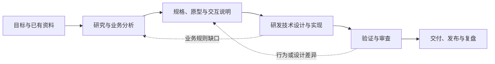

# YSS 用户手册

本手册面向产品、设计、前后端研发、测试及项目负责人，说明如何用 YSS 从一个目标开展研究、业务分析、规格与原型、工程实现、验证和交付。已有需求、原型、接口或代码时，从当前需要处理的位置继续工作。

核对日期为 2026-11-17。命令基线为 CLI 3.8.0，其内置 Template 5.8.0 对应提交 `bc008f11`。当前模板 main 的 `536f6eee` 增强技能来源核验、新会话运行接续和技能改版比较方法，`c8c61688` 加入 PR/MR 持续跟进方法。采用增量时核实实际技能与必要资源，CLI 受管安装还需核对 Bundle 来源。

本轮工作台增强随 CLI `3.11.0` 提供，包含工程维护、隔离 Codex 运行、草稿与版本恢复、在线一致备份。采用前核对实际程序与本机工具，已安装版本以自身帮助和可用界面为准。

首次使用可以先读“开始第一个任务”，授课与练习使用[培训材料](培训材料.md)，具体命令查[CLI 使用说明](unified-cli.md)。

通过一个项目串联全部环节时，阅读[客户跟进项目全生命周期 Demo](客户跟进项目全生命周期Demo.md)，其中给出请求示例、技能协作、问题定位和交付演练。

## 开始第一个任务

向 Agent 交代当前目标、已有材料、允许修改的工程和希望得到的结果。已确认的业务决定可一并提供，路径或版本不清楚时让 Agent 先调查。

```text
请先阅读本项目已有需求、CONTEXT.md 和相关实现。
本次目标是……，已有材料位于……，采用版本为……。
允许修改的工程为……，希望交付……。
复用已确认的规则和设计，只有新的关键业务取舍再向我询问。
```

Agent 会读取相关资料与代码，选择适用技能，核查现有成果和工程状态。产品规则有缺口时给出具体问题、影响及建议，能够调查的事实由 Agent 查明。任务结束时应拿到实际修改、已执行的检查、结果及剩余事项。

| 你当前要做的事 | 可以直接提出的请求 | 主要入口 |
| --- | --- | --- |
| 了解业务问题和资料 | 调查现状、来源、关键规则及未知项 | `yss-research`、`yss-stage-decision` |
| 决定业务方案 | 比较具体选项，集中询问必须由业务方决定的取舍 | `grilling` |
| 做完整产品规格 | 根据已有决定完成业务规格、高保真原型和交互说明 | `yss-product-lifecycle`、`yss-design-system` |
| 修改已有页面 | 按选定原型和交互说明修改指定前端工程 | `yss-frontend-application` |
| 开发或修复功能 | 在指定单仓或多仓完成必要设计、实现和验证 | `implement` 及适用工程技能 |
| 检查候选改动 | 审查指定分支、PR/MR 或工作树，报告有证据的缺陷 | `code-review` |
| 补测试或排查故障 | 针对现有行为补集成验证，或定位失败原因 | Backend 测试、应用验证或诊断技能 |
| 交付已选材料 | 将指定文件通过 PR/MR 交付给研发 | `handoff`，按相应动作授权执行 |

`to-spec`、`to-tickets`、`wayfinder`、`triage` 和 `llm-wiki` 按其明确调用条件使用。需要了解预装与按需能力时阅读[Profile 技能地图](../agents/profile-skills.md)。

## 安装方式和项目位置

### 选择 Profile 与安装范围

Profile 决定预装的专业方法，一个安装根使用一个 Profile。CLI 3.8.0 文档基线为 Spec 17 项、Backend 42 项、Frontend 13 项；当前候选增加三类工程共用的 `yss-help`，Spec、Backend、Frontend 默认集合分别为 18、43、16 项。实际成员以本机 CLI 的 Bundle 和 `skills list` 为准，旧程序不会随源码改变。

| Profile | 主要用途 | 工作资料 |
| --- | --- | --- |
| `spec` | 产品定义、业务分析、规格、设计及产品 Home 协调 | 业务规则、选定原型、交互说明和工程入口 |
| `backend` | 服务端技术设计、数据库分析、接口、实现与测试 | 实际工程中的设计、源码、API 与运行说明 |
| `frontend` | 已选设计的工程还原、接口接入和浏览器验证 | 实际应用中的页面、组件、资源与验证结果 |

`project` 安装项目入口、用户资料和技能，适用于需要完整 YSS 项目入口的工程。`skills` 安装技能、宿主入口及必要引用，适用于沿用现有工程资料布局的场景。同一 Profile 在两种范围中默认安装相同技能，应用源码通过脚手架或研发任务另行生成。

首次安装由 Agent 根据选定版本、平台、正式发行说明和摘要完成。安装后先运行以下只读命令核对程序与能力。

```sh
yss version
yss help
yss init --help
yss attach --help
yss sync --help
```

| 当前目录情况 | 使用方式 |
| --- | --- |
| 新目录或空目录 | `yss init --root <目录> --profile <Profile> --installation project` |
| 已有普通工程 | `yss attach --root <目录> --profile <Profile> --installation skills`，也可按需要选择 project |
| 已有 YSS 受管工程 | `yss sync --root <目录>`，沿用原 Profile 和安装范围 |

支持预览的命令加 `--dry-run` 查看影响。正常写入按已有授权执行。具体安装、升级和中断恢复见[安装维护](cli/install-and-verify.md)，已有资料如何继续使用见[既有成果复用](阶段接入与产物复用使用手册.md)。

### 从产品 Home 进入工程

Home 保存产品目标、业务规则与关联工程入口。一个产品可以关联多个服务、Web、Mobile 和共享组件，工程的技术方案、源码与验证保存在各自工程中。

配置关系时沿用已有 README 索引或仓库地图。需要独立地图时由 Agent 根据真实资料维护 `REPOSITORIES.md`，记录仓库身份、职责、资料入口和已知依赖。个人 checkout 路径、当前分支和临时进度在当前任务核实。

```text
请从本产品 Home 阅读仓库地图和客户查询规格，
核查客户后端与 Web 的实际调用关系，完成新增查询条件。
允许修改这两个工程，沿用各自技术栈并逐仓报告验证结果。
```

Agent 进入工程会核实 Git 身份、工作树、分支、局部规则和适用技能。跨仓依赖明确且写入路径、运行资源可隔离时可以分工，共享契约由一人整合。规格变化后只调整受影响的工作，续办时重新核对采用版本、剩余依赖和运行资源。多仓的操作示例见[Spec / Home 教程](cli/tutorial-spec.md)。

### 在工作台导入 Home 地图

CLI `3.11.0` 可在“项目 → 产品 Home”读取现有 `REPOSITORIES.md` 或等价 README。核对识别出的工程职责、Git 身份与仓内子路径后，逐行绑定本机工程绝对路径。非标准表头可填写字段映射，有歧义时采用人工核对的条目，再保存绑定。

工作台保存本机路径绑定和来源摘要，关系继续在原项目地图维护。地图变化后重新导入核对。绑定成功会复用已有工程或登记新工程，可在 Spec 详情的“运行 Codex”选择参与工程。工程 Issue tracker 继续从各自 `.template-spec/agents/issue-tracker.md` 读取。

## 从目标到交付的工作方式

下面展示一项从零需求常见的材料流向。已有材料可直接作为当前任务输入，各环节按实际缺口和任务授权选用。



### 研究与目标判断

产品负责人提供用户问题、业务动机、已有约束和希望达成的结果。Agent 调查现状、竞品、资料和技术事实，记录来源、时间或版本，并区分事实、推断和未知。

需要计划或方案比较时，说明本次范围、选择依据、优先级和待决定事项。大型工作只有在明确调用 `wayfinder` 时使用决定地图。资料中无法证明的收益、工期或规则保留其不确定性。

### 业务分析与领域语言

围绕具体场景确认角色、对象、责任、权限、状态、关键规则、失败恢复和可观察验收。Agent 复用已有决定，业务方决定真正的业务取舍。稳定词汇按项目约定写入根 `CONTEXT.md`，草稿和技术细节放在对应资料中。

例如“负责人可以审批”还需要知道负责人如何确定、可处理哪些记录、何时允许操作以及被拒绝时的反馈。规则变化应同步相关场景、原型和验收，已有规则的位置与必要版本应可定位。

### 业务规格、原型与确认

完整 Spec 交付包含业务规格、高保真交互原型和交互说明。三类内容可共用文件，核心操作可实际运行，纯展示可使用高保真静态稿，无 UI 的场景用逻辑或状态原型表达。

| 内容 | 应能回答的问题 |
| --- | --- |
| 业务规格 | 谁在什么条件下做什么，规则、权限、状态及验收是什么 |
| 高保真原型 | 页面如何组织，关键操作与必要异常状态如何表现 |
| 交互说明 | 入口、输入、校验、反馈、导航、离开和恢复如何工作 |

同一需求使用一个主 Spec 关联原型和交互说明。已有文件继续维护，新需求的位置按项目约定选择，默认命名详见[Spec 教程](cli/tutorial-spec.md)。业务含义、必填、唯一性、权限和状态应说明清楚，生产 API、物理表与实现方案由研发结合真实工程处理。

Agent 展示本次范围、版本、可用原型入口、验证情况和未决项。你要求内容确认时，Agent 核对关键问题及相关产物，只有你明确回复才记录该范围与版本已确认。内容实质变化后重新核对确认，历史记录保留。已有研发授权按其范围继续，规格确认与提交、发布各自使用对应授权。

### 组织任务与交给研发

普通局部修改可以直接提出研发目标。明确要求拆票时，Spec 的 `to-tickets` 按完整业务行为组织业务票，Backend 的同名技能按实际技术依赖组织实现切片。

准备交研发时，材料应能找到选定规格、原型、交互说明、业务验收、模拟范围、未决项及工程入口。完整 Spec、交接提示词和真实 PR/MR 交付按当前请求选择。明确要求通过 PR/MR 交付时，Agent 准备真实文件差异，核对接收仓库和动作授权，并回读结果。

### 技术设计与工程实现

研发读取选定材料和实际工程，决定必要的架构、数据、API、事务、幂等、权限与失败恢复方案。已有 DDD 或 MVC 按工程实际分层增量维护，新工程在明确目标目录生成骨架。技术设计细节见[技术设计指南](技术设计用户指南.md)。

Backend 根据需求实现服务端行为、数据访问和 API，数据库分析与 DDL 依据当前任务开展，真实数据库执行另按操作范围授权。Frontend 还原选定设计，复用工程组件与资源，按真实 API 接入参数、错误、权限和分页。接口缺口由相关工程协商并反馈来源。

完整工程交付应让接收者找到依赖、配置、启动、构建、验证和部署说明。后端优先使用项目根 `./mvnw`，前端优先使用 `pnpm` 及已有 scripts。详见[Backend 教程](cli/tutorial-backend.md)和[Frontend 教程](cli/tutorial-frontend.md)。

### 验证与审查

验证依据任务影响和工程实际选择。产品与设计核对业务规则和原型，研发执行适用工程检查，测试核对正常、边界、拒绝和失败恢复路径。TDD 在明确要求测试优先或 red-green-refactor 时采用。

| 验证结果 | 交付时需要说明 |
| --- | --- |
| 静态检查或构建 | 命令、采用版本、执行结果及覆盖范围 |
| 组件或业务逻辑测试 | 测试对象、关键规则和失败结果 |
| 浏览器交互与视觉检查 | 页面、视口、主题、关键操作及观察结果 |
| API、数据库或真实联调 | 实际服务、身份、数据和依赖，已覆盖及未覆盖路径 |
| 代码或规格审查 | 固定候选、问题位置、触发条件、影响和待处理项 |

模拟接口、客户端生成、构建和真实联调各有覆盖范围。服务启动后应核实工作树、端口、配置与就绪条件，使用测试资源时记录归属并完成必要清理。中断后沿已有任务记录恢复，避免误用其他任务的进程或数据。

### 交付、发布与复盘

交付说明实际修改、来源、检查结果、运行方式、未完成事项和接收方需要继续的工作。项目负责人结合本次范围与已知限制判断交付，提交、推送、部署和发行按对应授权执行。

发布任务按项目实际环境核对构建产物、配置、数据变更、观察信号及恢复方式。需要复盘或已出现返工、漏检时，记录结果、原因依据和改进行动，稳定规则再写回合适的资料或技能。技能维护采用当前共享源与 Profile 覆盖层，并同步受影响副本和清单。

### 跟进已有 PR/MR

当前 main 的 `c8c61688` 提供 PR/MR 持续跟进方法，由实际工程中的 `implement` 或前端应用方法按明确请求采用。给出目标 PR/MR、完成条件和已有动作授权，Agent 核对反馈、当前源与目标版本、实际 CI 检查对象，处理可推进的修复并继续等待相关结果。

```text
请持续跟进[PR/MR链接]，完成当前目标要求的修复和验证，直到[明确完成条件]。
已有动作授权为[实际允许的提交、推送、评论、合并等动作]。
每次版本变化后核对受影响的检查与讨论，简要记录剩余事项与实际结果。
```

合并任务需核对当前审批、保护规则、讨论和相应版本的检查，真正合并后回读实际产物。CI 重试依据失败原因和新证据处理，自动合并登记、入队和实际合并分别记录。中断续办先核对旧操作结果及最新平台状态。该方法在当前会话执行，长时间运行能力及真实账号权限按实际宿主与平台核验。

## 使用工作台管理规格与个人进度

工作台提供主 Spec、关联资源、问题、答复、确认和个人进度的查看入口。CLI 3.8.0 支持登记、续办文本、答复、快照、查询与生命周期查询，实际参数见[命令参考](cli/command-reference.md)。

1. 保存或更新主 Spec 后，在已核实的数据目录登记同一个主文件，关联交互说明与原型。
2. 在聊天或工作台答复具体问题。答复保存后，Agent 将真实答复写回规格、验收及相关产物，再核对一致性。
3. 延期时填写原因、影响、排除范围和复查日期或条件，依赖该问题的范围据此处理。
4. 需要内容确认时，查看更新后的范围与版本并明确回复。后续实质修改继续关联原记录并保留历史，已授权工作按范围推进。

工作台中的调研、分析、规格、原型、交接、实施、验证、交付用于个人进度记录。阶段进度、当前关注阶段和 Spec 确认状态分别维护，工作台交付标记的含义限定为个人记录。

续办文本帮助 Agent 找回材料和已有答复，用户回答后仍需回写。当前提醒随聊天或工作台打开、刷新出现。自定义工作台数据目录时，各命令沿用同一目录。数据采用 SQLite，旧 JSON 的备份迁移、查询和恢复约束见[维护与恢复](cli/tutorial-maintenance.md)。

### 从界面维护工程

工程详情和“设置”页的“工程维护”使用当前 Bundle 的技能与配方，提供诊断、技能清单与补装、初始化、接入、同步、DDD/MVC/Frontend 脚手架、事务恢复及工具升级。先填写目标绝对路径并“查看执行内容”，核对后执行，再从“执行记录”观察结果或停止当前作业。根目录、Bundle、参数或文件指纹变化时重新预览。

“设置”同时展示当前程序、Bundle、个人数据目录和本机工具。隔离运行依赖 Git 与支持 app-server 的本机 Codex，远端关联读取使用 gh/glab 的已有认证。工程与 Spec 中的“研发关联”支持 GitHub/GitLab、自建实例协议与端口，通过 GET 读取 Issue、PR/MR 或 CI 运行 ID 的状态，失败时保留最近成功结果和时间。

### 在隔离工作区续办 Spec

1. 在原 Spec 详情填写“运行 Codex”的任务并选择参与工程。工作区从 Git HEAD 创建，需要采用未提交内容时逐工程填写要带入的相对文件路径。
2. 进入执行详情查看日志及本次模型、权限信息，按卡片答复输入或处理授权请求。需要结束本次操作时选择“停止运行”。
3. 运行结束后核对冻结的“工作区差异”，逐文件比较运行起点、原工程当前内容和运行结果，再“接收选中文件”。并发变化会要求重新核对，多工程以各自返回结果为准。
4. 返回原 Spec 刷新，核对正文、原型、问题回写与确认状态。需要继续时在原执行详情填写“续接这次运行”，复用原 Spec、工程范围与已建立的宿主会话。

关闭浏览器后服务和作业继续运行，退出 CLI 会中断活动作业。再次启动后从执行记录核实结果，具备原会话和完整工作区的运行可尝试续接。

### 恢复编辑与比较确认版本

Spec 信息、问题答复和阶段进度支持本机草稿。看到“草稿已保存到本机”后，重载或重启可从“可恢复草稿”取回，核对后正常保存。编辑目标被其他页面或 CLI 更新时，逐字段比较开始编辑时、当前输入和最新记录，合并后再次保存。

内容区的“与确认版本比较”可查看正文、关联文档和原型资源的新增、修改与删除。图片支持按需加载确认版本与当前版本对照，历史 HTML 原型可预览，确认版本文件可下载原始字节。新确认保存实际产物快照，旧确认记录若仅保留摘要会提示“历史正文未留存”，版本比较从具备正文基线的确认开始。当前完整产物摘要与旧确认一致时，可补存对应快照并记录实际捕获时间。

### 备份个人工作台

在“设置 → 备份与恢复”填写新的归档绝对路径并创建一致备份，完成后从执行记录核实结果。恢复时选择新的或空的个人数据目录，目录位于项目和 Git 工作树之外，父目录已存在。校验成功后使用返回的 `yss workbench --data-dir <恢复目录>` 打开并核对工程路径与个人记录。历史运行已有完整冻结成果时，可在执行详情“核对工程绑定”，确认新的本机路径、分支及 HEAD 后重新审阅差异。

纯 CLI 或尚无该界面的已安装版本，采用退出服务后复制完整个人数据目录的离线备份方式。维护说明列出在线归档、离线目录备份和旧 JSON 迁移的适用步骤。[维护与恢复](cli/tutorial-maintenance.md)

## 用 Wiki 维护长期资料

需要长期综合、查询和维护有来源的资料时，明确调用 `llm-wiki`，指定资料、目标知识库和本次允许的动作。Spec 默认提供该技能，其他 Profile 先查看实际技能清单。

```text
使用 llm-wiki，将这些已授权资料整理进现有知识库。
保留结论来源和未决问题，检查与既有页面的冲突及过时引用。
本次允许更新知识页，查询过程采用现有检索方式。
```

常用任务包括摄取新资料、综合跨来源结论、查询具体问题、比较来源变化和巡检失效引用。查询任务保护知识正文，资料维护按明确范围写入。可选 QMD 需要独立工具和模型配置，采用前先核对环境与索引，现有文件检索也可继续使用。

## 按角色找到自己的工作

| 角色 | 提供或决定 | 通常检查的结果 |
| --- | --- | --- |
| 产品与业务负责人 | 用户问题、业务取舍、范围和选定版本 | 规格、规则、验收与原型一致，未决项影响清楚 |
| 设计 | 页面结构、交互和视觉选择 | 关键操作、状态、恢复和可访问性，研发采用的设计版本 |
| Backend | 工程事实、API、数据与服务端实现 | 业务行为、事务、权限、错误和适用集成验证 |
| Frontend | 应用结构、组件、状态与接口接入 | 视觉还原、交互、异常反馈和真实接口状态 |
| 测试 | 测试场景、环境和缺陷证据 | 正常、边界、拒绝、失败恢复及未覆盖范围 |
| 项目与交付负责人 | 本次目标、参与工程、交付和发布授权 | 依赖、实际进度、验证结果、未完成项及下一责任人 |

培训可按角色选读，再一起完成同一案例的协作练习，步骤与参考答案见[培训材料](培训材料.md)。

## 常见问题

| 情况 | 处理方式 |
| --- | --- |
| 所需命令不存在 | 查看实际版本与帮助，核对程序和 Bundle，说明缺口并继续可独立完成的部分 |
| 同步报告用户修改冲突 | 阅读差异，沿原 Profile 和安装记录处理具体文件，保留工作区与恢复资料 |
| 原型能操作，真实接口尚未接通 | 说明模拟范围，完成相关研发与真实联调后更新结果 |
| 多个 checkout 或同名技能来源冲突 | 核实实际 Git 身份、正文与资源，记录采用版本及影响 |
| 工作台登记失败 | 保留源文件，修复返回的路径、元数据或资源错误，重试同一登记 |
| 已答复的问题仍显示待回写 | 用实际答复 ID 核对原问题及当前摘要，完成规格与相关产物回写 |
| 任务中断或换了会话 | 从原材料、工作树和运行说明恢复，核查残留资源、最后结果及剩余步骤 |

更多入口见[用户手册索引](用户手册索引.md)。
